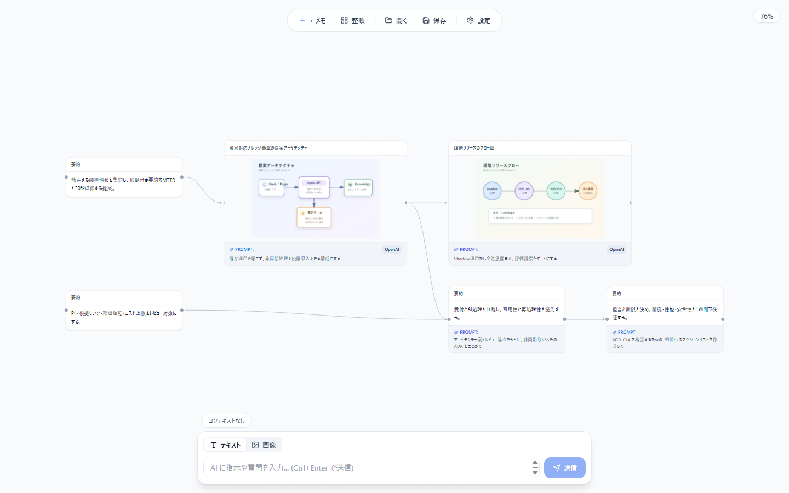
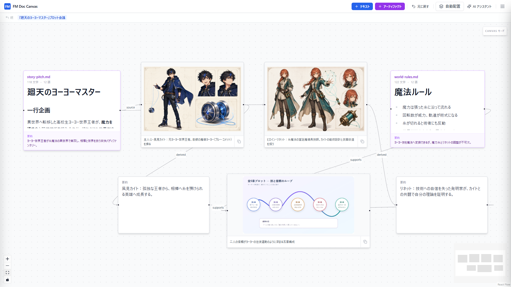
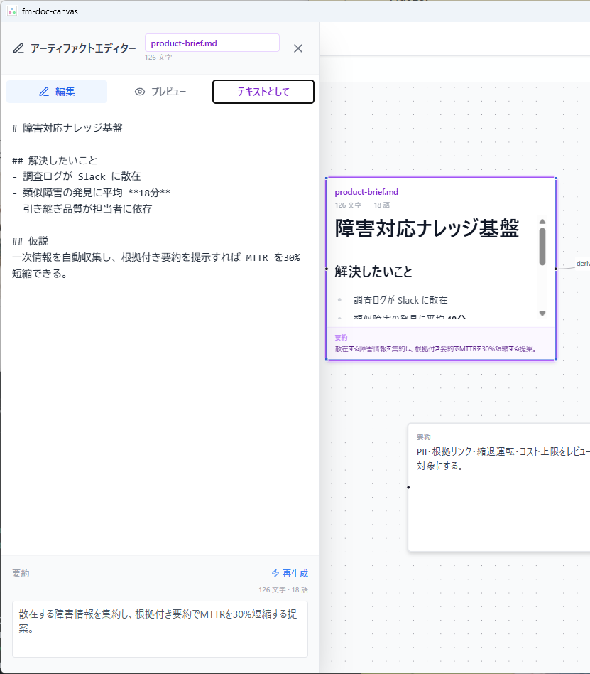
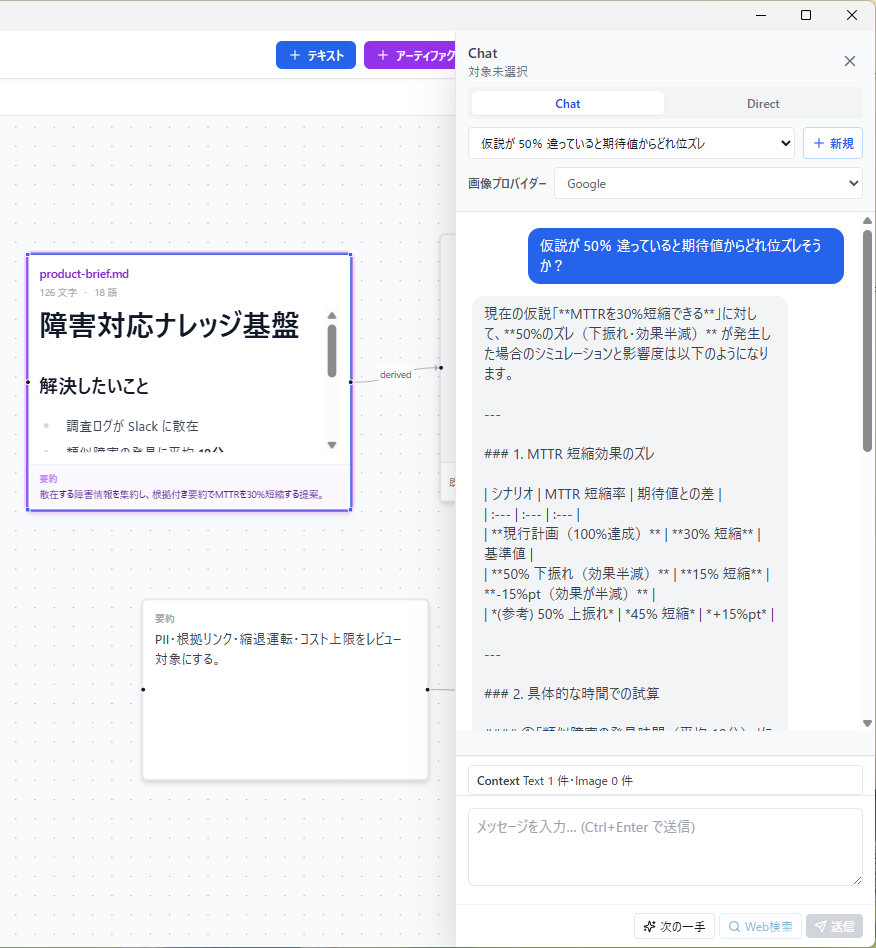

# fm-doc-canvas

[日本語](README.md) | [English](README_en.md)

`fm-doc-canvas` は、無限キャンバス上にテキストや画像を配置・連結し、LLM（大規模言語モデル）を活用して思考の整理や拡張を行うことができるデスクトップツールです。

LLM・画像生成・Web 検索を活用して、キャンバス上の情報を要約・比較・発展させながら作業を進められます。各機能の利用には API キーが必要です（OpenRouter, OpenAI, Google, xAI, Kagi, Brave 互換等）。



画像と Markdown を組み合わせた日本語デモワークスペースも同梱しています。再現方法は [`manuals/demo/product-review/README.md`](manuals/demo/product-review/README.md) を参照してください。

キャラクターシートを参照しながら物語を組み立てる、ライトノベル制作のデモもあります。



デモデータと再撮影手順は [`manuals/demo/light-novel/README.md`](manuals/demo/light-novel/README.md) にまとめています。

> 📖 **詳細な操作マニュアル**  
> GUI の詳細仕様、全メニュー項目、キーボードショートカット、トラブルシューティングについては [リファレンスマニュアル (`manuals/reference.md`)](manuals/reference.md) をご覧ください。

---

## 基本概念

キャンバスは思考や調査を行う**一時的なワークベンチ**です。  
ワークベンチ上で情報を整理・推敲した結果、完成した成果物は個別の Markdown や画像ファイル、Marp プレゼンスライドとしてエクスポートして活用します。

### ノードの種類

- **Text**: メモ、手書きテキスト、AI の回答などを記録するノード。
- **Artifact**: 完成・エクスポートを想定した Markdown テキストノード。エクスポート用ファイル名を持ちます（Text と相互変換可能）。
- **Image**: 取り込んだ画像ファイル、または AI が生成した画像ノード。プロンプト履歴を持ち、AI の入力コンテキストとしても利用可能。
- **FolderNode**: 階層化された SubCanvas への入り口を表すノード。

---

## 画面構成

- **メイン Canvas**: 拡大縮小・スクロールが可能な無限キャンバス。ノードの配置、移動、接続（Relation）、右クリックからの各種操作を行います。
- **ノードエディター（左側）**: Text / Artifact ノードを選択すると表示。Markdown の編集、プレビュー、要約の編集・再生成、Text ⇔ Artifact の変換を行います。
- **AI アシスタント（右側）**: 右上の「AI アシスタント」ボタンで開閉。「Chat モード」と「Direct モード」を切り替えて利用します。
  - **Chat モード**: LLM とチャット形式で対話。「ここまでの内容をキャンバスに追加して」といった指示や、チャット内での画像生成・共同編集が可能です。
  - **Direct モード**: 選択したノードとプロンプトから直接新しい Text / Image ノードをキャンバスに生成します。
  - **次の一手**: 現在の作業状況から次に実行できるアクション（比較、反対意見、検索など）を AI が提案します。
- **設定ドロワー（右側）**: 右上の「設定」ボタンで開閉。API キーやモデル、言語、画像保存先の設定、キャンバスの保存 / 読み込みを行います。
- **パンくずリスト（上部）**: SubCanvas の階層関係を表示し、上位階層への移動が可能です。


テキストコンテンツの編集ドロワー

AIチャットドロワー

---

## 主な使い方/ユースケース（逆引きガイド）

### テキスト・思考の整理

- **新規ノードを追加する**: 上部ツールバーの「テキスト」または「アーティファクト」ボタンをクリック
- **テキストを編集・プレビューする**: ノードをクリック（またはダブルクリック）して左側のノードエディターを開き、「編集」「プレビュー」タブで確認・編集
- **ノードの役割を切り替える（Text ⇔ Artifact）**: ノードエディターの「アーティファクトとして」/「テキストとして」をクリック
- **ノードにまとめメモ（要約）を付ける / 再生成する**: ノードエディターの「要約」欄を直接編集、または「再生成」ボタンをクリックして LLM に生成させる
- **散らかったノードを整頓する**: 上部ツールバーの「自動配置」をクリック
- **直前の操作を取り消す（Undo）**: 上部ツールバーの「元に戻す」をクリック（ノード編集・削除・Direct 生成・SubCanvas 変換などを取り消し可能）
- **Canvas 全体を見渡す / 縮尺調整**: Canvas 左下の Fit View ボタン（全体表示）、`+`/`-` ボタン、またはマウスホイールでズーム

### Relation（関連付け）と SubCanvas（階層化）

- **ノード同士を線で繋ぐ（簡易作成）**: ノード脇の接続ハンドルから別ノードのハンドルへドラッグ
- **種別や理由を明示して Relation を作成・編集する**: ノードを右クリックして「Relation を追加」（または接続線を右クリックして「Relation を編集」）し、種別（`source` / `derived` / `supports` / `opposes` / `similar`）や方向、理由を設定
- **Relation の向きを入れ替える**: 接続線を右クリックして「方向を反転」
- **AI にノード間の Relation を提案してもらう**: ノード選択または Canvas 空白部を右クリックして「Relation を提案」を実行し、候補を確認・編集して承認
- **複数ノードを SubCanvas（階層フォルダー）にまとめる**: まとめたいノードを複数選択（`Ctrl` / `Command` / `Shift` + クリック）して右クリック →「SubCanvas を作成」。作成された FolderNode をダブルクリックして階層内へ移動（パンくずリストまたは「親」ボタンで戻る）
- **SubCanvas 内の特定ノードを親階層へ戻す**: SubCanvas 内でノードを選択し、右クリック →「選択したノードを親 Canvas へ移動」
- **SubCanvas を解除（展開）して元に戻す**: FolderNode を右クリックして「SubCanvas を削除」（メンバーノードは親 Canvas に戻り、ノード間の Relation も保持される）
- **AI にクラスタリングを提案してもらい階層化する**: Canvas 空白部を右クリックして「Cluster を提案」を実行。色分けされた Generated View で確認後、「SubCanvas に変換」で実体化

### AI アシスタント・クイック操作

- **複数ノードを比較する**: ノードを複数選択して右クリック →「比較」（比較結果の Text ノードが生成される）
- **ノードに対する反対意見・批判的視点を出す**: ノードを選択して右クリック →「反対意見」（派生 Text ノードが生成される）
- **ノードの内容を素早く要約する**: ノードを選択して右クリック →「要約」（要約された派生 Text ノードが生成される）
- **ノードの内容から直接 Web 検索する**: ノードを選択して右クリック →「Web を検索」
- **AI に質問して返答を直接ノードとして配置する**: AI アシスタントの「Direct」タブで「Text」を選択してプロンプトを入力し、「生成」（または `Ctrl+Enter`）
- **キャンバス上のノードをコンテキストにして質問・指示する**: 対象ノードを選択（複数選択可）した状態で、AI アシスタント（Chat / Direct）から指示を送信
- **通常チャットでアイデア出し・壁打ちをする**: AI アシスタントの「Chat」タブで会話（通常のチャット発言はキャンバスに影響を与えません）
- **チャットのまとめをキャンバスに記録する**: Chat モードで調査・議論後に「ここまでのまとめをキャンバスに書いてください」と指示し、提案カードを確認して適用
- **Artifact ノードをチャットで共同編集する**: 編集したい Artifact ノードを 1 つ選択した状態で Chat モードから修正指示を送信
- **次に何をすべきか迷ったときのヒントを得る**: AI アシスタントの「次の一手」ボタンをクリックし、提示された操作候補を確認・実行
- **Web 検索から信頼できる情報・ノードを取り込む**: AI アシスタントで検索語を入力して「Web検索」（要 API キー）。Projected Context 画面で Sources や Claims、Relation 候補を確認・チェックして「Canvas に追加」

### 画像生成・画像編集

- **プロンプトから直接画像を生成する**: AI アシスタントの「Direct」タブで「Image」を選択し、画像プロバイダーを選んでプロンプトを入力・生成
- **AI と対話しながら画像を生成する**: AI アシスタントの「Chat」タブで「○○の画像を生成してください」と指示し、プレビュー確認後にキャンバスへ適用
- **キャンバス上の画像を参考に画像編集・バリエーション生成を行う**: 参考にする Image ノード（および指示テキスト）を選択した状態で、Direct の Image または Chat から編集指示を送信
- **画像を拡大表示する**: Image ノードをダブルクリック

### ファイルの取り込み・エクスポート・保存

- **Markdown / テキスト / 画像ファイルを取り込む**: OS からキャンバス上へファイルを直接ドラッグ＆ドロップ（テキストは Artifact、画像は Image ノードとして配置）
- **ノードを個別ファイルとして書き出す**: ノードを右クリックして「エクスポート」（Text / Artifact は `.md`、Image は画像ファイルとして保存）
- **複数ノードから Marp スライドを一括出力する**: 複数の Text / Artifact ノードを選択して右クリック →「スライドとしてエクスポート (Marp)」（各ノードが `---` で区切られたプレゼンテーション原稿 Markdown を生成）
- **Canvas ワークスペース全体を保存・再開する**: 設定ドロワーの「Canvas を保存」で任意の `.json` ファイルに保存、「Canvas を開く」で読み込み
- **キャンバスをリセットする**: 設定ドロワーの「Canvas をクリア」（作業内容の初期化、元に戻す可能）または「新しいワークスペース」（会話履歴も含め全クリア）

---

## 設定と構成

設定ドロワー（画面右上の「設定」）から以下の項目を構成します。設定変更後は下部の「設定を保存」をクリックしてください。

### LLM (テキスト生成) 設定
OpenAI 互換 API を提供する任意のプロバイダー（OpenRouter, OpenAI, Ollama, LocalAI 等）を利用可能です。
- **API ベース URL**: エンドポイント（例: `https://openrouter.ai/api/v1` や `http://localhost:11434/v1`）
- **API キー**: プロバイダーの発行した API キー
- **モデル**: 使用するモデル名（例: `openai/gpt-5`, `google/gemini-2.5-flash` 等）
  - 画像ノードを入力に含める場合は Vision 対応モデルを指定してください。
- **システムプロンプト**: 応答言語やスタイルなどの共通指示（例: 「常に日本語で簡潔に回答する」）

### 画像生成設定
- **プロバイダー**: OpenRouter、OpenAI、Google、xAI から選択
- **モデル**: 選択したプロバイダーの画像生成対応モデル名
- **API キー**: 各画像生成プロバイダーの API キー
- **ダウンロード先**: 生成画像およびインポート画像の保存先ディレクトリ（デフォルト: `Image/`）

### Web 検索設定
- **プロバイダー**: Ollama、Kagi、Brave から選択
- **API キー**: 選択したプロバイダーの検索 API キー

---

## 保存データとセキュリティ

- **アプリ設定 (`config.json`)**:
  - Windows: `%APPDATA%\fm-doc-canvas\config.json`
  - macOS: `~/Library/Application Support/fm-doc-canvas/config.json`
  - Linux: `~/.config/fm-doc-canvas/config.json`
  - **注意**: API キーが平文で保存されるため、設定ファイルやログを不用意に公開・共有しないようご注意ください。
- **チャット履歴 (`chat-sessions.json`)**:
  - 設定フォルダ配下に Canvas ID ごとに保存されます。
- **画像ストレージ**:
  - 設定で指定した保存先フォルダーに保存されます。Canvas JSON のみを別環境に移動した場合、画像ファイルも合わせて移動する必要があります。
- **Canvas データ**:
  - 「Canvas を保存」で明示的に保存した任意の `.json` ファイルに記録されます。未保存のままアプリを終了すると作業内容は失われます。

---

## 技術スタック

- **Framework**: [Wails v2](https://wails.io/) (Go + React)
- **Frontend**: React, Zustand, Tailwind CSS, React Flow
- **Backend**: Go
- **Toolchain**: [mise](https://mise.jdx.dev/)

---

## 開発環境のセットアップ

このプロジェクトでは、ツールチェーンのバージョン管理に `mise` を使用しています。

### 1. 前提条件
- [mise-en-place](https://mise.jdx.dev/getting-started.html) のインストール

### 2. ツールのインストールとセットアップ
```bash
# ツールチェーン（Go, Node.js, Wails CLI）のインストール
mise install

# 依存関係のセットアップ
mise run setup
```

### 3. 開発モードでの実行
```bash
mise run dev
```

### 4. ビルド
```bash
mise run build
```

---

## プロジェクト構造

- `backend/`: Go によるバックエンドロジック、API クライアント、データ永続化
- `frontend/`: React + Tailwind CSS による Canvas UI・各種コンポーネント実装
- `manuals/`: リファレンスマニュアルおよび各種ドキュメント
- `build/`: アプリケーションのアイコンやインストーラー設定

---

## ライセンス

[LICENSE](./LICENSE) ファイルを参照してください。

## 更新履歴

- v0.5.0: チャットドロワー追加と AI サポートの強化
- v0.4.1: xAI の Image generate/edit を追加
- v0.4.0: システムプロンプト設定の追加、OpenAI 画像生成での複数参照画像対応
- v0.3.5: 画像生成プロバイダを OpenRouter/OpenAI/Gemini の 3 つに拡張、複数ノード選択時のコンテキスト構築修正
- v0.3.0: First release

---
Created by [rerofumi](mailto:rero2@yuumu.org)
