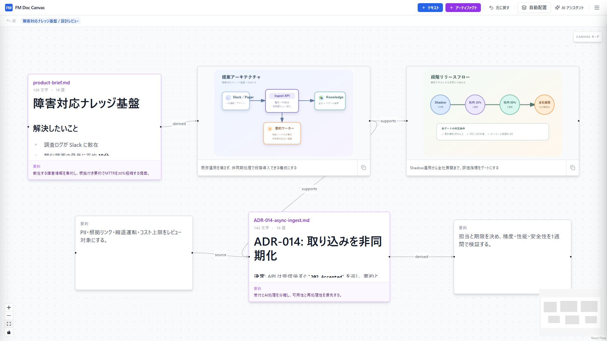
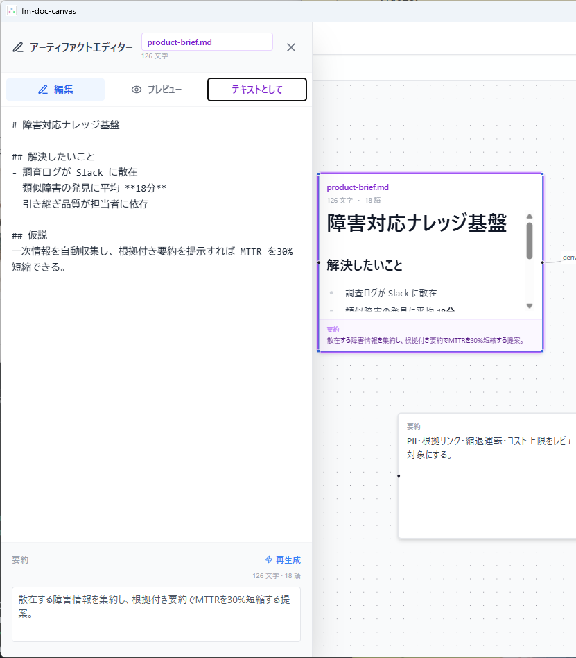
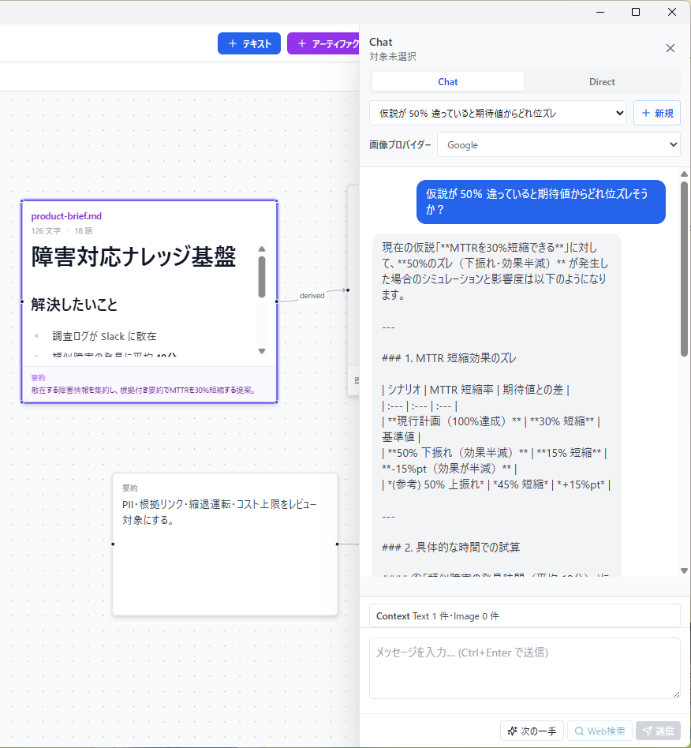

# fm-doc-canvas

[日本語](README.md) | [English](README_en.md)

`fm-doc-canvas` is a desktop tool that lets you place and connect text and images on an infinite canvas, then organize and expand your thinking with LLMs (large language models).

You can use LLMs, image generation, and web search to summarize, compare, and develop information on the canvas as you work. Each feature requires an API key (OpenRouter, OpenAI, Google, xAI, Kagi, Brave-compatible services, and others).



A Japanese demo workspace combining images and Markdown is also included. See [`manuals/demo/product-review/README.md`](manuals/demo/product-review/README.md) for reproduction instructions.

There is also a light novel writing demo in which a story is developed with reference to character sheets.


Demo data and screenshot reproduction instructions are available in [`manuals/demo/light-novel/README.md`](manuals/demo/light-novel/README.md).

> 📖 **Detailed user manual**  
> For detailed GUI specifications, all menu items, keyboard shortcuts, and troubleshooting, see the [reference manual (`manuals/reference_en.md`)](manuals/reference_en.md).

---

## Core Concepts

The canvas is a **temporary workbench** for thinking and research.  
After organizing and refining information on the workbench, you can export finished work as individual Markdown or image files, or as Marp presentation slides.

### Node Types

- **Text**: A node for notes, manually written text, AI responses, and similar content.
- **Artifact**: A Markdown text node intended for completion and export. It has an export filename and can be converted to and from Text.
- **Image**: An imported image file or an AI-generated image node. It retains its prompt history and can also be used as AI input context.
- **FolderNode**: A node that represents an entry point to a hierarchical SubCanvas.

---

## Interface

- **Main Canvas**: An infinite canvas that supports zooming and scrolling. Use it to place, move, and connect nodes (Relations), and to access operations from the context menu.
- **Node Editor (left)**: Appears when a Text or Artifact node is selected. Use it to edit and preview Markdown, edit or regenerate summaries, and convert between Text and Artifact.
- **AI Assistant (right)**: Open or close it with the **AI Assistant** button in the upper-right corner. It provides Chat and Direct modes.
  - **Chat mode**: Converse with an LLM in chat form. You can issue instructions such as “Add a summary of our discussion to the canvas,” generate images in the chat, and collaboratively edit content.
  - **Direct mode**: Generate a new Text or Image node directly on the canvas from selected nodes and a prompt.
  - **Next Step**: The AI suggests actions you can take next based on the current state of your work, such as comparing items, generating counterarguments, or searching.
- **Settings Drawer (right)**: Open or close it with the **Settings** button in the upper-right corner. Configure API keys, models, language, image storage, and canvas save/load operations.
- **Breadcrumbs (top)**: Show the SubCanvas hierarchy and let you navigate to higher levels.


Text content editor drawer

AI chat drawer

---

## Common Tasks and Use Cases

### Organizing Text and Ideas

- **Add a new node**: Click **Text** or **Artifact** in the top toolbar.
- **Edit and preview text**: Click (or double-click) a node to open the Node Editor on the left, then use the **Edit** and **Preview** tabs.
- **Change a node's role (Text ⇔ Artifact)**: Click **Convert to Artifact** or **Convert to Text** in the Node Editor.
- **Add or regenerate a summary note**: Edit the **Summary** field directly in the Node Editor, or click **Regenerate** to have an LLM create it.
- **Arrange scattered nodes**: Click **Auto Layout** in the top toolbar.
- **Undo the previous action**: Click **Undo** in the top toolbar. Node edits, deletions, Direct generation, SubCanvas conversion, and other operations can be undone.
- **See the entire canvas or adjust the scale**: Use Fit View, the `+`/`-` buttons in the lower-left corner, or the mouse wheel.

### Relations and SubCanvases

- **Connect nodes with a line (quick creation)**: Drag from a connection handle beside one node to a handle on another node.
- **Create or edit a Relation with an explicit type and reason**: Right-click a node and choose **Add Relation** (or right-click a connection and choose **Edit Relation**), then set its type (`source`, `derived`, `supports`, `opposes`, or `similar`), direction, and reason.
- **Reverse a Relation**: Right-click a connection and choose **Reverse Direction**.
- **Ask the AI to suggest Relations**: Right-click a selected node or empty canvas area, choose **Suggest Relations**, then review, edit, and approve the candidates.
- **Group multiple nodes into a SubCanvas**: Select multiple nodes (`Ctrl` / `Command` / `Shift` + click), right-click, and choose **Create SubCanvas**. Double-click the resulting FolderNode to enter it; use the breadcrumbs or **Parent** to return.
- **Move a node from a SubCanvas to its parent**: Select the node inside the SubCanvas, right-click, and choose **Move Selected Nodes to Parent Canvas**.
- **Remove and expand a SubCanvas**: Right-click its FolderNode and choose **Delete SubCanvas**. Member nodes return to the parent canvas, and Relations among them are preserved.
- **Ask the AI to suggest clusters**: Right-click an empty canvas area and choose **Suggest Clusters**. Review the color-coded Generated View, then choose **Convert to SubCanvas** to apply it.

### AI Assistant and Quick Actions

- **Compare multiple nodes**: Select them, right-click, and choose **Compare**. A Text node containing the comparison is created.
- **Generate counterarguments or a critical perspective**: Select a node, right-click, and choose **Counterargument**. A derived Text node is created.
- **Quickly summarize a node**: Select it, right-click, and choose **Summarize**. A derived summary Text node is created.
- **Search the web from a node's content**: Select the node, right-click, and choose **Search Web**.
- **Ask the AI and place its response directly as a node**: In the AI Assistant's **Direct** tab, select **Text**, enter a prompt, and click **Generate** (or press `Ctrl+Enter`).
- **Use canvas nodes as context**: Select one or more nodes, then send instructions from Chat or Direct in the AI Assistant.
- **Brainstorm in a regular chat**: Converse in the AI Assistant's **Chat** tab. Normal chat messages do not affect the canvas.
- **Record a chat summary on the canvas**: After researching or discussing in Chat mode, ask the AI to write a summary to the canvas, then review and apply the proposal card.
- **Collaboratively edit an Artifact in Chat**: Select one Artifact node and send editing instructions from Chat mode.
- **Get ideas for what to do next**: Click **Next Step** in the AI Assistant, then review and run a suggested action.
- **Bring reliable information onto the canvas from web search**: Enter a query in the AI Assistant and click **Web Search** (API key required). Review Sources, Claims, and proposed Relations in Projected Context, select the desired items, and click **Add to Canvas**.

### Image Generation and Editing

- **Generate an image directly from a prompt**: In the AI Assistant's **Direct** tab, select **Image**, choose an image provider, enter a prompt, and generate the image.
- **Generate an image through conversation**: In the **Chat** tab, ask the AI to generate an image, review the preview, and apply it to the canvas.
- **Edit or create variations from canvas images**: Select the reference Image nodes (and any instruction text), then send editing instructions through Direct Image or Chat.
- **Enlarge an image**: Double-click an Image node.

### Importing, Exporting, and Saving Files

- **Import Markdown, text, or image files**: Drag and drop files from the operating system onto the canvas. Text becomes an Artifact node; images become Image nodes.
- **Export a node as an individual file**: Right-click the node and choose **Export**. Text and Artifact nodes are saved as `.md`; Image nodes are saved as image files.
- **Export multiple nodes as Marp slides**: Select multiple Text or Artifact nodes, right-click, and choose **Export as Slides (Marp)**. This creates presentation-source Markdown with nodes separated by `---`.
- **Save and resume an entire canvas workspace**: Use **Save Canvas** in Settings to save to a `.json` file, and **Open Canvas** to load one.
- **Reset the canvas**: Use **Clear Canvas** in Settings to reset the work while retaining the option to undo, or **New Workspace** to clear everything including conversation history.

---

## Configuration

Configure the following items in the Settings drawer (the **Settings** button in the upper-right corner). Click **Save Settings** at the bottom after making changes.

### LLM (Text Generation)

You can use any provider that offers an OpenAI-compatible API, including OpenRouter, OpenAI, Ollama, and LocalAI.

- **API Base URL**: The endpoint, such as `https://openrouter.ai/api/v1` or `http://localhost:11434/v1`.
- **API Key**: The API key issued by the provider.
- **Model**: The model name, such as `openai/gpt-5` or `google/gemini-2.5-flash`.
  - Select a vision-capable model when including Image nodes in the input.
- **System Prompt**: Shared instructions for response language, style, and similar behavior, such as “Always respond concisely in English.”

### Image Generation

- **Provider**: OpenRouter, OpenAI, Google, or xAI.
- **Model**: An image-generation model supported by the selected provider.
- **API Key**: The API key for the image-generation provider.
- **Download Directory**: The directory for generated and imported images (default: `Image/`).

### Web Search

- **Provider**: Ollama, Kagi, or Brave.
- **API Key**: The search API key for the selected provider.

---

## Stored Data and Security

- **Application settings (`config.json`)**:
  - Windows: `%APPDATA%\fm-doc-canvas\config.json`
  - macOS: `~/Library/Application Support/fm-doc-canvas/config.json`
  - Linux: `~/.config/fm-doc-canvas/config.json`
  - **Warning**: API keys are stored in plain text. Do not expose or share the settings file or logs carelessly.
- **Chat history (`chat-sessions.json`)**:
  - Stored by Canvas ID under the settings directory.
- **Image storage**:
  - Images are stored in the configured directory. If you move only the Canvas JSON to another environment, you must move the image files as well.
- **Canvas data**:
  - Stored in the `.json` file explicitly selected with **Save Canvas**. Work is lost if you quit the application without saving it.

---

## Technology Stack

- **Framework**: [Wails v2](https://wails.io/) (Go + React)
- **Frontend**: React, Zustand, Tailwind CSS, React Flow
- **Backend**: Go
- **Toolchain**: [mise](https://mise.jdx.dev/)

---

## Development Setup

This project uses `mise` to manage toolchain versions.

### 1. Prerequisite

- Install [mise-en-place](https://mise.jdx.dev/getting-started.html).

### 2. Install Tools and Set Up Dependencies

```bash
# Install the toolchain (Go, Node.js, and Wails CLI)
mise install

# Set up dependencies
mise run setup
```

### 3. Run in Development Mode

```bash
mise run dev
```

### 4. Build

```bash
mise run build
```

---

## Project Structure

- `backend/`: Backend logic, API clients, and data persistence implemented in Go.
- `frontend/`: Canvas UI and components implemented with React and Tailwind CSS.
- `manuals/`: Reference manual and other documentation.
- `build/`: Application icons and installer configuration.

---

## License

See the [LICENSE](./LICENSE) file.

## Changelog

- v0.5.0: Added the chat drawer and enhanced AI support.
- v0.4.1: Added xAI image generation/editing.
- v0.4.0: Added system prompt settings and support for multiple reference images with OpenAI image generation.
- v0.3.5: Expanded image-generation providers to OpenRouter, OpenAI, and Gemini; fixed context construction when multiple nodes are selected.
- v0.3.0: First release.

---
Created by [rerofumi](mailto:rero2@yuumu.org)
