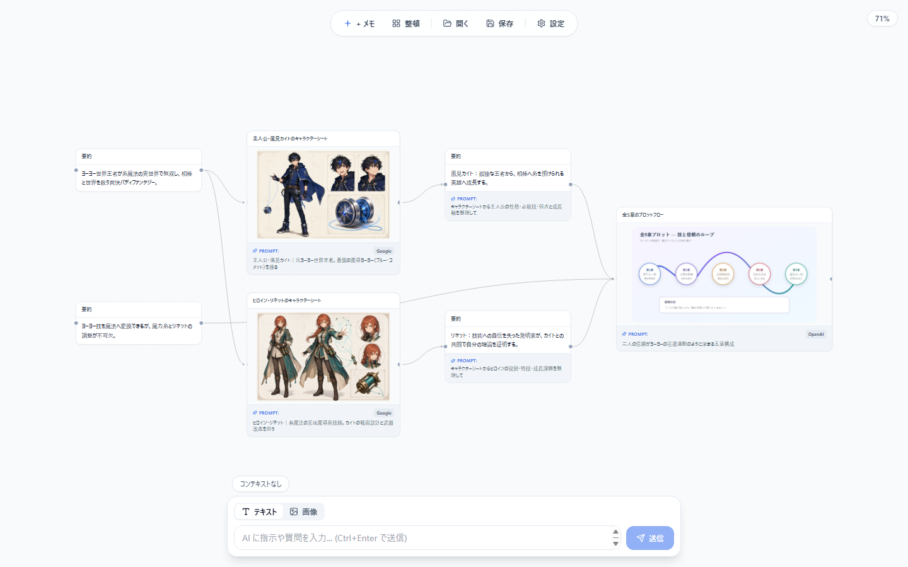

# fm-doc-canvas

[日本語](README.md) | [English](README_en.md)

`fm-doc-canvas` is a desktop tool for placing and connecting text and images on an infinite canvas, using LLMs (Large Language Models) and image generation APIs to organize and expand your ideas.

Arrange fragmentary notes and images on the canvas, collect context from selected nodes and their upstream chains to query AI, or switch between multiple providers to generate and save images.


A sample workspace combining diagrams and Markdown notes is included ([`manuals/demo/product-review/README.md`](manuals/demo/product-review/README.md)).



A creative writing demo referencing character sheets and a story arc is also included ([`manuals/demo/light-novel/README.md`](manuals/demo/light-novel/README.md)).

> 📖 **Detailed Reference Manual**  
> For full GUI specifications, context menu items, keyboard shortcuts, and troubleshooting, see the [Reference Manual (`manuals/reference_en.md`)](manuals/reference_en.md).

---

## Core Concepts

The canvas is a **temporary workbench** for thinking and research.  
Once you organize and refine information on the workbench, export the finished results as individual Markdown files, image files, or Marp presentation slides.

### Node Types

- **Text Node**: Stores notes, Markdown text, and AI responses. AI-generated nodes retain their original prompt (`originalPrompt`) and an automatically generated summary.
- **Image Node**: Stores an imported local image file or an AI-generated image. Generated images retain their generation prompt (as well as provider and model metadata) and can be used as visual context for both text generation and image generation.

---

## Interface

The app uses a light-themed, **Canvas-First / Low-Chrome** UI without permanent sidebars or multi-layer drawers, keeping most of the window open as canvas space.

- **Main Canvas**: An infinite canvas with panning and wide-range zooming (`0.1`–`4.0`). Place and resize nodes, connect directed edges via left/right handles, drag and drop files from the OS, and access actions via context menus.
- **Top Floating Toolbar**: A compact toolbar at the top of the canvas with `+ メモ` (add a new text node), `整頓` (auto layout), `開く` (open Canvas JSON), `保存` (save Canvas JSON), and `設定` (open Settings modal). The top-right corner shows the current zoom percentage (click to fit all nodes via `fitView`).
- **Bottom Command Dock & Context Strip**:
  - **Context Strip**: Displays the real-time count of text and image items collected from the selected node(s) and upstream chain. Shows a warning chip if upstream traversal stops due to a branch merge or cycle.
  - **Command Dock**: Switch between `テキスト` (Text — LLM text generation) and `画像` (Image — multi-provider image generation), enter a prompt, and submit (`Ctrl+Enter` / `Cmd+Enter`). In `画像` mode, you can temporarily switch providers per request. A loading state prevents duplicate submissions while generating.
- **On-Demand Overlays (open only when needed)**:
  - **Text Node Inspector (`NodeInspector`)**: Slides in from the right when you double-click a text node (or choose `編集` from its context menu). Supports Edit/Preview toggling, full-text Markdown editing, summary editing/regeneration, appending the original prompt to the input box, and single `.md` export.
  - **Image Lightbox (`ImageLightbox`)**: Opens an enlarged preview overlay when you double-click an image node (or choose `拡大表示` from its context menu). Displays the full generation prompt, lets you append it to the input box, and supports single image export.
  - **Settings Modal (`SettingsModal`)**: Organized into 3 tabs — `LLM 設定` (LLM Settings), `画像生成` (Image Generation), and `キャンバス管理` (Canvas Management) — for API configuration and `キャンバスを初期化（Clear Canvas）`.
  - **Toast Notifications & Confirmation Dialogs**: Completions and errors appear as non-blocking toasts, while destructive actions (Clear Canvas) require confirmation.

---

## Common Workflows (How-To Guide)

### Basic Canvas Operations

- **Pan and zoom the canvas**: Drag an empty area to pan; use the mouse wheel to zoom between `0.1` and `4.0`. Click the zoom percentage button in the top-right corner to fit the entire canvas (`fitView`).
- **Select and deselect nodes**: Click for single selection, `Shift` + click or `Shift` + drag box selection for multiple selection, and click the background to deselect.
- **Delete nodes or edges**: Select targets and press `Delete` / `Backspace`, or delete them from the context menu.
- **Clear the canvas**: Open `設定` (Settings) → `キャンバス管理` (Canvas Management) → `キャンバスを初期化（Clear Canvas）` (clears all nodes and edges only after confirmation).

### Text Nodes & Detail Editing

- **Add a new note**: Click `+ メモ` in the top toolbar to add an empty text node near the center of the canvas.
- **Preview content on cards**: Shows the summary if set, or clamped body text otherwise. AI-generated nodes display their original prompt at the bottom of the card.
- **Full-text editing, Markdown preview, and summary regeneration**: Double-click a text node to open the inspector and switch between `編集` (Edit) and `プレビュー` (Preview). Switching to another text node or closing the inspector automatically commits changes.
- **Reuse an original prompt**: Click the prompt area at the bottom of a card or in the inspector to append it to the Command Dock without erasing existing input (separated by `\n\n` if text is already present).

### Directed Edges & Context Collection

- **Connect nodes with directed edges**: Drag from a node's right handle to another node's left handle. Direct or indirect connections that would form a cycle are detected before creation and rejected with a notification.
- **Automatic upstream context collection**:
  - **0 nodes selected**: Sends only the prompt entered in the Command Dock.
  - **1 node selected**: Traverses upstream from the selected node and collects text and reference images separately in root → selected order.
  - **Multiple nodes selected**: Collects text and reference images separately in topological order based on edges between selected nodes (falling back to layout/selection order for unconnected nodes).
  - If a branch merge or cycle is encountered during traversal, upstream traversal stops at that point and a warning is shown in the Context Strip.

### LLM Text Generation, Vision & Auto Summary

- **Query AI with context**: Select target nodes (or leave none selected), set the Command Dock to `テキスト` mode, and submit your prompt.
- **Ask questions about images (Vision)**: When image nodes are included in the collected context, they are sent as Vision multimodal inputs to the OpenAI-compatible API (requires a Vision-capable model).
- **Use local LLMs**: When `API Key` is left blank, the `Authorization` header is omitted so you can connect to unauthenticated local LLM servers.
- **Auto summary**: After text generation succeeds, a new text node is added with an automatically generated summary (if summary generation fails, the body text is preserved and an error notification is shown).

### Multi-Provider Image Generation

- **Generate images with your chosen provider**: Switch the Command Dock to `画像` mode, select a provider (`OpenRouter`, `OpenAI`, `Google`, or `xAI`), and submit a prompt. Selecting a provider here is a per-request override and does not overwrite the default provider in `config.json`.
- **Generate or edit with reference images**: Select image nodes (and optional text instructions) on the canvas and run generation in `画像` mode to pass them as reference images (OpenAI supports up to 5 images; xAI uses 1 image).
- **Local storage and lightbox preview**: Generated images are saved locally under `downloadPath` with collision-free filenames, and a single image node is added to the canvas. Double-click to open the Lightbox, or click the prompt footer to non-destructively append the prompt to the input box.

### Importing, Auto Layout, Saving & Exporting

- **Drag and drop files to import**: Drop files directly from your OS file manager onto the canvas:
  - `.txt` / `.md`: Added as a new text node.
  - `.png` / `.jpg` / `.jpeg` / `.webp`: Copied to `downloadPath/Import/` with a collision-free filename and added as a new image node (unsupported extensions trigger an error toast).
- **Auto-arrange cluttered nodes**: Click `整頓` in the top toolbar to automatically arrange nodes left-to-right (`LR`) while preserving edge connections.
- **Save and reopen a canvas**: Use `保存` in the top toolbar to save to a `.json` file (version `1.1`), and `開く` to load it back. Compatible with existing `v1.0` / `v1.1` Canvas JSON files.
- **Export outputs**:
  - **Single Markdown (`.md`)**: Export from a text node's context menu or the Text Node Inspector.
  - **Single image file**: Export from an image node's context menu or the Image Lightbox.
  - **Marp slides (`.md`)**: Right-click multiple selected nodes (or a single node to include its upstream chain) and choose `Marp 出力` to export `---`-separated Markdown with embedded image syntax.

---

## Configuration

Click `設定` in the top toolbar to open the Settings modal, and click `保存` after making changes.

### LLM Settings
Works with any provider offering an OpenAI-compatible API (`POST {baseURL}/chat/completions`), including OpenRouter, OpenAI, Ollama, and LocalAI.
- **Base URL**: API endpoint (e.g. `https://api.openai.com/v1`, `http://localhost:11434/v1`)
- **Model**: Model name to use (specify a Vision-capable model for image inputs)
- **API Key**: Provider API key (optional for local LLMs)
- **System Prompt**: Shared system instruction (uses the built-in default when blank)
- **Summary Max Chars (`サマリー最大文字数目安`)**: Target character limit for automatic summaries

### Image Generation
- **Default Provider (`デフォルトプロバイダー`)**: Choose from OpenRouter / OpenAI / Google / xAI
- **Image Download Directory (`画像保存先ディレクトリ`)**: Storage location for generated and imported images (default: `Image/`)
- **Per-Provider Settings (`プロバイダー別設定`)**: Configure and store Base URL (OpenRouter / OpenAI), Model, and API Key independently for all 4 providers. Switching the default provider does not erase other providers' keys or settings.

### Canvas Management
- **Clear Canvas (`キャンバスを初期化（Clear Canvas）`)**: Clears all nodes, edges, and selection state after confirmation (saved image files on disk remain intact).

---

## Stored Data & Security

- **Application Settings (`config.json`)**:
  - Windows: `%APPDATA%\fm-doc-canvas\config.json`
  - macOS: `~/Library/Application Support/fm-doc-canvas/config.json`
  - Linux: `~/.config/fm-doc-canvas/config.json`
  - Legacy flat `config.json` fields (`imageGen.baseURL` / `model` / `apiKey`) are automatically migrated to the per-provider structure on load.
  - **Security Note**: API keys are stored only in `config.json` and are never written to Canvas JSON, logs, or error messages. Because `config.json` is stored in plaintext, handle it carefully.
- **Image Storage & Path Validation**:
  - Generated images are saved to `downloadPath` (default `Image/`), and dropped images are copied to `downloadPath/Import/`.
  - Path traversal (`..`, absolute paths, or paths escaping `downloadPath`) is rejected when resolving, reading, or exporting images.
- **Canvas Data**:
  - Explicitly saved via `保存` to a user-chosen `.json` file (contains no API keys or secrets). Unsaved work is lost when the app exits.

---

## Tech Stack

- **Framework**: [Wails v2](https://wails.io/) (`v2.12.0`, Go + React)
- **Frontend**: React 18, TypeScript, Vite, Zustand, React Flow (`@xyflow/react`), Tailwind CSS, Vitest
- **Backend**: Go (`1.26.1`)
- **Toolchain / VCS**: [mise](https://mise.jdx.dev/), `jj` (Jujutsu)

---

## Development Setup

This project uses `mise` to manage toolchain versions (run `go`, `npm`, `wails`, etc. via `mise`).

### 1. Prerequisites
- Install [mise-en-place](https://mise.jdx.dev/getting-started.html)

### 2. Install Toolchain
```bash
# Install Go, Node.js, and Wails CLI
mise install
```

### 3. Run in Development Mode
```bash
mise run dev
```

### 4. Tests, Frontend Build & App Build
```bash
# Backend unit tests (Go)
mise run test-backend

# Frontend unit tests (Vitest)
mise run test-frontend

# Frontend type-check & build
mise run build-frontend

# Build Wails desktop binary
mise run build
```

---

## Project Structure

- `app.go`, `main.go`: Wails application entry point and binding facade
- `backend/`: Go backend services (config, LLM/Vision, 4-provider image generation, image assets & path validation, file I/O) and unit tests
- `frontend/`: React + TypeScript + Tailwind CSS Canvas-First UI, Zustand stores, pure utilities, and unit tests
- `build/`: Application icons and installer configuration
- `manuals/`: Reference manuals (`reference.md`, `reference_en.md`) and demo assets
- `docs/`: Requirements, specifications, and design documents

---

## Changelog

- v0.6.0: Zero-based core rebuild and Canvas-First UI refresh (top floating toolbar, bottom Command Dock + Context Strip, on-demand NodeInspector & ImageLightbox, non-destructive 4-provider config & per-request switching, cycle prevention, upstream context visibility, etc.)
- v0.5.0: Added chat drawer and enhanced AI assistance
- v0.4.1: Added xAI image generate/edit support
- v0.4.0: Added system prompt setting and multi-reference image support for OpenAI image generation
- v0.3.5: Expanded image generation providers to OpenRouter/OpenAI/Gemini and fixed multi-node context building
- v0.3.0: First release

---
Created by [rerofumi](mailto:rero2@yuumu.org)
