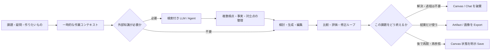

# 思考補助ツールの利用傾向・指向性調査

- 調査日: 2026-08-11
- 最終更新: 2026-08-11
- 状態: 暫定分析
- 主資料: [00_usecase.md](./00_usecase.md)
- 追補情報: Notion / AnyType / Kagi Assistant / 検索目的 / メモ利用、および `fm-doc-canvas` の破棄・Export・Save の使い分けについてのユーザーヒアリング（2026-08-11）
- 関連資料: [02_consultant.md](./02_consultant.md)、[rubberduck_log.json](./rubberduck_log.json)

## 1. 目的と前提

本書は、現在利用している自作・既製の思考補助ツールについて、継続利用される条件、利用が止まる摩擦、情報の扱い方、LLM に期待する役割を整理した調査記録である。

ここで述べる内容は固定的な人物像や恒久的な要件ではなく、記載された利用実態から得た仮説である。ツールの成熟度、現在取り組んでいる制作テーマ、用途によって評価が変わる可能性がある。設計示唆は未採用候補であり、実装要件としては確定していない。

本書は利用実態と指向性の分析を担当する。`fm-doc-canvas` の製品方向、現行実装の評価、優先順位、検証方法は [02_consultant.md](./02_consultant.md) に分離する。

## 2. エグゼクティブサマリー

利用傾向を最もよく表すのは、次の記述である。

> 解決したい課題を置き、必要なときは検索で複数の視点に接地し、AI に調査・生成・評価を任せる。思考過程は消費期限付きでよく、成果物と再訪価値のある作業状態だけを選択的に残したい。

主要な傾向は以下のとおり。

1. **課題起点**  
   思考は、解決したい課題、疑問、作りたい成果物から始まる。検索・調査・質問は頻出する入口だが、すべての作業が検索を必要とするわけではない。空の文書や構造を先に作るより、今回の課題を机上で検討する形が自然である。
2. **検索接地と複数視点の俯瞰**  
   LLM 単体の意見ではなく、多数の情報や意見を横断し、広く一致する事項と対立点を把握したい。
3. **手動の事前構造化を避ける**  
   構造化自体への関心は高いが、保存場所、分類、登録、接続を思考開始前に要求されると利用が止まりやすい。
4. **課題単位・成果物中心**  
   `fm-doc-canvas` は具体的な課題を机上で検討するために使われ、約 3 分の 2 は Canvas を保存せず閉じるか、成果物だけを Export して終える。後で見返す価値がある調査だけ、ノードを含む作業状態を Save する。
5. **自動反復と完遂を評価する**  
   単発回答より、検索・生成・観測・評価・修正を一つの仕事として最後まで進めるエージェントに価値を感じる。
6. **管理のための管理を避ける**  
   いつ整理するか、何を残すか、どこに置くか、どう探すかというメタ判断が独立した作業になると継続しにくい。
7. **永続化は常に便益とは限らない**  
   過去の思考や自己の痕跡が残り続けることには心理的負担があり、自動消去が気楽さにつながる。

この傾向は「長期知識庫としての第二の脳」より、**忘れることを前提に、問いから成果物までを短い手数で運ぶ一時的な思考ワークベンチ**に近い。

## 3. 観察された利用実態

| ツール | 実際の利用 | 継続要因 / 摩擦 | 読み取れること |
| --- | --- | --- | --- |
| `fm-live-radio` | 作業中の BGM として高頻度 | 操作がほぼ不要。既知・新規情報が混ざり、必聴ではない | 注意を奪わない偶発的情報流入は受け入れやすい |
| `fm-mindmap` | 発想は高評価だが低頻度 | マインドマップ入力が面倒 | 構造化への関心はあるが、手動構造化を開始条件にしたくない |
| `fm-doc-canvas` | 自作ツールでは高頻度。主に画像生成。具体的な課題を机上で検討し、約 3 分の 2 は保存せず閉じるか、成果物だけ Export する。再訪価値がある調査ではノード状態を Save する | 画像生成・参照画像生成は扱いやすい。作業全体を保存しなくても完了できる。テキスト用途は検索が入口にない | Canvas は恒久ノートより課題単位の一時作業面として機能する。成果物の持ち帰りと、例外的な作業状態保存を分ける必要がある |
| `fm-memo-chunk` | ほぼ定着せず | 整理時期、残す内容、他アプリへの移動判断が必要 | 「後で整理」も独立タスクになれば実行されない |
| `fm-link-stash` | URL の一時保存に高頻度 | 投入は容易。過去情報の再発見が難しく、MCP はほぼ未使用 | 収集は成立するが、利用時の再文脈化が弱い |
| `fm-image-assistant` | 高頻度・高満足 | プロンプト作成、生成、VLM 評価、再試行をエージェントが完遂 | 観測可能な閉ループとメタ作業の肩代わりに強い価値がある |
| `fm-image-prompt-manager` | 低頻度 | DB 登録と登録後の検索が、テキストファイル直接操作より重い | 高度な管理機能より、透明で直接扱える表現を優先する可能性がある |
| Kagi Assistant | 調査検索の主力 | 検索能力が強く、セッションログが 1 日で消える | 検索接地と一時的セッションの両方が重要 |
| Gemini | 利用減少 | 検索を確実に実行する保証が弱い | モデルの相談能力だけでは日常的な調査用途を満たさない |
| Hermes agent / kurumi | 調査分析を委任 | grounding と search skill が強い | LLM を知識源ではなく、検索を使う調査実行者として評価している |
| ChatWize | 旧主力から利用減少 | 多数モデルを選べるが知識検索が弱い | モデル選択肢の広さより、外部知識への接続が重要 |
| Notion | 利用停止 | 小さなメモの置き場所に悩む | 階層や分類先を保存時に決めさせる方式と相性が悪い |
| AnyType | 頻繁ではないが継続 | とりあえず投入でき、頻用情報をコピーできる。アプリ停止中は MCP が使えない | 高度な知識グラフより、低判断で使える参照棚として価値がある。連携は常時利用可能でなければ導線になりにくい |

## 4. 利用継続を左右するモデル

ツールの継続利用は、概ね次の関係で説明できる。

> 継続価値 ≒ 即時便益 + 自動完遂度 + 検索接地 − 登録・分類・保存判断・再発見コスト

### 継続しやすい条件

- 起動直後に質問、検索、生成など本来の目的へ入れる。
- 入力、分類、タグ付け、接続をほとんど要求しない。
- LLM が外部知識を検索し、複数視点をまとめる。
- 調査や生成だけでなく、評価と修正まで一つのループで完遂する。
- 利用後に「整理する」「残すものを選ぶ」という別タスクが発生しない。
- 保存されない、または保存範囲を明示的に選べる。
- Canvas 全体を保存せず、必要な成果物だけを直接 Export できる。

### 継続しにくい条件

- 空の構造をユーザー自身が埋めるところから始まる。
- メモごとに保存先や分類を決める。
- 将来の再利用のために、現在の作業とは別の登録作業を要求する。
- MCP やモデル選択など、機能は存在しても利用場面をユーザーが組み立てる必要がある。
- 過去情報を再利用するために、当時の分類方法や保存場所を思い出す必要がある。
- セッション履歴や試行錯誤が無条件に残り続ける。
- 課題が解決した後にも、Canvas の命名、分類、保存、履歴整理を要求される。

一時性を好むことと、事故から復旧できなくてもよいことは同義ではない。**意図的な破棄、クラッシュや誤操作から戻るための短期復旧、後日再開するための明示 Save** は、異なる寿命と発見経路を持つ概念として分けて検証する必要がある。

## 5. 自然な思考ワークフロー

主経路は必ず検索を通る一本道ではない。上位の起点は今回解決したい課題であり、外部知識が必要な場合は検索へ、制作や整理が中心なら生成・比較・編集へ進む。いずれの場合も、構造を先に作るのではなく、課題を進めた結果として必要な構造が生じる方式と考えられる。

これとは別に、二つの補助経路がある。

- **受動的収集**: 気になる URL を `fm-link-stash` へ低コストで投入する。ただし、蓄積から再発見への経路が弱い。
- **低注意の刺激**: `fm-live-radio` から既知情報と新情報を聞き流し、気になったものだけ拾う。

最大のボトルネックは保存機能の不足ではなく、次の段階への受け渡しである。

- 検索・質問から Canvas への移行
- URL・メモから現在の問いへの再文脈化
- 生成結果から再利用可能な成果物への昇格
- MCP 対応機能から実際のタスク実行への接続

この主経路では、破棄、成果物だけの Export、Canvas 状態の Save はいずれも正常終了になり得る。保存率だけでは、課題が解決したのか、未解決のまま離脱したのかを判別できない。

## 6. 情報の寿命に関するモデル

情報や思考は同じ保存ポリシーで扱わず、用途別に寿命を分ける方が利用傾向に合う。

| 情報クラス | 例 | 望ましい既定動作の仮説 |
| --- | --- | --- |
| 一時セッション | その場の疑問、チャット、迷い、試行錯誤 | 短い TTL で自動消去。必要な場合だけ明示保存 |
| 短期復旧データ | 未保存 Canvas の直近状態、送信直前の入力 | 誤操作やクラッシュから戻る期間だけ保持し、通常の履歴・検索対象にしない |
| 作業コンテキスト | 現在の調査素材、生成候補、比較中の情報 | タスクまたは Canvas 単位で保持し、完了後は既定で破棄 |
| 保存済み作業状態 | 再訪価値がある調査、後日再開するノード配置と文脈 | 明示 Save された場合だけ保持し、一時セッションと混在させない |
| 完成成果物 | 採用した文章、画像、決定事項 | Canvas 全体とは独立して永続化・Export |
| 頻用参照 | よく使う Phrase、定型値、操作用スニペット | 分類を深く要求せずピン留めし、即コピー可能にする |
| 外部情報 | URL、ニュース、調査結果 | 取得日と鮮度を保持し、古い場合は原文再提示より再検索・再検証を優先 |
| 過去の個人的思考 | 古いセッション、以前の仮説 | 既定の検索・推薦対象にせず、明示保存されたものだけ利用 |

パスワードやトークンは利用行動上「頻用参照」に見えるが、機密性が異なる。思考メモや通常の参照棚と同じ保存方式へ安易に統合せず、秘密情報として別の安全境界で扱う必要がある。

## 7. 永続化に対する指向

`fm-doc-canvas` では、作業の約 3 分の 2 を Canvas として保存せず閉じるか、成果物だけ Export して過程を残していない。一方、後で見返す可能性がある情報を調査した場合には、ノードを含む Canvas 状態を Save している。

この使い分けから、永続化の対象は「すべてのセッション」ではなく、**持ち帰る成果物**と、例外的に**再開・再参照したい作業状態**であると考えられる。未保存は保存失敗ではなく、課題が解決していれば意図された正常終了である。

Kagi Assistant のセッションログが 1 日で消えることは、履歴機能の不足ではなく積極的な利点として評価されている。ここから以下が推測できる。

- 古い自分の考えに拘束されたくない。
- 一時的な疑問や迷いを自己像として固定したくない。
- 解決済みの思考過程を後から管理したくない。
- 保存するかどうかを毎回判断する負担を避けたい。
- 必要なら成果物だけを別形式で残したい。

したがって、チャット履歴の永続化は常に便益ではなく、心理的コストにもなり得る。**会話は足場、Artifact / Image は持ち帰る成果物、明示 Save された Canvas は再開可能な作業状態**として分離する考え方が適合しやすい。

ただし、意図的な破棄と誤破棄は区別する必要がある。恒久的な履歴を既定にせず、通常の検索対象にならない短期復旧を別層として持つなら、一時性と安全性を両立できる可能性がある。

## 8. 検索に期待する役割

検索を重視する理由は、単に最新情報を得ることや出典リンクを確認することではない。主目的は、LLM 単体の個人的な見解に依存せず、多数の意見や情報を俯瞰することにある。

期待される検索結果の構造は次のように推測できる。

1. 広く一致している事実や見解
2. 意見が分かれている論点
3. 少数意見と、その根拠
4. 公式情報、専門的見解、経験談の区別
5. 現時点で確定できないこと
6. 情報の確認日と、鮮度に関する注意

元情報を頻繁に開かないという利用実態から、単にリンクを列挙するだけでは不十分である。エージェント側が、独立した複数情報源を使ったか、同じ情報の転載を重複して数えていないか、事実と意見を区別できているかを担う必要がある。

一方で、「検索した」こと自体は確定事項の保証にはならない。望まれているのは検索機能そのものより、**検索結果から合意、対立、不確実性を整理する evidence synthesis** と考えられる。

## 9. 構造化に対する指向

`fm-mindmap`、`fm-doc-canvas`、Notion、`fm-image-prompt-manager` の利用状況から、「構造化を嫌う」と結論するのは適切ではない。ノード接続、プロンプト部品化、知識整理といった構想には一貫して関心がある。

問題は、構造化のコストをいつ、誰が負担するかである。

- 合わない可能性が高い: 保存前に場所、タグ、ノード、分類、接続を決める。
- 合う可能性が高い: 質問や会話を進めると、カード、関連、要約、仮マップが自動的に生える。
- ユーザーの役割: 自動生成された構造を訂正し、採用対象を選ぶ。
- エージェントの役割: 本文、URL、会話、生成履歴から暫定構造を推定する。

つまり、望ましいのは「構造化しないこと」ではなく、**構造を入力にせず、思考の出力として生成すること**である。

## 10. エージェントと閉ループ

`fm-image-assistant` の高い満足度は、LLM を一回呼ぶことより、次の一連の仕事をまとめて完遂する点にある可能性が高い。

1. ユーザーの意図を解釈する。
2. 生成用プロンプトを作る。
3. 画像を生成する。
4. VLM で出力を観測する。
5. 意図との差分を評価する。
6. 必要ならプロンプトを改善して再生成する。

この設計パターンは、他の領域にも適用できる可能性がある。

- 調査: 検索 → 複数ソース照合 → 合意・対立の整理 → 不足検索 → 回答
- 執筆: 草稿生成 → 目的・制約によるレビュー → 差分編集 → 再レビュー
- アイデア整理: 会話 → 仮カード・関連生成 → 重複・欠落検査 → 構造更新

ここで価値を持つのは「エージェント機能」や「MCP 対応」というラベルではなく、ユーザーが連携方法を考えなくても仕事単位を完了できることである。

## 11. `fm-doc-canvas` との整合とギャップ

### 整合する点

- ChatDrawer を思考の入口にする方向は、検索・質問起点の利用傾向に近い。
- Artifact を会話から反復編集する構成は、過程ではなく成果物を残す指向と合う。
- ノードを必要時にコンテキスト化する設計は、保存時の厳密分類より利用時の文脈再構成に向いている。
- 画像ノード、参照画像、生成プロンプトの系譜は、実際に定着している画像用途と合う。
- エージェントループは、`fm-image-assistant` で評価されている自動完遂型の操作へ近づく。

### 重要なギャップ

1. **外部検索が思考の入口として統合されていない**  
   現行の Chat / Artifact 計画にある検索は主に Canvas 内検索であり、外部検索・MCP 連携は将来範囲である。検索接地が弱いままでは、Gemini や ChatWize と同じ離脱理由を再現する可能性がある。
2. **会話の保存と会話継続の意味が一致していない**  
   現行 UI は Canvas ごとの Chat セッションを自動保存する一方、Agent 呼び出しには過去メッセージを渡していない。履歴を残す負担があるのに対話の連続性には使われず、未保存 Canvas から孤立した Chat だけが残る可能性がある。
3. **構造化操作がユーザー側に残る**  
   ノード追加と接続が思考開始の前提になると、`fm-mindmap` と同じ入力摩擦が残る。
4. **古い情報の扱いが鮮度モデルを持たない**  
   過去カードをそのまま再利用するより、取得日を認識し、必要時に再検索する方が利用傾向に合う。
5. **MCP が能力として存在しても自然な導線にならない**  
   `fm-link-stash` や AnyType の MCP は、ユーザーが明示的に利用先を考えなくてもエージェントが現在の問いに応じて使う必要がある。
6. **AI の入口と文脈規則が分かれている**  
   PromptBar は複数選択と実画像を使った Text / Image 生成、Chat は単一 focus を起点とした会話と Artifact 編集を担当している。結果を同じ文脈で評価・再生成したい場面でも、機能に応じて入口を選び直す必要がある。

`fm-doc-canvas` は統合知識庫より、課題単位で一時的な文脈を展開する作業机として使われている。多くの作業は破棄または成果物だけの Export で終わり、再参照価値のある調査だけが Canvas の作業状態として明示的に保存される。この三つの終了形態を区別して捉える必要がある。

## 12. 設計提案との分離

本調査から導く製品方向、機能候補、優先順位、評価方法は [02_consultant.md](./02_consultant.md) に分離した。本書では利用実態、分析上の仮説、未確定事項のみを扱う。

## 13. 断定できない点と別解釈

- `fm-doc-canvas` で画像を多用することだけから、一般的な「視覚思考型」とは断定できない。現在の制作対象や画像機能の希少性でも説明できる。
- `fm-mindmap` の低頻度利用は、空間思考との不一致ではなく入力 UI の問題かもしれない。
- ローカル LLM、ComfyUI、LAN 内ツールの利用だけから、プライバシー優先のローカルファースト志向とは断定できない。改造性、費用、速度、趣味性でも説明できる。
- 長期知識管理そのものを望んでいないのか、整理コストが高いため使わないのかは完全には切り分けられていない。
- `fm-image-assistant` の満足度が自動評価ループ、生成品質、UI、ローカル実行のどれに最も由来するかは未確認である。
- 「現在の LLM は十分」という評価は主に日常調査用途についての発言であり、創作、設計、コーディングへそのまま一般化できない。
- 各ツールの成熟度が異なるため、思考指向だけでなく実装品質が利用頻度へ影響している可能性がある。
- 保存しない約 3 分の 2 のうち、課題解決後の意図的な破棄、成果物 Export 後の終了、未解決離脱、誤操作がそれぞれどの程度かは未計測である。
- 保存した Canvas を実際にどの頻度で再訪し、何を手掛かりに見つけているかは未確認である。
- Chat 内画像生成が必要という仮説は、生成機能そのものへの要望なのか、文脈を渡し直さず同じ場所で反復したい要望なのかを切り分ける必要がある。
- 意図的に過程を残さないことと、誤操作やクラッシュからも復旧したくないことは同義ではないが、短期復旧を望むかは未確認である。
- Agent に渡す文脈の確認・除外機能は考えられるが、確認操作自体が新たな負担になる可能性もあり、利用上の選好は未確認である。

## 14. 今後の確認事項

分析または次期仕様を具体化する際は、以下を確認すると精度が上がる。

1. 保存しなかったセッションは「解決したので破棄」「成果物だけ Export」「未解決離脱」「誤破棄」のどれに該当することが多いか。
2. Artifact / Image、Canvas 状態、Chat 履歴を別々の寿命で扱う構成は自然か。
3. 意図的な破棄と誤操作・クラッシュによる消失では望む扱いが異なるか。短期復旧が必要なら、終了時、1 日、7 日のどの程度が適切か。
4. 保存した Canvas を後で開く際、何を見返しており、ファイル名、課題名、本文中の Phrase、画像、作成時期のどれを手掛かりにするか。
5. 最近の実例を「きっかけ → 最初のツール → ツール間移動 → 最終成果 → 保存先 → 後日の再利用」の順で追うと、どの受け渡しが最も大きな摩擦か。
6. 検索結果では、合意・対立・少数意見・公式情報のうち何を最初に見たいか。
7. 自動分類・関連付けが完全に機能しても長期知識庫を使いたいか、それともその場限りの検索で十分か。
8. テキストファイルが DB より扱いやすい主因は、入力速度、自由形式、既存エディタ、検索、バージョン管理、可搬性、透明性のどれか。
9. `fm-image-assistant` の満足度に最も寄与するのは、プロンプト支援、生成操作、VLM 評価、自律再試行、ローカル実行のどれか。生成結果が意図と違う場合、同じ作業文脈で再試行する価値はどの程度か。
10. Agent に渡す Canvas 文脈について、実行前にどこまで内容を確認・除外したいか。それとも確認操作自体を負担と感じるか。

## 15. 暫定的な指向性

現時点では、次のように整理できる。

> 課題起点・検索接地・低摩擦・成果物志向であり、構造化と評価のメタ作業をエージェントへ委ねたい。現在の問いに必要な文脈をその場で組み立て、解決後は作業過程を手放し、成果物だけを持ち帰る。再訪価値がある場合に限って Canvas の作業状態を明示的に残す。

これは「構造化しない」「記録しない」という指向ではない。**構造化を開始条件にせず、記録の寿命と価値を区別し、現在の仕事に直接寄与する形でだけ残したい**という指向である。

## 16. 資料上の補足

`00_usecase.md` の `fm-image-assistant` URL は `fm-link-stash` と同じ URL になっているため、記載ミスの可能性がある。

`rubberduck_log.json` は設計上の質問を得るための会話ログであり、ユーザー回答を含まない。そのため、新しい観察事実の根拠ではなく、未確認事項を洗い出す補助資料として扱う。
