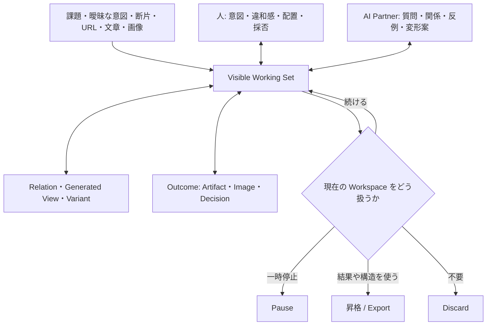

# `fm-doc-canvas` 改善方向性コンサルティング

- 作成日: 2026-08-11
- 最終更新: 2026-08-11
- 状態: 提案。上位概念はロードマップ上の作業仮説として採用
- プロセス区分: Patch 相当の製品方向調査
- 基礎分析: [01_research.md](./01_research.md)
- 利用事例: [00_usecase.md](./00_usecase.md)
- canonical 用語: [08_glossary.md](./08_glossary.md)
- 外部視点ログ: [rubberduck_log.json](./rubberduck_log.json)
- 現行計画: [plan_20260810_chat_artifact](../plan_20260810_chat_artifact/)

## 1. 本書の位置づけ

本書は、利用実態の分析をもとに、`fm-doc-canvas` がどのような製品になると手に馴染む可能性が高いかを整理した意思決定用の提案書である。

ここに記載する方向性、優先順位、機能候補は、まだ採用済み要件ではない。現行 `plan_20260810_chat_artifact` へ直ちに追加するものでもない。実課題による評価を通じて Go / Hold / Stop を決め、採用する方向だけを別の Requirements / Specification へ落とす。

本書の用語は [08_glossary.md](./08_glossary.md) を正本とする。今回の課題は単体アプリとしての `fm-doc-canvas` の改善に限定し、外部アプリを入口・出口にする IN/OUT 拡張など、後から提示された追加提案は [05_roadmap.md](./05_roadmap.md) の対象外に置く。

## 2. エグゼクティブサマリー

推奨する製品像は、次の一文に集約できる。

> `fm-doc-canvas` は、人と AI が同じ机を見ながら、問い、断片、URL、文章、画像を未整理のまま持ち込み、関係を見つけ、変形し、発展させ、必要な構造や成果物へ一緒に育てる **AI協働型Workspace** である。

最上位の製品概念は Workspace であり、中心となる状態は、人と AI の双方から見える **Visible Working Set** である。Task は保存・管理される中心オブジェクトではなく、現在どこへ注意を向けるかを示す一時的な **Focus** として扱う。明確な課題から始めてもよいし、素材を放り込み、関係を触るうちに問いが生まれてもよい。

内部では **Context Runtime** が、現在の Focus、Canvas 上の素材と配置、会話、外部知識、画像、派生関係、成果物を、可視化・訂正可能な作業文脈として組み立てる。

AI は完成した指示を処理するレイバーに限定しない。問い返し、別の見方、反例、関係、構造、変形案を持ち込み、人と評価・修正を往復する AI Partner として位置づける。Agent Runtime は AI Partner の検索・生成・編集などを支える内部実装機構であり、自律度の高さを製品成熟度とみなさない。

各要素の位置づけは次のとおり。

- Workspace: 人と AI が現在の素材・関係・変形状態を共有する協働境界
- Visible Working Set: いま机上に見えており、両者が働きかけられるもの
- Focus: 現在の問い、意図、制約、評価基準。一時的で分岐・移動・消滅してよい。Task は一般語としての課題に限る
- Canvas: Context Runtime を可視化し、直接操作する空間的な表面
- Dialogue: 曖昧さ、意図、評価基準、反論を調整する協働手段
- Relation: 根拠、対立、派生、類似など、対象間の意味的な接続
- Generated View: Cluster View / Library View など、思考中に生成・再編・解消される複数の見方
- Web / 外部知識 / 画像生成 / MCP: Workspace へ材料や変形能力を持ち込む道具
- Outcome: 必要に応じて昇格・Export できる成果物の総称。Artifact、Image、Decision などを含む
- Agent Runtime: AI Partner の限定的な実行を支える内部機構

「使い捨て可能なマルチモーダル AI 作業机」という方向は捨てない。ただし、これは最上位概念ではなく、AI協働型Workspace の**寿命設計と媒体特性**である。中核価値は、**人と AI が可視の文脈を共有し、相互の操作によって考えそのものを更新できること**にある。

## 3. 利用実態から導く設計原則

### 3.1 Workspace を最上位の枠とする

Workspace は恒久 Knowledge Base を意味しない。人と AI が同じ素材、関係、途中成果へ働きかける協働境界であり、その中で Focus を設定、移動、分岐、解除できる場所である。

開始点は課題だけに限定しない。問い、作りたいもの、URL、文章、画像、説明しにくい断片を机上へ出すことから始められる。未整理の状態を欠陥として扱わず、共同思考の材料として受け止める。

### 3.2 Task を一時的な Focus として扱う

Task は保存・管理する項目ではなく、現在の問い、意図、制約、評価基準を Workspace へ与える Focus である。作業中に問いが変わったり、答えを出さず別の方向へ分岐したりしてよい。

### 3.3 AI をレイバーではなく AI Partner として扱う

AI は道具を選んで仕事を代行するだけでなく、Focus の曖昧さを指摘し、別の見方、欠落、反例、関係、評価基準を提案する。人は意図、違和感、意味、採否判断を保持し、AI と同じ Workspace 上で考えを共同編集する。

機械的で可逆な部分作業は任せてもよいが、介入回数の少なさや自動完遂量だけで AI Partner の価値を測らない。

### 3.4 Context Runtime を共有する

Dialogue、Canvas の直接操作、検索、生成が別々の文脈規則を持つのではなく、Focus、選択、配置、関係、外部情報、変更対象を一つの Context Runtime として共有する。何が文脈に含まれ、何が変化したかは可視化・訂正可能にする。

### 3.5 一時利用を正常系とする

実利用の約 3 分の 2 は、Workspace を保存せず終了する。これは保存に失敗しているのではなく、課題が解決し、作業机が不要になった成功セッションである可能性が高い。

終了結果は次の五つに分ける。

1. 解決したため Workspace を Discard した。
2. 成果物だけ Export して Workspace を Discard した。
3. 続きを考えるため Workspace を Pause した。保存機構には Workspace Snapshot を使う。
4. 再参照する価値があるため Workspace を Save した。
5. 未解決のまま離脱した。

1〜4 は成功として扱い、5 を改善対象とする。保存率や履歴量を製品成功指標にしない。

### 3.6 成果物と過程を分離する

チャット、迷い、検索途中、生成失敗などは足場であり、必ずしも成果物ではない。採用した文章、画像、判断、Relation、Variant、頻用参照だけを明示的に昇格させる。

### 3.7 構造を保存分類ではなく共同思考に使う

Relation と Generated View は保存前の分類体系ではない。人と AI が検討を進める中で、論点、候補、根拠、派生、対立を捉えるために生成・再編・解消する暫定構造である。Cluster View と Library View は Generated View の候補として扱う。

構造化を開始条件にはしないが、AI だけが構造を作るとも考えない。ユーザーによる配置、group 化、edge、分割、統合も思考表現であり、AI が次の提案へ使う入力になる。双方の構造変更を可逆にする。

### 3.8 外部知識で接地する

LLM 単体の見解ではなく、複数の情報源と意見を俯瞰できることを重視する。検索結果の URL 数ではなく、合意、対立、不確実性を整理できたかを評価する。

### 3.9 同じ Context で反復できる

生成が意図と異なった場合に、別の入口へ移動して参照素材や失敗理由を再入力させない。物理的に同じ UI であることより、Focus、Visible Working Set、由来、評価が保たれた同じ Context の中で反復できることを優先する。

### 3.10 自動化を協働の下位能力とする

MCP、モデル、Context Provider、保存場所などを利用前に選ばせると、新しい分類判断になる。AI Partner が適切な道具や次の一手を提案し、必要な範囲だけ実行できる形が適する。

ただし、自律度を高めること自体を進化とみなさない。曖昧で重要な局面では質問と提案、明確で可逆な局面では単一操作、終了条件が明確な部分だけ範囲限定の委任を使う。

## 4. 現行 `chat_artifact` の評価

### 4.1 実現できている価値

現行計画は、Canvas 内の情報をエージェントが読み、安全に成果物を編集する基盤として有望である。

- フォーカス対象と接続元を直接文脈として扱える。
- 非接続ノードも `list_canvas_nodes` / `read_canvas_node` で必要時に読める。
- Artifact の作成、全文置換、一意差分編集、Canvas 内検索ができる。
- revision 照合、Frontend acknowledgment、diff 表示、Stop により、AI 編集を比較的安全に任せられる。
- Artifact 単体 Export は「成果物だけ持ち帰る」利用と合う。
- Text / Artifact / Image を同じ Canvas 上の参照対象にできる。

これらは次期機能のためだけの内部基盤ではなく、`fm-doc-canvas` 固有の価値である「見える文脈」と「成果物への昇格」を支える資産である。

focus、接続元、任意 node 取得、revision、diff、acknowledgment は、単なる Artifact 編集機能ではない。現在の Focus に応じて文脈を選び、人と AI が同じ対象を安全に読み書きする Context Runtime の初期構成要素とみなせる。

### 4.2 Chat の意味が UI と Backend で一致していない

UI は複数メッセージを ChatSession として保存・表示するが、現在の `ChatRequest` には過去メッセージが含まれない。Backend の agent loop は毎回 system prompt と現在の request だけから開始する。

- [frontend/src/types/chat.ts](../../frontend/src/types/chat.ts)
- [backend/agent_loop.go](../../backend/agent_loop.go)

したがって実態は、継続会話より「履歴表示付きの単発 Agent Runtime command」に近い。

この状態を無条件に会話履歴送信へ直すべきとは限らない。AI Partner に必要な文脈を、次の二層に分けて考える。

| 層 | 主な内容 | 寿命 |
| --- | --- | --- |
| Dialogue | Focus、意図、評価基準、疑問、反論を調整する短期対話 | 現在の協働に必要な範囲 |
| Workspace Context | Canvas 上の素材、関係、構造、由来、成果物 | Visible Working Set と昇格状態に従う |

会話をすべて保存する必要はないが、曖昧さの解消や評価基準の共有に必要な短期対話は Context Runtime へ含める。現時点では Canvas を共有作業記憶、Dialogue を Partner との調整面とし、採用された内容だけを Workspace Object へ昇格させる案が整合的である。

### 4.3 捨てた Canvas の Chat だけが残る

現在は Chat session を Canvas JSON と分離し、500ms debounce と終了時 flush でアプリ設定領域へ保存する。

- [frontend/src/App.tsx](../../frontend/src/App.tsx)
- [frontend/src/store/useChatStore.ts](../../frontend/src/store/useChatStore.ts)

未保存 Workspace にも実装上の `canvasId` があるため、Workspace を意図的に Discard しても会話履歴だけが残り得る。これは「過程を残さない」という利用傾向と衝突する。

### 4.4 協働方法ごとに Context 規則が分かれている

現状は次の役割分担になっている。

| 入口 | 主な機能 | 文脈 |
| --- | --- | --- |
| PromptBar | Text / Image の一発生成 | 複数選択ノードと上流接続 |
| ChatDrawer | 会話、Canvas 読込、Artifact 編集 | 単一 Focus と上流接続、Agent Runtime による追加読込 |

Chat と PromptBar を一つの UI に統合すること自体を目的にしない。Chat は意図や評価基準を共同調整する Dialogue、PromptBar は選択済み文脈への Direct Action として意味を分けられる。問題は入口数ではなく、両者が同じ Focus と Context Runtime を共有していないことである。

### 4.5 画像生成基盤はすでにある

[frontend/src/components/layout/PromptBar.tsx](../../frontend/src/components/layout/PromptBar.tsx) から、複数選択 Node、参照画像、複数 Image Provider を使った画像生成ができる。

したがって、次の検討対象は新しい画像生成サービスではなく、既存 `ImageGenService` を Agent Runtime の同一作業ループから呼び、Image Node として Canvas へ反映する導線である。

### 4.6 Chat の画像理解と複数文脈は未完成

- Chat の Agent Runtime が使う `read_canvas_node(image)` は image reference と prompt を返すが、実画像は LLM へ含めていない。
- Chat の直接対象は単一 focus であり、PromptBar の複数選択と一致しない。

検索資料の比較、複数参照画像、画像評価を行うには、「書込対象」と「複数の読込文脈」を分離する必要がある。

## 5. 製品概念の階層

以前の候補は排他的な製品像としてではなく、AI協働型Workspace を構成する異なる層として再分類する。ここでは候補名を増やさず、[08_glossary.md](./08_glossary.md) の canonical 用語へ統合する。

| 層 | 概念 | 役割 |
| --- | --- | --- |
| 最上位製品像 | AI協働型Workspace | 人と AI が素材、文脈、構造、成果物を共有して考える場所 |
| 共有作業状態 | Workspace | 一回の開始から終了まで、Focus、Canvas、Dialogue、寿命を束ねる |
| 内部原理 | Context Runtime | 現在必要な文脈を集め、可視化し、更新可能な状態で維持する |
| 注意の単位 | Focus | 今回扱う問い、意図、制約、評価基準 |
| 可視作業状態 | Visible Working Set | 現在、人と AI の双方が存在を共有して働きかけられる対象群 |
| 操作面 | Canvas / Dialogue / Direct Action | 見る、話す、直接操作するための異なる協働面 |
| 意味的な接続 | Relation | 根拠、対立、派生、類似などを型付きで表す |
| 生成される見方 | Generated View | Cluster View / Library View など、現在の Focus から作る暫定的な見方 |
| 外部情報源 | External Source | Web、AnyType、Repository など、Workspace 外の情報の所在 |
| 接続境界 | Context Provider | External Source ごとの差異を吸収して材料を接続する |
| 実装機構 | Agent Runtime | AI Partner の検索・生成・編集・限定委任を実行する |

自律タスク実行盤 / Agent Runboard は最上位候補から外す。必要な部分作業を実行する能力は有用だが、製品を「AI へ仕事を発注する場所」へ寄せると、共有 Workspace が単なる実行ログになる。

この階層により、製品を汎用 Chat、Knowledge Base、画像生成専用アプリ、Task Manager のいずれにも固定せず、同じ Visible Working Set を人と AI が共同操作することへ焦点を置ける。

## 6. 推奨する中核体験

### 6.1 開始

- 新規 Workspace は命名や保存場所を要求しない一時作業状態とする。
- 明確な課題を入力しても、URL、文章、画像、断片を先に置いても始められる。
- 空の Artifact を必ず一つ作るより、まず Visible Working Set を作れる状態を評価する。
- `Ask`、`Drop`、`Make` の三つを同じ入力面から開始できるようにする。
  - Ask: 質問、検索、比較
  - Drop: URL、テキスト、画像、ファイル
  - Make: 文書、画像、構成案
- モード選択を開始条件にせず、入力内容から必要な道具を選ぶ。

### 6.2 作業

- Canvas、Dialogue、Direct Action は同じ Context Runtime を共同操作する。
- AI Partner は回答や生成だけでなく、問い、反例、欠落、関係、分岐、Cluster View 候補を提示する。
- 人による配置、選択、接続、分割、統合、却下を AI の次の見方へ反映する。
- extract、split、merge、compare、summarize、reframe、Variant 化などの変形は、原文を破壊せず由来を保つ。
- Cluster View や Library View は固定の保存場所ではなく、Focus に応じて組み替わる Generated View とする。
- AI Partner の操作は Proposal、Variant、ToolCard、diff、source、target を通じて観測・取消可能にする。

### 6.3 終了

- 終了対象を Focus、Dialogue、Workspace 全体のどれかで区別する。
- Discard、Export、Pause、Save Workspace を異なる意味として扱う。Workspace Snapshot は Pause / Save / Short Recovery を実現する保存表現として分ける。
- 未保存終了を警告すべきデータ損失ではなく、通常の完了方法として扱う。
- ただし意図的破棄と、誤操作・クラッシュによる消失は分離する。
- 自動保存を導入する場合も、長期履歴ではなく短期クラッシュ復旧を目的とする。

## 7. AI との協働面と直接操作

### 7.1 推奨する役割

- Canvas: 素材、関係、配置、由来、成果物を人と AI が共有・直接編集する
- Dialogue: Focus、曖昧さ、評価基準、反論、次の見方を共同調整する
- Direct Action: 現行の PromptBar / Quick Action などから、選択済み Context へ既知の一操作を直接適用する
- Agent Runtime: 許可された検索、生成、編集、限定的な複数 step を実行する

Chat を製品の主入口、Agent Runtime を進化の頂点とはしない。協働の中心は Workspace であり、各操作面が同じ Context Runtime を共有することを優先する。

### 7.2 読込文脈と書込対象を分離する

- Focus: 現在の問い、意図、制約、評価基準
- Active Context: 選択、接続、group、位置、現在の Cluster View
- Candidate context: AI が追加を提案する Workspace 内・外部情報
- Mutation Target: 書き換え、派生、変形の対象
- Relation Target: 関係付ける対象と関係型
- Provenance / lifetime: 由来、鮮度、一時、昇格済みの区別

送信前または実行中に、実際に外部 LLM へ送る対象を確認・除外できる必要がある。これは token 管理だけでなく、不要な文章や画像の外部送信を防ぐ境界でもある。

### 7.3 結果を同じ入口で反復する

生成結果が意図と異なる場合、別の入口へ移動して前提を入れ直させない。Dialogue と Direct Action のどちらを使っても、同じ Focus、参照素材、由来、失敗理由を保ったまま再試行できるようにする。

## 8. Web 検索と Evidence Synthesis

Web 検索は、便利な追加 tool ではなく、外部世界の材料を現在の Workspace へ持ち込み、人間と AI が同じ根拠を見ながら考えられるかを決める中核仮説である。価値は「AI が検索回答を返す」ことではなく、検索結果を机上の比較・関連付け・反証・判断へ接続できることにある。

### 8.1 検索結果に求めるもの

- 広く一致している事実・見解
- 意見が分かれている論点
- 少数意見と根拠
- 公式情報、専門的見解、経験談の区別
- 現時点で確定できないこと
- 確認日、鮮度、再検索条件

### 8.2 最小形

最初から多数の Source node や検索管理画面を作らない。

1. Dialogue / Direct Action から `web_search` を実行する。
2. 複数の独立情報源を、現在の Focus に対する候補材料として取得する。
3. 通常要約ではなく、合意・対立・不確実性を整理する。
4. 根拠と由来を折り畳んで保持し、必要時には確認できるようにする。
5. 重要な主張や比較軸を Visible Working Set へ展開する。
6. ユーザーが必要と判断した結果だけ Research Node / Artifact へ Promote する。

### 8.3 注意点

- 「検索した」こと自体を確定事項の保証にしない。
- 転載や同一主張を独立意見として重複集計しない。
- 元情報を頻繁に開かない利用を前提に、Agent Runtime 側の source diversity と分類責任を重くする。
- 検索結果を既定で永続保存しない。
- 検索結果を長い回答へ閉じ込めず、現在の素材・仮説・判断との関係を操作できるようにする。

## 9. 外部知識の接続

Web 検索、個人の参照棚、過去の思考を同じ RAG へ混ぜない。

| Context の所在 | 主な用途 | 既定の利用方針 |
| --- | --- | --- |
| Web | 鮮度、多数意見、外部事実 | Focus に応じて利用を提案または明示実行し、由来を示す |
| Workspace Context | 今回の作業文脈 | 選択・接続・Focus に従って利用 |
| AnyType / 頻用参照 | Phrase、スニペット、安定情報 | 最初は read-only・明示取得 |
| `fm-link-stash` | 過去に気になった URL | 現在の課題に関連する候補として利用し、古ければ再検索 |
| `fm-memo-chunk` | 雑多な個人メモ | 既定では自動投入しない |
| 保存済み Workspace | 再開用の作業状態 | 明示指定された場合だけ利用 |
| 古い Chat / 個人的思考 | 過去の試行錯誤 | 既定の検索対象にしない |

この表は Workspace Context と複数の External Source を区別したものである。External Source は Context Provider を通じて接続し、いずれも製品の中心にはしない。MCP を UI の中心にせず、AI Partner が現在の Focus と Visible Working Set に応じて必要な接続を提案・利用し、結果側で情報源を示す。AnyType のようにアプリ起動が必要な接続は、待機・失敗時の fallback を含めて価値を評価する。

## 10. 画像生成とマルチモーダル作業

### 10.1 最初の候補

既存画像生成 Backend を Agent Runtime の Tool として呼ぶ最小導線を試す。

1. Chat / Command が選択テキスト、参照画像、現在の意図を読む。
2. 既存画像生成を呼ぶ。
3. 結果を新しい Image Node として配置する。
4. 入力素材との由来、比較対象、派生関係を提案する。
5. 人間と AI が結果を観察し、意図との差分を共有する。
6. 失敗理由を保ったまま同じ場所で再生成する。

### 10.2 段階的に追加する候補

- 実画像を画像入力として Chat の Agent Runtime へ渡す。
- 複数案を比較し、採用候補を示す。
- VLM による生成結果の観測と意図との差分評価を行う。
- `fm-image-assistant` へ機械的な処理を委譲し、結果と必要な由来を Canvas へ戻す。
- 終了条件が明確な部分だけ、生成、評価、改善を上限付きで反復する。

最初から `fm-image-assistant` を完全統合しない。Dialogue 経由で文脈再入力とツール移動が本当に減り、人間が比較・判断・修正へ参加したままでいられることを確認してから閉ループを広げる。閉ループの自律度自体は成熟度指標にしない。

## 11. 保存・履歴・復旧

### 11.1 対象ごとに寿命を分ける

| 対象 | 目的 | 既定の寿命 |
| --- | --- | --- |
| Short Recovery | 誤操作・クラッシュから戻る | 短期間、通常検索の対象外 |
| Focus / Dialogue | 現在の問いと対話を続ける | 作業中。Pause / Save 時だけ継続候補 |
| Workspace Snapshot | 後で同じ机上状態から再開する | 明示 Pause / Save したもの |
| Adopted Relation / Variant | 採用した中間理解や派生を保つ | Workspace または成果物に従う |
| Outcome | Artifact、Image、Decision などの完成成果物を利用する | 明示 Promote / Export したもの |

意図的に破棄した Canvas を密かに長期保存しない。短期復旧は「忘れる自由」と事故耐性を両立できるかを検証する。

### 11.2 Chat 履歴

- 未保存 Scratch の Chat を恒久保存しない。
- 継続会話を採用する場合も、既定は作業中だけの短期履歴とする。
- Artifact / Image / Workspace 保存と Chat 保存を分離する。
- 明示的に残す必要が確認できるまで、多セッションライブラリを製品中心にしない。

### 11.3 Pause / Resume と保存 Workspace の再発見

保存は例外でよいが、「成果物として残す」と「途中の机を一時停止する」を同じ操作にしない。Pause / Resume が実際に必要な時間幅と、再開時に必要な Focus、配置、採用済み関係、由来を観察する。

再訪実例が少ないため、巨大な Workspace ライブラリや常時全文検索はまだ採用しない。実例から、ユーザーが Focus、内容中の Phrase、Artifact 名、配置、時期の何を覚えているか確認する。

必要性が確認された場合は、フォルダ・タグより、明示保存した Workspace だけを対象にした内容検索を優先候補とする。

## 12. 思考中に生成される構造

Relation と Generated View は、保存先を先に決めるための分類ではない。机上の素材から共通点、対立、派生、欠落を見つけ、人間と AI が理解を発展させるための一時的な思考構造である。

最初から大規模な自動整理を作らず、次を独立して評価する。

1. 素材を extract / split / merge / compare / summarize / reframe / Variant 化する。
2. 根拠、対立、派生、類似など型のある Relation を提案する。
3. 複数の見方に応じた Cluster View / Library View を生成する。
4. 必要ならレイアウトを整える。

構造は AI が完成させて人間が訂正するものではない。人間による移動、接続、分離、採否も次の提案に使う協働入力である。すべて非破壊・理由表示・取り消し可能を基本とし、採用率が低い、削除・修正が多い、整理時間が増える場合は次段階へ進まない。

## 13. 学習ロードマップ

機能実装順ではなく、どの仮説を先に確かめるかで進める。

### Step 1: 現行 Workspace の基準観測

自然発生した実課題を 10 件程度使い、次を記録する。

- 課題、素材、断片のどれから始まったか
- 最初に使った入口
- Chat / PromptBar の利用
- AI Partner に求めた役割（質問、調査、整理、批評、生成、実行）
- 外部 Chat・検索・画像ツールへ移動した回数
- 手動コピー＆ペースト回数
- 人間が行った移動、接続、分離、比較などの操作
- Artifact / Image の Export
- Workspace の Discard / Export / Pause / Save / 未解決離脱
- 次も同種の課題で最初に開きたいか

会話本文や思考内容を計測のために保存せず、操作と終了結果だけをローカル集計する。

### Step 2: Shared Workspace Contract

Workspace、Canvas、Focus、Dialogue、Outcome の境界を定義し、どの協働面からでも次が分かる最小 slice を作る。

- AI Partner が読む Active Context / Candidate Context
- AI Partner が書き換える Mutation Target
- AI Partner が結ぶ Relation Target
- Proposal、適用、派生、取り消しの状態
- Focus / Dialogue / Workspace / Outcome / Short Recovery の寿命

### Step 3: 共同変形と関連付け

既存 Node を使い、extract / split / merge / compare / summarize / reframe / Variant と Relation Proposal を非破壊で試す。AI Partner の Proposal だけでなく、人間の配置・接続・採否が次の応答へ反映されるかを評価する。

### Step 4: Web 検索と外部材料

単一 Context Provider の薄い `web_search` で vertical slice を作り、検索なしと比較する。同じ検索結果から、通常要約と「合意・対立・不確実性」形式を比較し、回答だけでなく比較可能な材料として Workspace へ展開できるかを確認する。

### Step 5: Dialogue から画像生成

既存 Backend を変えず、PromptBar と Agent Runtime Tool の導線だけを比較する。

- プロンプト・参照素材の再入力回数
- 外部ツールへの移動
- 採用画像までの反復数
- 同じ入口で修正できたか

### Step 6: 外部参照棚

AnyType 等から明示的に取得する read-only tool を試す。自動探索は、明示取得の価値が確認できてから検証する。

### Step 7: 生成される Relation と Generated View

実セッションが十分に集まった後、Relation Proposal、複数の Cluster View / Library View、必要に応じたレイアウトの順に検証する。保存分類ではなく、理解や発見に寄与したかで評価する。

### Step 8: 勝った能力だけを組み合わせる

共同変形、検索、画像生成、外部参照、構造生成を同時に追加せず、単独で価値が確認できた能力だけを共通 Context Runtime 上で組み合わせる。

## 14. 評価指標

### 成功指標

- 課題完了率
- 最初の有用な結果までの時間
- 新しい論点、反証、比較軸、関係を発見できた割合
- AI Partner の Proposal を理解したうえで採用・修正・却下できた割合
- AI Partner の役割（質問、調査、整理、批評、生成、実行）がその局面に合っていた割合
- AI Partner が何を読み、どこを変えようとしているかを正しく把握できた割合
- 自分で考え、決め、作っている感覚を保てたか
- 外部アプリへの移動回数
- コピー＆ペースト回数
- 分類、命名、接続、保存判断などのメタ操作回数
- 同じ場所で検索・生成・評価・修正を継続できた割合
- 意図しない変更を停止・取消できた割合
- 次回も同種課題で最初に開きたいという評価
- 意図しない履歴残存、誤保存、整理作業の件数

### 成功とみなさない指標

- Workspace 保存率
- Chat 履歴件数
- Node 数
- Relation 数
- 接続 MCP 数
- 選択可能なモデル数
- 滞在時間の長さ
- Agent Runtime の Tool call 数や自律実行時間
- 人間の介入回数の少なさだけ（対話や修正は協働価値にもなりうる）

## 15. Go / Hold / Stop の判定例

| 仮説 | Go | Hold / 改善 | Stop |
| --- | --- | --- | --- |
| Shared Workspace Contract | 読込・変更・関係・寿命を自然に予測できる | 表示粒度や操作語を調整すれば理解できる | 入口ごとに挙動が異なり、意図しない変更が続く |
| 共同変形・関連付け | 新しい見方や欠落発見に使われ、人間の操作も次の提案へ反映される | 変形単位や Relation 型を絞れば使える | 掃除・修正・確認が便益を上回る |
| Web 検索 | Kagi 等への離脱と転記が継続的に減る | 検索品質はよいが表示形式が重い | 外部移動が減らず、結果も信頼されない |
| Evidence synthesis | 合意・対立表示が判断に使われる | 情報量や分類を調整すれば使える | 通常要約より追加検索・混乱が増える |
| Chat 画像生成 | 文脈再入力と切替が減る | Quick Action との役割調整が必要 | 現行 PromptBar の方が一貫して速い |
| 外部知識 | 手動コピーが減り、必要情報を正しく取得する | 起動待ち・古い情報対策が必要 | 不要情報や古い情報の混入が多い |
| Relation / Generated View | 複数の見方や欠落発見に寄与する | Proposal の粒度を下げれば使える | 保存分類や掃除作業へ変質する |
| Dialogue 永続化 | 実際に再開・再利用される | 明示保存・短期 TTL に限定する | 履歴を見返さず心理的負担だけが増える |

共通する Go 条件は次の四つである。

1. 対象セッションの過半数で明確な便益がある。
2. 発見、比較、判断、変形のいずれかを人間と AI が同じ文脈で前進させられる。
3. 外部移動、転記、メタ操作のいずれかが継続して減る。
4. 新しい管理、待機、誤作動、所有感の低下が便益を相殺しない。

## 16. 優先順位付き提案

### P0: Workspace の概念契約と評価前提を整える

1. Workspace、Canvas、Focus、Context Runtime、Dialogue、Outcome の境界を定義する。
2. Chat を履歴製品ではなく Dialogue を提供する画面として位置付ける。
3. PromptBar と Chat の読込 Context、Mutation Target、Relation Target を統一的に定義する。
4. Proposal、単発適用、限定委譲の AI Action Level と停止・取消を定義する。
5. 未保存 Workspace の Dialogue 自動永続化を評価対象へ戻す。
6. 実際に外部 LLM へ送る文章・画像を確認できる境界を検討する。
7. 現行 Chat / Artifact を実課題で基準観測する。

### P1: 最小の共同変形・関連付け

1. 既存 Node に対する compare / summarize / reframe / Variant を非破壊で試す。
2. 根拠・対立・派生など少数の Relation 型を提案できるようにする。
3. 人間の配置・接続・採否を Context Runtime へ戻す。
4. 理由、由来、差分、取消を確認できるようにする。

### P2: 最小の Web 検索

1. `web_search` の薄い vertical slice を試す。
2. 通常要約と evidence synthesis を比較する。
3. 結果を自動保存・自動 Node 化せず、Promote 操作を観察する。

### P3: 既存画像生成の協働導線

1. 既存 ImageGenService を再利用する。
2. 結果を Image Node として同じ Canvas へ置く。
3. 同じ入口で再試行できることを検証する。
4. 価値確認後に VLM 評価、`fm-image-assistant` 委譲を検討する。

### P4: 外部参照棚と選択的継続

1. AnyType 等を read-only・明示取得で試す。
2. 手動コピー削減と取得精度を評価する。
3. 自動探索は採用率を確認してから追加する。

### P5: Relation と Generated View

1. Relation Proposal
2. Cluster View / Library View
3. 必要な場合だけレイアウト

の順に、保存分類ではなく共同理解への寄与を独立して確認する。

## 17. 当面避ける方向

- Notion 型の恒久 Knowledge Base
- 手動ノード作成と接続を前提にした Mindmap
- 汎用 Chat アプリ化
- Task Manager 化、および Task を製品の最上位概念にすること
- AI を指示待ちのレイバー、または人間を置き換えるブラックボックス実行者として設計すること
- Tool call 数や自律実行量を AI Partner の価値とみなすこと
- 大量の Source Node を保存する Research Archive
- Cluster View / Library View を自動フォルダや恒久分類へ固定すること
- 理由・対象・由来を示さない自動 RAG、再編成、書き換え
- 人間へ同意するだけで、問い返し・反証・不足観点を出さない AI
- MCP 接続先をユーザーが管理・選択する Cockpit
- モデル選択肢を増やすこと自体を価値にする設計
- Chat と PromptBar の双方へ同じ機能を重複追加すること
- 過去の個人的思考を無条件で現在の context へ入れること
- 捨てた Canvas を秘密裏に長期保存すること
- 検証前にすべての自作ツールを統合すること

## 18. Rubberduck から得た追加論点

Rubberduck の三往復では、主に次の境界が問われた。

1. **保存場所と再発見**  
   保存 Canvas を何のために、どの手掛かりで探すかが未調査である。再訪事例なしにライブラリを作らない。
2. **文脈の取捨選択**  
   自動 context と外部送信の透明性を両立する必要がある。
3. **意図的破棄と事故復旧**  
   忘れる自由を維持しつつ、クラッシュ直後だけ復旧できる可能性を検証する。
4. **同じ場所での再試行**  
   Chat 内画像生成の本質は機能の所在ではなく、文脈を失わず評価・修正を続けられることにある。

Rubberduck は中核方向を覆さなかったが、「保存するか否か」「Chat か PromptBar か」という二択をそのまま採用せず、目的別に分離すべきことを明確にした。今回の再整理では、これらを個別 UI の問題ではなく、Workspace 内の Focus、Context、Mutation、Relation、Lifetime を共有する契約の問題として位置付け直した。

## 19. 計画上の扱い

現行 `plan_20260810_chat_artifact` では、外部 MCP と画像生成 tool は明示的に out of scope である。Web 検索、外部知識、Chat 画像生成、履歴寿命の変更を採用する場合は、既存計画へ無制限に追記せず、新しい計画として扱う方がよい。

新しい外部 API、MCP、Agent Runtime Tool、永続化方針、UI の主入口変更を含むため、採用時は Full tier 相当になる可能性が高い。実装計画を開始する前に、次を意思決定する。

1. 最上位概念を **AI協働型Workspace** とし、使い捨て可能性を寿命設計として扱うか。
2. Workspace、Canvas、Focus、Context Runtime の境界をどう定義するか。
3. AI Partner が問い返す、提案する、単発適用する、限定委譲を受ける境界をどう表現するか。
4. Dialogue と Direct Action の役割、および共通 Context をどう定義するか。
5. 課題、素材、断片のどれからでも開始できる最小導線をどう作るか。
6. Focus / Dialogue / Workspace / Adopted Relation / Outcome / Short Recovery の寿命をどう分けるか。
7. 最初の External Source を Web とし、それを扱う Context Provider を作るか。
8. Relation と Generated View（Cluster View / Library View）を保存分類ではなく思考構造としてどう評価するか。
9. 次期評価で記録する最小イベントと終了結果を何にするか。

## 20. 最終提案

`fm-doc-canvas` を「情報を保存する場所」「何でもできる Chat」「仕事を丸投げする自律 AI Agent」にしない。

**人間が見えている課題、素材、断片を机上へ出し、AI Partner と同じものを見ながら問い、関連付け、変形し、複数の見方へ発展させ、必要な結果・関係・途中状態だけを選んで持ち帰れる AI協働型Workspace**として育てる。

ここでいう AI Partner は、常に自律実行する AI Agent ではない。局面に応じて問い返す、視点を増やす、反証する、整理案を示す、一緒に比較する、限定された作業を引き受ける存在である。Agent Runtime はその一部を支える実装手段に留める。

次の一手は大規模統合ではない。まず Shared Workspace Contract を明確にし、現行 Chat / Artifact を実課題で基準観測する。その上で、共同変形・関連付けを最小実装し、外部材料と画像生成を同じ Context Runtime へ順次接続する。これにより、`fm-doc-canvas` が単なる回答入口ではなく、考える過程を人間と AI が共同所有できる場所になるかを検証する。
