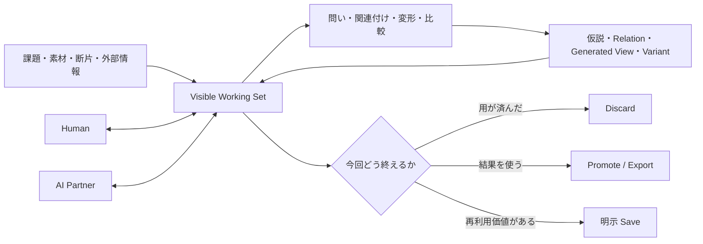
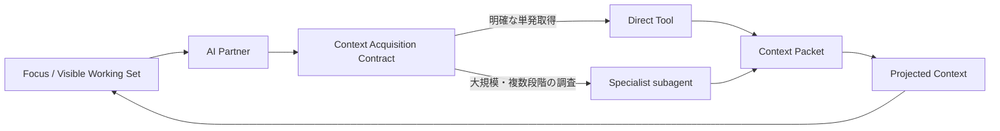
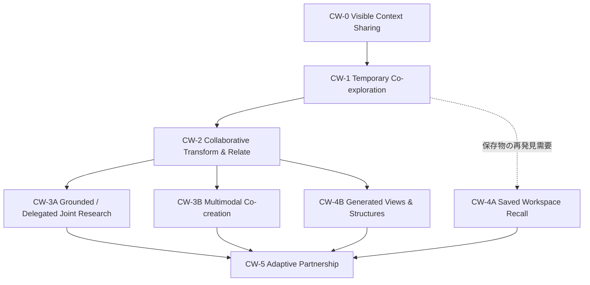
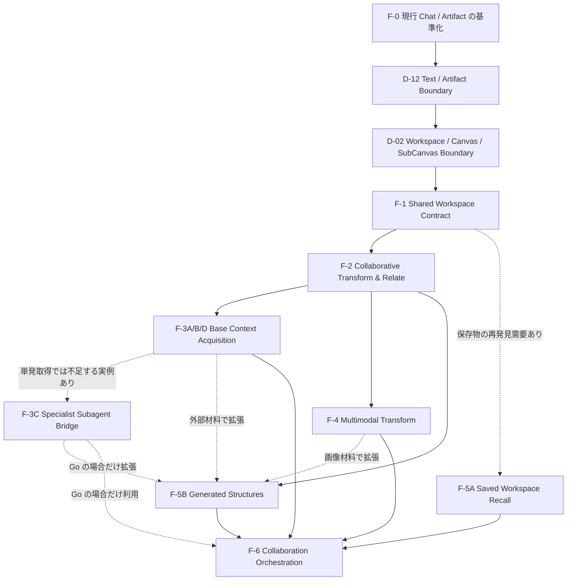

# `fm-doc-canvas` 進化ロードマップ

- 作成日: 2026-08-11
- 最終更新: 2026-08-13
- 状態: 検討用。上位概念はロードマップ上の作業仮説として採用
- プロセス区分: Patch 相当の方向性ロードマップ
- 利用傾向の分析: [01_research.md](./01_research.md)
- 改善方向の提案: [02_consultant.md](./02_consultant.md)
- canonical 用語: [08_glossary.md](./08_glossary.md)
- 基準実装計画（2026-08-11 完了）: [plan_20260810_chat_artifact](../plan_20260810_chat_artifact/)
- 正式 Full plan: [10_claim.md](./10_claim.md)、[30_requirement.md](./30_requirement.md)、[40_specification.md](./40_specification.md)、[90_status.md](./90_status.md)
- 昇格済み範囲: D-12・D-02・F-1 / F-2 / F-3 / F-4 core は各 plan で受理済み。F-5B core は [plan_20260815_generated_views](../plan_20260815_generated_views/)（`planned`）。F-3C / F-4B 後半 / F-5A / F-5B 後続候補（Library View・Layout suggestion）/ F-6 は各 Gate 後の別 plan とする。

## 1. 本書の目的

本書は、`fm-doc-canvas` の進化を次の二つに分けて検討するためのロードマップである。

1. **UX／概念的ロードマップ — 何を目指すか**  
   人間と AI がどのような関係で、何を共有し、どのように考えを発展させる Workspace にするかを示す。ここには、段階的な到達点だけでなく、今後はみ出さないための設計憲法を含む。
2. **機能的ロードマップ — 何を作るか**  
   その体験仮説を検証するために、どの能力を、どの依存順で、小さく止められる形で試すかを示す。

機能の追加を進捗とはみなさない。対応する UX 目的を説明できず、実課題で価値を確認できない場合は、実装済みであってもロードマップ上の前進とはみなさない。

本書にある機能段階と計画名は未採用候補である。各段階を Go / Hold / Stop で評価し、Go になった項目だけを Requirements / Specification を持つ個別計画へ昇格させる。

### 1.1 今回のスコープ

本ロードマップでは、利用者が `fm-doc-canvas` を起点として素材を机上へ置き、AI と検討し、Discard / Export / Save で終了する**単体アプリ体験**を対象とする。ここでの「単体」は製品・UX の境界を指し、Web APIやSpecialist subagentなどをアプリ内部から取得・実行経路として利用しないという意味ではない。ただしMCP clientは今回の初期実装から除外する。

外部アプリ、ブラウザ、OS の共有機能などから Workspace を生成する IN 拡張と、元のアプリや外部の保存先へ結果を自動返却する OUT 拡張は、今回の検討対象に含めない。

本書の用語は [08_glossary.md](./08_glossary.md) を正本とする。分析用語をそのまま UI 名や実装型名にはしない。

## 2. 北極星となる製品像

> `fm-doc-canvas` は、人間が見えている課題、素材、断片を机上へ出し、AI Partner と同じ対象を見ながら問い、関連付け、変形し、複数の見方へ発展させ、必要な結果・関係・途中状態だけを選んで持ち帰れる **AI協働型Workspace** である。

製品の中心は Chat、Task、node、Artifact、画像、保存ファイルのいずれでもない。中心にある状態は、その時点で人間と AI が一緒に扱っている **Visible Working Set** である。

### 2.1 製品概念の階層

| 層 | 概念 | 役割 |
| --- | --- | --- |
| 製品 | AI協働型Workspace | 人間と AI が同じ材料・関係・変化を共同所有して考える場所 |
| 内部機構 | Context Runtime | Focus、読込対象、変更対象、関係、由来、寿命を各操作へ組み立てる |
| 注意の単位 | Focus | 今どこへ注意を向けるかを示す一時的な焦点。Task は一般語としての課題に限り、開始条件や保存分類にはしない |
| 可視作業状態 | Visible Working Set | 現在机上にあり、人間と AI が共同で参照・変形している対象群 |
| 操作面 | Canvas / Dialogue / Direct Action | 見る・話す・直接操作するための異なる協働面 |
| 意味的な接続 | Relation | 根拠、反対、派生、類似など、対象間の意味を共同編集する |
| 生成される見方 | Generated View | Cluster View / Library View など、同じ材料を別の観点から一時的に可視化する |
| AI の役割 | AI Partner | 問い返す、視点を増やす、反証する、整理する、変形する、限定作業を担う |
| 外部情報源 | External Source | Web、Repository、外部参照棚など、Workspace 外の情報の所在 |
| 接続境界 | Context Provider | External Source ごとの差異を吸収し、共通 Context Packet として共同検討へ接続する |
| 内部実行機構 | Agent Runtime | AI Partner の Tool 呼び出し、提案、限定実行を支える。製品上の役割とは分ける |
| 取得・調査経路 | Acquisition Route | Direct Tool、Specialist subagentなどの交換可能な経路。MCP clientは初期実装に含めない |

「使い捨て可能なマルチモーダル AI 作業机」は、この製品像の重要な性質として残す。ただし、**使い捨て**は寿命設計、**マルチモーダル**は扱える材料、**作業机**は操作メタファーであり、最上位の製品目的は AI との協働である。

### 2.2 基本の協働ループ

開始時に明確な課題がなくてもよい。素材や断片を並べ、関係や問いが後から Focus として立ち上がる利用を正常系に含める。

#### 開始とFocusの境界（D-04）

**決定状態**: **採用済み**。課題を定義してから机を開く利用と、材料を机に出してから一緒に何を考えるか決める利用を、どちらも正常系として扱う。

- 課題名、目的、Focus名、保存先をWorkspace開始時の必須入力にしない。
- 空のCanvas、メモ、貼り付けた文章、importしたfile、複数素材の組合せから開始できる。
- Focusは開始条件や必須metadataではなく、操作とDialogueから暫定的に形成し、作業中に更新できる。
- 素材だけが提示され意図が不明な場合、AI Partnerは目的を決めつけず、判断に必要な質問を返す。
- 質問時には、素材から妥当に推測できる検討方向をSuggestとして添える。推奨に必要な情報がなければ、その不足を明示する。
- Focusを付けないまま短いDirect Actionを行い、DiscardまたはExportして終える利用も許容する。

終了時には、Discard、成果物のみの Export、採用した Relation / Variant の保持、Workspace の明示 Save のいずれも正常になり得る。Save の保存機構には Workspace Snapshot を利用できるが、終了意図と保存表現は同義にしない。保存率を成功指標にせず、未解決離脱や意図しない残存だけを改善対象とする。

### 2.3 Workspace が全Contextを所有する必要はない

この節の外部 Context は、`fm-doc-canvas` 内から取得・調査を依頼し、その結果を現在の Workspace へ戻す能力を指す。外部アプリを製品の入口・出口にする IN/OUT 連携は含まない。

大量のソースコード、Repository 履歴、複数回の Web 調査などを、すべて Canvas node や一つの LLM prompt へ取り込む必要はない。Context Runtime は、外部に保持された深い文脈を必要時に参照し、共同検討に必要な部分だけを Visible Working Set へ投影できればよい。

| 区分 | 主な所在 | Workspace で扱うもの |
| --- | --- | --- |
| Workspace Context | Canvas / Dialogue | Focus、現在の素材、仮説、Relation、判断 |
| Delegated Session | Specialist subagent | Repository 全体、複数段階の Web 調査、検索過程、専門的な一時作業状態 |
| Projected Context | Context Packet として Canvas へ投影 | 発見事項、根拠、反例、不確実性、未解決点、Relation 候補 |

Direct ToolとSpecialist subagentは実装時に比較する候補であり、両方を最初から作る必要はない。Specialist subagent自身が外部Toolを使う構成でも、`fm-doc-canvas`本体にMCP clientを組み込む必要はない。Workspace側が保持すべきなのは実行器の全ログではなく、根拠付きのProjected Contextと、必要なら同じDelegated Sessionへ追加質問できるhandleである。

Webを最初のExternal Sourceとする。取得経路はDirect Toolに固定せず、検索実装をAgent Runtimeへ直接接続する案と、read-only Specialist subagentへ委譲する案を小さく試す。MCP clientは今回の実装候補から外す。

## 3. 設計憲法 — これからはみ出さないための規範

この節はリリース段階ではない。各機能案、UI 変更、AI Agent 化の採否を判断する不変条件である。

| ID | 規範 | 設計判断で確認すること |
| --- | --- | --- |
| DC-01 | 課題・素材・断片から分類なしで始められる | 名前、保存場所、mode、schema を開始前に要求していないか |
| DC-02 | Canvas は人間と AI の共有外部記憶である | 会話だけ、内部 memory だけに重要状態を閉じ込めていないか |
| DC-03 | AI の Context と意図は必要時に見える | 読込対象、Mutation Target、Relation Target、外部委譲先と範囲が確認できるか |
| DC-04 | 最終的な意図・制約・判断は人間が所有する | AI が決定を不可逆に先取りしていないか |
| DC-05 | 過程・結果・対象ごとに寿命を分ける | Dialogue、Workspace、Relation、Outcome、Short Recovery を一括保存していないか |
| DC-06 | 意図的に忘れることと事故復旧を両立する | Discard を秘密保存せず、Short Recovery と区別しているか |
| DC-07 | 構造は共同編集可能な思考結果である | AI が分類を確定せず、人間の移動・接続・拒否も次の入力になるか |
| DC-08 | 外部世界へ接地する | 事実、合意、対立、少数意見、不確実性、鮮度、由来を扱えるか |
| DC-09 | 能力追加で管理作業を増やさない | Context Provider、Acquisition Route、model、保存先の選択を新しい仕事にしていないか |
| DC-10 | 変更と委譲は観測・停止・訂正・取消できる | 提案、差分、由来、scope、上限、cancel / undo があるか |
| DC-11 | 自律度を成熟度とみなさない | 最小限の適切な介入レベルを選び、人間の所有感を保てるか |
| DC-12 | Chat / PromptBar / Agent Runtime を製品中心にしない | 協働面や実装手段の都合が Workspace の一貫性を壊していないか |
| DC-13 | Workspace の能力と実行器を分離する | 「Web調査できる」ことを Agent Runtime 自身の実装へ固定せず、共通契約の背後で Direct Tool / Specialist subagent を比較・交換できるか |

## 4. UX／概念的ロードマップ — 何を目指すか

### 4.1 協働モデル

| 主体・面 | 主な役割 |
| --- | --- |
| Human | 何を机上へ出すかを選び、意図・制約・評価を示し、提案を採用・変更・拒否する |
| AI Partner | 問い返し、欠落や対立を示し、関係・構造・変形案を提案し、合意した範囲を実行する |
| Workspace | 一回の開始から終了までの共有作業状態。Dialogue、Canvas、Focus、寿命を含む |
| Visible Working Set | 現在双方が存在を共有し、参照・変形の候補にできる対象群。どちらか片方だけの隠れた記憶にしない |
| Context Runtime | Focus、Workspace Context、Projected Context、Mutation Target、Relation Target、由来、寿命を操作ごとに解決する |
| Dialogue | 曖昧さを保った探索、問い返し、比較、評価、方向修正を行う |
| Direct Action | 選択対象と明示promptを既定の実行経路へ直接渡し、Agentの追加判断を挟まず一発操作する |
| Outcome | 採用した成果や判断の総称。Artifact、Image、Decision などを含み、生の対話や全過程とは別の寿命を持つ |
| External Source | Web、Repository、AnyType、保存 Workspace など、外部情報の所在 |
| Context Provider | External Source を、共通の由来・鮮度・寿命規則で共同検討へ接続する論理境界 |
| Acquisition Route | Direct Tool、Specialist subagent等を必要に応じて使う取得・調査経路。同じContext Packetを返す。MCP clientは初期範囲外 |

AI Partner の価値は「作業を全部代行した量」では測らない。問いを明確にした、新しい視点を増やした、関係を発見した、比較可能な案へ変えた、判断を支えた、限定された機械作業を引き受けた、という複数の寄与で測る。

### 4.2 AI の実行レベル

実行レベルは成熟段階ではなく、局面ごとに選ぶ協働方法である。AL-3 が AL-0 より優れているわけではない。

| Level | AI の振る舞い | 代表例 | 必要な境界 |
| --- | --- | --- | --- |
| AL-0 Observe / Explain | 観察し、質問・説明・不足観点を返す | 「この二案の違いは？」「抜けている前提は？」 | 参照 Context の可視化 |
| AL-1 Suggest | 変更せず、関係・変形・次の手を提案する | Relation 候補、比較軸、Cluster View | 理由、対象、採用 / 拒否 |
| AL-2 Reversible Action | 単発で可逆な変更を行う | 要約 Node、Variant、画像生成、Relation 追加 | preview / diff、provenance、undo |
| AL-3 Bounded Delegation | 制約と上限のある一連の作業を担う | Specialist subagent による Repository 調査、調査→比較表、複数 Variant の生成と一次評価 | plan、scope、working directory / permission、round / cost / time 上限、stop |

#### 発動とinitiativeの境界（D-03）

**決定状態**: **採用済み**。AI Partnerのinitiativeは常時監視や無断発話ではなく、ユーザーが開始した協働ループ内の振る舞いとして扱う。

- ChatやAgent操作など、ユーザーの明示操作を協働ループの開始契機とする。PromptBar等のDirect Actionは、協働ループを開始せず直接実行できる別経路として残す。
- 協働ループ内では、AI PartnerはAL-0/1として、判断に必要な情報や不足前提をユーザーへ能動的に質問できる。
- ユーザーへ判断を求める際は、判断材料だけを列挙せず、可能な範囲で推奨案（Suggest）と理由を添える。推奨に必要な情報が不足する場合は、その不足自体を明示して質問する。
- AL-0/1の各発話に個別承認は求めないが、AL-2へ進む変更は明示的な依頼またはProposalへの同意を必要とする。
- AL-3は対象、scope、permission、上限、停止条件を合意した場合だけ開始する。
- AI Partnerは実行レベルの引上げを提案できるが、無断でAL-2/3へ移行しない。
- Canvas上の通常操作を常時監視して自動発話することや、Node追加・importだけを契機にmodelを自動実行することは初期範囲に含めない。必要性が確認された場合にopt-in triggerとして再検討する。

### 4.3 協働体験の到達点

CW-3A と CW-3B は並行候補である。CW-4A は再開・再利用需要が確認された場合だけ広げる。CW-5 は「完全自律 AI Agent」への到達点ではなく、局面に応じて AI Partner の役割と実行レベルを自然に切り替えられる状態を指す。

図の矢印は価値を積み上げる代表経路であり、すべての枝の実装を必須とする依存関係ではない。CW-5 も、Go になった複数の協働能力だけを組み合わせて評価する。

| ID | 目指す体験 | 守る境界 | 到達判定 |
| --- | --- | --- | --- |
| CW-0 | AI が何を見て、どこへ働きかけるかを双方が共有できる | Context 確認を毎回の儀式にしない | 読込・変更・Relation target を正しく予測し、誤りを訂正できる |
| CW-1 | 課題・素材・断片をすぐ机上へ出し、AI と探索し、気兼ねなく閉じられる | 課題の事前定義、分類、保存を開始条件にしない | Discard / Export / Save を自然に選び、次もここから始めたいと感じる |
| CW-2 | 人間と AI が素材を比較・分解・統合・言い換え・派生させ、関係を発見できる | AI の提案だけでなく人間の操作も共同文脈へ戻す | 新しい論点・比較軸・Relation が生まれ、掃除や確認が便益を上回らない |
| CW-3A | Web、Repository、Delegated Session などの深い文脈を必要な材料へ投影し、合意・対立・不確実性を一緒に検討できる | 全 Context の取込み、検索回答アプリ化、Research Archive 化、隠れた委譲を避ける | 外部移動・転記が減り、根拠付きの Projected Context が実際の判断に使われる |
| CW-3B | 文章・画像・参照素材を同じ文脈で生成・比較・評価・修正できる | 生成回数や自律再試行数を価値にしない | 文脈再入力と切替が減り、採用物までの反復が改善する |
| CW-4A | 明示Saveした机を、必要が生じた時だけ再発見して開ける | Save忘れの追跡、全履歴Memory、分類体系を作らない | 保存物を探せない実例に対してだけ検索・再発見が役立ち、不要・古い情報の混入が増えない |
| CW-4B | Relation、Cluster、Library が複数の見方として生成され、理解を発展させる | 恒久フォルダ、自動確定、単一の正解構造にしない | 構造が欠落・対立・まとまりの発見に使われ、人間と AI の双方が編集できる |
| CW-5 | AI が質問者、調査者、編集者、批評者、生成者、実行者を局面に応じて切り替える | 自律度を上げること自体を目的にしない | 役割と AL が局面に合い、人間が状態・次の判断・取消方法を理解できる |

## 5. 機能的ロードマップ — 何を作るか

機能ロードマップは一本の大型実装ではなく、各能力を独立して止められるゲート型とする。最初に検索を足すのではなく、あらゆる協働能力が共有する Workspace 契約と、机上の対象を共同で変形・関連付ける最小能力を先に置く。

F-5B の必須前提は F-2 であり、F-3 / F-4 は構造生成を別種の材料へ広げる任意枝である。F-3C は有力な将来候補だが、F-3 や F-6 の成立条件ではない。F-6 も全枝の完了を要求せず、Go になった能力が複数ある場合だけ統合評価する。

### F-0: 現行 Chat / Artifact を基準状態にする

**対応概念**: CW-0、CW-1 の評価基盤

基準実装となる [plan_20260810_chat_artifact](../plan_20260810_chat_artifact/) は 2026-08-11 に閉じた。残存していた追加 QA は、現時点で課題を感じていないというユーザー判断により、未実施内容と残余リスクを記録した EX waiver として受理した。

**実施候補**

- `REQ-N01`〜`REQ-N03`、`REQ-N06`、`REQ-N07`、Core E2E の closure waiver を記録する。**完了**
- `90_status.md` と `docs/plan_index.md` の state を `done` へ同期する。**完了**
- Chat / Artifact の確定挙動を current docs へ反映する。**完了**
- 現行版を実課題で使い込み、具体的に気になった点が生じた時だけ問題と再現状況を記録する。

**Gate F-0**

- 現行機能の受理と文書同期が完了している。
- 現行挙動が文書化され、具体的な問題が生じた時に変更前後を同じ実例で比較できる。

### D-12: Text Node と Artifact Node の境界を決める

**位置付け**: F-1 に入る前の必須 Decision Gate  
**候補計画名**: `text_node_contract`
**決定状態**: **採用済み**

現行 UI を経緯なしに見ると、Text Node と Artifact Node はどちらも Markdown 本文を編集する text-bearing Node であり、二つの作成ボタンを使い分ける理由が自明ではない。Workspace の共通契約を設計する前に、両者が本当に別の Node 型なのか、同じ対象の役割・表示・成熟状態なのかを決める。

#### 現行実装での違い

| 観点 | Text Node | Artifact Node | 実質的な評価 |
| --- | --- | --- | --- |
| 主な生成経路 | `+ Node`、Text生成、text file import | `+ Artifact`、空Canvasの初期Node、`write_artifact` | 生成経路が役割を暗黙決定している |
| 共通データ | Markdown `content`、`summary`、`revision`、文字数 | Markdown `content`、`summary`、`revision`、文字数 | 中核データはほぼ同じ |
| 固有データ | `originalPrompt` | `filename`、`language`、編集metadata | optional metadata として統合できる可能性がある |
| Canvas 表示 | Summary と元Prompt中心 | filename、本文Preview、count、Summary | 内容の種類より表示目的の差に近い |
| 編集 | 同じ EditorDrawer で Edit / Preview / Summary | 同左＋filename | 同一編集契約へ寄せられる |
| Export | Markdown、既定名は都度指定 | Markdown、`filename` を既定名に使う | filename capability の差 |
| AI操作 | `read_canvas_node`、`apply_edit` | 左記＋Artifact専用 list / search / read / write | Agent tool が型の差を増幅している |
| 想定役割 | 断片、材料、生成結果 | 育てる文書、持ち帰る成果 | 固定typeより、Focusに対する可変の役割として説明しやすい |

現在の差は保存媒体や編集原理の違いではなく、主に表示、metadata、Agent tool、想定用途の違いである。Text が後から成果物になったり、Artifact が比較材料になったりするため、役割は作成時に固定できない。

ユーザーが現時点で不便に感じている中心は、二種類が存在すること自体より、**同じ内容を保ったまま Text → Artifact または Artifact → Text へ移れないこと**である。このためD-12の中心論点を「二種類を消すか」から「同じNode identityに対して用途を可逆に切り替えられるか」へ置き直す。

#### 比較する選択肢

| 選択肢 | 内容 | 利点 | 主な問題 |
| --- | --- | --- | --- |
| A. 二種類を維持 | Text＝材料、Artifact＝文書として名称・見た目・作成導線を明確化 | 現行実装をほぼ維持できる | 作成時の分類判断と型間変換が残る |
| B. Promoteで接続 | 二種類は維持し、Text を Artifact へ明示 Promote できるようにする | 段階差として理解しやすく、移行も小さい | Artifact化とOutcome採用を誤って同一視する |
| C. 一つの型へ統合 | 一つの text-bearing Node に optional metadata と role / presentation を持たせる | 同じidentityのまま用途を往復できる | V1.2 migration、UI、Tool契約の変更範囲が大きい |
| D. UX先行で統合 | UIとAIでは一種類として扱い、内部の `customNode` / `artifactNode` は互換adapterで当面維持する | 利用者の分類負担を先に除き、内部migrationを延期できる | 内部と概念の二重構造を一時的に管理する必要がある |

#### 採用判断

**内部では一つのtext-bearing Nodeとし、UIではText / Artifactの二つのroleとして見せ、可逆に切り替えられる**ことをD-12の基本判断として採用する。両roleの境界は内容の成熟度やOutcome採用ではなく、**外部ファイルとの関係とfilenameを持つ必要性**で定める。

| role | 意味 | filename | 主な用途・生成経路 |
| --- | --- | --- | --- |
| Text | Canvas内で閉じ、Discardされてもよい軽量なテキスト | 不要 | 付箋的メモ、途中断片、LLMの調査結果、外部ファイル化を想定しない一時情報 |
| Artifact | 外部ファイルから来た、または外部ファイルとして持ち出す前提のテキスト | あり | file import、編集する文書、filenameを保ったExport、外部で再利用する文書 |

- LLM出力に明確なfile用途がなければ、命名負荷のないTextを既定とする。
- fileから取り込んだtextはArtifactを既定とし、元filenameを保持する。
- file出力を前提に作成する場合はArtifactとし、filenameをExportの既定名とsummary相当の識別表示に使う。
- TextからArtifactへの切替は即時に行い、本文またはsummaryから仮filenameを自動提案する。切替前の命名入力やmodal確認を要求しない。
- 仮filenameはArtifactカード上でinline編集できる。Exportまでは確定を要求せず、Export時の保存dialogでも修正できる。
- ArtifactからTextへ戻した場合、filenameは非表示metadataとして保持し、再度Artifactへ切り替えた時に復元する。
- ArtifactであることはOutcomeであることを意味しない。importしたArtifactは材料になり得て、Textも採用されたOutcomeになり得る。
- Text / Artifactを切り替えても、Node ID、Relation、revision、配置、Dialogueからの参照を維持する。
- `content`、`summary`、`originalPrompt`、`filename`、編集metadataは共通モデルに保持し、逆方向の切替でも失わない。Textへ戻した時のfilenameは非表示metadataとして保持できる。
- 表示はTextではSummary中心、Artifactではfilenameと本文Preview中心にする。roleに応じたcapabilityは変えてよいが、本文の編集原理は共有する。
- Agent Runtimeは全text-bearing Nodeを共通にread / search / editできる契約を持ち、Artifact専用toolはfilenameやfile-oriented actionに必要な範囲へ限定する。
- 移行はV1.2の`customNode` / `artifactNode`を共通runtime契約へ適合させるadapterから始め、保存typeの統合は個別計画で判断する。

#### filenameの確定規則

仮filenameの生成は切替を妨げない補助とする。人間が切替時に命名する必要はなく、Artifact上の識別やExportに必要になった時だけ修正すればよい。自動提案を最終的な名前として固定せず、Exportまでは軽量に変更可能な状態を維持する。

**Gate D-12**

- 初見の利用者へ両者の違いを一文で説明できるか、説明不要な一種類へするかが決まっている。
- 空のWorkspace、手動追加、Text生成、file import、Agent生成が同じNode契約へどう入るかが決まっている。
- 断片から育てる文書、材料からOutcomeへの変化で、Node identityとRelationを失わない。
- Text ↔ Artifact を往復しても本文、metadata、配置、Relation、履歴を失わず、undo可能である。
- Text / Artifact の共通操作と固有capabilityが分離され、Agent toolがUI上の分類を不必要に増幅しない。
- V1.0〜V1.2の読込互換と、既存Nodeを一括変換しない移行経路が定義されている。
- 新しい分類・命名・保存判断を作業開始時に増やさない。

### D-02: Workspace / Canvas / SubCanvas / Focus / Context Runtime の境界を決める

**位置付け**: F-1に入る前の必須Decision Gate  
**決定状態**: **採用済み**。Workspace / Canvas境界、SubCanvas navigation、単一parent membership、現在Canvasだけを編集Focusとする規則、Canvas境界を越えるRelationの保持を採用。境界RelationのGUI表現は実装時に検討する

ユーザーが求める可能性があるのは、同じ課題に複数の独立Canvasを持つことではなく、**指定した複数Nodeを意味のある集合としてまとめ、階層化して扱うこと**である。この要求は別Workspaceや別Canvas fileではなく、主Canvas内のSubCanvasとして整理する。

| 概念 | 境界 | 現時点の判断 |
| --- | --- | --- |
| Workspace | 一回の共同作業状態。Dialogue、Focus、寿命、主Canvasを包む | 作業の開始・終了単位。SubCanvasごとに分裂させない |
| Canvas | Workspaceのrootとなる空間的操作面 | 一つのWorkspaceに一つの主Canvasを基本とする |
| SubCanvas | 指定Nodeを意味のある集合として扱う、主Canvas内の階層化可能なcontainer / local view | 名前付きFolder Nodeからdrill-downする。同じWorkspace内の階層であり、独立Workspaceや別fileではない |
| Focus | 現在注意を向ける問い・対象・制約 | 単一Nodeだけでなく、選択集合やSubCanvasもFocus対象になり得る |
| Context Runtime | 操作ごとにActive Context、Mutation Target、Relation Targetを解決する内部機構 | SubCanvasを一つのscopeとして扱い、必要時にmember Nodeへ展開できる |

現在開いているCanvas PathのCanvasだけを編集Focusとする。他階層のNodeを自動的にVisible Working Set、Active Context、Mutation Target、Relation Targetへ含めない。別階層を操作する場合は、まずそのCanvasへnavigationする。

#### SubCanvasと近接概念の区別

| 概念 | 何を表すか | SubCanvasとの違い |
| --- | --- | --- |
| Relation | Node間のsupports / opposes / derived等の意味的接続 | containerや所有階層ではない |
| Cluster View | Focusや基準に応じて生成・再編できる一時的なまとまり | SubCanvasは人間が指定またはAI提案を採用した、安定した集合identityを持つ候補 |
| Library View | 再利用候補をある観点で並べるGenerated View | SubCanvasは保存棚ではなく、現在のWorkspace内で集合を操作する境界 |
| 複数Canvas | 独立したroot操作面 | 現時点では要求なし。SubCanvasは同じWorkspace、Dialogue、寿命を共有する |

#### SubCanvasの設計原則候補

- SubCanvas自体にidentityを持たせ、人間とAI Partnerが集合全体をread / move / relate / transformの対象にできる。
- member Nodeのidentity、Relation、revision、由来を維持し、group化でcopyを作らない。
- SubCanvasは入れ子を許容し、Canvas Pathとして階層を表す。ただし深いfile directory管理を目的にしない。
- SubCanvasは名前を持つ。group化を止めないよう、選択Nodeの特徴から仮labelを提案し、Folder Node上で後から編集できるようにする。
- AIが作る集合は最初から確定せずProposalとし、人間が採用した場合だけ安定したSubCanvasにする。
- SubCanvas外とのRelationやContext参照を失わない。

#### 採用するnavigation

- 親Canvasでは、SubCanvasを名前付きFolder Nodeとして一つ表示する。member Nodeは親階層へ重複表示しない。
- Folder Nodeをclickすると、そのSubCanvasを現在のCanvas面として表示するdrill-down navigationを行う。
- 画面にはrootから現在位置までのCanvas Pathを常時表示する。
- Canvas Pathはclick可能なパンくずリストとし、任意の親階層へ直接戻れる。
- 戻る操作でも直前の親SubCanvasへ移動できる。
- navigationでWorkspace、Dialogue、Focusの履歴、Node identityは切り替えない。変わるのは現在表示・操作しているCanvas Pathだけである。

#### 採用するmembershipと編集scope

- 各Nodeはroot Canvasまたはいずれか一つのSubCanvasだけをparentとして持つ。
- 同一Nodeを複数Canvasへ直接配置しない。別の意味的まとまりはRelationまたは将来の参照表現で示す。
- 現在開いているCanvasのNodeだけを直接選択・編集・接続・変形できる。
- Folder Nodeは子Node本文の代理ではない。子Nodeを操作・AI Contextへ含めるにはSubCanvasへ移動する。
- DialogueはWorkspaceに属するが、各操作のActive ContextとMutation Targetは現在Canvasへscopeする。

#### NodeのCanvas間移動

Node移動はcopyや再生成ではなく、`parentCanvasId`を変更する所有先変更として扱う。

- Node ID、role、本文、metadata、revision、由来を維持する。
- 単一Nodeと複数選択のどちらも移動対象にできる。
- SubCanvasへ入れる操作としてFolder Nodeへのdrag & dropを候補にする。
- 親・兄弟・離れた階層へ移す操作として、Canvas Pathを使う`Move to...`と`Move to parent`を候補にする。
- 移動はundo可能にし、移動先での配置位置を明示的に決める。
- 移動対象に既存Relationがある場合もRelationを維持し、移動を理由に自動削除しない。

#### Canvas境界を越えるRelation

異なるCanvas PathにあるNode間のRelationは、Node移動後も両端のidentity、Relation種別、由来を保つ。Current Canvasでは反対側Nodeを直接配置・編集せず、Folder NodeまたはBoundary Relation Proxyを介して「別階層に接続先がある」ことを表す。

- Context RuntimeはRelation種別、接続先identity、Canvas Path、Folder名などを参照できる。
- 反対側Nodeの本文はCurrent Canvasの既定Contextへ自動展開せず、明示的な参照または移動後に扱う。
- 反対側Nodeの変更はCurrent Canvasから暗黙に行わない。
- Nodeを元のCanvasへ戻した場合は、保持されていたRelationを通常の接続として再表示できる。

この判断によりContext作成上の契約は確定する。一方、GUI上でFolder Nodeへ集約するか、境界proxyを個別表示するかは利用時の視認性に関わるため、実装計画で比較する。

#### 実装時に残すGUI課題

- Boundary Relation Proxyの形状と、Folder Node上のbadge／集約表示の使い分け。
- 複数の境界Relationがある場合の本数、方向、Relation種別の見せ方。
- proxyから接続先Canvasへ移動する導線と、戻った際の視点復元。
- Current Canvasから境界Relation自体を選択・編集・削除する操作。

**Gate D-02**

- Workspace、主Canvas、SubCanvasの開始・終了・保存境界を一文で区別できる。
- 現在Canvasだけが編集Focusと操作scopeになり、他階層のNodeが暗黙に変更されない。
- group化と解除でNode identity、Relation、履歴を失わない。
- NodeをCanvas間でidentityを保って移動でき、undoできる。
- Canvas境界を越えたRelationを保持しつつ、他階層Nodeを暗黙に編集対象や既定Contextへ含めない。
- SubCanvasを人間とAI Partnerが同じ意味ある集合として対象指定できる。
- Cluster View等の一時構造と、採用された安定集合を区別できる。
- 階層化がfile整理のような必須管理作業にならない。

### F-1: Shared Workspace Contract を作る

**対応概念**: CW-0、CW-1  
**候補計画名**: `shared_workspace`

機能追加より先に、Workspace の対象、Context、変更、Relation、寿命、AI initiative の共通契約を整える。

F-1 で Specialist subagent の起動機能まで実装する必要はない。ただし、将来の外部委譲を隠れた Chat 応答へ閉じ込めないよう、Workspace Context、Delegated Session、Projected Context と由来の区別を概念契約に予約する。

#### F-1A: 対象と寿命を分ける

| 対象 | 役割 | 既定寿命の候補 |
| --- | --- | --- |
| Workspace | 今回の共有作業状態 | 作業中。明示Saveした場合だけ継続 |
| Focus | 現在の注意・問い | 一時的。差替え・複数化可能 |
| Dialogue | 曖昧さや指示語を含む短期対話 | Workspace の作業中に限る short memory |
| Delegated Session | 外部の専門文脈と複数段階の調査状態 | Focus に紐づく一時session。初期段階ではWorkspaceを閉じた後の継続を保証しない |
| Projected Context | Context Packet を通じて外部調査から机上へ戻した情報 | Candidate Context または採用先の寿命に従う |
| Adopted Relation / Variant | 採用した途中理解や派生 | Workspace または Outcome に従う |
| Outcome | 持ち帰る成果の総称。Artifact、Image、Decision など | 明示 Promote / Export |
| Short Recovery | 事故直後の復旧 | 短い TTL。通常検索の対象外 |

- 意図的な Discard では Workspace と Dialogue を同じ作業単位で破棄する。
- Export は Dialogue 保存を伴わない。
- Saveはユーザーの明示判断に委ね、保存忘れの確認、通知、整理促進、自動期限管理を初期範囲に含めない。

#### 情報寿命の最小境界（D-06）

**決定状態**: **採用済み**。Pauseを独立した終了状態として設けず、通常の寿命を「作業中／明示Save／Discard・Export」に絞る。

- FocusとDialogueは作業中の短期状態とし、明示Saveへraw Dialogueや思考過程を既定で含めない。
- Node、配置、採用済みRelation / Variantなどの机上状態は、明示SaveしたWorkspace Snapshotとしてだけ継続する。
- AI出力を後日残したい場合は、NodeまたはOutcomeとして机上へ採用してからSave / Exportする。
- Exportは選択したOutcomeだけを持ち出し、WorkspaceやDialogueの保存を伴わない。
- DiscardはWorkspaceとDialogueを意図的に残さない。
- Saveするかどうかはユーザーの責任とし、アプリは確認、催促、保存物の定期整理を行わない。
- Short Recoveryを実装する場合も、クラッシュ等の事故復旧専用の短いTTLとし、Pauseや秘密の長期保存として扱わない。

#### F-1B: 共通 Context Contract を作る

| 契約要素 | 意味 | 初期候補 |
| --- | --- | --- |
| Focus | 今回注意を向ける問い・対象 | 明示 focus、選択、Dialogue からの暫定 focus |
| Active Context | AI が実際に読む素材 | 選択、上流関係、採用済み材料 |
| Candidate Context | 関連候補だが未採用の素材 | AI 提案、Context Provider の取得候補 |
| Delegation Request | 外部取得・専門調査へ渡す依頼 | Focus、問い、scope、許可Context、working directory、期待する返却形式 |
| Delegated Session | Workspace 外に保持された深い調査状態 | Specialist subagent の session handle、対象 revision、permission、状態 |
| Projected Context | 外部実行から戻り机上へ投影する材料 | Context Packet。根拠、推論、不確実性、Relation 候補を含む |
| Mutation Target | 書き換え・派生・生成の対象 | 単一 node、選択群、新規 variant |
| Relation Target | 関係付ける対象と関係型 | source / derived / supports / opposes / similar など |

- 実際に送る文章・画像、外部送信先、Specialist subagent の scope / permission は chip / 折り畳みで軽く確認できるようにする。
- 不要項目だけ除外可能にし、毎回 modal を出さない。
- Dialogue と Direct Action は、選択Nodeや明示Contextの解決規則を共有する。ただしDirect ActionはDialogue側の自動Context拡張、問い返し、Suggestを暗黙に継承しない。
- 外部実行器の全ログを Active Context にせず、Context Packet から必要な項目だけを採用する。

#### F-1C: 提案と変更の状態を揃える

- `proposed → accepted / modified / rejected` を Relation、変形、構造で共有する。
- 明示的なDirect Actionは実行依頼そのものを承認として扱い、不要なProposalやDialogue履歴を生成しない。
- AL-2 以上は対象、理由、差分、由来、undo を持つ。
- AL-3 は scope、round / retry / cost / time 上限、stop を持つ。
- Delegated Session は executor、working directory / source revision、permission、status、session handle を持つ。
- 人間による移動、接続、分離、採否も次の Context Runtime へ戻す。

#### F-1D: 開始と終了を Workspace 中心にする

- 新規 Workspace は、課題、素材、断片、またはそれらの組合せから開始できる。
- 課題名、Focus名、初期Artifact、保存先、自動分類を開始条件にしない。
- Focusは選択とDialogueから暫定形成でき、作業中に変更できる。
- 素材だけで意図が不明な場合、AI Partnerは目的を決めつけず、質問と検討方向のSuggestを返す。
- 終了結果を Discard / Export / Save / 未解決離脱として扱う。
- 保存名、分類、終了アンケートを必須作業にしない。
- Save忘れを確認・追跡せず、保存判断をユーザーの責任とする。

**Gate F-1**

- Dialogue と Direct Action のどちらからでも Read / Mutation / Relation target を理解できる。
- 未保存 Workspace から孤立 Dialogue が長期残存しない。
- 誤った対象や変更を確認・訂正・取消できる。
- 将来の実行器をまだ接続しなくても、Workspace Context、Delegated Session、Projected Context と由来を区別する契約・表示先が定義されている。
- Context 確認と寿命選択が新たな管理作業にならない。

### F-2: Collaborative Transform & Relate を作る

**対応概念**: CW-2  
**候補計画名**: `collaborative_transform`

この段階は自動レイアウトより先に置く。AI と「一緒に考える」価値を、既存 node と既存 Canvas だけで検証する最小能力である。

#### F-2A: 非破壊の変形

- extract / split / merge
- compare / summarize
- reframe / counterpoint
- variant / text-to-card / card-to-text
- 元対象を書き潰さず、派生として作る。
- preview / diff、provenance、undo を共通にする。

#### F-2B: 型のある Relation

- 最初は `source`、`derived`、`supports`、`opposes`、`similar` 程度に絞る。
- AI は対象、関係型、理由を提案する。
- 人間は採用、型変更、方向変更、拒否を行える。
- 人間が作った Relation や配置も AI の次の理解へ反映する。

**Gate F-2**

- 新しい論点、比較軸、反証、Relation の発見に使われる。
- AI 提案の採用率だけでなく、修正から共同理解が進む。
- 元状態、由来、取消方法を理解できる。
- 生成物の掃除、確認、誤変形の訂正が便益を上回らない。

### F-3: External Research / Context Acquisition を接続する

**対応概念**: CW-3A  
**候補計画名**: 最小取得は `web_context`、将来の専門委譲は `specialist_agent_bridge`  
**個別計画**: [plan_20260813_web_context](../plan_20260813_web_context/)（2026-08-13、`done` / Gate Go）。F-3A / F-3B Direct Tool / F-3D の core sliceは受入完了。F-3Cは`specialist_agent_bridge`将来候補へdeferした。

Canvasから調査できることと、Agent Runtime自身が検索・Repository解析を実装することを分離する。最初のExternal SourceはWebとし、Acquisition RouteはDirect Toolまたはread-only Specialist subagentを実験して決める。MCP clientは今回の実装から外すが、Workspaceへ戻す契約は実行方法によらず共通にする。

#### 外部Contextの決定境界（D-07 / D-10 / D-11）

**決定状態**: **採用済み**。

- D-07: 最初のExternal SourceはWebとする。取得実装はDirect ToolとSpecialist subagentを比較可能に保ち、試作前に固定しない。
- D-10: Specialist subagentは複数段階、Repository横断、大規模Contextの有力候補とする。最初はread-only、明示scope / permission / working directory、短命session、cancel可能とする。
- D-11: 取得結果は共通のContext Packetとして返し、まずDialogue内の一時的なProjected Context / Candidate Contextとして扱う。
- 検索結果を自動で大量Node化しない。ユーザーが必要と判断した項目だけText Node、Artifact、Relation等として机上へ採用する。
- 採用時にはURL、確認時点、根拠、推論、不確実性、provenanceを引き継ぐ。
- 通常UIでexecutorを選ばせないが、外部委譲先、scope、主要sourceは必要時に確認できる。
- `fm-doc-canvas`本体のMCP clientは初期実装に含めない。将来必要性が生じた場合もContext Packet契約の背後へ追加する。

#### F-3A: Context Packet 契約

外部取得・専門調査の結果は、長い回答や raw log ではなく、少なくとも次を持つ Context Packet として返す。

- 観測事実と Specialist subagent / model の推論の区別
- Web なら URL・domain・確認日、Repository なら file・line・revision
- 支持、反証、重複、情報源の独立性
- 不確実性、未確認事項、追加調査候補
- 現在の Workspace 素材に対する Relation 候補
- executor、依頼 scope、完了 / 部分完了 / 失敗状態
- 追加質問が可能な場合の短命な session handle

Context Packet の各項目は Candidate Context として返し、採用前に Workspace の確定事実へ混ぜない。

検索結果はDialogue内へ一時表示するだけではNodeにならない。ユーザーが明示的に採用した項目だけをNode / Relationへ変換し、raw検索結果や全調査過程は保存しない。

#### F-3B: 最小Web取得の実装比較

- Context Provider は最初は一つだけにする。
- AIから明示的に呼べる`web_search`相当のDirect Tool、またはread-only Specialist subagentによる検索を小さく試す。
- MCP clientは候補に含めない。
- 明確な一回の検索、既知 object の取得、短い確認を主対象にする。
- title、URL、domain、snippet、確認時刻を表示する。
- timeout、Context Provider 障害、検索不能時の fallback を明示する。
- 検索結果を自動保存・大量 node 化しない。

#### F-3C: Specialist subagent による専門調査

Specialist subagent は、次のような場面の有力な将来候補とする。

- 大量のソースコードや複数ファイルを横断する Repository 調査
- 検索語の展開、複数回検索、source diversity 確認を伴う Web 調査
- Web、filesystem、複数の外部Toolを組み合わせる複数段階の調査
- 一度の返答で終わらず、同じ深い Context へ追加質問したい場合

最初は read-only の調査委譲に限定する。

- Focus、現在の仮説、選択した Workspace Context、明示 scope を渡す。
- Repository 調査では working directory と source revision を固定・表示する。
- Specialist subagentが外部Toolを内部利用してもよいが、利用した主要手段と根拠をContext Packetに残す。これはCanvas本体のMCP clientを要求しない。
- raw stdout / 全会話を Canvas node や長期履歴へ自動保存しない。
- 同じ session handle への追加質問、timeout、cancel、部分結果を扱う。
- Repository、外部サービス、Canvas への mutation は別の採用判断・計画に分ける。

ユーザーに毎回CLIやContext Providerを選ばせない。AI Partnerが依頼の複雑さからAcquisition Routeを提案し、外部委譲先、scope、permissionは必要時に確認・変更できるようにする。

#### F-3D: 回答ではなく共同材料にする

- Web では合意 / 対立 / 少数意見 / 不確実性 / 鮮度、Repository では観測挙動 / 制約 / 影響範囲 / 設計候補 / 未確認事項を整理する。
- 重要な主張や比較軸を Candidate Context として Workspace へ展開できる。
- 現在の素材・仮説・判断との Relation を F-2 の仕組みで提案する。
- 必要な部分だけ Artifact / Relation へ Promote する。

**Gate F-3（枝ごとに独立判定）**

- **Go — 共通**: 外部の調査 Agent / 検索への移動・転記が減り、根拠付きの Projected Context が比較や判断に使われる。
- **Go — Direct Tool**: 明確な単発取得を、Specialist subagent起動より少ない待機・cost・管理で完了できる。
- **Go — Specialist subagent**: 複数段階・大規模文脈の調査で外部壁打ちと転記が減り、同じ session への追質問と根拠保持が役立つ。
- **Go — routing**: Direct ToolとSpecialist subagentの使い分けが、手動選択なしで概ね適合する。片方だけで十分な場合はrouting自体を作らない。
- **Hold**: 調査価値はあるが、品質、速度、cost、表示量、Context Packet、Relation 粒度に調整が必要。
- **Stop**: 統合後も外部の調査 Agent や検索の方が明確に使いやすい、または投影時に根拠・重要な含意が失われる。この場合は外部で得た結果の手動取り込みだけを改善する。

F-3BとF-3Cは独立してGo / Hold / Stopにできる。Specialist subagent branchがStopでもDirect Toolの価値は残り、その逆も同様である。

複数Context Providerの選択UI、MCP client、大量Source Node、検索履歴ライブラリ、汎用terminal UI、Specialist subagentによるmutationはこの段階に含めない。最初のUX vertical sliceはDirect Toolまたはread-only Specialist subagentの小さい方から試し、結果を見て実装routeを決める。

### F-4: Multimodal Transform を接続する

**対応概念**: CW-3B  
**候補計画名**: `multimodal_context`  
**個別計画**: [plan_20260813_multimodal_context](../plan_20260813_multimodal_context/)（2026-08-13、`planned`）。F-4A + Vision Context の core slice。確認付き再生成 / AL-3 / `fm-image-assistant` は後続候補。

#### F-4A: 既存生成器への最小導線

- 既存 `ImageGenService` と Image Provider 設定を再利用する。
- 明示的な画像生成依頼だけ `generate_image` Tool として実行する。
- 選択 Text / Image、Focus を Context として使う。
- 結果を元素材との provenance を持つ Image Variant として配置する。
- 同じ Dialogue / Workspace から比較・評価・修正・再生成できる。
- 現行 PromptBar と同じ Backend・条件で比較する。

#### F-4B: 価値確認後の拡張

1. 実画像を Vision Context として AI へ渡す。
2. AI と人間が意図との差分を共有する。
3. ユーザー確認付きで再生成する。
4. 必要な局面だけ AL-3 の限定反復や `fm-image-assistant` 委譲を試す。

**Gate F-4**

- **Go**: Dialogueによる探索・比較が画像生成の文脈再入力や別toolへの移動を減らし、Direct Actionを損なわず採用画像までの反復を改善する。
- **Hold**: Dialogue側の画像生成に価値はあるが、追加判断や待機が用途によって便益を相殺する。PromptBarは一発Direct Actionとして維持する。
- **Stop**: Dialogue導線が判断負担だけを増やす場合、その導線だけを止める。Direct Actionの画像生成は縮小理由にしない。

### D-05: Dialogue と Direct Action の役割

**決定状態**: **採用済み**。入口が二つあるUI上の課題は認識しつつ、役割が異なるためDialogueとDirect Actionを併存させる。

- Dialogueは曖昧な探索、質問、比較、判断、複数往復、Agent initiativeを扱う。
- Direct Actionは選択Nodeと明示promptを既定routeへ直接渡し、Agentの追加判断を入れずに実行する。
- 画像生成promptなど、ユーザーが入力をそのまま実行へ反映させたい用途をDirect Actionの主要ユースケースとする。
- Direct ActionからDialogueへの自動昇格、質問への切替、会話履歴への自動追加は行わない。
- 二つの間で専用handoff機能は作らず、Node focusと必要時の手動copy / pasteを十分な接続手段とする。
- 内部では選択対象、明示Context、Mutation Target、provenance、undo等の基礎契約を共有できるが、Agentの判断過程まで共通化しない。
- 将来入口を再設計する場合も、Direct Actionの「余計な判断を挟まない」という性質を失わないことを条件にする。

### F-5A: Saved Workspace Recall は需要発生までHoldする

**対応概念**: CW-4A  
**実施条件**: 実際の再開・再利用需要が確認された場合  
**候補計画名**: `saved_workspace_recall`

- Pause / Resumeは作らず、既存の明示Save / Loadを最小の継続手段とする。
- Saveを促す通知、未保存追跡、自動整理、保持期限を追加しない。
- 保存済みWorkspaceを実際に探せなかった事例が生じた場合だけ、探すときに覚えている手掛かりを観察する。
- 需要が確認された場合は、tag 付けより内容・Focus による検索を優先する。
- AnyType 等の外部参照は、最初は一接続先・read-only・明示取得にする。
- 古い外部情報は再検索・再検証を優先する。
- password / token は一般 Context Provider と別の安全境界で扱う。

**Gate F-5A**

- 保存済みWorkspaceの再発見に実際の課題があり、追加した検索・参照導線で解決する。
- 外部参照が手動コピーを減らし、不要・古い情報の混入を増やさない。
- 利用実態が少なければ自動探索やライブラリ拡張を Stop する。

### F-5B: Generated Structures を共同編集可能にする

**対応概念**: CW-4B  
**実施条件**: F-2 の実セッションが十分に集まった後  
**候補計画名**: `generated_views`  
**個別計画**: [plan_20260815_generated_views](../plan_20260815_generated_views/)（2026-08-15、`planned`）。F-5B core slice（Relation batch suggestion + Cluster View + Cluster→SubCanvas 変換）。Library View と Layout suggestion は後続候補。

#### Relation / Generated View / SubCanvasの境界（D-08）

**決定状態**: **採用済み**。

- RelationはNode間の意味として保持できる。人間が作成したRelation、またはAI Proposalを人間が採用したRelationだけを確定状態とする。
- Generated Viewは同じNodeを別の観点で一時配置する表示であり、Node本文、Canvas ownership、確定Relationを暗黙に変更しない。
- Cluster Viewは類似、対立、論点等による一時的なまとまり、Library Viewは再利用性等の評価軸による一時的な見方とする。どちらも恒久分類ではない。
- 人間はGenerated View上で移動、分割、結合、命名、拒否でき、その操作を次のAI提案への入力にできる。
- Generated Viewを閉じてもNodeと確定Relationは失わない。
- 残したいClusterだけを明示操作でSubCanvasへ変換できる。Library View全体を恒久Knowledge Baseへ変換する導線は作らない。
- SubCanvas化ではFolder Nodeを作成して対象Nodeを実際に移動するため、対象一覧、移動先、境界Relationへの影響をpreviewし、undo可能にする。

次を独立して判定する。

1. **Relation suggestion**  
   F-2 の関係候補を複数素材へ広げる。
2. **Generated View**  
   Cluster View / Library View として観点ごとに異なるまとまりを生成し、Node ownershipを変えず、単一の保存分類として固定しない。
3. **Layout suggestion**  
   構造理解に配置が必要な場合だけ、自動配置を比較する。

人間の移動、分離、結合、命名、拒否を単なる修正ではなく、AI Partner への共同編集入力として扱う。

意味ある集合として残す場合だけ、選択したClusterをpreview付きでSubCanvasへ変換する。変換を採用するまでGenerated View上の配置は仮状態に留める。

**Gate F-5B**

- **Go**: 複数の見方が欠落、対立、まとまりの発見に寄与する。
- **Hold**: 自動生成ではなく「別の見方を提案」action に限定すれば有用。
- **Stop**: 保存分類や掃除作業へ変質し、削除・修正時間が便益を上回る。

### F-6: Collaboration Orchestration を検証する

**対応概念**: CW-5  
**候補計画名**: `collaboration_orchestration`

F-6 は閉ループ自動化の頂点ではない。Go になった能力を使い、AI が現在の局面に適した役割と AL を提案し、人間が軽く方向修正できる協働調整層である。

**実施候補**

- 現在の Focus、Visible Working Set、未解決点から「問い返す / 調べる / 比較する / 変形する / 批評する / 実行する」を提案する。
- 実行前に役割、対象、期待する結果を短く示す。
- AL-0〜AL-3 から必要最小のレベルを選び、人間が変更できる。
- 単発取得にはDirect Tool、複数段階・大規模ContextにはSpecialist subagentを提案候補とし、ユーザーへ実行器選択を押し付けない。
- なぜ外部委譲が必要か、なぜその Acquisition Route を選んだかを短く説明し、人間が route や scope を変更できる。
- 検索、専門調査、生成、評価、修正のうち Go になった能力だけを組み合わせる。
- AL-3 では中間結果、情報源、Delegated Session、変更対象、上限、停止点を確認できる。
- 最終成果だけでなく、採用した Relation / Variant / Decision の由来を必要に応じて残す。

**Gate F-6**

- AI Partner の役割と実行レベルが局面に合っている。
- Acquisition Route が依頼の複雑さに合い、必要時には人間が訂正できる。
- 人間が現在の状態、次の判断、変更・停止・取消方法を理解できる。
- 新しい視点や比較が増え、同時に自分で考え・決めている感覚を保てる。
- 自動化によって監視、確認、履歴整理という新しい仕事が生まれない。

Specialist Subagent BridgeがStop / Holdでも、GoになったDirect Toolや他能力だけでF-6を評価できる。

介入回数の少なさは診断材料にはなるが、単独の Go 条件にはしない。問い返し、共同比較、提案修正は AI協働型Workspace の価値そのものになり得る。

## 6. UX／概念と機能の対応表

| 概念到達点 | 主な機能段階 | 代表ユースケース | 機能があっても未達となる例 |
| --- | --- | --- | --- |
| CW-0 Visible Context Sharing | F-0、F-1B、F-1C | 複数素材を読ませ、対象を確認して変更する | DialogueとDirect Actionで、同じ明示選択の対象解釈が食い違う |
| CW-1 Temporary Co-exploration | F-1A、F-1D | 断片を置いて考え、Discard / Export / Save で終える | Focus 名や保存先を先に要求する |
| CW-2 Collaborative Transform & Relate | F-2 | 二案を比較し、反証と派生案を作り、Relation を共同編集する | AI が生成して人間が掃除するだけになる |
| CW-3A Grounded / Delegated Joint Research | F-3、条件付き F-3C | Web の多数意見や Repository 全体を専門調査し、根拠付きの要点を机上素材と比較する | 長い回答やraw logだけで、根拠・推論・既存素材の関係が投影されない |
| CW-3B Multimodal Co-creation | F-4、D-05 | 参照素材から画像を生成し、一緒に評価・修正する | 生成できても文脈を再入力し、人間が結果待ちになる |
| CW-4A Saved Workspace Recall | F-5A | 明示Saveした机を必要時に探して開き、頻用参照を持ち込む | 保存を促す管理機能や全履歴検索が先に増える |
| CW-4B Generated Views & Structures | F-5B | 同じ素材を複数の Cluster View で捉え直す | 自動フォルダが一つの正解構造として固定される |
| CW-5 Adaptive Partnership | F-6 | AI Partner と役割を切り替え、必要な場合だけ Specialist subagent へ委譲しながら調査・比較・生成を進める | Tool chain が自走するだけで状態と判断が見えない |

この対応表に紐づかない機能はロードマップへ追加しない。候補機能が Stop になった場合も概念目的を即座に捨てず、より小さな Direct Action、手動 Import / Export、既存 Tool 連携で達成できないかを検討する。

## 7. 推奨する検証順

1. 現行 `chat_artifact` の残存受理と文書同期
2. 実課題による基準観測
3. Workspace / Focus / Dialogue / Relation / Outcome / Short Recovery の寿命と境界
4. Active Context / Candidate Context、Mutation Target / Relation Target の共通契約
5. 最小の compare / reframe / Variant と型付き Relation
6. 人間の配置・接続・採否を Context Runtime へ戻す
7. Context Packet契約と、Direct Toolまたはread-only Specialist subagentによる最小Web取得の比較
8. Evidence synthesis と Projected Context の共同利用
9. 大規模・複数段階の調査需要に対する read-only Specialist subagent（CLI 実装候補）の比較
10. 既存画像生成の協働導線と実画像入力
11. Dialogue / Direct Action を別経路として保ったまま、選択対象と変更契約の整合を確認
12. 保存済みWorkspaceを探せない実例が確認された場合だけ再発見導線を検討し、外部参照は必要時に明示取得
13. Relation suggestion → Cluster View / Library View → 必要な場合だけ layout
14. Go になった能力だけを使う Collaboration Orchestration

外部調査は現在の主な離脱理由なのでContext Acquisitionの第一候補とする。ただし、調査結果を共同材料として扱うにはF-1とF-2が必要なため、機能追加順ではそれらを先に検証する。最初の実験はDirect Toolとread-only Specialist subagentのうち小さく検証できる案から始め、Repository横断や複数回のWeb調査ではSpecialist subagent（CLI実装候補）を有力候補として比較する。

## 8. 実利用から更新するルール

### 8.1 更新契機（D-09）

**決定状態**: **採用済み**。telemetry、定型session log、件数目標を設けず、実際に使い込んで具体的な違和感や不足が生じた時にロードマップを更新する。

- 問題が不明瞭な段階で、将来使うかもしれないeventを網羅的に収集しない。
- 終了時アンケート、保存確認、利用状況送信など、評価のための製品内UIを追加しない。
- raw Chat、prompt、Node本文、思考過程、subagent log、操作event全量を評価目的で保存しない。
- 気になった事例が生じた場合だけ、状況、期待した挙動、実際の挙動、なぜ困ったか、必要なら最小再現例を残す。
- 改善案はその具体例で試し、一度に変える主要差分を小さくする。
- 発生件数や過半数を機械的なGo条件にしない。一件でも中核体験を明確に損なう問題は更新契機になり得る。
- 課題が解消した後は計測機構を残さず、文書と実装へ確認済みの判断だけを反映する。

### 8.2 問題が生じた時の確認観点

以下は常時計測する指標ではなく、具体的な問題を整理する際の観点である。

| 観点 | 確認すること |
| --- | --- |
| Outcome | 必要なArtifact、Image、Decisionへ到達できたか。成果以外の過程を持ち帰る負担が増えていないか |
| Discovery | 新しい論点、反証、比較軸、Relation、欠落の発見に役立ったか |
| Collaboration | AIの役割が局面に合い、提案を理解して採用・修正・拒否できたか |
| Context / Control | AIの読込・変更対象と外部委譲先・scopeを予測でき、誤りを停止・取消できたか |
| Delegation quality | Acquisition Route、scope、permissionが依頼に合い、Context Packetが根拠を保ったか |
| Friction | 外部の調査 Agent・検索への移動、コピー＆ペースト、分類・命名・保存判断などのメタ操作 |
| Lifetime | Discard / Export / Saveが意図どおり働き、不要な履歴が残っていないか |
| Return intent | 同種の課題で自然に最初の作業場所として選びたくなるか |

### 8.3 目的化しないもの

- Workspace 保存率
- Chat 履歴件数
- Node / Relation 数
- 選択可能な model 数
- 滞在時間
- Agent Runtime の Tool call 数や自律実行時間
- Specialist subagent の起動数、session 数、読み込んだ file 数や token 量
- 人間の介入回数の少なさだけ

### 8.4 共通 Go / Hold / Stop

- **Go**: 問題が生じた実例で改善が確認でき、発見・比較・判断・変形のいずれかが前進し、新しい管理負担を生まない。
- **Hold**: 問題や便益がまだ曖昧、または速度、表示、導線、役割、提案粒度、失敗処理の摩擦が残る。
- **Stop**: 現行または外部Toolより課題完了や理解が悪化するか、新たな管理、待機、誤作動、履歴負担、ブラックボックス化を生む。

## 9. 個別計画への分割候補

現行 `plan_20260810_chat_artifact` へすべてを追記しない。採用時は、次の境界を候補とする。

| 候補計画 | 主な範囲 | 想定 tier | 開始条件 |
| --- | --- | --- | --- |
| `plan_20260810_chat_artifact` の完了 | Sprint A〜C 受理、EX waiver、current docs 反映 | Full・**2026-08-11 完了** | 完了済み |
| `text_node_contract` | Text / Artifact の意味、共通text-bearing契約、作成導線、role / capability、V1.2互換adapter | Light / Full 候補 | F-0後、F-1前にD-12を決定 |
| `shared_workspace` | 対象・寿命、Workspace Context / Delegated Session / Projected Context の概念予約、Proposal / undo、開始・終了 | Full 候補 | Gate D-12 完了後 |
| `collaborative_transform` | 非破壊 transform、typed Relation、人間操作の feedback | Light から開始可能 | F-1 Go |
| `web_context` | Web取得、Direct Tool、Context Packet、Evidence synthesis、明示Promote。MCP clientは対象外 | Full・[plan_20260813_web_context](../plan_20260813_web_context/) が F-3A/B Direct Tool/D coreを`done`、Gate Go | 2026-08-13受入完了。F-3Cは`specialist_agent_bridge`へdefer |
| `specialist_agent_bridge` | read-only Specialist subagent（CLI 実装候補）、Repository / 複数段階 Web 調査、scope / permission、session handle、Context Packet | Full 候補・**有力な将来候補** | F-1 / F-2 Go、深い外部 Context の反復利用例あり |
| `multimodal_context` | 既存画像生成、実画像入力、Variant、共同評価 | Full・[plan_20260813_multimodal_context](../plan_20260813_multimodal_context/) が F-4A + Vision を `planned` | 2026-08-13 plan 作成。実装未着手。再生成ループは対象外 |
| `saved_workspace_recall` | 明示Save済みWorkspaceの検索・再発見、read-only外部参照 | Light / Full 候補 | 保存物を実際に探せなかった実例あり。Pause / ResumeやSave催促は対象外 |
| `generated_views` | Relation、Cluster View / Library View、必要時 layout | Light から開始可能 | F-2 実セッション蓄積後 |
| `collaboration_orchestration` | 役割提案、AL 選択、Acquisition Route の選択、限定委譲、上限・観測・停止 | Full 候補 | 複数能力が Go。Specialist Subagent Bridge は必須ではない |

各計画を開始するときに改めて tier、E2E、worklog、新規依存、外部 API の検証範囲を確定する。

## 10. ロードマップ外に置くもの

現時点では次を目標にしない。

- Notion 型の恒久 Knowledge Base
- Task Manager、および Task を最上位概念にする設計
- 手動 Node / Relation 作成を前提にした Mindmap
- 汎用 Chat アプリ
- 指示待ちレイバー、または人間を置き換えるブラックボックス AI Agent
- Tool call 数、自律実行量、閉ループ数を価値にする設計
- 大量 Source Node を保持する Research Archive
- Repository 全体や Specialist subagent の raw log を Canvas へ複製すること
- 調査段階から Specialist subagent に無制限の filesystem / 外部 service mutation を許すこと
- Cluster View / Library View を恒久フォルダや単一の正解分類にすること
- 理由、対象、由来を示さない自動 RAG・再編成・書き換え
- MCP / CLI / Specialist subagent などの Acquisition Route をユーザーが管理する Cockpit
- `fm-doc-canvas`本体へのMCP client組込み
- model 選択肢の多さを価値にする UI
- 過去の個人的思考を無条件に自動投入する Memory
- 捨てた Workspace の秘密裏な長期保存
- すべての自作 Tool の一括統合
- 外部アプリ、ブラウザ、OS 共有機能、global hotkey、inbound MCP などから Workspace を起動・生成する IN 拡張
- Outcome Sink、outbox、外部アプリへの push / publish / 自動書き戻しなどの OUT 拡張

これらを永久に禁止するのではなく、現在の中核ユースケースを弱めず、実利用から必要性が確認された場合だけ再評価する。

## 11. このロードマップ上で決めること

| ID | 論点 | 現時点の判断・推奨 |
| --- | --- | --- |
| D-01 | 最上位の製品概念 | **AI協働型Workspace** をロードマップ上の作業仮説として採用する |
| D-02 | Workspace / Canvas / SubCanvas / Focus / Context Runtime の境界 | **採用済み**。一Workspace＝一主Canvas。SubCanvasはFolder Nodeからdrill-downする。各Nodeは一つのCanvasだけに属し、現在Canvasだけを編集Focusとする。Nodeはidentityを保ってCanvas間移動でき、境界を越えたRelationも維持する。GUI上の境界表現は実装時に比較する |
| D-03 | AI Partner の initiative | **採用済み**。ChatやAgent操作から協働ループを開始する。ループ内ではAL-0/1として必要情報を質問し、判断を求める際は可能な範囲で推奨案と理由を添える。AL-2は依頼または同意、AL-3はscope・permission・上限・停止条件の合意を必要とし、無断でlevelを引き上げない。Direct Actionは協働ループを開始しない別経路とする |
| D-04 | 開始単位 | **採用済み**。課題名・Focus名・保存先を開始時に要求せず、空のCanvas、素材、断片、file、組合せから開始できる。Focusは操作とDialogueから暫定形成・更新する。意図が不明ならAI Partnerは目的を決めつけず、質問と検討方向のSuggestを返す |
| D-05 | Dialogue / Direct Action の役割 | **採用済み**。Dialogueは探索・質問・複数往復とAgent initiative、Direct Actionは選択Nodeと明示promptを追加判断なしで既定routeへ渡す一発操作として併存させる。自動昇格や専用handoffは作らず、Node focusと手動copy / pasteで接続する。対象・provenance・undo等は共有してもAgent判断は共通化しない |
| D-06 | 情報の寿命 | **採用済み**。Pauseは作らず、通常の寿命を作業中／明示Save／Discard・Exportに絞る。FocusとDialogueは短期状態、机上状態は明示Save時だけ継続し、ExportはOutcomeだけを持ち出す。Save判断はユーザーの責任として確認・催促・整理を行わない。Short Recoveryは実装する場合も事故復旧専用の短いTTLとする |
| D-07 | 最初の外部材料と取得経路 | **採用済み**。最初のsourceはWeb。Acquisition Routeは試作前に固定せず、Direct Toolとread-only Specialist subagentを比較する。MCP clientは初期実装から外す |
| D-08 | Relation と Generated View の意味 | **採用済み**。Relationは人間が作成またはAI Proposalを採用した時だけ確定する。Generated Viewはownershipや本文を変えない可逆な仮配置とし、閉じてもNodeと確定Relationを失わない。残したいClusterだけpreview / undo付きでSubCanvasへ変換し、対象Nodeを実際に移動する。Library Viewは恒久Knowledge Baseにしない |
| D-09 | 次期評価方法 | **採用済み**。telemetry、定型session log、件数目標、終了時アンケートは設けない。実際に使い込み、具体的に気になった事例が生じた時だけ状況・期待・実挙動・困った理由・最小再現例を記録し、その問題を更新契機とする。raw Chat、prompt、Node本文、思考過程、操作event全量は評価目的で保存しない |
| D-10 | Specialist subagent の位置付けと初期境界 | **採用済み**。多段・Repository横断・大規模Web調査の有力候補とする。最初はread-only、明示scope / working directory / permission、短命session、cancel、Context Packet返却を境界とし、Direct Toolとの比較で実装routeを決める |
| D-11 | 外部調査の共通返却契約 | **採用済み**。取得方法によらずContext Packetへ揃え、まず一時的なProjected / Candidate ContextとしてDialogue内に提示する。自動Node化せず、必要な項目だけNode / Relationへ採用し、URL・確認時点・根拠・不確実性・provenanceを引き継ぐ |
| D-12 | Text Node / Artifact Node の境界 | **採用済み**。内部は一つ、UIは二role。Text＝Canvas内の軽量情報、Artifact＝filenameを持つfile-oriented情報。identityを保って可逆切替し、Outcome採用とは分離する。Text→Artifactでは仮filenameを自動提案し、Exportまで確定を要求しない |

D-01〜D-12のDecision Pointはすべて確認済みとなった。次は確定した境界を前提にロードマップ全体をレビューし、最初の個別計画へ昇格させる機能段階を選ぶ。
