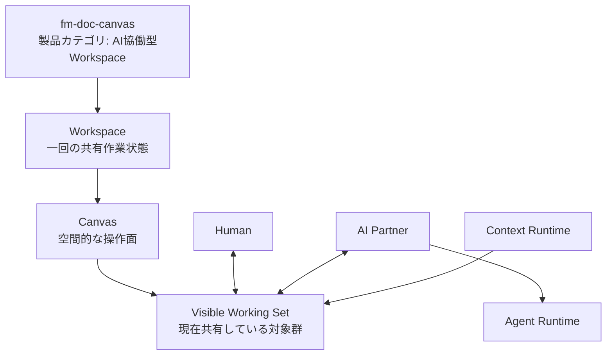

# `fm-doc-canvas` 用語集

- 作成日: 2026-08-11
- 最終更新: 2026-08-11
- 状態: 本計画内の canonical 用語。製品概念は作業仮説であり、実装済み仕様を意味しない
- 適用先: [02_consultant.md](./02_consultant.md)、[05_roadmap.md](./05_roadmap.md)、および本計画から派生する今後の計画

## 1. 目的と適用規則

本書は、分析・ロードマップ・UI・実装の語を混在させず、同じ語を同じ意味で使うための用語の正本である。

- [00_usecase.md](./00_usecase.md) と [01_research.md](./01_research.md) は、利用実態や当時の表現を記録するため、原文上の語を必ずしも置換しない。
- 本書は計画上の意味を定める。現行 UI、API、型名、保存形式の変更は、別途 Requirements / Specification を持つ計画で採用されるまで要求しない。
- `/` は同義語を示すために使わない。複数の別概念を列挙する場合だけ使う。
- `Provider`、`Agent`、`Context` は単独で使うと意味が広いため、原則として修飾語を付ける。

## 2. 今回の製品境界

| 用語 | canonical な意味 | 含まないもの |
| --- | --- | --- |
| 単体ツール | 利用者の操作起点と協働体験が `fm-doc-canvas` 内にあり、Workspace の開始から終了までを一つのアプリとして扱えること | 単一プロセス、外部 API 非使用、MCP 非使用、Specialist subagent 非使用という技術制約 |
| 外部 Context | 現在の Workspace 外にあり、`fm-doc-canvas` 内から必要時に取得・調査する情報 | 外部アプリを製品の入口や出口にすること |
| Handoff | 外部アプリから Workspace を生成する、または結果を元アプリへ返すアプリ間連携の予約語 | 手動コピー、通常の Import / Export、アプリ内の Context 取得 |

Handoff を含む IN/OUT 拡張は、今回の単体ツールのロードマップには採用しない。

## 3. 製品と作業状態

| canonical 用語 | 意味 | 種別・画面露出 |
| --- | --- | --- |
| `fm-doc-canvas` | 今回改善する単体アプリの製品名 | 製品名 |
| AI協働型Workspace | `fm-doc-canvas` が目指す製品カテゴリ。人間と AI が同じ材料・関係・変化を共同所有して考える環境 | 製品概念。常に一語で表記し、`AI 協働型 Workspace` などへ分割しない |
| Workspace | 一回の開始から Discard / Export / Save までに共有される作業状態 | UX／設計語。製品全体や Canvas の同義語にしない |
| Canvas | Workspace を空間的に表示し、Node の配置・選択・接続・編集を行う操作面 | 現行 UI／実装語。Workspace の保存単位とは概念上分ける |
| SubCanvas | 主Canvas内で、指定した複数Nodeを意味のある集合として扱うための名前付き・階層化可能なcontainer / local view | 親ではFolder Nodeとして表示し、clickでdrill-downする。独立Workspace、別Canvas file、Generated Viewとは区別する。各Nodeは一つのCanvasだけに属する |
| Folder Node | 親Canvas上でSubCanvasを一つの名前付きNodeとして表すnavigation入口 | member Nodeのcopyや独立保存fileではない |
| Canvas Path | root Canvasから現在のSubCanvasまでの階層位置 | click可能なパンくずリストと戻る操作を提供する。Workspaceの切替ではない |
| Current Canvas | Canvas Pathの終端にあり、現在表示・編集しているroot CanvasまたはSubCanvas | 直接選択・編集・接続・変形できるNodeと、既定のActive Contextをこの範囲へ限定する |
| Canvas ownership | 各Nodeがroot Canvasまたは一つのSubCanvasだけをparentとして持つ規則 | 同一Nodeを複数Canvasへ直接配置しない。意味的な横断はRelation等で表す |
| Move Node | Node identityと内容を保ったまま`parentCanvasId`を変更し、別Canvasへ所有先を移す操作 | copy、duplicate、別Node生成ではない。移動後も既存Relationを保持する |
| Boundary Relation Proxy | Current Canvas外のNodeへ続くRelationを、反対側Nodeのcopyを作らず現在階層に示す境界表現 | Folder Nodeへの集約または個別proxyを候補とする。具体的なGUI表現は実装時に比較する |
| Visible Working Set | 現在 Workspace 内で人間と AI が存在を共有し、参照・変形の候補にできる対象群 | 分析／設計語。画面の viewport に見えている範囲という意味ではない |
| Focus | 現在注意を向けている問い、対象、意図、制約、評価基準 | UX／設計語。永続管理する Task オブジェクトではない |
| 開始材料 | Workspace開始時に机上へ置かれる課題、メモ、文章、file、画像、断片、またはそれらの組合せ | 専用Node typeや必須分類ではない。開始時に明確な課題やFocusを伴わなくてもよい |
| Node | Canvas 上で扱う Text、Image、Artifact などの配置可能な単位 | 現行 UI／実装語 |
| text-bearing Node | Markdown / text本文と共通identityを持つ内部概念。計画上はText / Artifactの共通モデルとする | 分析／設計語。現行保存形式では`customNode` / `artifactNode`に分かれており、実装統合済みを意味しない |
| Text Node | Canvas内で閉じ、Discardされてもよい軽量なtext-bearing Node role。filenameを要求しない | 付箋的メモ、途中断片、LLM調査結果の既定role。Outcomeではないという意味ではない |
| 素材 | Node や外部情報が現在の Focus に対して入力として果たす役割 | 平易な説明語。新しい Node 型や保存分類にはしない |
| Dialogue | 曖昧さを保った探索、問い返し、比較、評価、方向修正を行う協働方法 | UX 概念。現行 UI の `Chat` は Dialogue を提供する一つの画面 |
| Direct Action | 選択対象と明示promptを既定の実行経路へ直接渡す、Agentの追加判断を挟まない一回の操作 | UX概念。現行`PromptBar`は主要な入口。Dialogueの短縮版ではなく、自動質問・Suggest・Dialogueへの昇格を行わない |
| AI Partner | 問い返し、別の見方、反例、関係、変形案を示し、人間と評価・修正を往復する製品上の役割 | 製品概念。Agent Runtime や Specialist subagent と同義にしない |
| 協働ループ | ChatやAgent操作など、ユーザーの明示操作から始まり、質問・提案・判断・必要なら変更を往復する一連のやり取り | Canvasの常時監視や、通常操作だけを契機とする無断のmodel実行、協働ループを開始せず直接実行するDirect Actionとは区別する |
| AI initiative | 開始済みの協働ループ内で、AI Partnerが不足情報を質問し、観点や推奨案、次の手を先回りして提示する度合い | 自動発火、常時監視、無断で実行levelを引き上げることを意味しない |

`Task` は日常語として「今回解決したい課題・仕事」を表す場合だけ使う。設計上の状態名には `Focus` を使い、`Focus / Task` とは表記しない。

## 4. 成果と思考構造

| canonical 用語 | 意味 | 区別する語 |
| --- | --- | --- |
| Outcome | 今回の作業から採用・持ち帰る結果の総称 | Artifact、Image、Decision、採用済み Relation / Variant は Outcome の例であり、同義語ではない |
| 終了結果 | Workspace が Discard / Export / Save / 未解決離脱のどれで終わったか | 持ち帰る対象を指す Outcome とは分ける |
| Artifact | 外部fileから来た、またはfileとして持ち出す前提でfilenameを持つtext-bearing Node role | Outcomeとは直交する。importしたArtifactは材料になり得て、Artifact化はPromoteを意味しない。現行実装では独立Node type |
| Text / Artifact role切替 | 共通identity、本文、metadata、配置、Relation、履歴を保ったままTextとArtifactの見え方・capabilityを可逆に切り替えること | copy、別Node生成、OutcomeへのPromoteとは区別する |
| 仮filename | TextからArtifactへ切り替えた時に、本文またはsummaryから自動提案する未確定のfilename | 切替前の入力を要求しない。Artifact上またはExport時に人間が修正できる |
| Image | 参照、比較、生成、Export の対象となる画像 Node | Artifact の下位型とは限らない |
| Decision | 共同検討の結果として人間が採用した判断 | 現時点で専用 Node 型を意味しない |
| Variant | 元の対象を破壊せずに作る派生候補 | 元データの直接上書きではない |
| Relation | 二つ以上の対象間に置く、型と由来を持つ意味的な関係 | `edge` は保存・描画上の実装語として使う |
| Relation batch | AIが複数Node間に提案する、項目別に採否可能なRelation候補の集合 | Accept前はProposalであり、選択した候補だけを一括適用・一括undoできる |
| Generated View | 同じNodeを別の観点から見せる、一時的で共同編集可能な仮配置 | Node本文、Canvas ownership、確定Relationを暗黙に変更せず、閉じても元の状態を失わない |
| Cluster View | 類似、対立、論点等にもとづくGenerated View | `Cluster`単独を保存先の名称として使わない。残す集合だけ明示的にSubCanvasへ変換できる |
| Library View | 再利用候補や関係を特定の評価軸で並べるGenerated View | 恒久Knowledge Baseやフォルダ階層ではなく、全体をSubCanvasへ自動変換しない |
| ClusterからSubCanvasへの変換 | 採用したClusterのFolder Nodeを作り、対象NodeをそのSubCanvasへ実際に移動する操作 | Generated Viewの保存ではない。対象・移動先・境界Relationをpreviewし、undo可能にする |
| viewHints | active Generated Viewのcluster label / membershipを次のContext解決へ渡す観測情報 | 確定Relationや恒久groupではなく、Viewを閉じた後や別Canvasには引き継がない |
| Proposal | AI が提示した、まだ適用・採用されていない変更、Relation、Variant、構造案 | Candidate Context は「読む候補」、Proposal は「行う・採用する候補」 |

## 5. Context

| canonical 用語 | 意味 | 種別・注意 |
| --- | --- | --- |
| Context | 一回の AI 操作が判断・生成に利用できる情報 | Workspace 全体や履歴全体の同義語にしない |
| Context Runtime | Focus、Active Context、変更対象、Relation 対象、由来、寿命を操作ごとに解決する内部機構 | 内部設計語。UI 名称にしない |
| Active Context | 現在の AI 操作へ実際に渡す Context | Visible Working Set 全体と同一とは限らない |
| Candidate Context | 関連する可能性はあるが、まだ Active Context として採用していない材料 | Proposal と区別する |
| Workspace Context | Workspace と Dialogue が現在保持する Context | `Local Context` は local model / local execution と紛らわしいため使わない |
| Delegated Session | Specialist subagent などが Workspace 外で保持する深い調査状態と、必要なら追加質問を続けるための handle | `Delegated Context` を別の Context 種別として増やさない。外部実行の raw log を意味しない |
| Projected Context | 外部取得・限定実行の結果から、Workspace へ共同材料として戻した Context | Context Packet という転送形式そのものではない |
| Context Packet | Direct Tool、Specialist subagent等の結果を、根拠・推論・不確実性・由来とともに返す共通データ契約 | `Projected Context Packet`とは呼ばない。Workspaceに戻った内容はProjected Context。MCP clientを前提にしない |
| External Source | Web、Repository、AnyType など、外部情報が存在する場所・サービス | Context Provider や Acquisition Route と同義にしない |
| Context Provider | External Source ごとの違いを吸収し、外部 Context を共通契約へ接続する論理境界 | `Provider` 単独では呼ばない。LLM Provider / Image Provider と区別する |
| Acquisition Route | Context Providerの背後で取得・調査を実行する経路 | 初期候補はDirect ToolとSpecialist subagent。MCPは将来候補であり、今回のMCP client実装には含めない |
| Delegation Request | Specialist subagent などへ渡す Focus、問い、scope、permission、上限、返却形式 | UI にそのまま露出する名称ではない |
| Mutation Target | 変更・派生・生成の対象 | 内部設計語。UI では「変更対象」等の平易な表現を使う |
| Relation Target | Relation を付ける対象と関係型 | 内部設計語。Mutation Target と区別する |

## 6. AI と実行手段

| canonical 用語 | 意味 | 区別する語 |
| --- | --- | --- |
| Agent Runtime | AI Partner の Tool 呼び出し、提案、限定実行を支える `fm-doc-canvas` 内部の実行機構 | AI Partner は製品上の役割、Agent Runtime は実装 |
| Tool | Agent Runtime から呼び出せる一つの明示的な能力 | 製品機能全体を Tool と呼ばない |
| Direct Tool | Specialist subagent を介さず Agent Runtime から直接呼ぶ取得・操作経路 | Tool の種類ではなく呼び出し経路の区別 |
| MCP | Toolや外部capabilityを接続するプロトコル／実装経路 | Context Providerや製品体験の名称にしない。clientは重いため今回の初期実装から除外する |
| Specialist subagent | scope、permission、時間・回数上限を持ち、複数段階または大規模 Context の調査を担う限定実行者 | AI Partner や Agent Runtime と同義にしない。CLI は初期実装候補を示す場合だけ付記する |

`Agent` 単独では、AI Partner、Agent Runtime、Specialist subagent のどれか判別できない。対象を限定できない場合は使わない。

## 7. 寿命と終了

| canonical 用語 | 意味 | 含まないもの |
| --- | --- | --- |
| Promote | Candidate Context、Proposal、途中結果を Workspace 内で採用済みの Outcome または構造へ昇格する | 外部ファイルへの出力 |
| Export | 選択した Outcome を Workspace の外で利用できる形に出力する | Workspace、Dialogue、過程の自動保存、外部アプリへの自動書き戻し |
| Discard | Workspace の作業状態と Dialogue を意図的に残さず終了する | クラッシュや誤操作による消失 |
| Save Workspace | 再利用・再参照する意図を持って Workspace を明示保存する | Outcome の Export や自動 Recovery |
| Workspace Snapshot | Save WorkspaceまたはShort Recoveryを実現するために保持するWorkspace状態の表現 | ユーザーの終了意図ではない。Pause状態は設けない |
| Short Recovery | クラッシュや直前の誤操作から戻すための、通常履歴には出さない短い TTL の復旧状態 | 明示 Save、秘密の長期保存 |

現行 UI の `Save Canvas` / `Load Canvas` は実装済み名称として維持する。計画上の `Save Workspace` との対応はF-1の個別計画で決めるが、独立したPause状態は作らない。

## 8. ロードマップ識別子

| 接頭辞 | 名称 | 役割 |
| --- | --- | --- |
| `DC-xx` | Design Constitution | 機能案がはみ出していないかを判断する設計規範 |
| `AL-x` | AI Action Level | 局面ごとに選ぶ AI の実行レベル。成熟度の順位ではない |
| `CW-x` | Collaboration Waypoint | 目指す協働体験の到達点。すべてを順番に実装する段階ではない |
| `F-x` | Functional Stage | UX 仮説を検証するための機能段階・枝 |
| `Gate F-x` | Evaluation Gate | 機能段階を Go / Hold / Stop で判定する地点 |
| `D-xx` | Decision | ロードマップ上で明示的に決める論点 |

これらの識別子は計画・レビュー用であり、UI 語彙にはしない。

## 9. 揺らぎを避ける置換表

| 使用しない／限定する表現 | canonical な表現 | 理由 |
| --- | --- | --- |
| `AI 協働型 Workspace` / `AI Collaborative Workspace` | AI協働型Workspace | 最上位製品像の表記を一つにする |
| `Focus / Task` | Focus | Task を永続データ型と誤解させない |
| `Workspace / Visible Working Set` | Workspace と Visible Working Set を別々に記述 | 作業単位と現在共有する対象群を分ける |
| `Artifact / Image / Decision` を総称として使う | Outcome（例: Artifact、Image、Decision） | 総称と具体型を分ける |
| `Cluster / Library / Relation` | Relation、Generated View（Cluster View / Library View） | 関係と表示構造を分け、保存分類化を避ける |
| `Projected Context Packet` | Projected Context、または Context Packet | Workspace 上の状態と転送契約を分ける |
| `Local Context` / `Delegated Context` | Workspace Context、または Delegated Session | 所在、実行状態、Context の種別を混在させない |
| `Canvas AI Partner` / `Canvas Agent` | AI Partner、Agent Runtime、Specialist subagent の該当語 | 役割と実装主体を混ぜない |
| `CLI subagent` / `Specialist Agent` | Specialist subagent | CLI を概念の必須条件にしない |
| `Provider` | Context Provider / LLM Provider / Image Provider | 何を供給するものかを明確にする |
| `Recovery` | Short Recovery | 明示 Save や長期履歴と区別する |
| 単なるコピーを `handoff` と呼ぶ | 手動コピー／貼り付け、Import、Export | 保留中のアプリ間 Handoff と混同しない |

## 10. UI 語彙との関係

内部概念をそのまま画面へ表示しない。`Visible Working Set`、`Context Runtime`、`Context Packet`、`Acquisition Route`、`AL`、`CW`、`DC` は設計・評価のための語である。

現行 UI の `Canvas`、`Chat`、`Artifact`、`Text`、`Image`、`Save Canvas`、`Load Canvas` は、具体的な変更計画が採用されるまで維持する。将来 UI 文言を検討するときは「机上」「素材」「提案」「成果物」のような平易な説明語を候補にできるが、現時点で新しい正式 UI 語彙にはしない。
