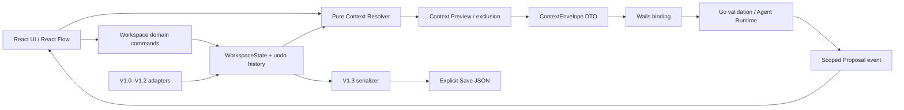
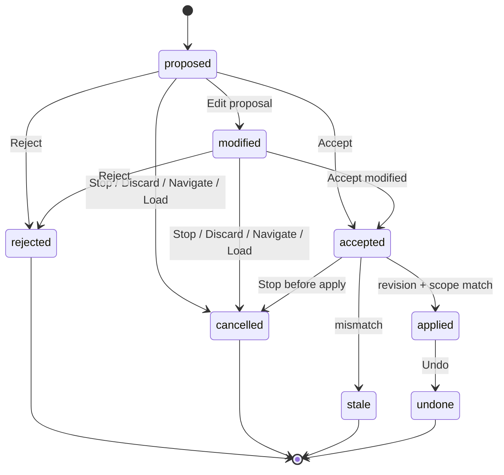
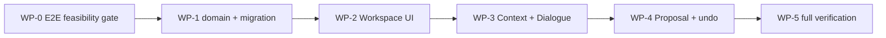

# Implementation Specification — Collaborative Workspace Foundation

## 1. Specification Boundary

この仕様は [30_requirement.md](./30_requirement.md) の REQ-01〜REQ-19 を実装する。対象は D-12 Text Node Contract、D-02 Workspace / Canvas boundary、F-1A〜D Shared Workspace Contract である。D-02 の SubCanvas集合targetと境界Relation、F-1 の将来Delegation表示先までを含めるが、F-2〜F-6 のexecutor / provider / 製品機能は実装しない。

用語は [08_glossary.md](./08_glossary.md)、domain invariant は [domain_primer.md](../cheatsheet/domain_primer.md) を正本とする。

## 2. Technical Stack

### 2.1 Adopted existing stack

- Go module: `go 1.24.4`、実行確認済み toolchain Go 1.26.1。
- Wails: Go module / CLI v2.12.0。
- Frontend: React 18.3.1、TypeScript 5.6.2、Vite 5.4.x、Zustand 5、`@xyflow/react` 12.3.x。
- Test baseline: Go `testing` / `httptest`、既存 Vite SSR logic test、Wails production build。
- Repository task runner / tool manager: `mise`。

WP-0 で `mise.toml` の floating version を、実行済み check を持つ exact versionへ pin する。少なくとも Go 1.26.1、Node 24.14.1、Wails CLI v2.12.0 を基準にする。変更後は全 baseline check を再実行する。

### 2.2 Conditional E2E candidate

`@playwright/test` 1.62.1 は CLI 起動まで確認済みだが、adopted stack ではない。WP-0 で次が成功した時だけ exact version を lockfile に残し、Go とする。

- headless browser / installed Edge channel の起動。
- Wails dev browser server から harmless Go binding を一回呼ぶ smoke。
- success / failure / timeout 時の Wails、native window、Vite、browser process cleanup。
- temp user-data isolation。

詳細は [wails_playwright_e2e.md](../cheatsheet/wails_playwright_e2e.md)。No-Go の場合は実行済み smoke を持つ代替 runner で plan を amend し、Core E2E を弱めない。

## 3. Architecture Overview



原則:

1. Workspace domain state を Frontend の正本として維持するが、React Flow presentation と domain model を分離する。
2. UI component は nodes/edges 配列を直接意味変更せず、domain command を発行する。
3. Context Resolver は pure function とし、Dialogue / Direct Action の payload builder が共有する。
4. Go Backend は request-local snapshot とbody allowlistを再検証する。時間経過後のfreshnessはFrontend domain storeのcompare-and-applyを最終権威とし、Goが保持していない最新Workspace状態を推測しない。
5. Dialogue は runtime-only、Workspace Save は versioned domain snapshot とする。

## 4. Target File Structure

既存ファイル名は実装時の最小差分に合わせて調整できるが、責務境界を維持する。

### Frontend domain / types

- `frontend/src/domain/workspace.ts`: Workspace / Canvas / Node / Relation / Focus の domain types。
- `frontend/src/domain/workspaceCommands.ts`: create、role switch、group、move、Relation、Discard、undo の pure reducer / command。
- `frontend/src/domain/workspacePersistence.ts`: V1.3 serialize / deserialize と V1.0〜V1.2 adapter。
- `frontend/src/domain/contextResolver.ts`: Context resolution と exclusion。
- `frontend/src/domain/runScope.ts`: Context digest、target revision、async resultのcompare-and-apply。
- `frontend/src/domain/proposal.ts`: Proposal state / apply receipt / inverse command。
- `frontend/src/types/index.ts`: App-facing export と互換 type。肥大化した persisted type は domain files へ移す。
- `frontend/src/types/chat.ts`: scoped request/event/proposal DTO。

### Frontend state / UI

- `frontend/src/store/useAppStore.ts`: domain command を公開する adapter。persistence / generation の直接分岐を減らす。
- `frontend/src/store/useChatStore.ts`: active Workspace 内の memory-only Dialogue と scoped run state。
- `frontend/src/components/canvas/TextNode.tsx`: role による Text / Artifact presentation。
- `frontend/src/components/canvas/FolderNode.tsx`: SubCanvas entry と boundary badge。
- `frontend/src/components/canvas/CanvasArea.tsx`: Current Canvas projection、group/move/drop、breadcrumb 連携。
- `frontend/src/components/layout/CanvasBreadcrumb.tsx`: root〜Current Canvas navigation。
- `frontend/src/components/context/ContextPreview.tsx`: Active / Candidate / Mutation / Relation target 表示と除外。
- `frontend/src/components/context/BoundaryPortal.tsx`: ancestor / sibling方向のRelation集約とnavigation。
- `frontend/src/runtime/runtimeEnvironment.tsx`: Frontend clock / ID / Backend adapter のproduction・E2E seam。
- `frontend/src/components/chat/ToolCard.tsx`: Proposal accept / modify / reject / Stop / undo。
- `frontend/src/components/drawer/EditorDrawer.tsx`: Text / Artifact role switch と filename。
- `frontend/src/components/layout/PromptBar.tsx`: shared resolver を使う Direct Action。
- `frontend/src/App.tsx`: blank start、New Workspace、Dialogue lifecycle。自動 Artifact と chat persistence effect を削除する。

旧 `CustomNode.tsx` / `ArtifactNode.tsx` は移行中 adapter として残してよいが、domain contract を二重化しない。最終的に同じ `TextNode` presentation へ集約する。

### Backend / Wails

- `backend/canvas_snapshot.go`: Workspace / Current Canvas / ContextEnvelope validation。
- `backend/agent_types.go`: scoped Proposal / resolution / event DTO。
- `backend/agent_loop.go`: common text-bearing tool contract と reject / modify / accept result。
- `backend/chat_service.go`: run-scoped proposal wait、decision / apply receipt、idempotency、cancel。Frontendの最新Workspaceを保持するregistryにはしない。
- `backend/ports.go`: ConfigStore、WorkspaceFilePort、AssetStore、LLM、Image、Event、Clock、IDのinterfaces。
- `backend/chat_session.go`: active runtime path から外す。legacy file を読込・更新・削除しない。
- `backend/file.go`: import filename、test file adapter、V1.3 JSON I/O の安全な error。
- `app.go`: production composition rootと`NewApp(options)`、E2E用in-memory / temp port injection。
- `frontend/wailsjs/`: Wails が生成する binding。手編集しない。

### Tests / tasks

- `frontend/src/tests/`: domain、migration、context、proposal logic suites。
- `frontend/e2e/`: Core E2E specs と fixture。
- `frontend/playwright.config.ts`: WP-0 Go の場合だけ採用。
- `backend/*_test.go`: validation、migration service、proposal/cancel/stale、temp-path isolation。
- `mise.toml`: `test` / `e2e` task、exact tool versions、E2E orchestration。

## 5. Domain Model

以下は契約を示す擬似 TypeScript。React Flow の `type` や generated Wails class を domain identity にしない。

```ts
type WorkspaceId = string;
type CanvasId = string;
type NodeId = string;
type RelationId = string;

interface WorkspaceDocument {
  workspaceId: WorkspaceId;
  rootCanvasId: CanvasId;
  canvases: Record<CanvasId, CanvasRecord>;
  nodes: Record<NodeId, WorkspaceNode>;
  relations: Record<RelationId, RelationRecord>;
  extensions?: Record<string, unknown>;
}

interface CanvasRecord {
  id: CanvasId;
  parentCanvasId?: CanvasId;
  folderNodeId?: NodeId;
  name: string;
  extensions?: Record<string, unknown>;
}

interface WorkspaceRuntime {
  currentCanvasId: CanvasId;
  runtimeGeneration: string; // New / Discard / Load ごとに再生成
  commandSequence: number;   // domain command成功時だけ単調増加
  scopeEpoch: number;        // Navigate / selection / Focus / exclusion等のContext scope変更で単調増加
  selection: SelectionState;
  contextSelection: ContextSelectionState;
  focus: FocusState | null;
  navigationBackStack: NavigationEntry[];
  runEpochCounter: number;
  asyncRuns: Record<string, AsyncRunState>;
}

interface AsyncRunState {
  runId: string;
  epoch: number;
  kind: "dialogue" | "direct";
  status: "active" | "cancelled" | "completed";
}

interface NavigationEntry {
  canvasId: CanvasId;
  viewport?: { x: number; y: number; zoom: number };
  highlightNodeId?: NodeId;
}

interface WorkspaceState {
  document: WorkspaceDocument;
  runtime: WorkspaceRuntime;
}

interface SelectionState {
  selectedNodeIds: NodeId[]; // UI操作順、Current Canvas所属だけ
  activeNodeId?: NodeId;
  revision: number;          // selection変更時だけ単調増加
}

interface ContextSelectionState {
  addedContextTargets: WorkspaceTargetRef[];
  explicitMutationTarget?: WorkspaceTargetRef;
  explicitRelationTargetNodeIds: NodeId[];
  includedRemoteRelationIds: RelationId[];
  candidateSeedNodeIds: NodeId[];
  excludedNodeIds: NodeId[];
  delegatedSessions: DelegatedSessionRef[];
  projectedContexts: ProjectedContextRef[];
  revision: number;
}

interface FocusState {
  id: string;
  canvasId: CanvasId;
  target?: { kind: "nodes"; nodeIds: NodeId[] } | { kind: "canvas"; canvasId: CanvasId };
  text?: string;             // 名前は必須にしない。問い・意図・制約の短文
  source: "explicit" | "selection" | "dialogue";
}

interface Provenance {
  origin: "user" | "file-import" | "llm" | "migration";
  sourceNodeIds?: NodeId[];
  operation?: string;
  provider?: string;
  model?: string;
  createdAt?: string;        // injected Clock。secret / full promptは入れない
}

interface NodeBase {
  id: NodeId;
  parentCanvasId: CanvasId;
  position: { x: number; y: number };
  order: number;             // legacy array orderを保持。tieはid昇順
  width?: number;
  height?: number;
  revision: number;
  provenance?: Provenance;
  extensions?: Record<string, unknown>;
}

interface TextBearingNode extends NodeBase {
  kind: "text";
  role: "text" | "artifact";
  content: string;
  summary: string;
  originalPrompt?: string;
  filename?: string; // text role では hidden metadata
  language: "markdown" | "text";
  charCount: number;
  wordCount: number;
  lastEditSummary?: string;
  lastEditedAt?: number;
}

interface ImageNode extends NodeBase {
  kind: "image";
  src: string;
  alt?: string;
  prompt?: string;
  provider?: string;
  model?: string;
}

interface FolderNode extends NodeBase {
  kind: "folder";
  childCanvasId: CanvasId;
  label: string;
}

type WorkspaceNode = TextBearingNode | ImageNode | FolderNode;

interface RelationRecord {
  id: RelationId;
  sourceNodeId: NodeId;
  targetNodeId: NodeId;
  kind: "context" | "source" | "derived" | "supports" | "opposes" | "similar";
  status: "accepted";
  provenance?: Provenance;
  presentation?: { sourceHandle?: string; targetHandle?: string };
  extensions?: Record<string, unknown>;
}

type WorkspaceTargetRef =
  | { kind: "nodes"; nodeIds: NodeId[] }
  | { kind: "canvas"; canvasId: CanvasId; expansion: "metadata-only" | "direct-members" };

interface ValidatedWorkspaceLoad {
  document: WorkspaceDocument;
  restoredCurrentCanvasId: CanvasId;
}

interface DelegatedSessionRef {
  kind: "delegated-session";
  sessionId: string;
  executor: string;
  focusRef?: string;
  workingDirectoryRef?: string; // opaque reference。raw pathをContextへ自動送信しない
  sourceRevision: string;
  permissions: {
    readableNodeIds: NodeId[];
    workspaceWrite: "none" | "proposal-only";
    externalNetwork: "none" | "explicit";
  };
  limits: { maxRounds: number; maxRetries: number; maxDurationMs: number; maxCost?: number };
  status: "proposed" | "running" | "stopped" | "completed" | "failed";
  provenance: Provenance;
}

interface ProjectedContextItemRef {
  itemId: string;
  summary: string;
  sourceRefs: string[];
  inference: boolean;
  uncertainty?: string;
}

interface ProjectedContextRef {
  kind: "projected-context";
  packetId: string;
  delegatedSessionId?: string;
  items: ProjectedContextItemRef[];
  provenance: Provenance;
  status: "candidate" | "adopted" | "rejected";
}
```

Foundation で product UI が作成する Relation は legacy-compatible `context` と SubCanvas move 時に維持される既存 Relation に限定する。semantic Relation proposal は F-2 で有効化する。型を先に持つことと、未検証 feature を提供することを分ける。

`DelegatedSessionRef` / `ProjectedContextRef` は F-1 Gate の予約契約であり、fixtureで表示・型検証できるようにする。本計画のproduction pathは空配列だけを渡し、executor、working directory、external provider、session persistenceを実装しない。Projected Contextを将来接続する場合も最初はCandidate欄へ入り、明示採用前にbody allowlistへ入らない。

### 5.1 Domain invariants

- `workspaceId`、Canvas ID、Node ID、Relation ID は Workspace 内で一意。
- root Canvas は parent / folder node を持たない。
- root 以外の Canvas は一つの parent Canvas と一つの Folder Node を持つ。
- Folder Node の `parentCanvasId` は child Canvas の `parentCanvasId` と一致する。
- Folder Nodeの`childCanvasId` / `label`は対応Canvasの`id` / `name`と一致し、renameは両方をatomic更新する。
- Canvas parent graph はrootへ到達する一つのacyclic treeであり、Folder subtreeを自己または子孫へ移動しない。
- 各 Node は存在する Canvas 一つだけに所属する。
- Relation endpoint は存在する Node を参照する。Canvas を跨いでも削除しない。
- `currentCanvasId` は存在する Canvas を参照する。
- selection / active nodeはCurrent Canvas所属だけ。navigation時は新Canvas外のselectionを一transactionでclearする。
- `direct-members` Canvas集合targetはCurrent Canvas自身だけを指定でき、明示時点のdirect non-folder memberを`order`, `id`順でsnapshot化する。Current Canvas上のFolderはchild Canvasの`metadata-only` targetへ正規化できるが、nested member本文は再帰展開しない。
- async run epochはruntime内で単調増加し、result適用は同じ`runId` / epochが`active`の時だけ許可する。StopはBackend callより先にlocal statusを`cancelled`へ変える。
- scope epochはCurrent Canvas、selection、Focus、Context chip / exclusionが変わるたび単調増加し、そのscopeで開始済みのrunをlocal cancelする。A→B→Aと戻っても過去epochへ戻さない。
- role switch は `id` と `revision` を維持し、role metadata 変更を一つの undoable transaction とする。
- content mutation だけが content revision を増やし、revision は単調増加する。content undo も新しい mutation として revision を増やし、過去値へ巻き戻さない。role、filename、位置、ownership の変更は domain command sequence / workspace generation で相関し、content revision を偽装しない。

## 6. React Flow Projection

`WorkspaceState` から Current Canvas の Node / Relation だけを React Flow へ projection する。

- Text-bearing node は domain `kind: text` のまま、role に応じて Text card / Artifact card を描画する。
- Folder Node は child Canvas の入口として表示する。
- 同一 Canvas 内 Relation は通常 edge として表示する。
- cross-canvas Relation は remote Node を複製せず、Canvas tree上のprojection anchorへ関係数・kind・方向を集約する。
- badge / portal click はrelation listの軽量popoverを開き、対象Canvasへnavigationしてendpointをhighlightする。Backで元のCanvas path / viewportへ戻れる。
- 初期実装では remote Node ごとの Boundary Relation Proxy を Canvas 上へ常時描画しない。

React Flow の `selected`、Editor の active node、Dialogue target を独立した正本にしない。明示選択は一つの `SelectionState` へ正規化し、各 UI が参照する。

### 6.1 Boundary projection algorithm

`projectBoundary(currentCanvasId, endpointCanvasId)` はrootから両Canvasへのpathとlowest common ancestor（LCA）を使い、次のanchorを返す。

1. endpointがCurrent Canvasなら実Nodeをanchorにする。
2. endpointがCurrent Canvasのdescendantなら、Current Canvasからendpointへ向かう最初のchild CanvasのFolder Nodeを`down-folder` anchorにする。
3. endpointがancestor、sibling、別branchなら、breadcrumb / Backの隣に一つ置く`up-boundary` portalをanchorにする。popoverにはremote Canvas pathを表示し、endpoint Canvasへ直接navigationできる。
4. Current Canvas外に両endpointがあり同じanchorへ畳まれるRelationは、そのcollapsed subtree内部の関係なので表示しない。異なるanchorへ写る場合だけ双方のbadge countへ集約する。
5. aggregate keyは`anchor kind + anchor id + relation kind + local direction + remote canvas id`。Relation ID順に安定表示し、重複countしない。

これによりrootで別child間、childでparent / sibling、nested childで別branchという全方向をFolder badgeまたはup-boundary portalで表す。個別edge proxyは将来の視認性評価後にだけ追加する。

## 7. Workspace Commands and Undo

UI は次の domain command を使う。

- `createText(role, input)`
- `createImageRef(input)` / `importTextFile(result)` / `applyAsyncGenerationResult(result, scopeToken)`
- `editTextContent(nodeId, content, baseRevision)` / `editTextMetadata(nodeId, patch)`
- `switchTextRole(nodeId, role)`
- `createSubCanvas(nodeIds, label?)`
- `dissolveSubCanvas(canvasId)` / `moveFolderSubtree(folderNodeId, destinationCanvasId, position)`
- `renameSubCanvas(canvasId, label)`
- `moveNodes(nodeIds, destinationCanvasId, positions)`
- `moveNodePositions(changes)` / `resizeNode(nodeId, dimensions)`
- `deleteNodes(nodeIds)`
- `addRelation(relation)` / `removeRelation(id)`
- `applyTextMutation(proposalResolution)`
- `setSelection(state)` / `setFocus(focus)` / `clearFocus()`
- `addContextTarget(target)` / `removeContextTarget(target)` / `setContextExcluded(nodeId, excluded)`
- `setMutationTarget(target?)` / `setRelationTargets(nodeIds)` / `setRemoteRelationIncluded(relationId, included)`
- `setCandidateSeeds(nodeIds)` / `setExternalContextRefs(refs)`
- `navigateCanvas(canvasId)` / `navigateBack()`
- `startAsyncRun(kind, runId)` / `cancelAsyncRun(runId)` / `completeAsyncRun(runId)`
- `newWorkspace()` / `discardWorkspace()` / `replaceWorkspaceAfterValidatedLoad(validatedWorkspace)`
- `undo()` / `redo()` は MVP では undo 必須、redo は optional。

mutation command は適用前後の最小 inverse data を一つの history entry にする。content undo は本文と派生 count を復元するが、revision は新たに 1 増やす。role / position / ownership の undo は content revision を変更しない。history は runtime-only で Save しない。New、Discard、Load で history を破棄し、別 Workspace へ undo を持ち越さない。

React Flow callbackは次の変換だけを許可し、domain配列を直接replaceしない。

| React Flow change | Domain command |
| --- | --- |
| position / drag stop | `moveNodePositions` |
| dimensions | `resizeNode` |
| select | `setSelection`（history外） |
| remove normal node | `deleteNodes` |
| remove Folder Node | generic deleteを拒否し、`dissolveSubCanvas` previewへ誘導 |
| connect / edge remove | `addRelation` / `removeRelation` |
| reset / replace | 通常UIでは禁止。validated Load / New / Discardのatomic replacementだけ |

`deleteNodes` は通常Nodeとincident Relationを同じundoable transactionで削除する。Folder Node / Canvasのcascade deleteは提供しない。`dissolveSubCanvas` はdirect member（nested Folder subtreeを含む）をparentへidentity-preserving moveし、空になったCanvasとFolderを削除する。Folder自身がRelation endpointならrewireを推測せず変更なしで拒否し、対象Relationの確認を促す。undoはCanvas、Folder、member placementを同一transactionで復元する。

Folderをgroup / move対象に含める場合はsubtree moveとして扱い、Folderの`parentCanvasId`とchild Canvasの`parentCanvasId`を同時更新する。destinationがchild Canvas自身またはdescendantならcycle errorで全変更を拒否する。nested Folderのdescendant ownershipは変更しない。

`applyAsyncGenerationResult` と `applyTextMutation` は§13のscope tokenをdomain storeへcompare-and-applyする唯一の入口とする。scope mismatch時はNodeを作成・変更せずstale resultを返す。

selection / Focus / ContextSelection commandはhistory外のruntime transactionである。valid inputへnormalizeしてstate revisionとscope epochを同時に増やし、そのscopeのactive runを同じtransactionでlocal `cancelled`にする。transaction成功後、取り出したrun IDすべてへbest-effort `CancelRun`を送る。Backend到達を安全性の前提にはしないが、human waitを残さないため必ず試行する。NavigateはselectionとContextSelectionをclearし、New / Discard / Loadはruntime全体を初期化する。

手動edit / move / delete等のdomain command成功後もactive run tokenを新stateへ照合し、digest / target revision / membershipが変わったrunをlocal cancelしてbest-effort `CancelRun`する。例外は同じrunのaccepted Proposal applyで、§14.2のverified `nextScope`へatomic refreshする場合だけである。

`replaceWorkspaceAfterValidatedLoad`は`ValidatedWorkspaceLoad.document`を一回で置換し、`restoredCurrentCanvasId`を新しいruntimeへ設定する。generation、selection、Focus、navigation、history、async run registryは同じtransactionで初期化する。top-level / Canvas / Node / Relationの`extensions`はdomain objectに保持し、次Saveへroundtripする。

Node / Relation の物理 image file は history entry に含めず、undo / Discard で file を削除しない。

## 8. Text / Artifact Role Contract

### 8.1 Creation defaults

- `+ Text`: empty Text role、summary fallback `New Text`。
- `+ Artifact`: Artifact role、default body は空。filename は `untitled.md` を仮値として表示する。
- text LLM result: Text role。
- `.txt` / `.md` import: Artifact role、Backend が basename を返して保持する。
- legacy `customNode`: Text role。
- legacy `artifactNode`: Artifact role。

初期 Workspace に Node は作らない。

### 8.2 Role switch

- Text → Artifact は本文 first heading / summary から filename slug を提案する。
- filename sanitization は既存 Backend rule と整合し、空の場合 `untitled.md`、拡張子がなければ `.md`。
- 同一 Canvas 内 collision は表示上警告する。通常Exportはnative dialogでユーザーが確定したpathを使い、存在時の扱いを自動連番と仮定しない。既存Artifact tool-createのunique-name規則は、そのtool内部だけの互換挙動として別testに残す。
- Artifact → Text は filename editor と Artifact preview を隠すが `filename` を削除しない。
- role switch は modal を出さず即時、undo 可能。
- role は Outcome status ではない。別の `promoted` flag を追加しない。

### 8.3 Agent tools

Backend snapshot では Text / Artifact をどちらも `type: text` + `role` として扱う。

- common: list / search / read / edit text-bearing nodes。
- Canvas集合target: 明示`Use this Canvas as context`時だけ、authorized direct membersを一つのscopeとして`describe_current_canvas` / `list_authorized_nodes`へ渡す。nested Canvasは再帰展開せず、親Folderから子本文を読まない。
- file-oriented: filename read / update、明示的な Artifact create / export に必要な operation。
- 旧 Artifact 専用 tool 名を互換 alias として一時受理してよいが、system prompt と新 request は common contract を使用する。
- 現行`write_artifact`のcreate pathは削除せず、`create-text` proposal（Artifact role）へ変換する。既存Node editは`edit-text` proposalへ変換する。
- provider の opaque `extra_content` は既存どおり無変更で再送する。

## 9. Workspace / Canvas / SubCanvas UX

### 9.1 Header and blank start

- `App.tsx` の initial Artifact effect を削除する。
- Header は `+ Text`、`+ Artifact`、`New Workspace` を提供する。
- `New Workspace` の accessible name は破棄を含む意味が分かる文言にし、tooltip で「現在の未保存作業と Dialogue を破棄」と示す。
- D-06 に従い save confirmation modal は出さない。

### 9.2 Create SubCanvas

- 2 個以上の Current Canvas Node を選び、context menu の `Create SubCanvas` を実行する。
- 選択 Node を新 child Canvas へ identity-preserving move し、親に Folder Node を一つ作る。
- label は first non-empty summary から短く提案し、fallback は `Group`。作成を止める命名 modal は出さない。
- 対象 Node、移動先、cross-canvas Relation 数を compact preview し、明示 action 自体を承認として適用する。
- 直後に undo を提供する。
- Folderを含む選択はsubtreeとしてpreviewし、cycleになるgroup化は実行前に拒否する。

### 9.3 Navigation and move

- Folder Node activate で child Canvas へ drill-down。
- Header 下に clickable breadcrumb を常時表示し、root / ancestor へ移動できる。
- browser-style Back action で一つ前の Canvas path へ戻る。
- `Move to parent` と `Move to…` は Current Canvas 選択 Node にだけ表示する。
- `Dissolve SubCanvas` はmemberの移動先、Folder endpoint Relation、undo可否をpreviewする。Folder endpoint Relationが残る場合は拒否し、cascade deleteしない。
- Canvas headerの`Use this Canvas as context`はCurrent Canvasのdirect non-folder memberだけをstable集合targetにする。nested Folder本文は含めず、親CanvasのFolder選択から子本文を展開することもしない。
- navigation は Dialogue session を維持するが、Context / Mutation scope を即時に新 Current Canvas へ切り替える。
- navigation 前の pending proposal は新 Canvas へ適用せず stale とする。

### 9.4 Focus controls

- Headerのoptional Focus chipから短いtextをset / edit / clearできる。空Workspace開始時に入力を要求しない。
- `Set selection as Focus`はCurrent CanvasのNode集合または明示Canvas targetを`FocusState.target`へ入れる。selection変更だけでは既存Focusを自動上書きしない。
- Dialogueから暫定Focusを提案してよいが、人間が採用するまではCandidateであり`setFocus`を発行しない。
- FocusはSaveせず、New / Discard / Loadでclearする。navigationでは履歴として保持するが、targetがCurrent Canvas外ならContext ResolverはCandidate bodyを展開しない。

## 10. Persistence

### 10.1 V1.3 JSON shape

```json
{
  "version": "1.3",
  "metadata": {
    "workspaceId": "...",
    "rootCanvasId": "...",
    "currentCanvasId": "...",
    "lastOpened": "2026-08-11T...Z"
  },
  "canvases": [
    { "id": "root", "name": "Workspace" },
    { "id": "child", "parentCanvasId": "root", "folderNodeId": "folder-1", "name": "Group" }
  ],
  "nodes": [],
  "relations": []
}
```

実装契約は次のdiscriminated unionとする。JSON keyはこの擬似TypeScriptと同名、数値はfinite、文字列IDはnon-emptyとする。

```ts
interface CanvasFileV1_3 {
  version: "1.3";
  metadata: {
    workspaceId: string;
    rootCanvasId: string;
    currentCanvasId: string;
    lastOpened?: string; // ISO-8601、injected Clock
  };
  canvases: PersistedCanvasV1_3[];
  nodes: PersistedNodeV1_3[];
  relations: PersistedRelationV1_3[];
  extensions?: Record<string, unknown>;
}

interface PersistedCanvasV1_3 {
  id: string;
  name: string;
  parentCanvasId?: string;
  folderNodeId?: string;
  extensions?: Record<string, unknown>;
}

interface PersistedNodeBaseV1_3 {
  id: string;
  parentCanvasId: string;
  position: { x: number; y: number };
  order: number;
  revision: number;
  width?: number;
  height?: number;
  provenance?: Provenance;
  extensions?: Record<string, unknown>;
}

interface PersistedTextNodeV1_3 extends PersistedNodeBaseV1_3 {
  kind: "text";
  role: "text" | "artifact";
  content: string;
  summary: string;
  originalPrompt?: string;
  filename?: string;
  language: "markdown" | "text";
  lastEditSummary?: string;
  lastEditedAt?: number;
}

interface PersistedImageNodeV1_3 extends PersistedNodeBaseV1_3 {
  kind: "image";
  src: string; // asset root配下のrelative reference
  alt?: string;
  prompt?: string;
  provider?: string;
  model?: string;
}

interface PersistedFolderNodeV1_3 extends PersistedNodeBaseV1_3 {
  kind: "folder";
  childCanvasId: string;
  label: string;
}

type PersistedNodeV1_3 =
  | PersistedTextNodeV1_3
  | PersistedImageNodeV1_3
  | PersistedFolderNodeV1_3;

interface PersistedRelationV1_3 {
  id: string;
  sourceNodeId: string;
  targetNodeId: string;
  kind: "context" | "source" | "derived" | "supports" | "opposes" | "similar";
  status: "accepted";
  provenance?: Provenance;
  presentation?: { sourceHandle?: string; targetHandle?: string };
  extensions?: Record<string, unknown>;
}
```

`charCount` / `wordCount` は`content`からload時に再計算するderived fieldで、V1.3へ保存しない。`focus`、selection、navigation back-stack、runtime generation、command sequenceもruntime-onlyである。known `1.3` objectの未知fieldは黙って捨てずvalidation errorにする。拡張dataは明示`extensions`配下だけを許可し、そのobjectはroundtripで保持する。

Deserializerは`ValidatedWorkspaceLoad { document, restoredCurrentCanvasId }`を返す。`document`はtop-level / Canvas / Node / Relation extensionsを持ち、`restoredCurrentCanvasId`はmetadata値をtree検証後に保持する。Serializerは`WorkspaceState.document`と現在の`runtime.currentCanvasId`を合わせてV1.3を作る。

保存するもの:

- Workspace / Canvas IDs、current path。
- Node domain data、position、dimensions、ownership、content revision、必要な provenance。
- accepted Relation と presentation metadata。

保存しないもの:

- Dialogue / Chat messages / Tool logs。
- Focus、selection、ContextSelection / Candidate Context、pending Proposal、run、undo history、runtime generation / scope epoch。
- credential / config。

### 10.2 Migration

V1.0〜V1.2 load adapter:

1. source object を変更せず parse / validate する。
2. V1.2のnon-empty `metadata.canvasId`を`workspaceId`として採用する。V1.0/1.1または欠損時はinjected ID generatorで一度だけ生成する。
3. root Canvas IDは`legacy-root:${workspaceId}`とする。Canvas / Node / Relationは別namespaceだが、各namespace内duplicateを拒否する。全legacy Nodeの`parentCanvasId`をrootにする。
4. `customNode` → Text role、`artifactNode` → Artifact role、`imageNode` → Image kind。
5. legacy edge → `kind: context`, `status: accepted` Relation。handle metadataをpresentationへ、旧`type` / `markerEnd`を`extensions.legacyPresentation`へ保持する。edge ID欠損時だけsource file順の`legacy-edge:${index}:${source}:${target}`を使い、collisionはload errorにする。
6. `currentCanvasId` は root、Focus / Dialogue / history は空にする。
7. legacy node array indexを`order`にする。既知data field以外は`extensions.legacyData`、top-level `llm`は`extensions.legacyFileMetadata.llm`へ移し、次の1.3 Saveでも保持する。
8. invariantを検証してから一回のstore replacementで適用する。

| Source | Node mapping | Workspace ID | Normalization |
| --- | --- | --- | --- |
| V1.0 | 全nodeを`customNode`相当のText roleとして読む | injected | missing content/summaryは空文字、revisionは0、languageはmarkdown |
| V1.1 | `customNode`→Text、`artifactNode`→Artifact、`imageNode`→Image | injected | Text/Artifactのmissing countは再計算、Artifact filename空は`untitled.md` |
| V1.2 | V1.1と同じ | `metadata.canvasId`、invalid/emptyならinjected | `lastOpened`を可能なら保持、全nodeをrootへ所属 |

全versionでnode ID、position、edge endpointは必須とする。未知node type、duplicate node/edge ID、non-finite position、missing relation endpointはtransactional load errorにし、`customNode` fallbackでsilent coercionしない。fixture matrixは各versionのText / Artifact / Image、unknown data保持、handle、空/欠損metadata、duplicate、missing endpoint、unknown node、unknown versionを含める。

unknown version、unknown V1.3 field、duplicate ID、missing Canvas、missing endpoint、Folder↔Canvas不一致、cycle in Canvas parent tree は load error。現在の Workspace を保持し、部分適用しない。

### 10.3 Legacy chat data

- Frontend の `LoadChatSessions` / `SaveChatSessions` effects と beforeunload flush を削除する。
- Backend の legacy service/file は自動読込・更新・削除しない。
- 互換 rollback のため source code を直ちに消す必要はないが、active App binding から外す。
- legacy file cleanup は別の明示的・破壊的 migration plan がある場合だけ行う。

## 11. Dialogue Lifetime

`useChatStore` は active `workspaceId` / `runtimeGeneration` に scope する memory-only store とする。

- New / Discard / Load で全 session、message、active run、pending proposal を clear / cancel。
- app close は memory release だけでよく、async persistence を行わない。
- same Workspace 内の Canvas navigation では session を維持する。
- Focus / selection 変更で session を自動切替しない。
- Agent requestの`history`はcurrent turnより前に完了した直近12件のuser/assistant messageを時系列で含め、current user入力は`input`へ一度だけ入れる。system prompt、tool event、raw log、stream途中chunk、error message、cancelled assistant partialはhistoryへ数えない。
- Stopされたrunのuser messageとpartial assistant textはUIにstatus付きで残してよいが、partial assistant textを次requestへ暗黙再送しない。必要なら人間が明示引用する。
- UI 表示と Agent に送る history を同じ bounded list から作り、表示だけ残って Context に使われない状態を避ける。

## 12. Context Resolver

### 12.1 Input

```ts
interface ResolveContextInput {
  document: Readonly<WorkspaceDocument>;
  runtime: Readonly<Pick<WorkspaceRuntime,
    "currentCanvasId" | "runtimeGeneration" | "commandSequence" | "scopeEpoch" | "selection" | "contextSelection" | "focus">>;
  mode: "dialogue" | "direct";
  operation: "read" | "summarize" | "generate-text" | "generate-image" | "mutate-text" | "relate" | "group" | "move";
}
```

### 12.2 Output

```ts
interface ContextEnvelope {
  workspaceId: string;
  canvasId: string;
  runtimeGeneration: string;
  scopeEpoch: number;
  commandSequenceAtResolve: number;
  focus?: FocusState;
  activeContextNodeIds: string[];
  activeCanvasTargets: Array<{ canvasId: CanvasId; expansion: "metadata-only" | "direct-members" }>;
  candidateContextNodeIds: string[];
  delegatedSessionRefs: DelegatedSessionRef[]; // local preview only
  projectedContextRefs: ProjectedContextRef[]; // local Candidate preview only
  mutationTarget?: WorkspaceTargetRef;
  relationTargetNodeIds: string[];
  bodyAllowlistNodeIds: string[];
  payloadItems: ContextPayloadDescriptor[];
  excludedNodeIds: string[];
  warnings: ContextWarning[];
  contextDigest: string;
}

type WireContextEnvelope = Pick<ContextEnvelope,
  "workspaceId" | "canvasId" | "runtimeGeneration" | "scopeEpoch" | "activeContextNodeIds" | "activeCanvasTargets" |
  "mutationTarget" | "relationTargetNodeIds" | "bodyAllowlistNodeIds" |
  "payloadItems" | "contextDigest">;

type ContextPayloadDescriptor =
  | { kind: "text"; nodeId: NodeId; destination: "llm" | "image-provider" }
  | { kind: "image-metadata"; nodeId: NodeId; destination: "llm" | "image-provider" }
  | { kind: "image-binary"; nodeId: NodeId; destination: "llm" | "image-provider" }
  | { kind: "canvas-metadata"; canvasId: CanvasId; destination: "llm" }
  | { kind: "remote-relation-metadata"; relationId: RelationId; destination: "llm" };
```

### 12.3 Resolution rules

Dialogue / Direct Actionの両payload builderは同じ`buildResolveInput()`を使う。`ContextSelectionState`をchip / exclusion / explicit targetの唯一の正本とし、component local stateへ複製しない。send時のsanitized `runtime.selection.selectedNodeIds`をUI操作順のNode targetとしてeffective targets先頭へ入れ、`runtime.contextSelection.addedContextTargets`をその後へ並べ、`excludedNodeIds`を適用する。したがって同じselectionとContextSelectionは両入口で同じActive Contextになり、selectionを全Canvas送信へ拡張しない。

1. `document`のtree / ownership / endpoint invariantを確認し、runtimeのCurrent Canvasとselectionが一致しなければwarning付きで無効IDを除く。resolverは入力を変更しない。
2. effective targetsを入力順に展開する。通常Node targetはCurrent Canvas所属だけを許可する。Folder Node targetは対応child Canvasの`metadata-only` targetへ正規化し、label / path / direct member countだけをdescriptorにする。`direct-members` Canvas targetはCurrent Canvas自身だけを許可し、direct non-folder memberを`order`, `id`順で展開する。子本文を親Folderから、nested memberを再帰的に展開しない。
3. accepted `context` RelationのupstreamをCurrent Canvas内だけbreadth-firstに辿る。同じdepthではRelation ID、source Node `order`, ID順とし、stable de-duplicateする。branchは複数材料、loopは一度だけvisitしてwarningにする。
4. Candidateは`contextSelection.candidateSeedNodeIds`、Current Canvas内のFocus target、active editor node、Active Contextから一hopの未採用Relation endpointの順に作る。重複、Active、excluded、remoteを除く。`contextSelection.projectedContexts`はCandidate表示先にだけ追加し、node bodyを展開しない。
5. mutation targetは`contextSelection.explicitMutationTarget`を最優先する。Dialogueだけは明示targetがない時にCurrent Canvasのactive editor nodeを単一Node target候補にできる。Direct Actionはoperation requestにtargetがなければmutationを行わない。Canvas mutation targetはoperationが集合対応を宣言した場合だけ許可する。
6. Relation targetは`contextSelection.explicitRelationTargetNodeIds`だけを入力順に採用する。Candidateやremote endpointを暗黙targetにしない。
7. `contextSelection.excludedNodeIds`はActiveとbody allowlistから同じNodeを除く。mutation targetを除外した場合はtargetもclearしてwarning、operationがtarget必須ならsendを禁止する。Candidateはもともとbody allowlistへ入らない。
8. `bodyAllowlistNodeIds`は除外後Active Contextと、operationが本文を必要とする明示mutation targetの和集合だけである。relation target、Current Canvas全体、remote endpoint、Candidateは自動追加しない。
9. cross-canvas Relationはlocal UI projection用metadataとしてwarningへ出す。人間がboundary popoverの`Include relation metadata`を選んだIDだけを`contextSelection.includedRemoteRelationIds`からdescriptor / authorized metadataへ入れ、kind / direction / endpoint ID / Canvas pathをpreviewする。remote bodyは常に禁止する。
10. targetless Dialogue / Direct Actionは全Canvasを自動送信しない。canonical descriptor + authorized bodyのSHA-256を`contextDigest`にし、request作成直前に再解決する。

### 12.4 Payload materialization and image boundary

ResolverはIDとdescriptorだけを返し、payload builderが`bodyAllowlistNodeIds`から本文をmaterializeする。Goへ送るsnapshotも同じallowlistだけを含む。

- text-bearing Node: `text` itemとして本文を送る。
- Folder Node selection: child Canvasのlabel / path / direct member countだけを`canvas-metadata`として送り、member bodyは送らない。Canvas chipを外すとdescriptor / payloadの双方から消える。
- included cross-canvas Relation: kind / direction / endpoint ID / Canvas pathだけを`remote-relation-metadata`として送り、remote summary / bodyは送らない。
- image in Dialogue Agent: `alt`、`prompt`、basename等のpreview済みmetadataだけを`image-metadata`として送り、pixelは送らない。UIに`metadata only`を表示する。
- text generation Direct Action: 現行vision routeを維持し、人間が明示選択したimageを`image-binary` / destination `llm`として送れる。PromptBar previewに各imageとLLM送信を表示する。
- image generation Direct Action: 人間が明示選択したimageだけを`image-binary` / destination `image-provider`にし、Backend `AssetStore`がasset root内の相対pathを検証してprovider contentへ変換する。data URL / bytesをWorkspace JSON、log、traceへ保存しない。
- F-4まではDialogue Agentへ`image-binary`を許可しない。mode / operation / destinationが上記matrixと一致しないbinary descriptorはGo validation errorにする。

Agentのlist / search / read toolも`bodyAllowlistNodeIds`だけを対象にする。未採用Candidateを発見するためCurrent Canvas全snapshotを渡す方式は廃止する。toolに見えるID / summary / metadataを増やす場合も、それ自体をContext Previewの送信項目として先に表示する。

### 12.5 Context preview

Chat header と PromptBar の共通 `ContextPreview` は次を表示する。

- `Context N`、text / image count、Current Canvas breadcrumb。
- Mutation Target と Relation Target。
- destination、text / image-metadata / image-binary、Canvas集合targetの展開件数、body access範囲。
- warning（loop、remote relation、excluded item、stale selection）。
- disclosure 内に Node summary / filename / image label と除外 toggle。
- future fixtureが存在する場合だけ、`External work`へDelegated Sessionのexecutor / permission / limit / status / Stop位置、`Candidate Context`へProjected Contextのsource / inference / uncertaintyを表示する。productionでは空sectionを常時見せない。

毎回modalを出さず、送信直前までinlineで修正できる。chip add/remove、exclude toggle、Mutation / Relation target変更は必ず§7のContextSelection commandをdispatchし、Chat / PromptBar component local stateだけを変更しない。

## 13. Wails / Go DTO and Validation

非同期処理は同じscope tokenをechoする。Frontend store以外に最新Workspaceの正本を増やさない。

```ts
interface RunScopeToken {
  workspaceId: WorkspaceId;
  canvasId: CanvasId;
  runtimeGeneration: string;
  scopeEpoch: number;
  runId: string;
  runEpoch: number;
  sessionId?: string;
  contextDigest: string;
  targetRevisions: Record<NodeId, number>;
  canvasMembershipFingerprint?: string;
}

type AuthorizedContextItem =
  | { kind: "text"; nodeId: NodeId; parentCanvasId: CanvasId; revision: number; content: string }
  | { kind: "image-metadata"; nodeId: NodeId; parentCanvasId: CanvasId; alt?: string; prompt?: string; basename: string }
  | { kind: "image-binary-ref"; nodeId: NodeId; parentCanvasId: CanvasId; assetRef: string; mimeType: string }
  | { kind: "canvas-metadata"; canvasId: CanvasId; parentCanvasId?: CanvasId; name: string; directMemberCount: number }
  | { kind: "remote-relation-metadata"; relationId: RelationId; localNodeId: NodeId; remoteNodeId: NodeId; remoteCanvasId: CanvasId; direction: "incoming" | "outgoing"; relationKind: RelationRecord["kind"] };

interface ScopedNodeMeta {
  nodeId: NodeId;
  parentCanvasId: CanvasId;
  kind: WorkspaceNode["kind"];
  revision: number;
}

interface ScopedCanvasMeta {
  canvasId: CanvasId;
  parentCanvasId?: CanvasId;
  folderNodeId?: NodeId;
  name: string;
}

interface ScopedRelationMeta {
  relationId: RelationId;
  sourceNodeId: NodeId;
  sourceCanvasId: CanvasId;
  targetNodeId: NodeId;
  targetCanvasId: CanvasId;
  kind: RelationRecord["kind"];
}

interface ScopeCatalog {
  nodes: ScopedNodeMeta[];
  canvases: ScopedCanvasMeta[];
  relations: ScopedRelationMeta[];
}

interface ChatRequest {
  scope: RunScopeToken;
  input: string;                         // current user message、一度だけ
  history: Array<{ role: "user" | "assistant"; content: string }>;
  context: WireContextEnvelope;
  scopeCatalog: ScopeCatalog;            // Go validation専用、providerへ転送しない
  authorizedSnapshot: AuthorizedContextItem[];
}

interface DirectActionRequest {
  scope: RunScopeToken;
  operation: "generate-text" | "generate-image" | "summarize";
  instruction: string;
  executionOptions: {
    llmProvider?: string;
    imageProvider?: string;
    model?: string;
    outputRole?: "text" | "artifact";
  }; // identifierのみ。credentialは含めない
  context: WireContextEnvelope;
  scopeCatalog: ScopeCatalog;
  authorizedSnapshot: AuthorizedContextItem[];
}

interface DirectActionResult {
  scope: RunScopeToken;
  resultId: string;
  kind: "text" | "image-ref";
  value: string;
  provenance: Provenance;
}
```

`authorizedSnapshot`のtext / image itemは`bodyAllowlistNodeIds`と一対一にする。canvas / cross-canvas relation metadataはbody allowlist外だが、必ず対応するpreview済みdescriptorと`scopeCatalog` recordを持つ。remote bodyや全Current Canvas snapshotを含めない。`DirectActionRequest/Result`は旧`GenerateText*` / `GenerateImage*` bindingを段階的に置換する。

Go validation:

- request / scope / envelope のWorkspace・Canvas・generation・run IDが内部一致する。
- snapshot itemはCurrent Canvas Nodeか、明示preview済みremote metadataだけであり、snapshot body ID集合はbody allowlistと一致する。
- Active / Mutation / Relation target IDは`scopeCatalog.nodes`上でCurrent Canvas所属と一致する。Canvas metadata targetはcatalog上のFolder↔child Canvas対応、remote relation metadataは`scopeCatalog.relations`のsource/target/directionと両endpoint ownershipに一致する。catalogに必要なancestor pathとreferenced endpoint metadataを含めるが、provider message / Agent toolへ転送しない。Candidate / exclusions / Delegated Session / Projected Contextはlocal preview stateでありwire envelope自体へ入れない。
- duplicate ID、missing endpoint、unsupported role/kind を拒否する。
- request受理時のmutation base content revisionとsnapshot revisionを照合する。
- toolsのlist / search / readはauthorized snapshotかつbody allowlistだけを見る。
- Dialogue Agentのimage-binary、asset root外path、mode / operation / destination / payload kindの不一致を拒否する。Direct Action text visionのLLM binaryとimage generationのprovider binaryは許可matrixを別testにする。
- `executionOptions`はconfigured provider/model identifierだけを受け、API key等のcredential fieldをDTO schemaで受理しない。DirectActionResultのprovenanceは実際に使ったprovider/modelをechoする。

Frontend が送らなかった remote body を Backend が別 store から補わない。

### 13.1 Freshness authority and lifecycle

Backendはrequest-local validationと、`runId` / `proposalId`に紐づくpending stateだけを保持する。最新の`runtimeGeneration`、Current Canvas、Node ownershipを持つWorkspace registryは作らない。

1. Frontendは`startAsyncRun`で単調増加`runEpoch`を割り当ててactive registryへ入れ、send直前にresolverを再実行する。target revision、Canvas集合targetの`nodeId@revision`をorder順にhashしたmembership fingerprint、context digest、scope epoch、run ID / epochをtokenへ入れる。
2. Navigate、selection / Focus / Context chip変更、Load、New、Discard時はscope epochを増やし、そのscopeのactive runをlocal `cancelled`にした後、各runへbest-effort `CancelRun`を送る。Stopもまず同一Frontend transactionで対象runを`cancelled`にしてからBackendへ送る。cancel eventの到達は安全性の前提にしないが、Backendの無期限human waitを解放するため全scope変更で送信を試行する。
3. Result / Proposal event受信時、Frontendの`compareScope(currentState, token)`がworkspace ID、generation、scope epoch、Current Canvas、context digest、target revision、membership fingerprintに加え、同じrun ID / epochがまだ`active`かを照合する。
4. mismatchまたはrun cancelled/completedならdomain commandを一切発行せず`stale` / `cancelled` receiptを返す。Direct Action resultのmatch時だけcompare-and-applyとrun `completed`化をatomicに行う。Dialogue Proposal applyはproposalをconsumeするがrunをactiveのまま保ち、§14.2のnext scopeへrefreshする。最終assistant response時にrunを`completed`にする。
5. Backendはreceiptを元run/proposalと相関するが、Frontendの最新状態を独自推測しない。

これによりStop / cancelとDecisionAck・Direct Action resultがraceしても、late result / proposalを適用できない。`runtimeGeneration`はNew / Discard / Loadで変え、Navigateは同generationでもscope epochを進めるため、A→B→Aで同じCanvas / Contextへ戻っても旧tokenは一致しない。

## 14. Proposal State Machine



### 14.1 Proposal record

- proposal ID / provider tool call IDを分離し、§13のscope tokenを持つ。
- operation、reason、diff / proposed content、target Node / Canvas、base revision、provenanceを持つ。
- state、resolution actor/time、decision ID、apply receipt / errorを持つ。

```ts
type ProposalOperation =
  | { kind: "edit-text"; targetNodeId: NodeId; baseRevision: number; content: string }
  | { kind: "create-text"; role: "text" | "artifact"; content: string; summary: string; filename?: string; placement: { canvasId: CanvasId; position: { x: number; y: number } } }
  | { kind: "switch-role"; targetNodeId: NodeId; role: "text" | "artifact" }
  | { kind: "move-nodes"; nodeIds: NodeId[]; destinationCanvasId: CanvasId }
  | { kind: "create-subcanvas"; nodeIds: NodeId[]; label?: string }
  | { kind: "add-relation"; relation: RelationRecord }
  | { kind: "remove-relation"; relationId: RelationId };

interface ProposalEvent {
  scope: RunScopeToken;
  proposalId: string;
  providerToolCallId: string;
  operation: ProposalOperation;
  reason: string;
  diff: string;
  provenance: Provenance;
}

interface ProposalDecision {
  scope: RunScopeToken;
  proposalId: string;
  decisionId: string;
  decision: "accept" | "modify" | "reject";
  modifiedOperation?: ProposalOperation;
}

interface ProposalApplyReceipt {
  scope: RunScopeToken;
  proposalId: string;
  decisionId: string;
  receiptId: string;
  status: "applied" | "stale" | "conflict" | "cancelled" | "error";
  resultingRevision?: number;
  createdNodeId?: NodeId;
  nextScope?: RunScopeToken;
  errorCode?: string;
}
```

`modify`は同じoperation kindと許可済みtarget scope内に限る。本文、Relation kind/direction、label等の編集はできるが、別Node / Canvasへのtarget拡張や追加permissionは新proposalを要求する。`create-text`のplacement CanvasはscopeのCurrent Canvasに固定し、Node IDはaccept時にFrontend injected ID generatorが一度だけ発行する。role / filename / positionはpreview対象で、applyは一つのhistory entry、undoは作成Nodeと同proposal内Relationだけを戻す。decision / receipt IDの再送で二重Nodeを作らない。

本計画のAgent production pathは現行回帰を避けるため`edit-text`と`create-text`を必須実装とする。他operationはhuman commandと共通state/reducer fixtureでprotocol互換を検証する。semantic Relation suggestionの製品導線はF-2まで有効化しない。

### 14.2 Human wait

Wails protocolは人間decisionとFrontend applyを分離する。

1. Backendは`chat:proposal` eventをemitし、run context内のpending proposalを待つ。人間decisionには固定timeoutを設けない。
2. Frontendは`ResolveProposal(decision)`を呼ぶ。Backendはscope、proposal state、decision payloadをatomicに検証し、`DecisionAck`を返す。rejectはここでterminalにする。
3. accept / modifyの`DecisionAck`後、Frontendは§13.1のcompare-and-applyを一度だけ行う。
4. Frontendはapply後に同じselection / Context chipを再解決し、更新されたdigest / target revision / membership fingerprintを`nextScope`へ入れて`AcknowledgeProposalApply(receipt)`を呼ぶ。createではFrontendが割り当てた`createdNodeId`も返す。Backendは元scopeとexpected operation resultを検証してrun-local token / authorized snapshotをrefreshし、receipt後だけprovider tool resultをsuccessにする。stale / conflict / cancelled / errorは変更成功と報告しない。
5. `GetProposalState(proposalId)`をreconnect / receipt再送の照合に使えるようにする。

`decisionId`と`receiptId`をidempotency keyとする。同一ID・同一payloadの再送は同じresultを返し、異なるpayloadまたは二つ目のdecisionは`already_resolved`で拒否する。apply receipt再送も同じresultを返す。BackendはFrontend stateを再適用しない。next scopeのrun ID / epoch / generation / Canvasは変えず、revision / digest / membershipだけexpected operationに整合する値へ進める。合わなければrunをconflictで停止する。

現行10秒timeoutは人間waitから削除する。DecisionAck後の機械的apply receiptだけに短いtechnical timeoutを設定してよいが、timeout時は`apply_unknown`として再適用せず`GetProposalState` / receipt再送で照合する。Stop、Discard、Load、Navigate、app shutdown、provider cancellationはpending waitを解除する。race時の最終安全性はFrontend compare-and-applyが担う。

rejectはproviderへ`rejected_by_user`、modified acceptは最終適用operation、stale/conflictは再読込・再提案が必要なresultを返し、loopが人間判断を認識できるようにする。

### 14.3 Direct Action

ユーザーが operation と対象を明示して起動した Direct Action は、その invocation 自体を承認とする。AI が別 target や別 operation を選ばない限り proposal wait を挟まない。ただし新規 Variant、role switch、group/move は domain command と undo receipt を持つ。

## 15. Error Handling

| Failure | Behavior | State guarantee |
| --- | --- | --- |
| V1.3 parse / invariant error | file と原因を通知し、load 前 state を維持 | no partial replacement |
| Context scope mismatch | send / apply を中止し、preview を再解決 | no remote body / mutation |
| stale proposal | Proposal card を stale 表示、再読込を提示 | no mutation |
| reject / Stop | Backend wait を解除し、providerへ明示 result | no mutation |
| Wails event / Direct Action result after navigation/load | Frontend scope compareでstale/cancelled receipt | no cross-workspace apply |
| undo reducer / invariant failure | inverseをcommitせずerror、history cursor / content revision / command sequenceを維持 | original state remains current |
| Save/export cancel | silent normal return | Workspace unchanged |
| Backend/file failure | actionable message + retry | no optimistic partial success |
| E2E child process timeout | process tree cleanup、non-zero exit、trace path | no residual server/user-data write |

error message は secret、full prompt、raw Chat、provider opaque metadata を表示・保存しない。

## 16. Import / Export

- Backend `ImportFileResult` に `filename` を追加する。
- `.md` / `.txt` import は Artifact role + original basename。
- image import の現行 relative asset handling を維持する。
- Text export は hidden filename があれば候補に使い、なければ summary 由来。
- Artifact export は visible filename を既定にする。
- Export は selected Node content だけを Backend に渡す。
- Save / Export の native dialog は production で現行 adapter、E2E では temp path adapter を使う。
- file cancel は error ではなく変更なしで戻る。

## 17. E2E Harness Design

### 17.1 Composition root

constructor side effectをなくし、production composition rootとE2E composition rootを分ける。`ChatService`を含むserviceは具象`*LLMService`や`os.UserConfigDir()`ではなく次のportへ依存する。

```go
type AppOptions struct {
    Config ConfigStore
    Dialog DialogPort
    Files FileSystemPort
    Assets AssetStore
    LLM LLMPort
    Image ImagePort
    Events EventPort
    Clock Clock
    IDs IDGenerator
    FaultPlan E2EFaultPlan // e2e only; productionではnil必須
    Mode RuntimeMode // production | e2e
}
```

`NewProductionApp()`だけがOS ConfigStore、native Dialog、real FileSystem / AssetStore、provider clientsを構築する。`NewApp(options)`は渡されたportのnon-nil / mode invariantを検証するだけで、constructor中にreal config/chat fileをread/writeしない。Config loadは注入後のstartup lifecycleで行う。legacy `ChatSessionService`はproduction / E2Eどちらのactive graphにも入れない。

E2EはMemoryConfigStore、root-guard付きTempFileSystem / TempAssetStore、FixtureLLM / FixtureImage、capturing EventPort、FakeClock、seeded IDGeneratorを注入する。`FM_E2E=1`かつcanonicalized temp rootが明示された時だけE2E composition rootを許可し、path欠損、workspace root / user config rootとの重複、root外accessはfail closedとする。実`%AppData%`へのfallbackはしない。

`E2EFaultPlan`は起動時fixtureで`undo-before-commit`等の一回限りのfault pointを指定するだけとし、production modeでnon-nilならstartupを拒否する。Frontend runtimeへmode-gated fault planを渡し、domain reducer wrapperがcommit直前に失敗を返す。production bindingから任意faultを後付け設定するAPIは公開しない。

Frontendもmodule-scopeの`crypto.randomUUID` / `Date.now`を直接使わない。App mount前の`bootstrapApp()`がreal Wails binding `GetRuntimeEnvironment()`を呼び、次を`createAppStore(environment)` / React contextへ注入する。

```ts
interface RuntimeEnvironment {
  mode: "production" | "e2e";
  ids: { next(kind: string): string };
  clock: { now(): number; nowISO(): string };
  backend: AppBackendPort; // generated Wails binding adapter
  faultPlan?: { failOnceAt: "undo-before-commit" }; // mode=e2eだけ
}
```

production adapterだけがbrowser random / wall clockを使う。E2E modeはBackendから得たnon-secret seed / fixed epochでFrontend generatorを初期化し、store生成前からdeterministicにする。`mode=e2e`をproduction Backendが返さない限りtest seedを受理しない。Wails event transport自体はreal bindingを通し、LLM / image / file / clock / IDsだけをportで置換する。

### 17.2 Orchestration

`mise run e2e` が以下を一つの task として行う。

1. temp data dir と空 fixture を用意。
2. fixed fake LLM と file adapter を有効化。
3. Wails dev を `-nosyncgomod` 等の確認済み flag で起動。
4. ready URL / harmless binding health を待つ。
5. browser E2E を serial / isolated workspace で実行。
6. browser routeはloopback以外をabortしてattemptをtest failureにし、Backend fixture portsからHTTP clientへ到達できないことをassertする。provider credential envは子processへ渡さない。
7. test前後にreal user config / legacy chat pathの存在・mtime・sizeだけが変わらないこと（内容は読まない）と、capturing FileSystem上の全writeがcanonical temp root内であることをassertする。
8. screenshot / trace は失敗時だけ temp artifact directory に保存し、prompt/secret を含めない。
9. success / failure とも child process tree と temp credential-free data をcleanup。artifactを保持する場合はsanitized file一覧だけをevidenceへ残す。

Windows で graceful signal が使えない場合も、開始した exact process tree だけを終了する。既存の任意 port process を kill しない。

### 17.3 Selectors

- button、menu、dialog、breadcrumb、status は accessible role/name を第一選択。
- Canvas Node は role + stable domain ID を test attribute へ公開してよい。
- generated/random ID は test `IDGenerator` で deterministic にする。
- CSS class / text position / pixel coordinate だけに依存しない。

### 17.4 Native smoke boundary

browser E2E 後に Windows WebView2 app で REQ-17 を実施する。native dialog、drag/drop、clipboard、window behavior は E2 evidence とし、未実施なら pass にしない。

## 18. Environment Constraints

- `mise` 以外の direct Go/npm/Wails command を plan command にしない。
- E2E は external network deny を既定にし、package/browser install は WP-0 setup と通常 test run を分ける。
- Wails generated binding は build/test command で生成し、hand edit しない。
- `wails dev` による go.mod sync を防止する flag を再確認する。
- port conflict は ready probe で検出し、他 process を破壊せず fail する。
- Windows local を最初の受理対象とし、CI OS 拡張は別判断。

## 19. Requirement Traceability

| REQ ID | Specification area | Files / components | Verification |
| --- | --- | --- | --- |
| REQ-01 | §9.1 blank start | `App.tsx`, Header, workspace command | unit + CE2E-01 |
| REQ-02 | §5, §8 role contract | domain types/commands, TextNode, EditorDrawer | reducer + CE2E-02 |
| REQ-03 | §5, §6, §9 | Workspace/Canvas model, FolderNode, breadcrumb | invariant + CE2E-03 |
| REQ-04 | §7, §9.2/9.3 | move/group/history, Relation projection | reducer/roundtrip + CE2E-03 |
| REQ-05 | §10 | persistence/adapters/file path | fixture migration + CE2E-02/05 |
| REQ-06 | §10.3, §11 | App/chat store/backend legacy service | persistence assertion + CE2E-01/05 |
| REQ-07 | §11, §13 | chat store/request/agent loop | payload integration + CE2E-04 |
| REQ-08 | §12, §13 | complete workspace resolver/body allowlist/Go validation | fixtures + CE2E-03/04 |
| REQ-09 | §12.4/12.5, §14.3 | ContextPreview, Chat/PromptBar | payload + CE2E-04 |
| REQ-10 | §7, §14 | proposal state, ToolCard, ChatService | integration + CE2E-04 |
| REQ-11 | §13, §14 | scoped DTO/event/cancel | concurrency tests + CE2E-04 |
| REQ-12 | §8.1, §16 | import/export/filename | Backend + CE2E-02/05 |
| REQ-13 | §15 | errors and transactional replacement | fault injection + observation |
| REQ-14 | §17 | composition root/temp/fakes/network | harness assertions |
| REQ-15 | §9, §12.5, §17.3 | primary controls/status | keyboard E2E + automated assertions |
| REQ-16 | §2, §17, §18 | `mise.toml`, tests, build | commands |
| REQ-17 | §17.4 | native Wails app | E2 smoke |
| REQ-18 | §5, §9.3, §12, §17 | Canvas集合target / reserved external refs | resolver/component fixtures + CE2E-03/04 |
| REQ-19 | §9, §12.5, §14, §17.4 | human-visible workload / predictability | separate human review |

## 20. Work Packages

| WP | REQ IDs | Target files / components | Completion condition |
| --- | --- | --- | --- |
| WP-0 | REQ-14, REQ-16 | `mise.toml`, package/lockfile candidate, Backend ports/composition roots, Frontend runtime seam, temp adapters, one E2E smoke | no constructor real-path access; deterministic real-binding smoke and cleanup pass; runner Go recorded in cheatsheet |
| WP-1 | REQ-02〜REQ-05, REQ-12, REQ-13 | domain model/commands/persistence, React Flow adapter, import filename, migration fixtures | V1.0〜1.3 fixtures pass; role/ownership/Relation invariants and transactional load/undo pass |
| WP-2 | REQ-01, REQ-03, REQ-04, REQ-06, REQ-12, REQ-13, REQ-15, REQ-18 | blank start, TextNode, Folder tree lifecycle, boundary portal, breadcrumb, New/Discard, role/group/move/export/error UI | CE2E-01〜03 skeleton passes; nested/cycle/dissolve/boundary/error cases pass |
| WP-3 | REQ-06〜REQ-09, REQ-11, REQ-13, REQ-18 | memory-only Dialogue, complete resolver, body allowlist, ContextPreview, Chat/Direct DTO, reserved refs, Go validation/errors | no legacy chat write/scope leak; payload/tool access/stale/failure tests; CE2E-04 context steps pass |
| WP-4 | REQ-10, REQ-11, REQ-13 | proposal state, ToolCard controls, ChatService wait/cancel, undo receipts | accept/modify/reject/Stop/stale/undo integration and CE2E-04 pass |
| WP-5 | REQ-01〜REQ-19 | full tests, CE2E-01〜05, keyboard variant, native smoke, acceptance packet, as-built feedback inventory | all Plan Checks evidence ready; implementation state may move to `accepting`, not `done`; current docsはaccept後だけ更新 |

### WP ordering and gates



- WP-0 No-Go: implementationを進めず、runner調査と plan amend。
- WP-1 migration failure: UI implementationを進めず、schema/adapterを修正。
- WP-2 scope leak: Context / Proposalへ進めず、Current Canvas invariantを修正。
- WP-5 実装セッションは evidence を記入するが Acceptance を自己判定しない。

## 21. Verification

Baseline 2026-08-11:

- `mise x -- go test ./...`: pass。
- `mise x -- go vet ./...`: pass。
- `mise x -- npm --prefix frontend run test:sprint-c`: pass。
- `mise x -- npm --prefix frontend run build`: pass。
- `mise run build`: Wails v2.12.0 / windows/amd64 pass。

Implementation / acceptance commands:

```text
mise x -- go test -count=1 ./...
mise x -- go vet ./...
mise x -- npm --prefix frontend run test:sprint-c
mise x -- npm --prefix frontend run build
mise run e2e
mise run build
```

既存 `test:sprint-c` は実装時に一般名へ変更してよい。その場合 `mise run test` から全 Frontend logic suite を呼び、旧 command 互換または docs 更新を行う。

## 22. Core E2E Scope

Core E2E は [30_requirement.md](./30_requirement.md#core-e2e-scenarios) の CE2E-01〜05 を正本とする。

- CE2E-01: blank start、全creation入口、memory-only Dialogue、Discard。
- CE2E-02: import + Text / Artifact identity、filename、V1.3 roundtrip。
- CE2E-03: nested SubCanvas、subtree move/cycle/dissolve、全方向cross relation projection、集合target、scope、undo。
- CE2E-04: shared Context、exclusion/body allowlist、image transport boundary、Direct Action late result、二段階Proposal、Stop/idempotency/stale、reserved ref表示先。
- CE2E-05: Save / Export / error transaction。

CE2E-01、03、04のprimary operationはkeyboard-only variantでも実行する。`mise run e2e`が全scenario / variantを起動し成功することをREQ-16 evidenceへ記録する。

F-3 / F-4 の E2E extension は本計画へ空 test や skip として追加しない。各 Gate が Go になった個別 plan で REQ と実装を追加する。
