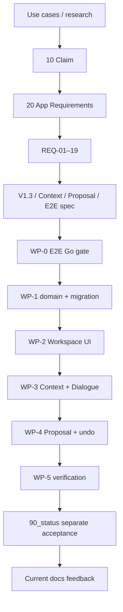
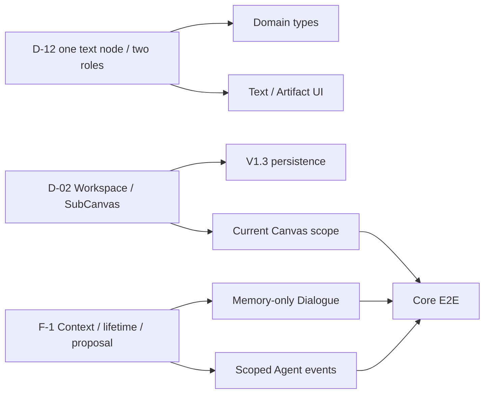
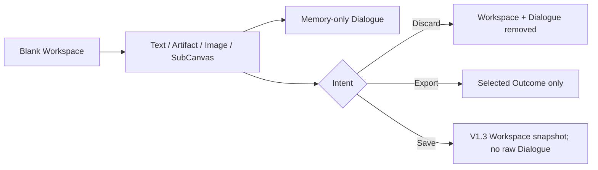

# Review Packet — Collaborative Workspace Foundation

## Review Purpose

`fm-doc-canvas` の次期実装を D-12 / D-02 / F-1 foundation に限定し、型・保存・寿命・Context・Proposal・E2E が後続機能の安全な土台になるかを確認する。

## Decisions Needed

| Item | Proposed decision | Review outcome |
| --- | --- | --- |
| Scope | D-12 + D-02 + F-1 を本計画、F-2〜F-6 を別 plan | pending human review |
| Persistence | V1.3 + V1.0〜V1.2 load adapter | pending human review |
| Dialogue | memory-only、Saveにraw Dialogueを含めない | pending human review |
| Legacy chat | read/write停止、自動削除なし | pending human review |
| SubCanvas boundary | Folder + breadcrumb + down badge / up-boundary portal、non-cascade dissolve | pending human review |
| Context authority | body allowlist、request-local Go validation、Frontend compare-and-apply | pending human review |
| Agent discovery regression | implicit Current Canvas searchを廃止し、明示Canvas targetでだけ全direct memberを許可 | pending human review |
| Existing generation compatibility | Direct text vision / image provider selector / Agent Artifact createを維持 | pending human review |
| E2E | WP-0 runner Gate、browser E1 + native E2 | pending human review |

## Maximum Risks

| Risk | Impact | Mitigation | Residual risk |
| --- | --- | --- | --- |
| V1.3 migration loss | 既存Canvasを開けない、Relation/filename消失 | version fixtures、transactional load、source非変更 | 実在する未知legacy shape |
| Current Canvas scope leak | 別階層・Candidate本文の外部送信・誤変更 | body allowlist + tool restriction + request validation + Frontend scope compare | UI表示とpayloadの将来drift |
| Agent discovery縮小 | 未選択NodeをAIが自発的に発見しにくい | `Use this Canvas as context`でpreview後に明示許可 | 明示操作が一手増える |
| Human proposal deadlock | Agent run停止、誤自動適用 | fixed 10sを廃止しexplicit resolve/cancel | provider側timeout |
| Dialogue lifetime regression | Discard後も個人思考が残る | persistence effect削除、temp-path E2E | 既存legacy fileは残る |
| E2E harness flakiness | 必須受理が不安定 | WP-0 smoke、fixed fakes、process cleanup、serial test | native window / port / WebView2差 |
| Plan overreach | F-2以降の価値Gateが消える | REQとWPをfoundationだけに限定 | foundation自体も横断範囲が広い |

## Open Questions / Go / No-Go

| Item | Blocks | Decision condition |
| --- | --- | --- |
| Playwright adoption | WP-1以降 | real Wails binding browser smoke、temp isolation、cleanupがすべてpassでGo |
| Alternative E2E runner | WP-1以降（Playwright No-Go時） | 実行済みvertical smokeを記録してplan amend |
| Toolchain pin | WP-0 completion | exact versionsでbaseline + smokeがpass |
| Native dialog automation | REQ-17の自動化だけ | browser adapterが安全ならE1へ、難しければnative E2を維持 |

## Plan Overview

## Decision / Impact Overview

## Lifecycle Snapshot

## Traceability Snapshot

| REQ group | Spec / WP | Evidence | Review concern |
| --- | --- | --- | --- |
| REQ-01/06 | §9/11, WP-2/3 | CE2E-01 | Discardを誤保存警告に戻さない |
| REQ-02/12 | §8/16, WP-1/2 | reducer + CE2E-02 | identity/filename/roleを混同しない |
| REQ-03/04/05 | §5–10, WP-1/2 | migration + CE2E-03 | ownershipとcross Relation |
| REQ-07〜09/18 | §11–13, WP-2/3 | payload/tool access + CE2E-03/04 | Context previewと実body allowlist一致 |
| REQ-10/11/13 | §10〜15, WP-1〜4 | integration + CE2E-04/05 | transactional failure/stale/cancel/human wait |
| REQ-14/16 | §17/18, WP-0/5 | `mise run e2e` | user data/network/process isolation |
| REQ-15 | §9/12/17, WP-2 | keyboard E1 | human reviewの代用にせず機械失敗も独立判定 |
| REQ-17/19 | §17, WP-5 | native E2 + human E4 | browserだけでnative/UXを受理しない |

## Core E2E Review

- CE2E-01: blank start → temporary Dialogue → Discard → no restore。
- CE2E-02: Text ↔ Artifact → filename / identity → V1.3 Save / Load。
- CE2E-03: nested SubCanvas → subtree move/cycle/dissolve → down/up boundary →集合target / scope → undo。
- CE2E-04: shared Context / exclusion / image boundary → Direct Action late result → decision/apply二段階Proposal → Stop/idempotency/stale。
- CE2E-05: Save / Export separation → malformed data / Backend failure / undo-before-commit faultのtransaction保証。

## Review Checklist

- [ ] REQ-01〜REQ-19 が Claim / App Requirements を覆う。
- [ ] D / DC / F ID と REQ ID を別の意味で維持している。
- [ ] V1.0〜V1.2 sourceをloadだけで変更しない。
- [ ] Text / Artifact role switchでidentityとhidden filenameを維持する。
- [ ] Current Canvas外・Candidate・除外済みbodyをpreview / payload / Agent toolの全てで拒否する。
- [ ] Chat / Direct Actionのlate resultはFrontend compare-and-applyを通らず状態変更できない。
- [ ] Dialogue、Save、Export、Discardの寿命が分離される。
- [ ] Proposalはaccept前に適用されず、Stop/reject/staleが変更を残さない。
- [ ] Direct ActionはDialogueのinitiativeを暗黙継承しない。
- [ ] Folder subtreeのcycle / cascadeを防ぎ、全tree方向のcross Relationを辿れる。
- [ ] V1.3 unionとV1.0〜1.2変換表が未知fieldをsilent lossしない。
- [ ] E2E runnerは実行済みGo evidence後だけadopted stackになる。
- [ ] Core E2Eはexternal network/credential/user dataを使わない。
- [ ] Browser E2Eとnative smokeの責務が分かれている。
- [ ] `90_status.md` はimplementer evidenceとAcceptanceを分離している。
- [ ] F-2〜F-6は本計画のdone条件ではない。
- [ ] worklogはStep 0〜8を持ち、source-of-truthを重複していない。

## Go Recommendation

三系統の独立re-reviewで、amend後snapshotにBlocker / High / Mediumの残存がないことを確認した。humanがDecisions Neededと上記checklistを承認した場合に限り、Plan reviewは **Go with WP-0 gate** を推奨する。WP-0のE2E vertical smokeがNo-Goの場合はfeature implementationへ進まず、runner調査とplan amendを行う。
