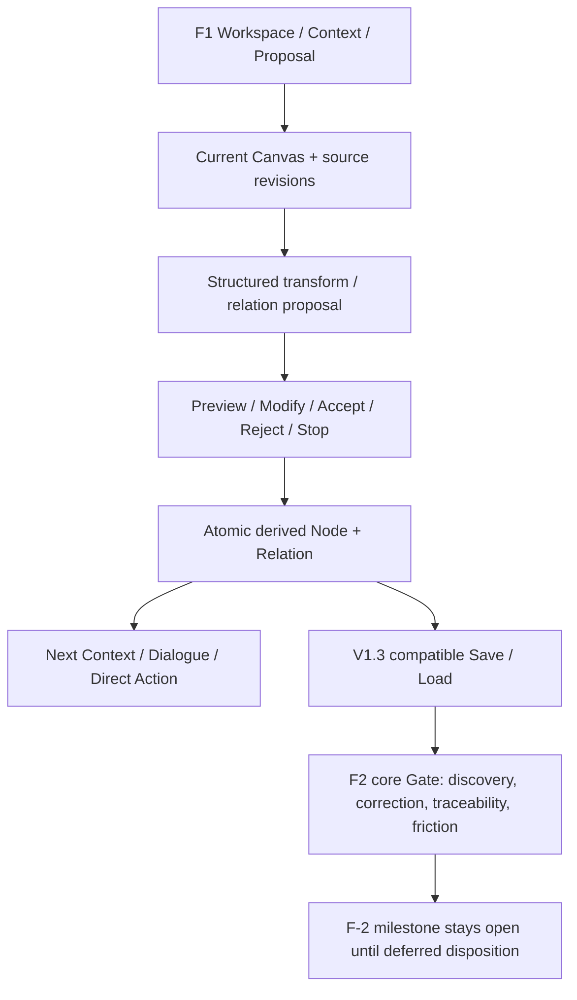
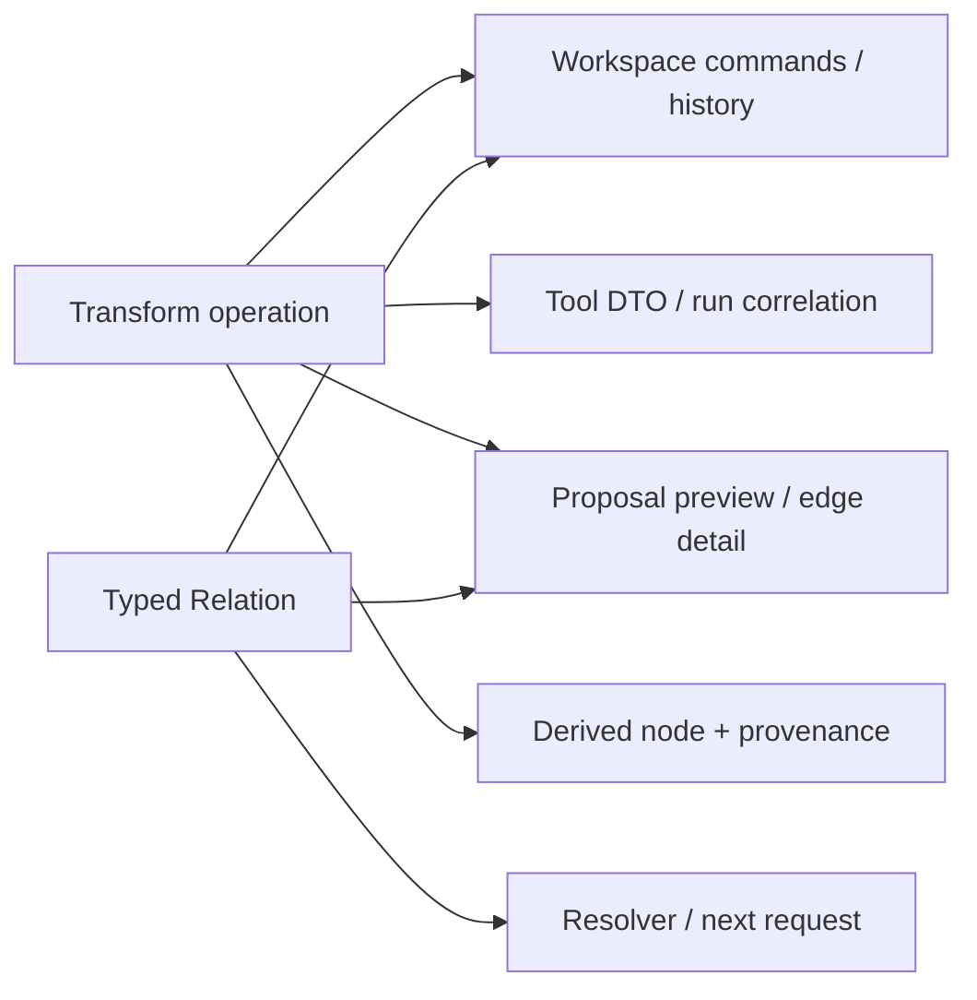

# Review Packet — plan_20260812_collaborative_workspace_F2

## Decisions Needed

- [ ] `summarize` / `compare` / `counterpoint` の MVP operation set を承認する。
- [ ] この plan の `done` は F2 core slice の受理であり、ロードマップ F-2 milestone は後続 disposition 完了まで open とする境界を承認する。
- [ ] Dialogue / Agent は Proposal、明示 Direct Action は request-as-approval + post-apply diff / undo とする。
- [ ] V1.3 compatible optional Relation metadata を採用し、V1.4 を作らない方針を承認する。
- [ ] Relation edge label は常時表示ではなく、selected edge / proposal / Context preview で詳細表示する方針を承認する。
- [ ] Core E2E と worklog を F1 と同じく有効にする。

## Maximum Risks

| Risk | Impact | Mitigation | Residual risk |
| --- | --- | --- | --- |
| LLM の proposal schema 差異 | Proposal parse / apply が不安定 | existing tool-call contract、fake provider、strict DTO validation | 実 provider の細かな差異 |
| Node + Relation の partial apply | 由来・undo・Context が壊れる | atomic command、fault injection、receipt | 複雑な将来の複数出力 |
| Relation 表示が管理作業になる | F2 Gate 未達 | compact label、selected detail、auto layout なし | Relation 数増加時の視認性 |
| 機能成立だけで F2 Gate を通す | CW-2 の価値を誤判定 | REQ-18 task-based E4 review | 代表課題の偏り |
| 配置を意味として過剰解釈する | 誤った構造・Relation の確定 | explicit spatial hint、semantic inference 禁止 | raw coordinate の有用性 |
| Direct Action に追加承認を課す | 一発操作の摩擦増加 | entry route 分離、post-apply diff / undo | error recovery copy |
| source revision の遅着 | 意図しない派生 / Relation | source revision + scope / run correlation、stale no-op | provider timeout / retry の UX |
| V1.3 optional extension の互換性 | 旧 consumer が metadata を失う | required field 不変更、roundtrip / unknown field fixture | 外部 consumer は未確認 |

## Open Questions / Go / No-Go

| Item | Blocks | Decision condition |
| --- | --- | --- |
| V1.3 optional field が strict parser と衝突するか | WP-2 | local fixture / current parser で Go。衝突なら plan amend して version strategy を再設計 |
| Existing agent route で structured transform proposal を返せるか | WP-3 | fake provider + backend test + Wails event roundtrip が pass |
| Relation label の密度 | WP-4 / Gate | F2-03 E2E と human UX review で source / target / kind が追える |
| Modify が atomic apply と両立するか | WP-2/4 | output / Relation edits を一つの decision payload にして partial state なし |
| spatialHints の粒度 | WP-3/4 | Current Canvas の selected / active Node ID + position で開始し、意味推論を行わない |
| F2 core の価値 | Gate | REQ-18 の別受入者による実課題 E4 review で Go / Hold / Stop |

## Plan Overview

## Decision / Impact Overview

## Traceability Snapshot

| REQ ID | Spec / WP | Evidence class | Review concern |
| --- | --- | --- | --- |
| REQ-01〜03 | `transform.ts`, WP-1/2 | E1 | scope, arity, non-destructive output |
| REQ-04/05/10 | proposal / atomic apply, WP-2/3 | E1 | stale, Stop, no partial mutation |
| REQ-06〜09 | Relation / projection / resolver, WP-1/2/4 | E1 | type, direction, accepted-only context |
| REQ-11 | persistence, WP-2/5 | E1 | V1.3 compatibility |
| REQ-12 | UI / E2E / UX, WP-4/5 | E1/E4 | understandability, keyboard path |
| REQ-13/14 | harness / checks, WP-0/5 | E1 | no credentials/network, full evidence |
| REQ-15 | resolver / Context preview, WP-3/4 | E1 | placement feedback without semantic inference |
| REQ-16/17 | entry routing / comparison UI, WP-3/4/5 | E1/E4 | Direct Action separation, preview/diff |
| REQ-18 | separate task-based review | E4 | discovery, correction, control, cleanup burden |
| NFR-01〜04 | dependency / transaction / allowlist / provenance | E1/E3 | all NFR rows present in status |

## Plan-Specific Checklist

- [ ] F1 `state: done` と current docs を baseline にした。
- [ ] F2 core と follow-up candidates が分離されている。
- [ ] 各 REQ に method / evidence class がある。
- [ ] source revision、scope、run correlation を Proposal に含めた。
- [ ] Node + Relation は atomic apply / one undo である。
- [ ] unaccepted Proposal が persistence / Context に漏れない。
- [ ] V1.3 migration / roundtrip / failure fixture を定義した。
- [ ] Core E2E F2-01〜05 を実装前に定義した。
- [ ] REQ-18 の E4 Gate review 観点と Go / Hold / Stop を定義した。
- [ ] 人間の配置を spatial hint として次の Context へ戻し、意味を自動確定しない。
- [ ] Dialogue / Agent と Direct Action の承認境界を分離した。
- [ ] NFR-01〜04 が `90_status.md` の受入表に存在する。
- [ ] 新規 dependency / external API の採用判断は発生していない。
- [ ] `90_status.md` は実装者と受入者を分離した表になっている。
