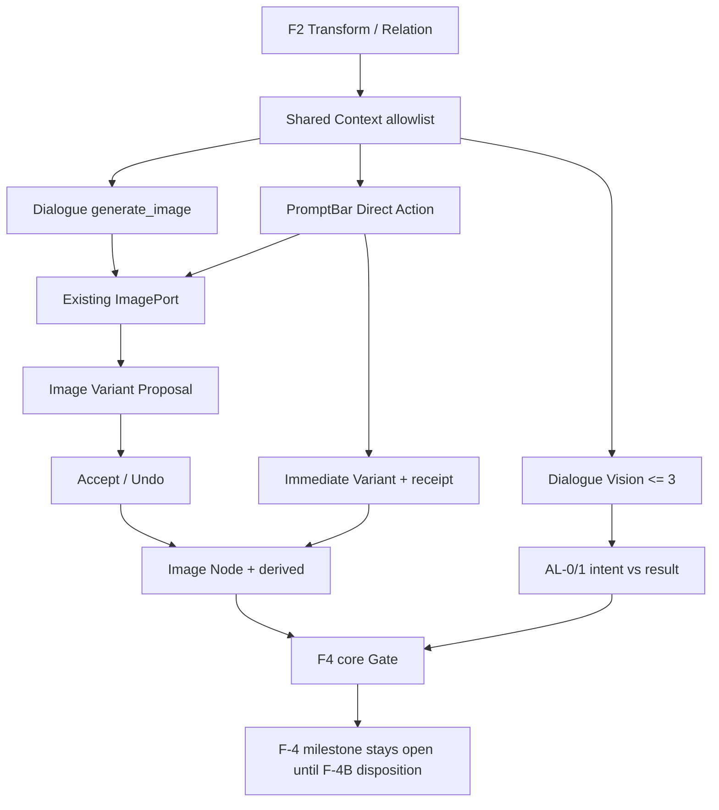
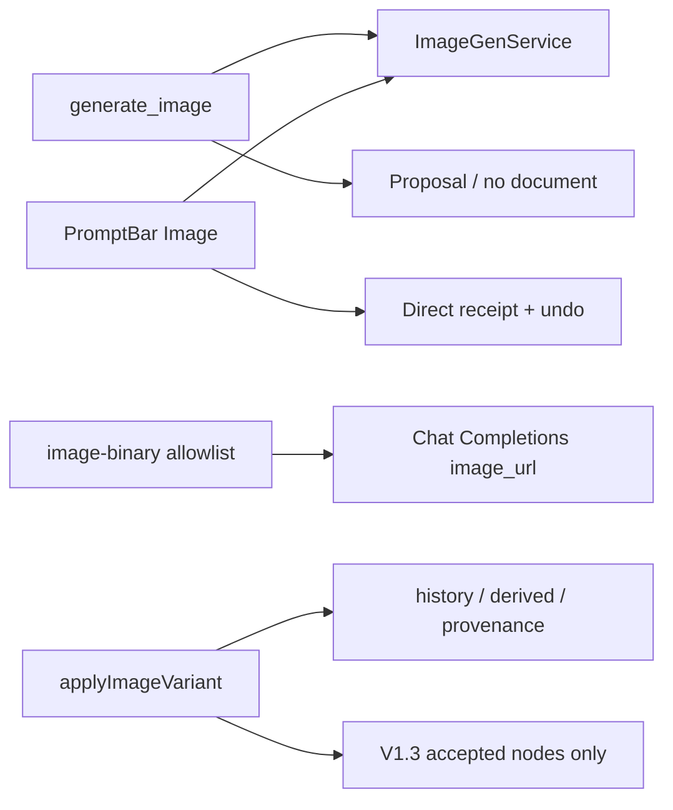

# Review Packet — plan_20260813_multimodal_context

## Decisions Needed

- [ ] F4 core を F-4A + Vision Context に限り、確認付き再生成 / AL-3 / `fm-image-assistant` は別判断とする。
- [ ] この plan の `done` は F4 core の受理であり、ロードマップ F-4 milestone は後続 disposition まで open とする。
- [ ] Dialogue の `generate_image` は既存 ImagePort を使い、配置は Proposal とする。
- [ ] PromptBar Image Direct Action は残し、Dialogue へ自動昇格しない。
- [ ] Dialogue Vision は明示 allowlist 最大 3 枚で F1 metadata-only を局所解除する。
- [ ] Core E2E と worklog を F1〜F3 と同じく有効にする。

## Maximum Risks

| Risk | Impact | Mitigation | Residual risk |
| --- | --- | --- | --- |
| 実 VLM が tool + image を同時に扱えない | Dialogue 評価が弱い | fake で契約先行、品質は Conditional / E4 | 実 model 差 |
| Dialogue 導線が Direct Action を遅くする | Gate Stop | 入口分離、PromptBar 維持 | 共有 command の待ち |
| 自動 Node 化・枚数過多 | 掃除負担 | generate-then-place、1 tool 1 枚 | 連続 Accept |
| pixel 漏洩 | JSON / log 肥大、秘密面 | allowlist、data URL 非 persist | preview 経路 |
| stale 配置 | 別 Workspace へ誤配置 | proposalId + generation / scope | timeout 中の操作 |
| 残留画像ファイル | downloadPath のゴミ | NFR-05 で明示。GC しない | ディスク残留 |
| 機能成立だけで Gate を通す | 再入力削減を誤判定 | REQ-16 E4 | 代表課題の偏り |

## Open Questions / Go / No-Go

| Item | Blocks | Decision condition |
| --- | --- | --- |
| 実 LLM の Vision + tools | 本番 Dialogue 評価の品質。WP-3 契約は止めない | fake E2E 先行。実 model 失敗は Hold 理由になり得るが core 契約の No-Go ではない |
| PromptBar receipt の copy | WP-4 | F4-02 で Undo が分かること |
| F4 core の価値 | Gate | REQ-16 の別受入 E4 で Go / Hold / Stop |

WP-0〜2、fake E2E、Variant 契約は実 VLM を待たずに実装してよい。

## Plan Overview

## Decision / Impact Overview

## Traceability Snapshot

| REQ ID | Spec / WP | Evidence class | Review concern |
| --- | --- | --- | --- |
| REQ-01/14 | allowlist, WP-1/0 | E1 | hidden body / extra images |
| REQ-02/04 | tool + proposal, WP-3/2 | E1 | 生成が即 mutation にならない |
| REQ-03 | Direct Action, WP-4 | E1 | Dialogue 非追加、provider 非破壊 |
| REQ-05/06 | variant, WP-2 | E1 | atomic / provenance / undo |
| REQ-07/08/09 | Vision, WP-1/3 | E1/E4 | cap、差分説明、no auto-regen |
| REQ-10/11/12 | lifetime / stale / errors | E1 | 遅着と key 欠落 |
| REQ-13/16 | UX / Gate, WP-4/5 | E1/E4 | 再入力削減と Direct 非劣化 |
| REQ-15 | completion checks, WP-5 | E1 | F1〜F3 E2E 回帰 |
| NFR-01〜05 | deps / txn / allowlist / secrets / files | E1/E2/E3 | 全 NFR 行が status にある |

## Checklist

- [ ] F3 `state: done` と current docs を baseline にした。
- [ ] F4 core と再生成ループ / AL-3 / 新 provider が分離されている。
- [ ] 各 REQ に method / evidence class がある。
- [ ] Dialogue 生成は document を変えず、配置だけが atomic apply / one undo である。
- [ ] PromptBar Direct Action が残っている。
- [ ] Dialogue Vision は明示 allowlist 最大 3 で、F1 制限の上書き範囲が書いてある。
- [ ] V1.3 optional provenance と physical file 非削除を定義した。
- [ ] Core E2E F4-01〜05 を実装前に定義した。
- [ ] REQ-16 の E4 Gate 観点と Go / Hold / Stop を定義した。
- [ ] 実 VLM 品質は Conditional であり、未検証 200 を adopted と書いていない。
- [ ] `90_status.md` は実装者と受入者を分離した表になっている。
- [ ] worklog に Step 0〜8 がある。
