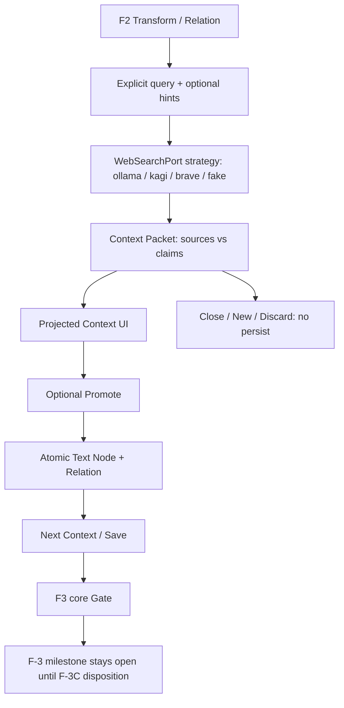
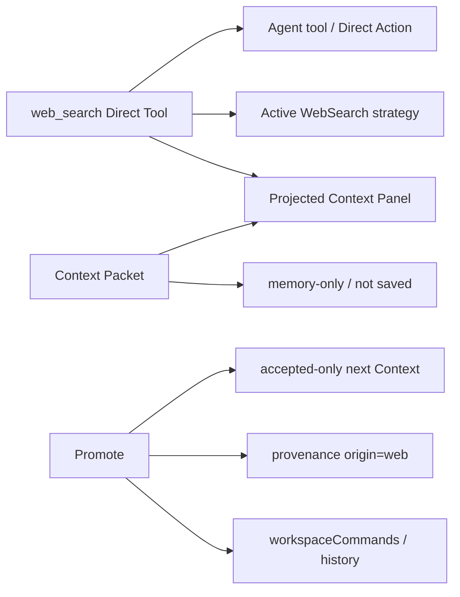

# Review Packet — plan_20260813_web_context

## Decisions Needed

- [ ] F3 core を F-3A + F-3B Direct Tool + F-3D に限り、F-3C は別 plan とする。
- [ ] この plan の `done` は F3 core の受理であり、ロードマップ F-3 milestone は F-3C 等の disposition まで open とする。
- [ ] 検索は `WebSearchPort` strategy。既定 Ollama Cloud Search、切替 Kagi / Brave。LLM 内蔵検索、`web_fetch`、Kagi `extract` を strategy にしない。
- [ ] 検索は mutation にせず、明示 Promote だけが Node / Relation を作る。
- [ ] 既知 URL は scrape せず、OS browser で開く。
- [ ] Core E2E と worklog を F1 / F2 と同じく有効にする。

## Maximum Risks

| Risk | Impact | Mitigation | Residual risk |
| --- | --- | --- | --- |
| 認証付き Ollama / Kagi / Brave が使えない / 品質不足 | 選択中 strategy の本番検索が欠ける | Conditional Go、fake で契約先行、Settings で切替 | 各 provider の日本語品質・Kagi 課金 |
| 検索結果が長い回答に畳まれる | CW-3A 未達 | packet UI を一次面、synthesis は推論ラベル | モデルが本文に断定を書く |
| 自動 Node 化・件数過多 | 掃除負担で Stop | 検索非 mutation、Promote cap 5、表示 8 | 連続 Promote の蓄積 |
| SSRF / scrape | セキュリティと依存増加 | backend は検索 API 以外を fetch しない | ユーザーが開く先のサイト |
| stale Promote | 別 Workspace へ誤採用 | packetId + generation / scope guard | timeout 中の操作 |
| 新 API key の管理負担 | DC-09 違反 | 検索ごとには選ばせず、Settings だけ。imageGen と同じ key 保持 | Settings 項目の増加 |
| 機能成立だけで Gate を通す | 転記削減を誤判定 | REQ-17 E4 | 代表課題の偏り |

## Open Questions / Go / No-Go

| Item | Blocks | Decision condition |
| --- | --- | --- |
| Ollama / Kagi / Brave 認証付き 200 | 各本番 adapter 確定（WP-3 production path） | 1 回の成功応答を cheatsheet に記録。失敗した strategy は Settings で切替。Tavily は別 amend |
| synthesis の表示密度 | WP-4 / Gate | F3-01 と human UX で claim が追い切れる |
| Direct Action の query 入力位置 | WP-4 | PromptBar または明示 Search ダイアログで query が空にならない |
| F3 core の価値 | Gate | REQ-17 の別受入 E4 で Go / Hold / Stop |

WP-0〜2、fake E2E、Promote 契約、registry unit test は認証付き 200 を待たずに実装してよい。

## Plan Overview

## Decision / Impact Overview

## Traceability Snapshot

| REQ ID | Spec / WP | Evidence class | Review concern |
| --- | --- | --- | --- |
| REQ-01/15 | resolver / allowlist, WP-1/0 | E1 | hidden body を検索へ送らない |
| REQ-02/13 | Direct Tool + routes, WP-3/4 | E1 | 検索が mutation にならない |
| REQ-18 | strategy registry / Settings, WP-3/4 | E1 | 切替で key を失わない、failover しない |
| REQ-03/11 | packet invariants, WP-1 | E1 | 観測と推論、重複 cluster |
| REQ-04/08 | lifetime, WP-2 | E1 | 未採用が Save / Context に漏れる |
| REQ-05/06/07 | promote, WP-2 | E1 | atomic / provenance / F2 Relation |
| REQ-09/12 | stale / errors, WP-3 | E1 | 遅着と key 欠落 |
| REQ-10 | known URL, WP-1/4 | E1 | scrape / SSRF を作らない |
| REQ-14/17 | UX / Gate, WP-4/5 | E1/E4 | 転記削減と掃除負担 |
| REQ-16 | completion checks, WP-5 | E1 | F1/F2 E2E 回帰 |
| NFR-01〜05 | deps / txn / allowlist / secrets / SSRF | E1/E3 | 全 NFR 行が status にある |

## Checklist

- [ ] F2 `state: done` と current docs を baseline にした。
- [ ] F3 core と F-3C / routing / MCP が分離されている。
- [ ] 各 REQ に method / evidence class がある。
- [ ] 検索は document を変えず、Promote だけが atomic apply / one undo である。
- [ ] unaccepted packet が persistence / Active Context に漏れない。
- [ ] V1.3 optional provenance と failure fixture を定義した。
- [ ] Core E2E F3-01〜05 を実装前に定義した。
- [ ] REQ-17 の E4 Gate 観点と Go / Hold / Stop を定義した。
- [ ] Ollama / Kagi / Brave は Conditional Go であり、未検証 200 を adopted と書いていない。
- [ ] 検索 strategy 切替は Settings のみ。failover、`web_fetch`、Kagi `extract` は入れない。
- [ ] `90_status.md` は実装者と受入者を分離した表になっている。
- [ ] worklog に Step 0〜8 がある。
