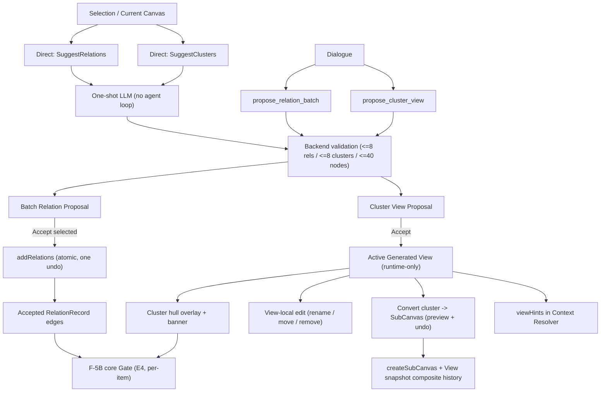
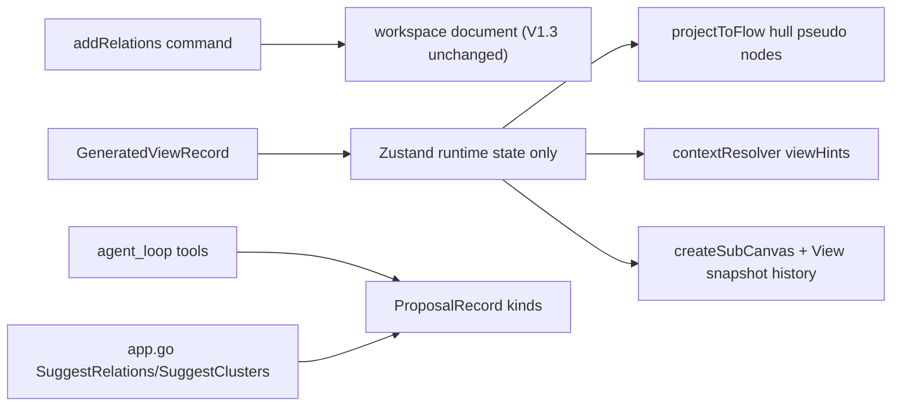

# Review Packet — plan_20260815_generated_views

## Decisions Needed

- [ ] F-5B core を Relation batch suggestion + Cluster View + Cluster→SubCanvas 変換に限り、Library View / Layout suggestion は別判定とする。
- [ ] この plan の `done` は F-5B core slice の受理であり、ロードマップ F-5B milestone は Library View / Layout suggestion の disposition まで open とする。
- [ ] Direct Action（Suggest Relations / Suggest Clusters）は提案生成までを承認とし、Relation / View の確定には人間の Accept を要求する。
- [ ] Generated View は runtime-only で Save file に含めず、V1.3 format を変更しない。
- [ ] Relation batch は新 command `addRelations` で単一 transaction / 単一 undo とする。
- [ ] Cluster→SubCanvas変換はdocument + active Viewのcomposite historyとし、undo / redoで両方を復元する。
- [ ] Relation batch / Cluster Viewは対象全Nodeのsource revisionを結果到着時とAccept時に検証する。
- [ ] Image NodeはF4 Vision allowlist（最大3画像）を再利用し、Vision不可時は表示付きmetadata-only fallbackとする。
- [ ] Cluster overlay は React Flow への非 interactive pseudo node で描画する（spike 失敗時は SVG overlay へ切替）。
- [ ] Folder Node は cluster member にしない。
- [ ] Stopはin-flight request / 未確定Proposalだけを無効化し、accepted Viewは維持する。
- [ ] View-local共同編集は既存コード中心の部分実装とし、新規cluster / split / merge / ungrouped追加は後続候補とする。
- [ ] Core E2E と worklog を F1〜F4 と同じく有効にする。

## Maximum Risks

| Risk | Impact | Mitigation | Residual risk |
| --- | --- | --- | --- |
| 提案品質が低く掃除負担が増える | Gate Stop / 信頼低下 | 上限設定、理由表示、項目単位除外、E4 で独立判定 | 実 LLM の質 |
| View overlay が Canvas 操作を妨げる | UX 劣化 | pseudo node は selectable/draggable/connectable=false、低 z、spike 先行 | xyflow 版本差 |
| View を恒久構造と誤解する | D-08 違反 | banner に「一時的な View」表示、Save 非対象を明記、SubCanvas 変換は明示操作 | copy の分かりやすさ |
| batch accept が部分適用になる | 整合性毀損 | 単一 command transaction + fault injection test | 未検証経路 |
| SubCanvas undo後にViewだけ失われる | 可逆性・信頼性の毀損 | document + active Viewのcomposite history / E2E | runtime history統合の複雑性 |
| 編集後のNodeを古い内容でcluster化する | 誤った構造の採用 | 全対象source revisionの到着時 / Accept時再検証 | 再提案の待ち時間 |
| Image入力がproviderごとに不一致 | 提案品質・privacy境界の不明確化 | F4 Vision allowlist再利用、metadata fallback表示 | metadataだけでは判断できない画像 |
| stale View が別 Canvas へ残る | 誤った hint 送信 | navigation / New / Load / Discard で破棄、resolver は canvasId 一致のみ | race 中の表示 |
| viewHints が意味の自動確定に使われる | DC-07 違反 | hint 注記、relation は既存契約のみで確定 | prompt 解釈差 |
| 既存 F1〜F4 導線の退行 | 全体品質 | Core E2E regression 必須（F5-05） | 広範な UI 変更 |

## Open Questions / Go / No-Go

| Item | Blocks | Decision condition |
| --- | --- | --- |
| xyflow pseudo node の z / 追従挙動 | WP-4 overlay 方式 | WP-0 spike で確認。不可なら SVG overlay へ切替（契約は不変） |
| SuggestClusters の既定 scope（選択優先 or canvas 全体） | WP-3 導線 copy | 実装時に選択があれば選択、なければ全体とする。E4 で再確認 |
| 実 LLM の batch / cluster 提案品質 | Gate 判定（契約実装は止めない） | fake E2E で契約を固定。品質は REQ-17 E4 で Go / Hold / Stop |
| 新規cluster / split / merge / ungrouped追加 UX | 将来候補 | coreはrename / 既存cluster間移動 / 除外 / 削除の部分実装。需要確認後 |

WP-0〜2（harness / domain / backend 契約）は実 LLM 品質確認を待たずに実装してよい。

## Plan Overview

## Decision / Impact Overview

## Traceability Snapshot

| REQ ID | Spec / WP | Evidence class | Review concern |
| --- | --- | --- | --- |
| REQ-01/02 | body / Vision allowlist + Direct one-shot, WP-1/2 | E1 | hidden body / image / scope 漏れ |
| REQ-03/14 | dialogue tools + system prompt, WP-2 | E1/E3 | read-before-propose、無断確定しない |
| REQ-04/05 | batch proposal + addRelations, WP-1/3/4 | E1 | 部分適用なし、one undo |
| REQ-06/07 | cluster draft + proposal UI, WP-1/2/4 | E1 | 上限、重複 member、preview |
| REQ-08/09 | overlay + lifecycle, WP-3/4 | E1 | 非破壊、Save 非含入、Stop separation |
| REQ-10 | convert dialog + composite history, WP-3/4 | E1 | document / View undo、境界 Relation |
| REQ-11/13 | revision / run stale guard + errors, WP-1/2/3 | E1 | 遅着 no-op、actionable error |
| REQ-12 | viewHints, WP-1 | E1 | 観測情報、意味自動確定しない |
| REQ-15/17 | UX / Gate, WP-4/5 | E1/E4 | 発見の便益 vs 掃除負担 |
| REQ-16 | completion checks, WP-5 | E1 | F1〜F4 E2E 回帰 |
| NFR-01〜05 | deps / txn / allowlist / persistence / limits | E1/E3 | 全 NFR 行が status にある |

## Checklist

- [ ] F4 `state: done` と current docs を baseline にした。
- [ ] core と Library View / Layout suggestion が分離されている。
- [ ] 各 REQ に method / evidence class がある。
- [ ] Relation / View の確定に人間の明示 Accept が必要で、自動 Accept 経路がない。
- [ ] Generated View が Save file / document に入らない設計である。
- [ ] `addRelations` が単一 transaction / 単一 undo である。
- [ ] Cluster → SubCanvas が既存 `createSubCanvas` とView snapshotのcomposite undoを使う。
- [ ] Image入力modeとmetadata fallbackがproposal上で確認できる。
- [ ] F5 frontend unit testがtest entry / scriptへ登録され、`mise run test`で実行される。
- [ ] Stopがaccepted Viewを破棄しない。
- [ ] viewHints が観測情報としてのみ定義されている。
- [ ] Core E2E F5-01〜05 を実装前に定義した。
- [ ] REQ-17 の E4 Gate を項目別 Go / Hold / Stop で定義した。
- [ ] 実 LLM 品質は Conditional であり、未検証を adopted と書いていない。
- [ ] `90_status.md` は実装者と受入者を分離した表になっている。
- [ ] worklog に Step 0〜9 がある。
