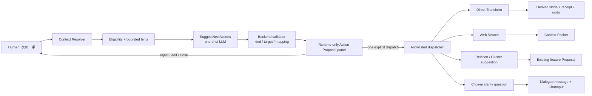

# Implementation Specification — F6 Collaboration Orchestration Core

## Technical Stack

新規 stack は採用しない。

- Backend: Go、既存 `LLMPort.GenerateText`、Wails binding、F5 one-shot JSON suggestion pattern。
- Frontend: React / TypeScript、Zustand、既存 Context Resolver と store action。
- Verification: 既存 Go / frontend test、FixtureLLM / FixtureWebSearch、Playwright Core E2E。

Pre-implementation inspection で次を確認済みである。

- `app.go` の `SuggestRelations` / `SuggestClusters` と `backend/suggest_service.go` に one-shot JSON parse / validation の先例がある。
- `contextResolver.ts` は Focus、selection、body allowlist、Relation / spatial / View hint、context digest を返す。
- `runScope.ts` と F2〜F5 action は workspace / canvas / generation / epoch / revision correlation を持つ。
- `useAppStore.ts` は Direct Transform、Web Search、Relation / Cluster suggestion と result surface を公開する。
- FixtureLLM と E2E bridge は structured response、delay、fault を拡張可能である。

## Architecture Boundary



Suggestion 生成面と action 実行面は分離する。`SuggestNextActions` は Tool 実行器を持たず、構造化候補だけを返す。frontend dispatcher は固定 allowlist 以外を呼ばない。

## Adopted Design

### 採用案: one-shot planner + runtime Action Proposal + existing dispatcher

- proposal quality と child action correctness を別々に検証できる。
- suggestion を見るだけでは document / external tool / Dialogue を変更しない。
- F2 / F3 / F5 の accepted safety / lifecycle / result surface を再利用できる。
- generic plan UI や Agent loop の nested approval state を追加しない。

system prompt だけで自然文を返す案、Agent loop に `propose_next_actions` Tool を追加する案、deterministic menu だけを出す案は `50_review_notes.md` に rejected / deferred として記録する。

## Data Model

### Backend request

`backend/orchestration.go` に次の DTO を置く。名称は実装時に Go style へ調整してよいが、field semantics は維持する。

```go
type NextActionRequest struct {
    RequestID         string                    `json:"requestId"`
    WorkspaceID       string                    `json:"workspaceId"`
    CanvasID          string                    `json:"canvasId"`
    RuntimeGeneration string                    `json:"runtimeGeneration"`
    ScopeEpoch        int64                     `json:"scopeEpoch"`
    ContextDigest     string                    `json:"contextDigest"`
    FocusText         string                    `json:"focusText,omitempty"`
    DialogueHistory   []OrchestrationTurn       `json:"dialogueHistory,omitempty"`
    SelectedNodeIDs   []string                  `json:"selectedNodeIds"`
    NodeHints         []OrchestrationNodeHint   `json:"nodeHints"`
    RelationHints     []OrchestrationRelation   `json:"relationHints,omitempty"`
    ViewHints         []ViewContextHint         `json:"viewHints,omitempty"`
    SourceRevisions   map[string]int64          `json:"sourceRevisions"`
}

type OrchestrationNodeHint struct {
    ID       string `json:"id"`
    Type     string `json:"type"` // text | artifact | image
    Revision int64  `json:"revision"`
    Label    string `json:"label"`
    Summary  string `json:"summary,omitempty"`
    Excerpt  string `json:"excerpt,omitempty"`
}
```

Rules:

- `NodeHints` は resolver の Active Context 内だけ。最大40件。
- `SelectedNodeIDs` は `NodeHints` の subset で同一 Current Canvas の明示 selection のみ。
- Text / Artifact は label、既存 summary、bounded excerpt。full body を planner contract にしない。
- Image は prompt / alt / provenance 由来の metadata label / excerpt のみ。pixel / data URL / asset path は送らない。
- `DialogueHistory` は既存 `boundedDialogueHistory(..., 12)` の complete user / assistant text のみ。
- API key、provider configuration body、raw Tool event は含めない。

### Eligibility catalog

backend は request validation 後、次の表から available action catalog を導出して orchestration prompt へ入れる。frontend も同じ条件で UI preflight を行うが、backend validation を authority とする。

| kind | eligibility | role | AL | route | effect / control |
| --- | --- | --- | --- | --- | --- |
| `clarify` | always | `questioner` | `AL-0` | `dialogue` | document変更なし。採用後に質問をDialogueへ置き、回答または拒否 |
| `compare` | selected Text-bearing >= 2 | `comparer` | `AL-2` | `direct-transform` | derived Text。single undo |
| `counterpoint` | selected Text-bearing >= 1 | `critic` | `AL-2` | `direct-transform` | derived Text。single undo |
| `web_search` | Focus / latest user intent / query seed が非空 | `researcher` | `AL-2` | `direct-web-search` | Candidate Context Packet。dismiss / Promote |
| `suggest_relations` | selected non-Folder >= 2 | `organizer` | `AL-1` | `direct-relation-suggestion` | Proposalのみ。Modify / Accept / Reject |
| `suggest_clusters` | selected non-Folder >= 2 | `organizer` | `AL-1` | `direct-cluster-suggestion` | Proposalのみ。Modify / Accept / Reject / Close |

LLM に role / AL / route / effect を選ばせない。

### LLM draft and normalized response

LLM へ求める JSON は必要最小限にする。

```json
{
  "actions": [
    {
      "kind": "compare",
      "targetNodeIds": ["node-a", "node-b"],
      "title": "二案を比較する",
      "reason": "選択中の案は目的が同じだが評価軸が未整理です。",
      "expectedResult": "共通点、相違点、判断軸を持つ派生Text",
      "query": "",
      "question": ""
    }
  ]
}
```

backend normalization で `id`、`role`、`actionLevel`、`route`、`documentEffect`、`control` を付与する。

```ts
type NextActionKind =
  | "clarify"
  | "compare"
  | "counterpoint"
  | "web_search"
  | "suggest_relations"
  | "suggest_clusters";

interface NextActionItem {
  id: string;
  kind: NextActionKind;
  role: "questioner" | "comparer" | "critic" | "researcher" | "organizer";
  actionLevel: "AL-0" | "AL-1" | "AL-2";
  route:
    | "dialogue"
    | "direct-transform"
    | "direct-web-search"
    | "direct-relation-suggestion"
    | "direct-cluster-suggestion";
  targetNodeIds: string[];
  title: string;
  reason: string;
  expectedResult: string;
  documentEffect: string;
  control: string;
  query?: string;
  question?: string;
}

interface NextActionProposalSet {
  requestId: string;
  workspaceId: string;
  canvasId: string;
  runtimeGeneration: string;
  scopeEpoch: number;
  contextDigest: string;
  sourceRevisions: Record<string, number>;
  actions: NextActionItem[];
}
```

### Validation

`ParseNextActions` / `ValidateNextActionProposalSet` は次を全て確認する。

1. JSON object と `actions` 1〜3件。
2. kind が request-derived eligible catalog 内。
3. action kind 重複なし。
4. target ID は `SelectedNodeIDs` 内のみ。`clarify` / `web_search` は target optional、Node action は required。
5. compare / counterpoint / structure の arity と type。
6. title / reason / expectedResult と kind-specific query / question が非空かつ bounded。
7. response correlation は request から echo / copy し、LLM 値を信用しない。
8. role / AL / route / control は mapping から付与する。

一部 action だけを黙って落として残りを表示しない。一件でも不正なら response 全体を error とする。これにより LLM 出力と「1〜3件の推奨順」の意味がずれない。

## Focus Resolution

frontend request builder は次の順で planning intent を組み立てる。

1. `ContextEnvelope.focus?.text`。
2. active Chat session の最新 complete user message。
3. selected / active Node の label / summary から得た短い query seed。
4. 上記がすべて空で Current Canvas に Text-bearing Node がある場合、その bounded canvas hints を read-only planning context として使う。

上位があっても下位情報を hidden instruction として結合しない。request では `focusText`、`dialogueHistory`、`nodeHints` を別 field のまま送る。

Current Canvas にも usable material がなく、eligible Node action もない場合だけ、backend は LLM を呼ばず deterministic `clarify` を返してよい。この場合も proposal set contract と correlation を維持する。通常 case の provider call は最大1回である。canvas-wide fallback は助言生成用であり、明示 target を必要とする child action の対象を暗黙確定しない。

## Acceptance Amend — 2026-08-16 runtime findings

- `canvas-2.json` 相当の実データを fixture 化し、1件選択、2件選択、再提案、未選択を反復検証する。
- backend の validation error は typed orchestration error として frontend へ渡し、`next-actions-failed` の回復文言は「再提案、対象変更、通常 Chat」に限定する。Undo / New Workspace / relation / transform 再作成という他機能向け文言を流用しない。
- 通常 Chat の `read_canvas_node` 後 continuation request を request-shape test で固定し、tool call ID、tool name、tool result role/part、provider adapterの順序・必須fieldを検証する。
- 修正単位は `WP-6 — Runtime acceptance repair` とし、REQ-05/17/18/19/20/21/22/23 と NFR-02/03/06 を対象にする。

## Prompt Contract

orchestration prompt は product system prompt と分け、次を明示する。

- あなたは action を実行せず、現在の共同作業に合う次の一手を 1〜3 件選ぶ。
- available catalog にない kind と selected target にない ID を出さない。
- 必要最小の AL を選ぶ。ただし AL / route 値は出力せず kind だけを選ぶ。
- 同じ kind を重複しない。
- 情報不足時は `clarify` で具体的な一問を出す。
- 全機能のメニュー一覧や provider / model 推奨を返さない。
- JSON 以外を返さない。

Configured system prompt が存在しても backend validator が最終 authority である。

## Backend / Wails API

### New files / symbols

- `backend/orchestration.go`
  - DTO / enums / fixed mapping。
  - request validation / eligibility。
  - bounded prompt context builder。
  - `ParseNextActions` / response normalization。
- `backend/orchestration_test.go`
  - valid actions、eligibility、mapping、unknown / duplicate / arity / target / count / JSON / limit。

### Existing files

- `app.go`
  - `SuggestNextActions(req backend.NextActionRequest) (backend.NextActionProposalSet, error)`。
  - no-context deterministic clarify。
  - `suggestRaw(..., kind="next-actions")` または同等の既存 one-shot helper 再利用。
- `backend/ports.go`
  - `FixtureLLM.NextActionsJSON` と deterministic `SuggestNextActionsText`。
  - delay / fault / call-count が既存 fixture mechanism で観測可能。
- generated Wails bindings
  - new method / DTO を frontend から呼べるよう更新する。

Agent `toolDefinitions()` と `agentSystemPrompt` に orchestration Tool は追加しない。core suggestion は Agent loop 外である。

## Frontend Domain and Store

### Domain

新規 `frontend/src/domain/orchestration.ts` に次を置く。

- TS types / fixed mapping mirror。
- `buildNextActionRequest(workspace, envelope, history, nodes)`。
- bounded node hint builder。
- frontend response normalization / correlation shape check。
- editable target / query patch validation。
- `revalidateNextActionScope`。
- `dispatchKind` の exhaustive mapping helper。

Go / TS mapping の drift を検出する shared fixture test を追加する。コード生成や新 dependency は導入しない。

### Store state

`useAppStore.ts` の runtime-only extras に次を追加する。

```ts
interface OrchestrationState {
  status: "idle" | "pending" | "ready" | "cancelled" | "stale" | "error" | "dispatching" | "dispatched";
  activeRequestId?: string;
  request?: NextActionRequestSnapshot;
  proposal?: NextActionProposalSet;
  dispatchingActionId?: string;
  dispatched?: { actionId: string; kind: NextActionKind; resultSurface: string };
  error?: string;
}
```

Store actions:

- `requestNextActions(history)`
- `cancelNextActionRequest()`
- `dismissNextActions()`
- `rejectNextAction(actionId)`
- `dispatchNextAction(actionId, edits?)`

`requestNextActions` flow:

1. pending / dispatching 中の重複開始を拒否。
2. `resolveContext(... operation="orchestrate")` を呼ぶ。`ResolveOperation` に `orchestrate` を追加し、read-only / planner-hint semantics とする。
3. request snapshot と requestId を保存。
4. Wails `SuggestNextActions` を await。
5. await 後の latest store と active requestId を読み直す。
6. correlation / revision / scope を再検証し、cancel / stale は no-op。
7. valid response だけ `ready` にする。

`cancelNextActionRequest` は local requestId を無効化し、status を `cancelled` にする。core では provider transport の強制停止を保証しない。遅着 response は必ず無視する。

### Exact-target child dispatch

- `compare` / `counterpoint`: `runDirectTransform(operation, targetNodeIds?)` へ backward-compatible optional exact targets を追加する。既存 Context Menu 呼出しは引数なしで従来 selection を使う。
- `web_search`: edited query を `runWebSearch(query, {entryRoute:"direct-action"})` へ渡す。
- `suggest_relations`: `runDirectSuggestRelations(targetNodeIds)`。
- `suggest_clusters`: `runDirectSuggestClusters(targetNodeIds)`。
- `clarify`: 選択時だけ question を active Dialogue session の assistant message として追加し、proposal を `dispatched` にして ChatInput へ focus を移す。suggestion 表示だけでは Dialogue を追加しない。

dispatch 前に request correlation、source revisions、current eligibility、edited target / query を検証する。dispatch 開始時に全 card を disable し、一つの promise だけを開始する。success 後に新しい action を自動選択しない。

## UI / Interaction

### Placement

- `ChatDrawer` の `MessageList` と `ChatInput` の間に collaboration control / proposal panel を置く。
- idle 時は小さい `次の一手` button のみ。
- pending 時は対象概要、`提案を考えています…`、Cancel。
- ready 時は最大3 cards。
- dispatched 時は action と result surface の短い receipt、Close / `もう一度考える`。

Canvas context menu と PromptBar へ同じ `次の一手` entry を重複追加しない。

### Card content

各 `NextActionCard` は次の順で表示する。

1. title と recommendation order。
2. role badge / AL badge。
3. `対象` chips / checkboxes または `検索 query` input。
4. `なぜ今` reason。
5. `得られるもの` expected result。
6. `実行すると` document effect と `戻し方` control。
7. primary action、Reject。

target label を主表示し、Node ID は disclosure / title 属性等の補助情報にする。AL は `AL-1 Suggest` 等の平易な説明を併記する。route は `既存のWeb検索`、`可逆な比較Node作成` 等の利用者向け表示に変換する。

### Clarify

`clarify` card は question を主表示し、`この質問に答える` と Reject を提供する。採用時に question を Dialogue へ追加し、ChatInput を focus する。回答送信時に古い proposal set を閉じる。

### Accessibility

- region: `aria-label="Next action proposals"`。
- progress / status: `role=status`, `aria-live=polite`。
- error: `role=alert`。
- card heading と control を関連付ける。
- target checkbox、query input、execute/reject/cancel/close/retry に action-specific accessible name。
- keyboard focus は suggestion 完了後に panel heading へ移しすぎず、screen reader announcement と自然な tab order を優先する。

## Lifecycle Matrix

| Event | pending request | ready proposal | dispatched receipt | child accepted result |
| --- | --- | --- | --- | --- |
| Close | local cancel / ignore late | clear | clear | unchanged |
| Re-suggest | invalidate old / new request | replace after new success | new request | unchanged |
| selection / Focus / revision change | stale on result / dispatch | stale on dispatch | receipt may remain until close | existing child lifecycle |
| New / Discard / Load | cancel + clear | clear | clear | existing Workspace behavior |
| Canvas navigation | cancel + clear | clear | clear | F2/F3/F5 behavior |
| Save | not serialized | not serialized | not serialized | existing accepted result only |
| Dialogue Stop | unrelated planner stays only if not pending; no child auto-start | proposal stays until scope changes / close | unchanged | existing run rule |

Implementation may choose to auto-clear ready proposal immediately on scope change instead of showing stale, but dispatch revalidation is mandatory and E2E must assert no-op.

## Error Handling

| Error | Behavior | Next action |
| --- | --- | --- |
| no usable context | deterministic clarify | answer / add or select material |
| >40 hints | provider callなし、error | narrow selection / context |
| provider unavailable / timeout | state error、no mutation | retry / normal Dialogue |
| invalid JSON / empty / >3 | state error、no partial cards | retry |
| unknown / unavailable kind | state error | change context / retry |
| target / arity mismatch | state error or stale | edit target / re-suggest |
| scope / revision / request mismatch | stale、no dispatch | re-suggest |
| child action failure | proposal remains unless stale、error shows existing cause | edit / retry / reject |
| local cancel + late result | cancelled stays or clears、late response ignored | re-suggest |

## Persistence / Privacy

- Workspace V1.3 schema は変更しない。
- `OrchestrationState`、request、proposal、receipt は Zustand runtime-only extras。
- proposal / prompt / raw response / action history を Chat session file / Workspace JSON へ自動保存しない。
- `clarify` で人間が採用した question とその後の回答だけは通常 Dialogue message として既存寿命規則に従う。
- planner へ送る画像は metadata-only。child Relation / Cluster action が F5 contract に従い Vision を使うかは、card 実行後の既存 route が決める。

## Core E2E / Fixture Design

### Fixture additions

- `FixtureLLM.NextActionsJSON`。
- action set preset: compare-first / web-first / structure-first / clarify-only。
- fault: invalid JSON、unknown kind、4 actions、wrong target、empty actions。
- existing delay / fault arm で cancel / late result を作る。
- E2E bridge: set orchestration fixture、inspect last request / call count / orchestration state、invoke / edit / dispatch helper。

### `frontend/e2e/ce2e-f6.spec.ts`

- F6-01〜F6-05 を `30_requirement.md` の順に実装する。
- 実 network / API key を使用しない。
- F1〜F5 suite と同じ run で回帰させる。

### Frontend tests

- `frontend/src/tests/f6Orchestration.test.ts` を追加する。
- existing domain / acceptance test entry へ明示 import し、`mise run test` output で test name を確認する。

## Requirement Traceability

| REQ ID | Specification area | Primary files / components | Verification |
| --- | --- | --- | --- |
| REQ-01 | Manual entry / pending / cancel | `ChatDrawer.tsx`, `NextActionPanel.tsx`, store | F6-01/05 |
| REQ-02 | Context / bounded hints / metadata-only image | `contextResolver.ts`, `orchestration.ts`, backend DTO | payload test, F6-01/05 |
| REQ-03 | Eligibility | Go + TS mapping / validator | unit, F6-01/05 |
| REQ-04 | one-shot no execution | `app.go`, fixture call count | Go test, F6-01 |
| REQ-05/06 | DTO / parse / fixed mapping | `backend/orchestration.go`, `domain/orchestration.ts` | Go/TS contract test |
| REQ-07/08 | Cards / edit / reject / re-suggest | `NextActionCard.tsx`, panel | component, F6-01 |
| REQ-09 | clarify → Dialogue | panel, `useChatStore`, `ChatInput` ref | F6-05 |
| REQ-10 | exact-target transform | `useAppStore.ts`, transform request builder | F6-02 |
| REQ-11 | Web dispatch | `useAppStore.ts`, existing packet panel | F6-03 |
| REQ-12 | structure dispatch / separate accept | `useAppStore.ts`, existing proposal panel | F6-04 |
| REQ-13/14 | single dispatch / result surfaces | store, panel, existing receipts | F6-02〜04 |
| REQ-15/16 | runtime lifecycle / stale / cancel | store lifecycle, orchestration domain | F6-05 |
| REQ-17 | errors / no fallback | Go parser, store, panel | fault tests, F6-05 |
| REQ-18 | accessibility / regression | panel/cards/ChatInput | F6-01/05, E4 |
| REQ-19/20 | harness / commands | fixture, E2E bridge, tests, mise tasks | F6-01〜07, plan checks |
| REQ-21 | value Gate | task protocol / review note | separate E4 |
| REQ-22 | Current Canvas fallback | `contextResolver.ts`, `orchestration.ts`, `app.go` | F6-06, E4 |
| REQ-23 | Chat tool continuation | `agent_loop.go`, provider adapter, E2E bridge | request-shape test, F6-07, E2 |
| NFR-01 | no dependencies | package / module diff | E3 |
| NFR-02 | read-only / atomic reuse | state snapshot / existing commands | E1 |
| NFR-03/04 | data / limits | payload / parser / limit tests | E1/E3 |
| NFR-05 | runtime-only / no telemetry | persistence roundtrip / inspection | E1/E3 |
| NFR-06 | concurrency / correlation | store / E2E | E1 |

## Work Packages

| WP | REQ IDs | Target files | Completion condition |
| --- | --- | --- | --- |
| WP-0 — Harness / contract spike | REQ-04/19/20, NFR-01 | `backend/ports.go`, E2E bridge, frontend test entry | FixtureLLM が valid / invalid / delay action set を決定的に返し、F1〜F5 baseline が green。新規 dependency なし |
| WP-1 — Domain / DTO | REQ-02/03/05/06/16/17, NFR-03/04 | `backend/orchestration.go`, tests, `frontend/src/domain/orchestration.ts`, tests, resolver operation | request / eligibility / mapping / parse / limits / correlation が Go + TS test で pass |
| WP-2 — Backend one-shot | REQ-04/17, NFR-01/02/03 | `app.go`, `backend/ports.go`, generated Wails bindings | provider 最大1 call、no-context deterministic clarify、no Tool / mutation、valid normalized response、fault no-op |
| WP-3 — Store / dispatcher / lifecycle | REQ-08〜17, NFR-02/05/06 | `useAppStore.ts`, transform request helpers, `useChatStore.ts` integration | pending/cancel/stale/dispatch state、exact target、single child action、New/Load/navigation clear、existing results reuse |
| WP-4 — UI / accessibility | REQ-01/07/08/09/14/18 | `components/collaboration/NextActionPanel.tsx`, `NextActionCard.tsx`, `ChatDrawer.tsx`, `ChatInput.tsx` | manual trigger、1〜3 cards、edits、clarify、progress/error/receipt、keyboard / accessible names |
| WP-5 — Regression / Gate handoff | REQ-01〜21, NFR-01〜06 | `f6Orchestration.test.ts`, `ce2e-f6.spec.ts`, plan evidence / E4 note | F6-01〜05、all plan commands、F1〜F5 regression pass。route family別 E4 packet が separate acceptance に渡せる |
| WP-6 — Runtime acceptance repair | REQ-04/05/17〜23, NFR-02/03/06 | orchestration prompt/provider adapter、resolver/store/UI、Chat tool adapter、F6-06/07 | canvas-wide提案、typed recovery、Gemini tool continuation、real-shape相当fixture、全plan commandsがpass。E2/E4 handoff可能 |

## Implementation Order / First Checks

1. WP-0 で fixture と test registration を先に作り、現行 baseline を実行する。
2. WP-1 で Go / TS の mapping と invalid response matrix を固定する。
3. WP-2 の backend method を valid / no-context / invalid / delay fixture で検証する。
4. WP-3 で UI なしの store dispatch と stale / no-op を検証する。
5. WP-4 で manual flow と accessibility を接続する。
6. WP-5 で F6-01〜05、build / vet、E4 handoff を完了する。
7. Human acceptance failを受け、WP-6でF6-06/07とprovider互換修正を追加し、自動再受入後にE2/E4へ戻す。

各 WP 完了時、実装 session は `90_status.md` の implementer state / evidence のみ更新する。Acceptance column と plan `done` は別 session / human が更新する。
