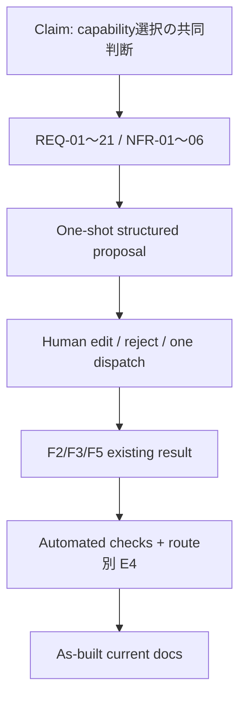
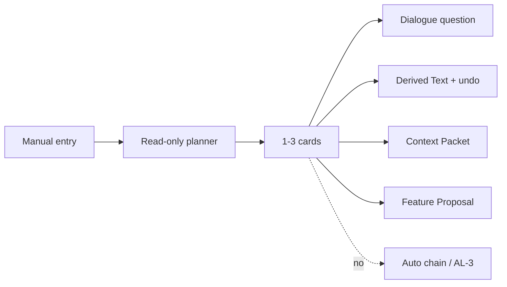
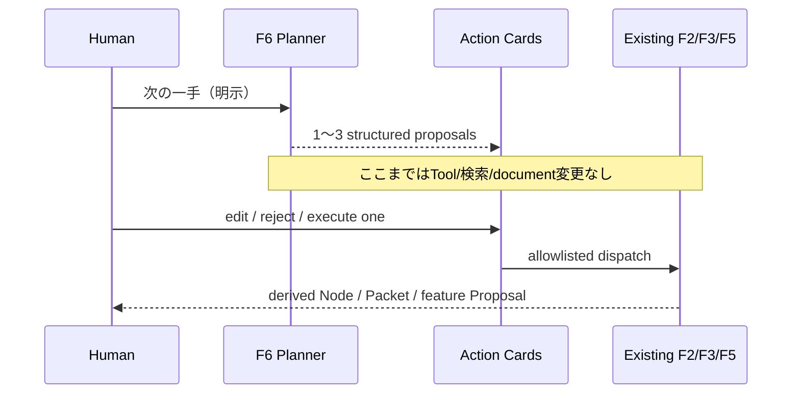

# Review Packet — F6 Collaboration Orchestration Core

## Review Purpose

F6 を generic workflow / Agent cockpit にせず、現在の Workspace に合う「次の一手」を少数提案し、人間が一件だけ既存能力へ dispatch する core として実装してよいか確認する。

## Decisions Requested

1. Manual `次の一手` → 1〜3 cards → single dispatch を F6 core とする。
2. 初期 allowlist を clarify / compare / counterpoint / Web / Relation / Cluster に限定する。
3. role / AL / route は kind ごとの code mapping とし、自由編集 UI を作らない。
4. proposal set は runtime-only、planner payload は bounded hints / image metadata-only とする。
5. Contextual Proposal layer Go + route family 2/3 Go を F6 core Gate とする。

## Maximum Risks

| Risk | Impact | Mitigation | Residual risk |
| --- | --- | --- | --- |
| 提案が既存menuの言い換えに留まる | F6固有価値がない | 理由・優先順位・clarifyをE4評価 | model / task依存は残る |
| card確認が入口探索より重い | 新しい管理作業になる | 最大3、manual entry、single dispatch | 実課題でしか判断できない |
| LLMがunsupported action / targetを出す | 誤実行・予測不能 | fixed catalog、全体validation、dispatch再検証 | validだが不適切な提案はE4対象 |
| proposalとfeature Acceptが混同される | Relation / Viewが無断確定 | 二段階境界とcopyをE2E/E4確認 | UI理解は人間判定が必要 |
| scope変更後に古いcardを実行 | stale内容でaction開始 | correlation / revision / eligibility再検証 | provider自体の物理cancelなし |
| planner送信量が増える | privacy / cost / wait悪化 | bounded hints、Image metadata-only、最大40 | excerpt品質とのtradeoff |
| Go判定がchild action回帰だけになる | orchestration未検証 | proposal layer独立Gate、2/3 family条件 | E4 task設計の質に依存 |

## Open Questions / Go / No-Go

| Item | Blocks implementation | Decision condition |
| --- | --- | --- |
| manual entryで十分か | no | entry忘れが実課題の主要摩擦なら後続opt-in trigger |
| target subset編集量は適切か | no | card修正が頻発・複雑ならHoldしてscope UI再検討 |
| clarify cardは自然か | no | 曖昧課題E4で通常Dialogueより不自然ならHold/Stop |
| Cluster対象2件は有用か | no | structure E4で誤提案が多ければeligibility閾値を上げる |
| physical cancelが必要か | no | provider待機がlocal cancel後も実害なら後続plan |
| F6 core Go | yes at acceptance | proposal layer Go、2/3 family Go、Context/Control Stopなし |

## Plan Overview

## Decision / Impact Overview

## Proposal / Execution Boundary

## Traceability Snapshot

| Area | REQ | WP | Evidence |
| --- | --- | --- | --- |
| Manual context / privacy | REQ-01〜03, NFR-03/04 | WP-1/4 | payload + F6-01/05 |
| Structured planner | REQ-04〜06, REQ-17 | WP-1/2 | Go/TS validation + faults |
| Card control / clarify | REQ-07〜09, REQ-18 | WP-4 | component + F6-01/05 + E4 |
| Transform dispatch | REQ-10/13/14/16 | WP-3 | F6-02 |
| Research dispatch | REQ-11/13/14/16 | WP-3 | F6-03 |
| Structure dispatch | REQ-12〜16 | WP-3 | F6-04 |
| Lifecycle / persistence | REQ-15〜17, NFR-02/05/06 | WP-3 | F6-05 |
| Regression / value Gate | REQ-19〜21, NFR-01 | WP-0/5 | commands + separate E4 |

## Core E2E

| Scenario | Main assertion |
| --- | --- |
| F6-01 | manual call、1〜3 cards、no pre-execution side effect、edit/reject/re-suggest |
| F6-02 | exact-target transform、one call、derived result、stale、undo |
| F6-03 | edited query、one Web call、Context Packet、no document/Dialogue mutation |
| F6-04 | structure proposal生成とfeature Acceptを分離 |
| F6-05 | clarify、cancel/late no-op、invalid response、lifecycle、a11y、regression |

## Human Gate

- 比較課題、外部根拠課題、構造課題、曖昧課題を実施する。
- Contextual Proposal / Transform / Research / Structure を別々に Go / Hold / Stop 判定する。
- Discovery、Context / Control、Collaboration、Result return、Friction、Return intent を記録する。
- Tool call数、採用率、介入回数だけでGoにしない。

## Review Checklist

- [ ] F6 が既存 capability の追加計画ではなく選択支援として理解できる。
- [ ] suggestion 生成と action 実行が分離されている。
- [ ] initial / future / rejected の境界が明確である。
- [ ] action kind、role、AL、route、target、effect、control が traceable である。
- [ ] unknown / invalid / stale / cancel は no-op になる。
- [ ] planner payload に full body / image pixel / secret が入らない。
- [ ] Relation / Cluster の二段階 Accept が維持される。
- [ ] Action Proposal は Save / history / telemetry を増やさない。
- [ ] F6-01〜05 が REQ と failure path を覆う。
- [ ] E4 Gate が child feature regression と orchestration value を分離する。
- [ ] `90_status.md` の全 REQ / NFR が todo で初期化されている。
- [ ] worklog が Step 0〜8 を記録している。

## Planning Go / No-Go

**Planning recommendation: Go for implementation of the bounded core.**

ただし、AL-3、画像、multi-step、自動triggerを同時実装する変更は plan amend と再レビューを必要とする。

