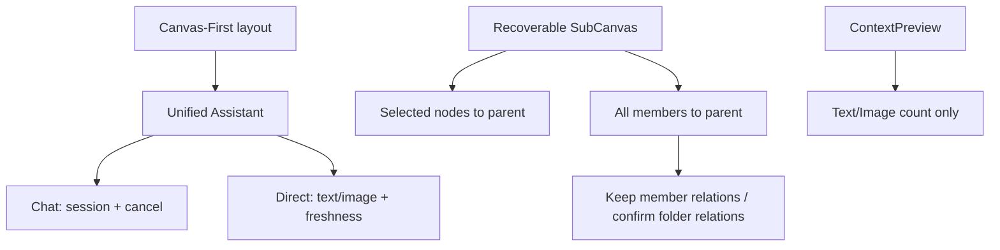

# Review Packet — fm-doc-canvas GUI Update (amended)

## Decisions Adopted

1. i18n は部分実装せず別 Full Plan へ分離する。
2. 任意 Canvas picker は作らず、SubCanvas から親 Canvas へ戻す操作を提供する。
3. SubCanvas 解体は member と member Relation を保持し、Folder Relation は件数明示・確認後に削除する。
4. Chat / Direct は共通 draft を使うが、停止は Chat のみ。Direct は stale guard を使う。
5. ContextPreview は件数 badge のみとし exclusion UI を廃止する。

## Maximum Risks

| Risk | Impact | Mitigation | Residual risk |
| --- | --- | --- | --- |
| dissolve が Relation / layout を壊す | high | atomic command、Folder Relation限定削除、deterministic placement、Undo完全比較 test | parent node 密集時に多少重なる |
| late Direct result が別Canvasへ入る | high | scope snapshot と apply直前 freshness guard | backend計算自体は停止しない |
| Chat / Direct state が分裂する | high | draft authorityを `useChatStore` に一本化、single operation | store migration の実装量 |
| PromptBar削除で既存導線/E2Eが壊れる | medium | 機能移植後に最後に削除、Playwright更新 | selector更新漏れ |
| exclusion廃止後も stale ID が効く | medium | load/replace normalize + resolver regression test | 外部古いruntime fixture |

## Open Questions / Go-No-Go

計画上の未決定はない。実装時の Gate は次のとおり。

| Gate | Go condition | No-Go condition |
| --- | --- | --- |
| Safe dissolve | member / Relations / positions / Undo の domain test pass | silent Relation loss または partial commit |
| Unified Assistant | action matrix、draft、freshness の test pass | Direct result の cross-canvas apply |
| PromptBar removal | Direct Text / Image / Web Search が drawerから動作 | 旧導線にしかない機能が残る |
| Acceptance | build + test + Playwright + manual UX pass | active REQ evidence不足 |

## Plan Overview

## Traceability Snapshot

| Area | REQ | WP | Primary evidence |
| --- | --- | --- | --- |
| Layout | 02,03,04,N01 | WP-1 | Playwright viewport |
| SubCanvas | 10,12,14,N02 | WP-2 | domain + Playwright + Undo |
| Assistant | 05,06,07,08,15,N01,N02 | WP-3 | store/payload + Playwright |
| Context | 09 | WP-4 | resolver + Playwright |
| Regression | 13 | WP-5 | mise command outputs |

## Checklist

- [x] Active REQ と deferred ID を分離した。
- [x] 各 active REQ に verification / evidence class がある。
- [x] Chat / Direct action matrix と lifecycle が定義されている。
- [x] Relation-aware dissolve と parent lift が定義されている。
- [x] 正規 Build / logic / Playwright コマンドを定義した。
- [x] `90_status.md` に active non-functional REQ を含めた。
- [x] `91_worklog.md` に改訂判断を追記する。
