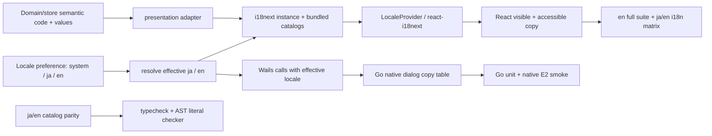

# Implementation Specification — 全 UI i18n (2026-08-17)

## 1. Technical Stack

| Item | Adopted | Evidence |
| --- | --- | --- |
| Core i18n | `i18next@26.3.6` exact | `docs/cheatsheet/ui_i18n.md`: install/import/init/interpolation/plural/language switch pass |
| React integration | `react-i18next@17.0.11` exact | React 18.3.1 / TS 5.6 peer compatibility、`initReactI18next` spike pass |
| Resource delivery | bundled TypeScript modules | offline、first-render deterministic、type inference |
| Locale detection | project-owned resolver | `localStorage` preference + `navigator.languages`; detector plugin 不使用 |
| UI integration | `useTranslation` + `LocaleProvider` + presentation adapters | React rerender と domain separation |
| Completeness gate | TypeScript typecheck + custom TS AST checker + catalog test | current TypeScript devDependency を再利用 |
| E2E | existing Playwright 1.62.1 / Wails harness | baseline 73/73 pass |

`i18next-http-backend`、`i18next-browser-languagedetector`、TMS SDK、追加 accessibility library は導入しない。

## 2. Architecture



翻訳関数は presentation layer に閉じ込める。domain state は locale 非依存の semantic value を保持し、locale 切替で document/state mutation を起こさず再描画だけを行う。

## 3. File Structure

### New files

```text
frontend/src/i18n/
  catalogTypes.ts          # locale/catalog shape types
  resources/ja.ts          # canonical Japanese resource shape
  resources/en.ts          # CatalogShape<typeof ja> を satisfies
  i18n.ts                  # instance init/config/bootstrap
  localePreference.ts      # storage、system resolution、normalization
  LocaleProvider.tsx       # preference/effective locale lifecycle + hook
  messages.ts              # UiMessageDescriptor and typed presenter
  formatters.ts            # Intl number/date helpers
  presentation.ts          # enum/status/relation/role/action label adapters
frontend/scripts/check-i18n.mjs
frontend/src/tests/i18n.test.ts
frontend/vite.i18n-test.config.ts
frontend/e2e/ce2e-i18n.spec.ts
backend/file_dialog_copy.go
backend/file_dialog_copy_test.go
```

### Existing files changed by area

| Area | Target files |
| --- | --- |
| Bootstrap / package | `frontend/package.json`, lockfile, `frontend/src/main.tsx` |
| Shell / settings | `frontend/src/App.tsx`, `components/drawer/SettingsDrawer.tsx`, layout components |
| Canvas / node / dialogs | `components/canvas/**/*.tsx`, `components/ui/*.tsx`, `components/drawer/EditorDrawer.tsx` |
| Assistant / context / proposals | `components/chat/*.tsx`, `components/drawer/ChatDrawer.tsx`, `components/context/*.tsx`, `components/proposal/*.tsx`, `components/collaboration/NextActionPanel.tsx` |
| State / domain | `store/useAppStore.ts`, `store/useChatStore.ts`, `domain/orchestration.ts`, user-visible result/error producers in `domain/*.ts`, `types/*.ts` |
| Wails boundary | `frontend/src/runtime/runtimeEnvironment.tsx`, `frontend/src/runtime/e2eBridge.ts`, `app.go`, `backend/file.go`, generated `frontend/wailsjs/go/main/App.*` |
| Tests | `frontend/src/tests/*.ts`, `frontend/e2e/helpers.ts`, affected existing E2E specs, `mise.toml` only if task wiring needs adjustment |
| Dead UI | delete `frontend/src/components/layout/PromptBar.tsx` after import absence check |

## 4. Catalog Contract

### 4.1 Shape and key policy

- `ja.ts` を canonical nested resource とし、key は `common.action.cancel`、`settings.language.label`、`error.canvas.saveFailed` のような semantic English path とする。
- 値は日本語、`en.ts` は同じ nested shape を `CatalogShape<typeof ja>` で `satisfies` する。
- `CatalogShape<T>` は leaf literal type を `string` へ広げ、missing / extra key を compile time で拒否する。
- value が空白のみでないことを runtime catalog test で全 leaf 走査する。
- natural-language text を key として使わない。component が動的 key string を組み立てない。
- catalog は feature namespace 相当の top-level group に分けるが、MVP は一つの bundled `translation` namespace とし、lazy load は行わない。

```ts
export const ja = {
  common: { action: { cancel: "キャンセル" } },
  context: {
    items: "{{count}} 件",
    items_one: "{{count}} 件",
    items_other: "{{count}} 件",
  },
} as const;

export const en = {
  common: { action: { cancel: "Cancel" } },
  context: {
    items: "{{count}} items",
    items_one: "{{count}} item",
    items_other: "{{count}} items",
  },
} satisfies CatalogShape<typeof ja>;
```

plural key は base + `_one` + `_other` を両 catalog に持ち、selector から base key と `{count}` を渡す。日本語は同文言でも shape を揃える。

### 4.2 i18next configuration

`frontend/src/i18n/i18n.ts` は singleton を作り、React mount 前に `await initI18n(effectiveLocale)` する。

```text
supportedLngs: ["ja", "en"]
fallbackLng: "en"
resources: bundled ja/en
defaultNS: "translation"
returnNull: false
interpolation.escapeValue: false
react.useSuspense: false
TypeScript CustomTypeOptions: resources + strictKeyChecks + selector API
```

初期化失敗時は key を表示して続行せず、bootstrap error を console に出して English bundled resource で一度だけ fallback init する。resource は local constant なので通常は失敗しない。

## 5. Locale Lifecycle

### 5.1 Types and storage

```ts
type LocalePreference = "system" | "ja" | "en";
type SupportedLocale = "ja" | "en";
const LOCALE_STORAGE_KEY = "fm-doc-canvas.locale";
```

- `readLocalePreference()` は `localStorage` access を `try/catch` し、missing/invalid/access failure を `system` とする。
- `resolveSystemLocale(navigator.languages, navigator.language)` は lower-case BCP 47 prefix を調べ、最初の `ja` / `ja-*` を `ja`、最初の `en` / `en-*` を `en`、supported match がなければ `en` とする。
- 明示 `ja` / `en` は system locale より優先する。
- `setPreference` は storage、i18next language、`document.documentElement.lang` を同期し、workspace/store action を dispatch しない。
- `system` 選択時だけ `window.languagechange` を購読し、effective locale が変わった場合に再翻訳する。
- storage write failure は current session の state を維持し、console warning のみにする。UI operation を失敗扱いにしない。

### 5.2 React integration

- `main.tsx` は preference/effective locale を解決し、i18next init 完了後に root を mount する。
- root を `LocaleProvider` で wrap する。
- `useLocale()` は `{ preference, effectiveLocale, setPreference }` を返す。
- Settings drawer の最上部に Language section を置く。option value は `system` / `ja` / `en`、display は current locale の `System` と self-name `日本語` / `English`。
- language change は Settings の unsaved AI config を保存・破棄せず、drawer/focus/current operation を維持する。

## 6. UI Migration Rules

### 6.1 Included copy

- JSX text、button/link/menu/dialog label
- `aria-label`、`aria-description` の prose、`title`、`placeholder`、`alt`
- loading/empty/success/error/retry/recovery guidance
- status/operation/relation/role/action-level presentation
- count / plural / date / number unit
- native application-owned dialog title / file filter label

### 6.2 Excluded literal categories

次は翻訳せず、AST checker allowlist に pattern と reason を記録できる。

- product / provider / model: `FM Doc Canvas`, `OpenAI`, `OpenRouter`, `Google`, `xAI`, model ID
- protocol / format / code: `URL`, `JSON`, `Markdown`, `Marp`, `AL-0`, enum value、test id
- punctuation / symbols: `→`, `·`, `↑`, `×`
- user/model/source value、filename、URL、path、revision / ID

`FM Doc Canvas` のような brand は label として literal のままでよいが、その周辺説明は catalog に置く。

### 6.3 Presentation mappings

- `domain/orchestration.ts` の `roleLabel`、`actionLevelLabel`、`routeLabel`、`documentEffect`、`control`、`resultSurface` の prose を domain constant から除去する。
- domain は `NextActionKind`、role、AL、route、document-effect code、control code を返す。
- `i18n/presentation.ts` の exhaustive `switch` / typed map が catalog selector と params を返す。default branch は `never` check とする。
- Tool status、proposal status、relation kind/direction、context packet status も同じ adapter pattern を使う。
- component 内で enum を `replace` / capitalization して表示しない。

### 6.4 App-owned default content

- generic chat title は persisted `title` を直接表示せず、`isDefaultTitle === true` の間は catalog の default title を表示する。
- storage compatibility のため、新規 session の persisted placeholder は既存 stable value `新しい会話` と marker を維持してよい。表示は marker を正とし、locale 非依存にする。
- 最初の user message による title 自動命名後は `isDefaultTitle=false` とし、locale switch で title を変更しない。
- New Text / Artifact / Canvas 等の app-owned default label を作る箇所は、UI action boundary で現在 locale の値を明示引数として domain command へ渡す。保存後は content として変更しない。

## 7. User-Facing Message / Error Boundary

### 7.1 Descriptor

`lastError`、chat `loadError/saveError/contextWarning`、UI notification を raw `string` から discriminated `UiMessageDescriptor` へ変更する。

```ts
type UiMessageDescriptor =
  | { code: "canvas.saveFailed" }
  | { code: "canvas.loadFailed" }
  | { code: "subcanvas.moveSuccess"; values: { count: number } }
  | { code: "proposal.stale" }
  | { code: "search.failed"; values?: { provider?: string } };
```

- `messages.ts` は code ごとの catalog selector と required value を exhaustive に結び付ける。
- descriptor に locale 済み prose を保存しないため、表示中 message は locale change で自動再翻訳される。
- raw `unknown` / `Error` は operation boundary で `console.error` へ記録し、descriptor には入れない。primary UI に stack/provider body/pathを表示しない。
- domain が既に stable code（例: `suggest-requires-2-nodes`）を返す箇所は typed domain code として維持し、store adapter が `UiMessageDescriptor` へ変換する。
- domain が prose error を返す箇所は、UI へ到達するものを code + params へ変更する。persistence validation 等の developer diagnostic は catch boundary で operation-level localized message に包む。
- Settings の `alert` は application-owned inline/banner message へ置き換える。native browser `alert` を新たに増やさない。

## 8. Wails Native Dialog Localization

### 8.1 Binding changes

effective locale を call 時に渡す。

```text
SaveCanvasToFile(jsonData, locale)
LoadCanvasFromFile(locale)
ExportMarkdown(content, locale)
ExportMarkdownWithFilename(content, defaultFilename, locale)
ExportImage(src, locale)
```

変更対象は `App` method、`FileService` method、generated `wailsjs`、`AppBackendPort`、production/E2E adapter、全 call site。locale は `getEffectiveLocale()` の current value を各 async call 開始時に snapshot する。

### 8.2 Go copy table

`backend/file_dialog_copy.go` に `normalizeDialogLocale` と pure `fileDialogCopy(kind, locale, ext)` を置き、`ja` / `en` の title/filter display name を返す。不正 locale は `en`。path、default filename、pattern は翻訳しない。

| Kind | Japanese title | English title |
| --- | --- | --- |
| save canvas | Canvas を保存 | Save Canvas |
| open canvas | Canvas を開く | Open Canvas |
| export markdown | Markdown をエクスポート | Export Markdown |
| export image | 画像をエクスポート | Export Image |

file filter は `JSON ファイル (*.json)` / `JSON Files (*.json)`、`Markdown ファイル (*.md)` / `Markdown Files (*.md)`、`画像ファイル (*.<ext>)` / `Image Files (*.<ext>)` とする。OS-owned confirmation/button copy は対象外。

## 9. Static and Runtime Gates

### 9.1 AST hard-coded literal checker

`frontend/scripts/check-i18n.mjs` は TypeScript compiler API で production `frontend/src/**/*.{ts,tsx}` を走査する。

検出対象:

- non-whitespace `JsxText` に letters / Japanese script がある
- `aria-label` / `title` / `placeholder` / `alt` の natural-language literal
- JSX expression 内の natural-language string / no-substitution template
- `alert` / `confirm` / user-facing setter への literal
- presentation field（`label`, `message`, `description`, `emptyText` 等）の natural-language literal

除外:

- `frontend/src/i18n/resources/**`
- test / E2E / fixture files
- import path、className、id/testid、URL、known symbol
- `literalAllowlist` の exact file + text/pattern + reason に一致する項目

checker は file:line、kind、text excerpt を出し、unallowlisted 1 件以上で exit 1。件数スナップショットだけで pass としない。

### 9.2 Catalog/runtime test

`frontend/src/tests/i18n.test.ts` は次を検証する。

- `ja` / `en` flattened key set 完全一致
- value が non-empty string
- supported/invalid/system locale resolution
- selector translation、interpolation、0/1/2 plural、Intl number/date
- all `UiMessageDescriptor` / enum presentation mapping が両 locale で non-key text を返す
- locale change で同一 descriptor の表示値が変わる
- locale storage key が workspace/chat serialization に現れない

`frontend/package.json` に `test:i18n` を追加し、AST checker + Vite SSR test を実行する。既存 `test` script に組み込み、`mise run test` から必ず実行されるようにする。

## 10. E2E Strategy

### 10.1 Locale control

`frontend/e2e/helpers.ts` に次を追加する。

- `setLocaleBeforeLoad(page, preference, navigatorLanguages?)`: `addInitScript` で localStorage と必要な navigator stub を page script 前に設定
- `openApp(page, { locale: "en" })`: existing suite の deterministic default
- `switchLocale(page, preference)`: Settings UI 経由
- `expectEffectiveLocale(page, locale)`: `<html lang>` と i18next state / key UI を確認

既存 `openApp(page)` は default `en` とし、現在混在している日本語 selector を stable role/test id/state anchor へ移す。translated copy の assertion は `ce2e-i18n.spec.ts` に集約する。

### 10.2 Matrix

- existing 73+ workflow suite: `en` で一回
- `ce2e-i18n.spec.ts`: `ja` / `en` の project loop で I18N-01〜07
- network guard は継続し、catalog fetch が発生しないことを request failure なしで確認
- 1280x720 / 1920x1080 で `scrollWidth <= clientWidth`、dialog/menu viewport内、primary action visible を確認
- copy quality は catalog 自体を oracle にした E2E だけで pass とせず、E4 human sweep を別 evidence にする

## 11. Work Packages

### WP-1 — Foundation / Locale Lifecycle

**REQ:** REQ-02、03、REQ-N02

**Targets:** package/lockfile、`src/i18n/**` foundation、`main.tsx`、`SettingsDrawer.tsx` Language section、i18n unit config、dead `PromptBar.tsx` removal。

**Tasks:**

1. exact dependencies を追加する。
2. catalog shape、minimal ja/en resource、i18next bootstrap、LocaleProvider、storage resolver を実装する。
3. first-render、switch、reload、system resolution を unit/E2E seam から操作可能にする。
4. `PromptBar.tsx` の import absence を再確認して削除する。

**Completion:** typecheck/build pass、locale unit tests pass、Settings switch で state loss なし、offline初期化。

### WP-2 — Semantic Messages / Content Integrity

**REQ:** REQ-05、06、08

**Targets:** `i18n/messages.ts`, `presentation.ts`, `formatters.ts`, `types/*.ts`, `store/useAppStore.ts`, `store/useChatStore.ts`, `domain/orchestration.ts`, UIへ到達する `domain/*.ts` result/error producer、persistence tests。

**Tasks:**

1. `UiMessageDescriptor` と exhaustive presenter を導入する。
2. `lastError` / chat error/warning/notification を descriptor 化する。
3. domain presentation prose を semantic code へ分離する。
4. default chat title marker、app-owned default label、user content 非変更を実装・検証する。
5. raw Wails/provider error を console diagnostic + localized operation message に分離する。

**Completion:** raw user-facing string type が store error path に残らず、ja/en mapping unit、fault、roundtrip、locale-switch test pass。

### WP-3 — Shell / Canvas / Native Dialogs

**REQ:** REQ-01、04、05、07、09、REQ-N01

**Targets:** `App.tsx`、Settings/Editor、layout、canvas/node、GeneratedView、ContextMenu、Relation/SubCanvas dialogs、`runtimeEnvironment.tsx`、`e2eBridge.ts`、`app.go`、`backend/file*.go`、generated binding。

**Tasks:**

1. shell/canvas/editor/dialog の visible/accessibility copy を catalogへ移す。
2. count/relation/status formatting を adapter へ移す。
3. native dialog locale parameter と Go copy table/unit test を追加する。
4. translated copy length に合わせ wrap/min-width/overflow を修正する。

**Completion:** WP area の AST violations 0、Go/unit/build pass、ja/en shell E2E、Windows native smoke handoff ready。

### WP-4 — Assistant / Context / Proposal Surfaces

**REQ:** REQ-01、04、05、06、09、REQ-N01

**Targets:** chat components、`ChatDrawer.tsx`、Context components、Proposal components、`NextActionPanel.tsx`、ToolCard、related tests。

**Tasks:**

1. Chat/Direct header/input/session/status/tool/result copyを catalogへ移す。
2. Context/Promote/Projected Context、Relation/Cluster proposals、Next Action mappingを移す。
3. long card/dialog/error/recovery guidance を sentence-level message にし、fragment concatenationを除去する。
4. locale switch during active/error/result state を再描画だけで処理する。

**Completion:** WP area の AST violations 0、ja/en assistant vertical slice、fault/switch/state preservation、viewport checks pass。

### WP-5 — Completeness Gate / E2E / Human Handoff

**REQ:** 全 REQ、特に REQ-01、03、04、09、REQ-N01〜N03

**Targets:** AST checker、allowlist、catalog tests、all affected E2E specs、`ce2e-i18n.spec.ts`、review/evidence docs。

**Tasks:**

1. checker を production tree 全体へ適用し、allowlist を理由付きで review する。
2. existing workflow selector を locale-stable にする。
3. full `en` suite + i18n `ja/en` matrix + supported viewport を実行する。
4. human reviewer 用に主要 screen、error、native dialog、copy glossary の確認手順を提示する。

**Completion:** literal 0、catalog drift 0、test/build/full E2E pass、E4/EX evidence ready。implementation session は acceptance を記入しない。

## 12. Requirement Traceability

| REQ | Specification area | WP | Main verification |
| --- | --- | --- | --- |
| REQ-01 | 4, 6, 9, 10 | WP-3/4/5 | AST 0 + ja/en E2E + E4 |
| REQ-02 | 5, 10 | WP-1/5 | resolver unit + switch/reload E2E |
| REQ-03 | 3, 4, 9 | WP-1/5 | typecheck + parity/missing test |
| REQ-04 | 3, 6, 11 | WP-3/4/5 | file inventory + AST + screen sweep |
| REQ-05 | 4, 6, 9 | WP-2/3/4 | formatter/message unit + E2E |
| REQ-06 | 7, 9 | WP-2/4/5 | typecheck + fault E2E |
| REQ-07 | 8 | WP-3/5 | Go unit + binding pointer + native E2/EX |
| REQ-08 | 5, 6.4, 7 | WP-2/5 | roundtrip + switch snapshot E2E |
| REQ-09 | 6, 10 | WP-3/4/5 | keyboard/role + selector review |
| REQ-N01 | 6, 10 | WP-3/4/5 | viewport automation + human E4 |
| REQ-N02 | 4, 5, 8 | WP-1/2/3/5 | offline build/E2E + persistence |
| REQ-N03 | 9, 10, 11 | WP-5 | all commands/evidence/status review |

## 13. Verification Commands

```text
mise run test
mise exec -- npm --prefix frontend run test:i18n
mise run build
mise run e2e
```

Expected:

- exit 0
- catalog missing/extra/empty 0
- hard-coded UI literal allowlist外 0
- Go/frontend logic pass
- production Wails build pass
- existing Core E2E + i18n ja/en matrix pass
- E2E child process/temp root cleanup pass

Manual:

- 1280x720 / 1920x1080、ja/en
- Header → Settings → Canvas menu/dialog → Assistant → Context/Proposal → error/recovery
- keyboard Tab/Shift+Tab/Escape/focus return、localized accessible name
- Windows native Save/Open/Export title/filter
- terminology/copy quality、user/model content非翻訳

## 14. Known Caveats

- OS-owned native dialog button/shell copy は application catalog で制御しない。
- macOS/Linux native display は acceptance environment がなければ EX。Go pure copy test と binding inspection は必須。
- selector API / resource type inference が compile time を悪化させた場合は namespace split または selector optimization を再調査し、plan amend 後に変更する。
- AST checker は semantic correctness を保証しない。E2E と人間 review を省略しない。
- persisted default placeholder の内部値が日本語でも、`isDefaultTitle` marker により UI へ直接表示しない。raw storage は翻訳 completeness の対象外。

