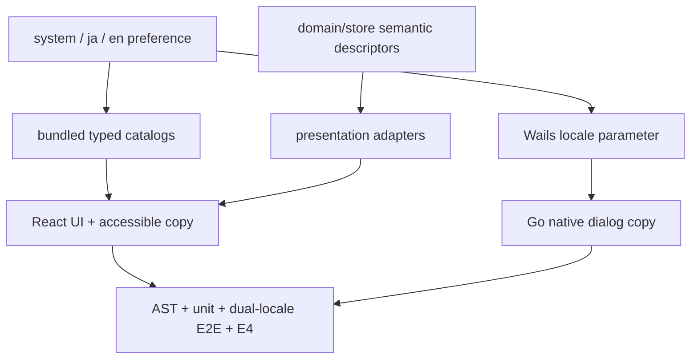
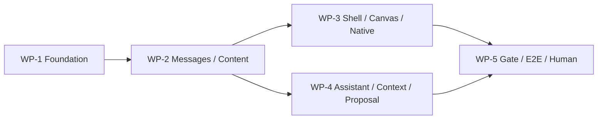

# Review Packet — plan_20260817_ui_i18n

## Review Goal

`plan_20260816_gui_update` でdeferした全UI i18nを、部分移行・data mutation・E2E driftなしで実装開始できるか判断する。

## Decisions Adopted

1. `ja` / `en` bundled TypeScript catalog、offline delivery。
2. exact `i18next@26.3.6` + `react-i18next@17.0.11`。
3. preferenceは`system` / `ja` / `en`、application-local storage、React mount前init。
4. domain/storeはsemantic code + values、translationはpresentation boundary。
5. user/AI/persisted contentは翻訳しない。default chat titleだけmarkerで表示時翻訳。
6. native dialogはeffective localeをbindingへ渡し、Go copy tableでtitle/filterを作る。
7. existing full E2Eは`en`、i18n vertical sliceは`ja`/`en` matrix。
8. AST violation 0 + catalog drift 0 + human copy reviewまで部分完了を受理しない。

## Maximum Risks

| Risk | Impact | Mitigation | Residual risk |
| --- | --- | --- | --- |
| computed/domain stringの漏れ | mixed UI | typed descriptor/presenter + AST + ja/en E2E + E4 | human-only semantic漏れ |
| English copy expansion | narrow UI崩れ | 1280/1920 overflow E2E + visual review | platform font差 |
| locale switch中のasync/error |旧言語またはstate loss | proseでなくdescriptorをstate保持 | third-party contentは原文 |
| persisted title/label mutation | user data変更 | marker display、roundtrip/snapshot test | legacy ambiguous title |
| E2E selector drift | regression検出低下 | workflow selectorとcopy assertionを分離 | test id過剰化 |
| native dialog OS差 |一部UIが未確認 | Go unit + Windows E2 + other OS EX | shell表示差 |
| catalog type compile負荷 | developer UX低下 |実測後namespace/selector最適化 | key数増加時再評価 |

## Open Questions / Go-No-Go

| Item | Blocks | Decision condition |
| --- | --- | --- |
| Library compatibility | No — verified | exact version install/init/select/plural/changeLanguage pass |
| Core E2E availability | No — verified | baseline 73/73 pass |
| Product locale scope | No | `ja`/`en`; other locales deferred |
| Content boundary | No | user/model/existing persisted content excluded |
| macOS/Linux native observation | No for implementation; acceptance EX possible | REQ-07 fallback and residual risk review |

**Planning recommendation: Go for implementation.** Human reviewで変更が必要ならREQの意味を変えずplan amendを行う。

## Plan Overview



## Work Package Flow



## Traceability Snapshot

| REQ | WP | Evidence | Main concern |
| --- | --- | --- | --- |
| REQ-01 | 3/4/5 | E1/E2/E4 | 全copyと例外分類 |
| REQ-02 | 1/5 | E1/E2/E3 | first render / persistence |
| REQ-03 | 1/5 | E1/E3 | key parity / exact lock |
| REQ-04 | 3/4/5 | E1/E2/E3/E4 | 31+ files一括移行 |
| REQ-05 | 2/3/4 | E1/E2/E3 | plural / status mapping |
| REQ-06 | 2/4/5 | E1/E2/E3 | raw error leakage |
| REQ-07 | 3/5 | E1/E2/EX | native OS差 |
| REQ-08 | 2/5 | E1/E2/E3 | content mutation |
| REQ-09 | 3/4/5 | E1/E2/E3 | a11y/selector drift |
| REQ-N01 | 3/4/5 | E1/E2/E4 | copy length |
| REQ-N02 | 1/2/3/5 | E1/E2/E3 | offline/schema互換 |
| REQ-N03 | 5 | E1/E2/E4 | completion discipline |

## Plan-Specific Checks

- [ ] package exact versions / lockfileがcheatsheet targetと一致する。
- [ ] locale init完了前にReactをmountせず、key/fallback flashがない。
- [ ] preferenceはworkspace/config/chat JSONに混入しない。
- [ ] domain/storeにlocalized prose stateを残さない。
- [ ] raw `Error.message` / provider responseをprimary UIへ描画しない。
- [ ] ja/en catalogにmissing/extra/empty keyがない。
- [ ] AST allowlistはfile/pattern/reason付きで、brand/technical/symbolに限定する。
- [ ] visible copyとaccessible nameの意味/localeが一致する。
- [ ] sentenceをfragment concatenationで組み立てない。
- [ ] generic chat title markerとfirst-message namingを維持する。
- [ ] native binding/app/service/call siteを同一WPで更新する。
- [ ] existing workflow E2E selectorをlocale-stableにする。
- [ ] `en` full suite + `ja/en` I18N-01〜07を実行する。
- [ ] 1280x720 / 1920x1080のoverflow/focus/copyを両localeで確認する。
- [ ] native dialogのE2またはEX evidenceをREQ-07へ記録する。
- [ ] implementationはacceptance列を自己記入しない。

## Human Review Route

1. SettingsでSystem → 日本語 → Englishを切替し、open drawer/dialog/errorが即時変わる。
2. Header/Canvas/context menu/SubCanvas/Relation/Editorを両localeで確認する。
3. Chat/Direct/ToolCard/Context/Proposal/Next Actionのempty/loading/success/errorを確認する。
4. node/relation/source countの0/1/2、status/recovery guidanceを確認する。
5. user text、AI output、filename、URL、existing titleが切替で変わらないことを確認する。
6. 1280x720と1920x1080でcutoff/overflow、Tab/Escape/focus returnを確認する。
7. Windows native Save/Open/Export title/filterを確認し、他OSのavailabilityを記録する。

## Required Final Commands

```text
mise run test
mise exec -- npm --prefix frontend run test:i18n
mise run build
mise run e2e
```

## Reviewer Outcome

- [ ] Go
- [ ] Amend and re-review
- [ ] No-Go / abandon（reasonとreconsideration conditionを記録）

