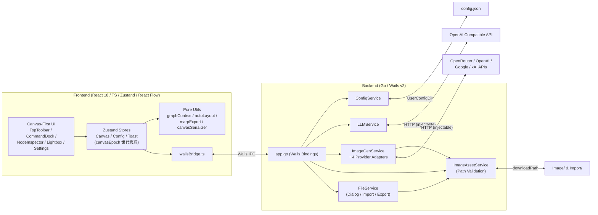

# Implementation Specification — Overview & Architecture Map

本設計書は、`docs/plan_20261123_core_rebuild/30_requirement.md` の全要求（`REQ-01`〜`REQ-15`）を実現するための全体構造・共通ポリシー・設計項目マップ・確認済み知識と未確認前提を定義する。達成条件の正本は [`30_requirement.md`](./30_requirement.md) に置く。

見通しを保つため、詳細なデータ構造・IF・プロバイダー通信仕様・UI 設計・失敗/失効時の振る舞い・受入確認手順は 3 つの分割設計書（`42_spec_*.md`）へ切り出している。

---

## 1. 分割設計書マップ

| 文書 | 担当領域 | 対応 REQ | 定義する設計項目 ID |
| --- | --- | --- | --- |
| [`42_spec_core_data_security.md`](./42_spec_core_data_security.md) | ビルド基盤・Wails ファサード・`config.json`・`canvas.json` 互換・パス解決・セキュリティ | `REQ-01`, `REQ-11`, `REQ-13`, `REQ-15` | `[D-001]`〜`[D-005]` |
| [`42_spec_providers_io.md`](./42_spec_providers_io.md) | LLM/Vision/Summary・4画像生成プロバイダー・画像保存/読込・D&Dインポート・各種エクスポート | `REQ-07`, `REQ-08`, `REQ-09`, `REQ-12` | `[D-006]`〜`[D-010]` |
| [`42_spec_canvas_ui.md`](./42_spec_canvas_ui.md) | Canvas-First UI・ノード/エディタ/ライトボックス・エッジ循環防止・コンテキスト収集・Auto-layout・非同期世代管理 | `REQ-02`, `REQ-03`, `REQ-04`, `REQ-05`, `REQ-06`, `REQ-10`, `REQ-14` | `[D-011]`〜`[D-018]` |

---

## 2. REQ ↔ 設計項目 ID マッピング

各設計項目の定義（`D-xxx: <項目名>`）は上記の各 `42_spec_*.md` に一意に配置する。

| REQ | 要求概要（正本は `30_requirement.md`） | 対応設計項目 ID | 主な詳細文書 |
| --- | --- | --- | --- |
| REQ-01 | `mise` 管理による Wails v2 + React/TS ビルド・テスト基盤 | `[D-001]`, `[D-002]` | `42_spec_core_data_security.md` |
| REQ-02 | キャンバス基本操作（パン、ズーム `0.1`〜`4.0`、選択、確認付き Clear Canvas） | `[D-011]`, `[D-012]`, `[D-018]` | `42_spec_canvas_ui.md` |
| REQ-03 | テキストノード機能・詳細エディタ（切替自動確定・サマリー再生成・元プロンプト追記） | `[D-013]`, `[D-018]` | `42_spec_canvas_ui.md` |
| REQ-04 | 画像ノード・ライトボックス（Data URL 表示・リサイズ・非破壊追記・拡大/出力） | `[D-014]`, `[D-008]`, `[D-005]` | `42_spec_canvas_ui.md`, `42_spec_providers_io.md` |
| REQ-05 | 有向エッジ連結と循環事前検出・拒否通知 | `[D-015]` | `42_spec_canvas_ui.md` |
| REQ-06 | コンテキスト収集・上流トラバーサル・分岐/ループ停止警告・可視化 | `[D-016]` | `42_spec_canvas_ui.md` |
| REQ-07 | LLM テキスト生成・Vision 入力・自動サマリー（失敗時本文維持） | `[D-006]`, `[D-013]`, `[D-018]` | `42_spec_providers_io.md`, `42_spec_canvas_ui.md` |
| REQ-08 | マルチプロバイダー画像生成（4種）・リクエスト単位切替・衝突回避保存 | `[D-007]`, `[D-008]`, `[D-018]` | `42_spec_providers_io.md`, `42_spec_canvas_ui.md` |
| REQ-09 | ファイルインポート（D&D で `.txt`/`.md`/画像取込、衝突回避コピー） | `[D-009]`, `[D-005]` | `42_spec_providers_io.md` |
| REQ-10 | オートレイアウト（接続関係を保った全ノード `LR` 自動再配置） | `[D-017]` | `42_spec_canvas_ui.md` |
| REQ-11 | キャンバス JSON 保存/読込と v1.0/v1.1 互換・秘匿情報非混入 | `[D-004]`, `[D-002]` | `42_spec_core_data_security.md` |
| REQ-12 | エクスポート機能（単体 `.md`、単体画像コピー、Marp スライド `.md`） | `[D-010]`, `[D-005]` | `42_spec_providers_io.md` |
| REQ-13 | ローカル設定管理（`config.json` 永続化・4プロバイダー非破壊・旧形式移行） | `[D-003]`, `[D-002]` | `42_spec_core_data_security.md` |
| REQ-14 | 新規 Canvas-First UI/UX と非同期状態・通知（ローディング・多重送信抑止・トースト） | `[D-011]`, `[D-018]` | `42_spec_canvas_ui.md` |
| REQ-15 | セキュリティ（画像パストラバーサル拒否、API Key の限定保存・ログ/JSON 非出力） | `[D-005]`, `[D-003]`, `[D-004]`, `[D-006]`, `[D-007]`, `[D-008]`, `[D-009]`, `[D-010]` | `42_spec_core_data_security.md` |

---

## 3. システム全体アーキテクチャと責務境界



### クリーン再構築ファイル構成（新規作成対象）

```text
fm-doc-canvas/
├── mise.toml
├── wails.json
├── go.mod / go.sum
├── main.go                           # Wails エントリポイント（DragAndDrop 有効化）
├── app.go                            # Wails バインド用ファサード
├── backend/
│   ├── config.go                     # Config構造体、デフォルト値、旧形式マイグレーション
│   ├── config_test.go
│   ├── path_base_dev.go              # //go:build dev 時の相対ベース解決（os.Getwd）
│   ├── path_base_prod.go             # //go:build !dev 時の相対ベース解決（os.Executable）
│   ├── sanitize.go                   # API Key マスキング・エラー正規化ヘルパー
│   ├── sanitize_test.go
│   ├── llm.go                        # OpenAI互換 Chat Completions (Text / Vision / Summary)
│   ├── llm_test.go
│   ├── image.go                      # ImageGenService, ImageGenProvider interface, ディスパッチ
│   ├── image_asset.go                # パス検証、衝突回避保存、URL取得、DataURL/FileURL解決
│   ├── image_asset_test.go
│   ├── provider_openrouter.go        # OpenRouter 画像生成アダプタ
│   ├── provider_openai.go            # OpenAI Images API & Responses API アダプタ
│   ├── provider_google.go            # Google Gemini generateContent アダプタ
│   ├── provider_xai.go               # xAI Images Generations & Edits アダプタ
│   ├── providers_test.go             # httptest による4プロバイダー単体テスト
│   ├── file.go                       # Canvas JSON 保存/読込、ImportFile、ExportMarkdown/Image
│   └── file_test.go
└── frontend/
    ├── package.json
    ├── tsconfig.json
    ├── vite.config.ts
    ├── vitest.config.ts              # 純粋関数単体テスト（E1）用
    ├── index.html
    └── src/
        ├── main.tsx
        ├── index.css                 # Tailwind + CSS カスタムプロパティ（ライトテーマ既定トークン）
        ├── App.tsx                   # Canvas-First 全体シェル & 通知/確認ダイアログレイヤー
        ├── types/
        │   ├── canvas.ts             # Runtime/Persisted ノード・エッジ・CanvasFile型
        │   └── config.ts             # AppConfig / ImageGenProvider 型
        ├── services/
        │   └── wailsBridge.ts        # Wailsバインディング呼び出しの薄いラッパー
        ├── utils/
        │   ├── graphContext.ts       # 上流トラバーサル、循環検出、複数選択順結合
        │   ├── graphContext.test.ts
        │   ├── autoLayout.ts         # Dagre 自動整頓（LR）
        │   ├── autoLayout.test.ts
        │   ├── marpExport.ts         # Marp スライド Markdown 変換
        │   ├── marpExport.test.ts
        │   ├── canvasSerializer.ts   # CanvasFile v1.0/v1.1 シリアライズ・正規化・秘匿情報除外
        │   └── canvasSerializer.test.ts
        ├── store/
        │   ├── useCanvasStore.ts     # nodes, edges, selection, activeInspector, promptInput, canvasEpoch
        │   ├── useConfigStore.ts     # config 読込・保存・ロード状態
        │   └── useToastStore.ts      # インアプリトースト通知キュー
        └── components/
            ├── canvas/
            │   ├── CanvasViewport.tsx    # ReactFlow本体、Wails OnFileDrop 受信、右クリックメニュー制御
            │   ├── TextCardNode.tsx      # テキストカード（本文/サマリー表示＋下部元プロンプト）
            │   └── ImageCardNode.tsx     # 画像カード（リサイズ＋欠損フォールバック＋下部プロンプト）
            ├── overlay/
            │   ├── TopToolbar.tsx        # 上部フローティングバー（追加/整頓/開く/保存/設定）
            │   ├── CommandDock.tsx       # 下部フローティングドック（コンテキストチップ＋入力＋切替）
            │   ├── NodeInspector.tsx     # テキスト詳細エディタ（Edit/Preview・サマリー・元プロンプト）
            │   ├── ImageLightbox.tsx     # 画像拡大オーバーレイ（全文プロンプト・追記・エクスポート）
            │   ├── SettingsModal.tsx     # タブ構成設定モーダル（LLM / 画像生成 / キャンバス管理）
            │   ├── ContextMenu.tsx       # 右クリックメニュー
            │   └── ToastContainer.tsx    # 非ブロッキング通知表示
            └── common/
                └── ConfirmDialog.tsx     # Clear Canvas 等の確認ダイアログ
```

---

## 4. 共通ポリシー（優先順位・副作用境界・既定方針）

### 4.1 競合時の優先順位（勝敗規則）
1. **画像生成プロバイダー選択**: リクエスト引数 `provider`（CommandDock の一時選択） > `config.json` の `imageGen.provider` > 既定値 `"openrouter"`。リクエスト引数で選択しても `config.json` は更新しない。
2. **画像保存先ベースディレクトリ解決（`downloadPath` が相対パスの場合）**: 環境変数 `FM_DOC_CANVAS_BASE_DIR`（テスト/検証用） > ビルド形態基準ディレクトリ（`dev` タグ時は `os.Getwd()`、通常ビルド時は `filepath.Dir(os.Executable())`）。`downloadPath` が絶対パスの場合はベース解決を行わずそのまま使用する（詳細は `[D-005]`）。
3. **既存 `config.json` の旧フラット形式マイグレーション**: プロバイダー別オブジェクト（`imageGen.<provider>`）に非空値が存在すればそれを優先し、空の場合のみ旧フラットフィールド（`imageGen.baseURL` / `model` / `apiKey`）から該当 `provider` へ移行する（詳細は `[D-003]`）。
4. **テキストカード表示内容**: `summary` が非空なら `summary` を表示し、空の場合のみ `content` を最大 8〜10 行クランプで表示する。
5. **エディタ編集中ドラフトとキャンバス操作の競合**: 別テキストノード切替・インスペクターを閉じる・JSON 保存実行時は、未確定ドラフトを先に確定（ストアへ反映）する。対象ノード削除・Clear Canvas・Load Canvas 実行時は、ドラフトを破棄してインスペクターを閉じる。

### 4.2 副作用の許容境界
- **`config.json` の書き込み**: `SaveConfig` の明示呼び出し（設定モーダルの「保存」ボタン押下）時のみ実行する。初回起動時や壊れた `config.json` の読み込み失敗時には、ファイルを自動上書きしない。
- **Clear Canvas**: `ConfirmDialog` でユーザーが明示的に「初期化する」を確定した後にのみ、ノード・エッジ・選択状態・インスペクターを消去し `canvasEpoch` をインクリメントする。
- **画像ファイルのディスク保存と失効**: 画像生成 API が有効な画像データを返却した時点で `downloadPath` へ保存する。直後にフロントエンド側で `canvasEpoch` 失効（Clear/Load Canvas 済み）が検出された場合、キャンバスへのノード追加は抑止するが、ディスクへ保存済みの物理ファイルは自動削除しない（ユーザーデータ保全を優先）。

### 4.3 委譲された既定方針の反映（`30_requirement.md` 準拠）
- **ビジュアルテーマ**: ニュートラルなライトテーマを既定とし、CSS カスタムプロパティ（`--bg-canvas`, `--bg-surface`, `--text-primary`, `--border-subtle`, `--accent-primary` 等）でトークン化して将来のダークテーマ切替を容易にする（`[D-011]`）。
- **UI 言語**: MVP はシンプルな日本語 UI 固定とする（ラベル・トースト・確認ダイアログ・エラー概要文を日本語で統一、`[D-011]`）。
- **Auto-layout 方向**: 左右コネクタ（右出力 `source` → 左入力 `target`）と整合する左→右（`LR`）を既定とする（`[D-017]`）。

---

## 5. 確認済み知識と未確認前提の区別

| 分類 | 項目 | 状態・根拠 | 未確認時の確認タイミング・代替案 |
| --- | --- | --- | --- |
| **確認済み** | 4画像生成プロバイダー（OpenRouter / OpenAI Images & Responses / Google Gemini / xAI）のリクエスト/レスポンス構造 | `docs/cheatsheet/image_generation_providers.md`（2026-05-05 確認済み） | 外部実 API の稼働・モデル ID 有効性は `30_requirement.md` の `EX` 運用条件に従い実通信または代替確認で検証 |
| **確認済み** | OpenAI 互換 Chat Completions における Vision `content[].type="image_url"`（Data URL）形式 | `docs/cheatsheet/multimodal_vision.md`（2026-08-13 確認済み） | 実 LLM モデルの Vision 対応可否はローカルモック `E1`/`E2` ＋実利用設定で確認 |
| **確認済み** | ツールチェーン管理に `mise` を使用し、VCS に `jj` を使用する制約 | `AGENTS.md` | なし |
| **未確認前提** | ローカル開発環境における `mise` 導入状況（Go / Node.js / Wails v2.12 系のインストール・Windows WebView2 ビルド動作） | リポジトリ初期化直後のため未実測 | `REQ-01`（WP-1）開始時に `mise install` / `mise x -- go version` / `mise x -- wails doctor` を観測。`wails` CLI の `mise` 導入手段が環境に合わない場合は `go tool` / `go install` 経由の `mise` タスクへ切替 |
| **未確認前提** | `wails dev` 実行時に `-tags dev` が自動付与され、かつ `os.Getwd()` がリポジトリルートを指すか | Wails v2 の一般的挙動だが本環境で未実測 | `REQ-01` / `REQ-08` 実装時に `wails dev` で実測。もし `os.Getwd()` が異なる場合は `wails.json` 探索によるフォールバックを `path_base_dev.go` に適用する |
| **未確認前提** | Wails v2 の `EnableFileDrop` / `runtime.OnFileDrop` が Windows WebView2 上で React Flow のキャンバスドロップと干渉しないか | 本再構築コードでは未実測 | `REQ-09` 実装時に Windows 実機で `.md` / `.png` の D&D を実観測する |

---

## 6. 採用理由と主要トレードオフ

- **バックエンド 5 サービス分離 + `http.Client` 注入**: 外部 API 依存を標準ライブラリ `net/http` と小規模インターフェース（`ImageGenProvider`）に閉じることで、サードパーティ SDK 依存を避けつつ `httptest.Server` による決定的単体テスト（`E1`）を全プロバイダーで成立させる。
- **フロントエンド単体テスト基盤に `Vitest` を採用**: `30_requirement.md` が要求する純粋関数（`graphContext`, `autoLayout`, `marpExport`, `canvasSerializer`）の `E1` 検証を Vite 設定と共有して最小構成で実行できる。代案の Jest は ESM / TypeScript 設定が冗長になるため見送る。
- **非同期失効対策に `canvasEpoch` カウンタを採用**: Clear Canvas や Load Canvas のたびに単調増加する整数トークンを比較する軽量な仕組みで、古い非同期レスポンスが新しいキャンバスへ混入する事故を防ぐ。リクエストキャンセル（`AbortController` + Go `context.WithCancel` の Wails IPC 経由伝播）は実装コストが高く、MVP の実行予算に対して過剰なため見送る（結果破棄で合意動作を完全に守れる）。
