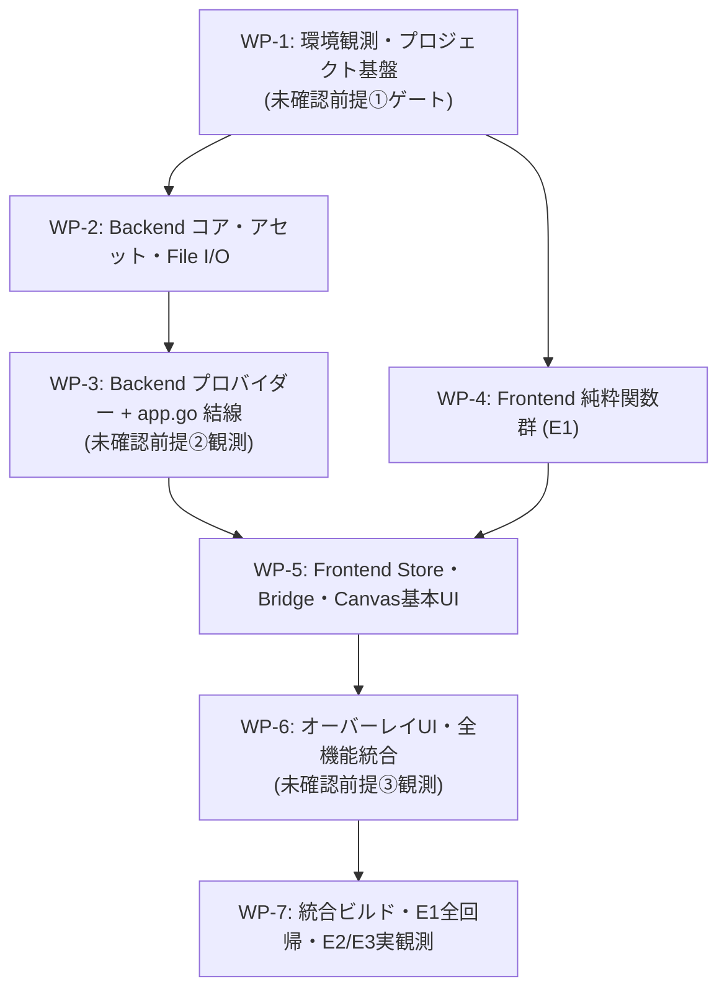

# Work Packages — plan_20261123_core_rebuild

本計画は、[`30_requirement.md`](./30_requirement.md)（`REQ-01`〜`REQ-15`）および [`40_specification.md`](./40_specification.md) / 各 `42_spec_*.md`（`[D-001]`〜`[D-018]`）を実現するための作業単位（`WP-1`〜`WP-7`）、依存関係、並列実行境界、未確認前提の検証ゲート、および完了確認手順を定義する。

- **基準版**: 改訂案 `r1`（基準親 commit: `70773a33` / `recreating_20261123`）
- **参照正本**:
  - 要求・受入条件正本: [`30_requirement.md`](./30_requirement.md)
  - 全体設計・共通ポリシー正本: [`40_specification.md`](./40_specification.md)（第 4 節の優先順位・副作用境界・既定方針は本計画で書き直さず同節を参照する）
  - 詳細設計正本: [`42_spec_core_data_security.md`](./42_spec_core_data_security.md)、[`42_spec_providers_io.md`](./42_spec_providers_io.md)、[`42_spec_canvas_ui.md`](./42_spec_canvas_ui.md)
  - ツールチェーン・VCS 規約: [`AGENTS.md`](../../../AGENTS.md)（`go`, `npm`, `wails` 等は `mise x --` / `mise run` 経由で実行し、VCS は `jj` を使用）
- **完了条件の位置づけ**: 各 WP の完了条件は作業結果の内部確認および統合確認を示すものであり、REQ の `Acceptance`（`pass`）判定を代行しない。REQ の最終合否は独立した `acceptance` 担当が `30_requirement.md` に照らして判定する。

---

## 1. WP 一覧サマリー

| WP | 目的・対応REQ・対象設計ID | 入力・対象箇所（編集範囲） | 成果・完了条件 | 依存・統合・確認 |
| --- | --- | --- | --- | --- |
| **WP-1** | ツールチェーン環境観測（未確認前提①）と Wails v2 + React/TS プロジェクト基盤構築 **REQ**: `REQ-01` **設計**: `[D-001]`, `[D-002]`（骨格）, `[D-011]`（テーマトークン） | `AGENTS.md`, `42_spec_core_data_security.md` §1-2, `42_spec_canvas_ui.md` §1 **編集**: `mise.toml`, `wails.json`, `go.mod`, `go.sum`, `main.go`, `app.go`（最小骨格）, `frontend/package.json`, `frontend/tsconfig.json`, `frontend/vite.config.ts`, `frontend/vitest.config.ts`, `frontend/index.html`, `frontend/src/main.tsx`, `frontend/src/index.css`, `frontend/src/App.tsx`（最小シェル）, `frontend/src/types/canvas.ts`, `frontend/src/types/config.ts` | 未確認前提①の観測報告、クリーンな Wails v2 + React/TS プロジェクト骨格、共有型定義確定。`mise run test-backend` / `test-frontend` / `build-frontend` / `build` が終了コード 0 で成功 | 依存なし（今すぐ開始可）。未確認前提①の成功条件を満たした場合のみ WP-2・WP-4 を開始 |
| **WP-2** | バックエンドコア（`config.json`・パス解決・セキュリティ/マスキング・画像アセット・File I/O）実装 **REQ**: `REQ-13`, `REQ-15`, `REQ-04`, `REQ-08`, `REQ-09`, `REQ-11`, `REQ-12` **設計**: `[D-003]`, `[D-005]`, `[D-008]`, `[D-009]`, `[D-010]`（Backend部） | WP-1 成果, `42_spec_core_data_security.md` §3・§5, `42_spec_providers_io.md` §3-5 **編集**: `backend/config.go`, `backend/config_test.go`, `backend/path_base_dev.go`, `backend/path_base_prod.go`, `backend/sanitize.go`, `backend/sanitize_test.go`, `backend/image_asset.go`, `backend/image_asset_test.go`, `backend/file.go`, `backend/file_test.go` | 4プロバイダー非破壊設定＋旧形式移行、パストラバーサル拒否、API Key マスキング、衝突回避画像保存/読込、D&D インポート・単体出力の実装と単体テスト（E1）緑 | 依存: WP-1。**WP-4 と並列実行可**。WP-3 へ `ConfigService` / `SanitizeError` / `ImageAssetService` / `FileService` を引き渡し |
| **WP-3** | バックエンド外部プロバイダー連携（LLM/Vision/Summary・4画像生成プロバイダー）・`app.go` 全14メソッド結線・未確認前提②観測 **REQ**: `REQ-01`, `REQ-07`, `REQ-08`, `REQ-09`, `REQ-11`, `REQ-12`, `REQ-13`, `REQ-15` **設計**: `[D-002]`, `[D-006]`, `[D-007]` | WP-2 成果, `42_spec_core_data_security.md` §2, `42_spec_providers_io.md` §1-2, `docs/cheatsheet/image_generation_providers.md`, `docs/cheatsheet/multimodal_vision.md` **編集**: `backend/llm.go`, `backend/llm_test.go`, `backend/image.go`, `backend/provider_openrouter.go`, `backend/provider_openai.go`, `backend/provider_google.go`, `backend/provider_xai.go`, `backend/providers_test.go`, `app.go`, `frontend/wailsjs/*`（Wails 生成） | LLM/Vision/Summary および 4画像生成プロバイダーの `httptest` 単体テスト（E1）緑、`app.go` 14メソッド結線、Wails バインディング生成、未確認前提②の観測報告 | 依存: WP-2。**WP-4 と並列実行可**。WP-5 へ Wails バインディングを引き渡し |
| **WP-4** | フロントエンド純粋関数群（循環検出・上流コンテキスト収集・Auto-layout・Marp 変換・Canvas JSON v1.0/v1.1 シリアライザ）実装 **REQ**: `REQ-05`, `REQ-06`, `REQ-10`, `REQ-11`, `REQ-12`, `REQ-15` **設計**: `[D-004]`, `[D-010]`（Marp部）, `[D-015]`, `[D-016]`, `[D-017]` | WP-1 成果（`frontend/src/types/canvas.ts`）, `42_spec_core_data_security.md` §4, `42_spec_providers_io.md` §5, `42_spec_canvas_ui.md` §5-7 **編集**: `frontend/src/utils/graphContext.ts`, `graphContext.test.ts`, `autoLayout.ts`, `autoLayout.test.ts`, `marpExport.ts`, `marpExport.test.ts`, `canvasSerializer.ts`, `canvasSerializer.test.ts` | 4純粋関数モジュールと Vitest 単体テスト（E1: 循環・分岐警告・LR 配置・Marp・v1.0/v1.1 互換・秘匿除外）全緑 | 依存: WP-1。**WP-2 / WP-3 と並列実行可**。WP-5 へ純粋関数群を引き渡し |
| **WP-5** | フロントエンド状態管理（Zustand・`canvasEpoch`）・Wails Bridge・Canvas-First UI 基盤・ノードカード・基本操作実装 **REQ**: `REQ-02`, `REQ-03`（カード部）, `REQ-04`（カード部）, `REQ-05`, `REQ-06`, `REQ-10`, `REQ-14` **設計**: `[D-011]`, `[D-012]`（Viewport/Menu）, `[D-013]`（カード）, `[D-014]`（カード）, `[D-015]`, `[D-016]`, `[D-017]`, `[D-018]` | WP-3 成果（`frontend/wailsjs/*`）, WP-4 成果（`frontend/src/utils/*`）, `42_spec_canvas_ui.md` §1-8 **編集**: `frontend/src/services/wailsBridge.ts`, `frontend/src/store/useCanvasStore.ts`, `useConfigStore.ts`, `useToastStore.ts`, `frontend/src/components/canvas/CanvasViewport.tsx`, `TextCardNode.tsx`, `ImageCardNode.tsx`, `frontend/src/components/overlay/TopToolbar.tsx`, `CommandDock.tsx`, `ContextMenu.tsx`, `ToastContainer.tsx`, `frontend/src/components/common/ConfirmDialog.tsx`, `frontend/src/App.tsx` | Canvas-First シェル、パン/ズーム `0.1`〜`4.0`、選択/削除、循環防止、Context Strip、整頓、トースト/確認ダイアログ、`canvasEpoch` 排他基盤の実装と型チェック・ビルド緑 | 依存: WP-3, WP-4（統合ポイント）。WP-6 へキャンバス・ストア基盤を引き渡し |
| **WP-6** | オーバーレイ詳細 UI（NodeInspector・ImageLightbox・SettingsModal）と全機能統合・未確認前提③観測 **REQ**: `REQ-02`（Clear Canvas）, `REQ-03`, `REQ-04`, `REQ-07`, `REQ-08`, `REQ-09`, `REQ-11`, `REQ-12`, `REQ-13`, `REQ-14` **設計**: `[D-012]`（Settings/Clear）, `[D-013]`（Inspector）, `[D-014]`（Lightbox）, `[D-006]`, `[D-007]`, `[D-009]`, `[D-010]`, `[D-018]` | WP-5 成果, `42_spec_canvas_ui.md` §2-4・§8, `42_spec_providers_io.md` §1-2・§4-5 **編集**: `frontend/src/components/overlay/NodeInspector.tsx`, `ImageLightbox.tsx`, `SettingsModal.tsx`, `frontend/src/App.tsx`, `frontend/src/components/canvas/CanvasViewport.tsx`（`OnFileDrop` 結線）, `frontend/src/store/useCanvasStore.ts`（非同期生成・ドラフト確定結線） | 全オーバーレイ UI、LLM/画像生成/自動サマリー・世代失効破棄、D&D 取込、JSON 保存/読込、3種エクスポート、設定 3 タブ統合完了。未確認前提③の Windows 実機観測報告 | 依存: WP-5。WP-7 へ統合済みアプリ一式を引き渡し |
| **WP-7** | 統合ビルド・E1 全自動テスト回帰・Windows 実機 E2 代表シナリオ（S-1〜S-5）観測・E3 セキュリティ確認 **REQ**: `REQ-01`〜`REQ-15` **設計**: `[D-001]`〜`[D-018]` | WP-1〜WP-6 全成果, `30_requirement.md`（Verification Scope / EX 条件）, `42_spec_*.md` 各受入確認手順 **編集**: 原則なし（テスト証跡記録・確認のみ。不具合発見時は該当 WP へ差し戻し） | 全 E1 緑、Windows 実アプリ（`wails dev`＋ビルドバイナリ）での S-1〜S-5 / REQ-02〜14 の E2 観測記録、ローカルモック E2＋EX 対象整理、REQ-15 の E3 確認記録 | 依存: WP-6。担当: `tester`（独立検証）。結果を Lv.2 implement leader → `acceptance` へ引き渡し |

---

## 2. 依存関係・並列実行計画と統合順序

### 並列実行可能な範囲と非競合条件
- **並列化可能区間**: `WP-1` 完了後、**レーン A（`WP-2` → `WP-3`）** と **レーン B（`WP-4`）** は並列実行できる（単一 worker で逐次実行する場合もそのまま順序実行可能）。
- **共有作業ツリーでの編集非競合条件**:
  1. `WP-1` 完了時点で共有契約（`frontend/src/types/canvas.ts`, `frontend/src/types/config.ts`, `mise.toml`, `go.mod`, `frontend/package.json`, `vitest.config.ts`）が確定していること。
  2. レーン A（`WP-2`, `WP-3`）は `backend/` 配下、`app.go`、および Wails 自動生成物 `frontend/wailsjs/` のみを編集し、`frontend/src/utils/` および `frontend/src/types/` に触れない。
  3. レーン B（`WP-4`）は `frontend/src/utils/` 配下のみを編集し、`backend/`, `app.go`, `frontend/wailsjs/`, `frontend/src/types/` に触れない。共有型（`frontend/src/types/*.ts`）の修正が必要になった場合は独断変更せず Lv.2 implement leader へ報告して統合調整する。
- **統合順序と担当役**:
  1. **基盤確定**: `develop` が `WP-1` を完了し、Lv.2 implement leader が未確認前提①の観測結果と共有型定義を照合して `WP-2` / `WP-4` の開始を許可する。
  2. **バックエンド・純粋関数統合点**: `WP-3`（`app.go` 結線・`frontend/wailsjs/` 生成・未確認前提②観測）と `WP-4`（Vitest 全緑）の両完了を Lv.2 implement leader が照合し、`WP-5` へ引き渡す。
  3. **UI・全機能統合**: `develop` が `WP-5` → `WP-6` の順に直列実施し、`WP-6` で未確認前提③の Windows 実機観測を行う。
  4. **独立検証・受け入れ引き渡し**: `tester` が `WP-7` で全自動テスト（E1）・実アプリ観測（E2）・セキュリティ構造確認（E3）を実施し、結果を Lv.2 implement leader 経由で `acceptance` へ引き渡す。

---

## 3. 未確認前提 3 点の観測・判定ゲート

`40_specification.md` §5 に定義された 3 つの未確認前提について、観測担当 WP・手順・Go/No-Go 条件・代替案・依存 WP の開始条件を以下に固定する。

| ID | 未確認前提（`40_specification.md` §5） | 観測 WP | 問い・観測対象・実施手順 | 成功条件（Go） | 不成立時の代替案 / 後退条件（No-Go） | 依存 WP の開始条件 |
| --- | --- | --- | --- | --- | --- | --- |
| **前提①** | ローカル開発環境における `mise` 導入状況（Go / Node.js / Wails v2.12 系のインストール・Windows WebView2 ビルド動作） | **WP-1** | **問い**: `mise` 管理下で Go / Node.js / Wails v2 CLI が動作し、Windows 実行バイナリを生成できるか。 **観測**: `mise install`, `mise x -- go version`, `mise x -- node -v`, `mise x -- wails doctor`, 最小アプリの `mise run build` を実行し終了コードと出力を記録。 | 全ツールが `mise` 経由で実行でき、WebView2 ランタイムが検出され、`mise run build` が終了コード 0 で `.exe` を生成する。 | `wails` CLI の `mise` 直接導入が環境に合わない場合は、`mise` 管理の Go 経由（`go install` / `go tool` + `mise` タスク）へ切替えて再観測する。Windows WebView2 SDK/環境自体が欠如しビルド不能な場合は `blocked` として leader へ返却する。 | **前提①が Go になるまで `WP-2`〜`WP-7` を開始しない。** |
| **前提②** | `wails dev` 実行時に `-tags dev` が自動付与され、かつ `os.Getwd()` がリポジトリルートを指すか | **WP-3**（`WP-7` で再確認） | **問い**: `mise run dev` 起動時に `backend/path_base_dev.go`（`//go:build dev`）が有効になり、`os.Getwd()` がリポジトリルート（`wails.json` 所在ディレクトリ）を指すか。 **観測**: `WP-3` で `app.go` 結線後、`mise run dev` を起動し `GetImageFileURL`（または相対 `downloadPath` 解決結果）が `<repoRoot>/Image/...` を返すことを実測。 | `wails dev` 実行時に `path_base_dev.go` が選択され、基準ディレクトリが `<repoRoot>` と一致する。 | `-tags dev` が付与されない、または `os.Getwd()` が別ディレクトリを指す場合は、`path_base_dev.go` に `wails.json` 上位探索フォールバック（または `wails.json` 側のビルドタグ設定）を適用して再実測する。通常ビルド（`!dev`）の `os.Executable()` 基準には影響させない。 | `WP-5` の着手自体はブロックしない（`FM_DOC_CANVAS_BASE_DIR` でテスト可能なため）。ただし **前提②が Go または代替案で実測解消されるまで `WP-7` の `REQ-08`/`REQ-09` E2 完了としない。** |
| **前提③** | Wails v2 の `EnableFileDrop` / `runtime.OnFileDrop` が Windows WebView2 上で React Flow のキャンバスドロップと干渉しないか | **WP-6**（`WP-7` で最終確認） | **問い**: `main.go` の `EnableFileDrop: true, DisableWebViewDrop: true` 設定下で、(1) エクスプローラーから `.md`/`.png`/非対応ファイルを D&D した際に `OnFileDrop` が発火しノード追加/エラー通知されるか、(2) React Flow のノードドラッグ・パン・矩形選択が阻害されないか。 **観測**: Windows 実機で `mise run dev` 起動し、上記 (1)(2) を両方操作観測。 | OS からの `.md`/`.png` D&D でノードが追加され、非対応拡張子でエラートーストが出て、かつ React Flow のノード移動・エッジ接続・パン・矩形選択が正常動作する。 | イベント未発火または React Flow 干渉が観測された場合は、`DisableWebViewDrop` の切替、`--wails-drop-target: drop` CSS 指定、またはドロップターゲット領域の分離で調整して再実測する。WebView2 制約により両立不能と判明した場合は独断で諦めず `replan_required`（代替インポート導線を含む設計見直し）へ戻す。 | **前提③が Go になるまで `WP-7` の `REQ-09` E2 観測へ進まない。**（`WP-6` 内の他オーバーレイ UI 実装は並行可能） |

---

## 4. 各 WP 詳細定義

### WP-1: ツールチェーン環境観測と Wails v2 + React/TS プロジェクト基盤構築

- **WP-ID / 目的 / 対応REQ / 対象設計ID**:
  - `WP-1` / `mise` 環境での Wails v2 + React/TS ビルド・テスト基盤および共有型定義を確立する / `REQ-01` / `[D-001]`, `[D-002]`（骨格）, `[D-011]`（ライトテーマトークン）
- **必要な入力・参照版**:
  - `AGENTS.md`
  - `40_specification.md`（§3 ファイル構成、§5 未確認前提①）
  - `42_spec_core_data_security.md`（§1 `[D-001]`、§2 `[D-002]`）
  - `42_spec_canvas_ui.md`（§1 `[D-011]` テーマトークン）
- **変更する範囲と維持する振る舞い**:
  - 新規作成: `mise.toml`, `wails.json`, `go.mod`, `go.sum`, `main.go`, `app.go`（最小起動骨格）, `frontend/package.json`, `frontend/tsconfig.json`, `frontend/vite.config.ts`, `frontend/vitest.config.ts`, `frontend/index.html`, `frontend/src/main.tsx`, `frontend/src/index.css`, `frontend/src/App.tsx`（最小シェル）, `frontend/src/types/canvas.ts`, `frontend/src/types/config.ts`
  - 維持: `AGENTS.md` 規約（全コマンド `mise` 経由、VCS は `jj`）、過去コードのコピー＆ペースト禁止（ゼロベース新規作成）。
- **作る成果**:
  1. 未確認前提①の観測結果（使用したツールバージョン、`wails doctor` 結果、導入形態の確定記録）。
  2. `mise.toml`（`test-backend`, `test-frontend`, `build-frontend`, `build`, `dev` タスク定義）。
  3. ビルド・テスト可能な Wails v2 + React 18 / TS / Tailwind / Vitest プロジェクト骨格（`main.go` に `DragAndDrop` 設定済み）。
  4. 並列 WP の共有契約となる `frontend/src/types/canvas.ts` および `frontend/src/types/config.ts`（`[D-003]`, `[D-004]` 準拠）。
- **開始条件・依存**:
  - 依存なし（`implement` 工程開始直後に着手可能）。
- **完了条件・確認方法**:
  1. `mise install`（必要時）および `mise x -- go version`, `mise x -- node -v`, `mise x -- wails doctor` を実行し結果を記録。
  2. `mise run test-backend` が終了コード 0 で完了。
  3. `mise run test-frontend`（スモークテスト 1 件以上含む）が終了コード 0 で完了。
  4. `mise run build-frontend`（`tsc --noEmit && vite build`）が終了コード 0 で完了。
  5. `mise run build` が終了コード 0 で完了し、Windows 実行バイナリ（`build/bin/` 配下）が生成される。
- **統合先・後続への引き渡し**:
  - `WP-2`（バックエンド実装）および `WP-4`（フロントエンド純粋関数実装）へ共有基盤・型定義を引き渡す。
- **未実施・未解決**:
  - 未確認前提①の観測（本 WP 冒頭で実施・確定）。

---

### WP-2: バックエンドコア・アセット管理・File I/O・セキュリティ実装

- **WP-ID / 目的 / 対応REQ / 対象設計ID**:
  - `WP-2` / ローカル設定永続化・旧形式移行、画像パス解決・パストラバーサル拒否・API Key マスキング、画像アセット保存/読込、D&D インポートおよびファイルダイアログ I/O を実装する / `REQ-13`, `REQ-15`, `REQ-04`, `REQ-08`, `REQ-09`, `REQ-11`, `REQ-12` / `[D-003]`, `[D-005]`, `[D-008]`, `[D-009]`, `[D-010]`（Backend 部）
- **必要な入力・参照版**:
  - `WP-1` 成果（`go.mod`, `mise.toml`）
  - `40_specification.md`（§4.1 優先順位 2・3、§4.2 副作用境界）
  - `42_spec_core_data_security.md`（§3 `[D-003]`、§5 `[D-005]`）
  - `42_spec_providers_io.md`（§3 `[D-008]`、§4 `[D-009]`、§5 `[D-010]`）
- **変更する範囲と維持する振る舞い**:
  - 新規作成: `backend/config.go`, `backend/config_test.go`, `backend/path_base_dev.go`, `backend/path_base_prod.go`, `backend/sanitize.go`, `backend/sanitize_test.go`, `backend/image_asset.go`, `backend/image_asset_test.go`, `backend/file.go`, `backend/file_test.go`
  - 編集禁止: `frontend/` 配下、`app.go`。
  - 維持: 既存 `config.json`（旧フラット形式含む）非破壊互換、破損 `config.json` 非上書き、ダイアログキャンセル時の `("", nil)` 契約。
- **作る成果**:
  1. `ConfigService`（`GetConfig`, `SaveConfig`, アトミック置換, `0600`/`0700`, 旧フラット形式 `UnmarshalJSON` マイグレーション）。
  2. ビルドタグ別ベースパス解決（`path_base_dev.go` / `path_base_prod.go` + `FM_DOC_CANVAS_BASE_DIR` 優先）と `SanitizeError` / `SanitizeText`。
  3. `ImageAssetService`（`ResolveImagePath` パストラバーサル拒否、`SaveGeneratedImage` 衝突回避命名＋HTTP(S) URL 取得、`GetImageDataURL`, `GetImageFileURL`）。
  4. `FileService`（`SaveCanvasToFile`, `LoadCanvasFromFile`, `ImportFile` 拡張子検証・`Import/` 衝突回避コピー、`ExportMarkdown`, `ExportImage`）。
  5. 上記すべての Go 単体テスト（E1）。
- **開始条件・依存**:
  - `WP-1` 完了（未確認前提① Go）。
- **完了条件・確認方法**:
  - `mise run test-backend` が終了コード 0 で以下すべてのケースをパスすること:
    - `config_test.go`: 4プロバイダー同時保持＋デフォルト切替非破壊、旧フラット形式自動移行（個別非空優先）、破損 JSON 非上書き。
    - `sanitize_test.go`: 既知 `apiKey`、Google `?key=...`、`Bearer ...` の `[REDACTED]` マスク。
    - `image_asset_test.go`: `../secret.png`, `/etc/passwd`, `C:\Windows\win.ini`, `Import/../../x.png` 拒否、Data URL / `httptest` HTTP URL 保存の衝突回避命名、`GetImageDataURL` / `GetImageFileURL` 正常・欠損エラー。
    - `file_test.go`: `.txt`/`.md`/`.png`/`.jpg`/`.jpeg`/`.webp` インポート、同名画像 2 回インポート非上書き、`.pdf` 等非対応拡張子エラー、`ExportImage` バイト一致とパストラバーサル拒否。
- **統合先・後続への引き渡し**:
  - `WP-3` へ `backend/` コアサービス一式を引き渡す。
- **未実施・未解決**:
  - OS ネイティブダイアログの実動作は `WP-7` の実機 E2 で観測（`file_test.go` ではコア書込/コピー/インポートロジックを単体検証）。

---

### WP-3: バックエンド外部プロバイダー連携・Wails ファサード結線・未確認前提②観測

- **WP-ID / 目的 / 対応REQ / 対象設計ID**:
  - `WP-3` / `LLMService`（Text/Vision/Summary）および 4 画像生成プロバイダー（OpenRouter / OpenAI / Google / xAI）を実装し、`app.go` の全 14 Wails メソッドを結線したうえで未確認前提②を実測する / `REQ-01`, `REQ-07`, `REQ-08`, `REQ-09`, `REQ-11`, `REQ-12`, `REQ-13`, `REQ-15` / `[D-002]`, `[D-006]`, `[D-007]`
- **必要な入力・参照版**:
  - `WP-2` 成果（`ConfigService`, `SanitizeError`, `ImageAssetService`, `FileService`）
  - `40_specification.md`（§4.1 優先順位 1、§5 未確認前提②）
  - `42_spec_core_data_security.md`（§2 `[D-002]`）
  - `42_spec_providers_io.md`（§1 `[D-006]`、§2 `[D-007]`）
  - `docs/cheatsheet/image_generation_providers.md`, `docs/cheatsheet/multimodal_vision.md`
- **変更する範囲と維持する振る舞い**:
  - 新規作成・更新: `backend/llm.go`, `backend/llm_test.go`, `backend/image.go`, `backend/provider_openrouter.go`, `backend/provider_openai.go`, `backend/provider_google.go`, `backend/provider_xai.go`, `backend/providers_test.go`, `app.go`（全 14 メソッド結線）, `frontend/wailsjs/*`（Wails バインディング自動生成）。※未確認前提②が不成立の場合のみ `backend/path_base_dev.go` にフォールバックを追加。
  - 編集禁止: `frontend/src/utils/` 配下、`frontend/src/types/` 配下。
  - 維持: 全プロバイダーで `*http.Client` / `baseURL` 差し替え可能、エラー文言への API Key 非混入、`GenerateImageWithProvider` で `config.json` 不変。
- **作る成果**:
  1. `LLMService`（`GenerateText`, `GenerateTextWithImages`, `GenerateSummary`）と `llm_test.go`。
  2. `ImageGenService`＋4 プロバイダーアダプタと `providers_test.go`。
  3. `app.go` 全 14 Wails バインドメソッド結線と生成済み `frontend/wailsjs/` バインディング。
  4. 未確認前提②（`wails dev` の `-tags dev` 付与と `os.Getwd()` 基準）の実測報告。
- **開始条件・依存**:
  - `WP-2` 完了。
- **完了条件・確認方法**:
  1. `mise run test-backend` が終了コード 0 で以下をすべてパスすること:
     - `llm_test.go`: `systemPrompt` 既定/指定、`apiKey` 空時 `Authorization` ヘッダー省略、Vision `image_url` 配列送信、HTTP 500/空レスポンス時の正規化エラー＋マスク、`GenerateSummary` 失敗時エラー返却。
     - `providers_test.go`: OpenRouter / OpenAI（Images API 参照なし・Responses API 参照あり最大5枚・候補モデルフォールバック・401即失敗）/ Google（`inline_data`・`?key=` マスク）/ xAI（`/v1/images/generations` 参照なし・`/v1/images/edits` 参照1枚制限・URL フォールバック）の各正常系・エラー系・`GenerateImageWithProvider` 設定不変。
  2. `mise run build` が終了コード 0 で完了し、`frontend/wailsjs/go/main/App.d.ts` に全 14 メソッドの型が生成されていること。
  3. `mise run dev` を起動して未確認前提②を実測し、結果を記録すること（不成立時は `path_base_dev.go` フォールバック適用後に再実測）。
- **統合先・後続への引き渡し**:
  - `WP-5` へ `frontend/wailsjs/` バインディング一式を引き渡す。
- **未実施・未解決**:
  - 実課金外部 API の通信確認は `30_requirement.md` の `EX` 運用条件に従い `WP-7` でローカルモック E2 確認＋EX 整理を行う。

---

### WP-4: フロントエンド純粋関数群と Vitest 単体テスト実装

- **WP-ID / 目的 / 対応REQ / 対象設計ID**:
  - `WP-4` / UI 非依存のグラフ探索・循環検出・コンテキスト収集・Auto-layout・Marp 変換・Canvas JSON v1.0/v1.1 シリアライザを実装し、Vitest 単体テスト（E1）で検証する / `REQ-05`, `REQ-06`, `REQ-10`, `REQ-11`, `REQ-12`, `REQ-15` / `[D-004]`, `[D-010]`（Marp 部）, `[D-015]`, `[D-016]`, `[D-017]`
- **必要な入力・参照版**:
  - `WP-1` 成果（`frontend/src/types/canvas.ts`, `frontend/vitest.config.ts`）
  - `42_spec_core_data_security.md`（§4 `[D-004]`）
  - `42_spec_providers_io.md`（§5 `[D-010]` Marp 仕様）
  - `42_spec_canvas_ui.md`（§5 `[D-015]`、§6 `[D-016]`、§7 `[D-017]`）
- **変更する範囲と維持する振る舞い**:
  - 新規作成: `frontend/src/utils/graphContext.ts`, `graphContext.test.ts`, `autoLayout.ts`, `autoLayout.test.ts`, `marpExport.ts`, `marpExport.test.ts`, `canvasSerializer.ts`, `canvasSerializer.test.ts`
  - 編集禁止: `backend/`, `app.go`, `frontend/wailsjs/`, `frontend/src/types/`, `frontend/src/components/`, `frontend/src/store/`。
  - 維持: UI/Wails ランタイムに一切依存しない純粋関数として保つこと。
- **作る成果**:
  1. `graphContext.ts`（`wouldCreateCycle`, `collectCanvasContext`）と `graphContext.test.ts`。
  2. `autoLayout.ts`（`applyAutoLayout`、`LR` 方向）と `autoLayout.test.ts`。
  3. `marpExport.ts`（`buildMarpMarkdown`）と `marpExport.test.ts`。
  4. `canvasSerializer.ts`（`serializeCanvas`, `deserializeCanvas`）と `canvasSerializer.test.ts`。
- **開始条件・依存**:
  - `WP-1` 完了（未確認前提① Go）。**`WP-2` / `WP-3` と並列実行可能**。
- **完了条件・確認方法**:
  - `mise run test-frontend` および `mise run build-frontend` が終了コード 0 で以下すべてをパスすること:
    - `graphContext.test.ts`: 自己ループ（A→A）・直接ループ（A→B→A）・間接ループ（A→B→C→A）検出と DAG 許容、選択 0 件 / 1 件上流チェーン（源流→選択順）/ 複数選択トポロジカル順、テキスト/画像分離、分岐合流停止警告、既存ループ停止警告。
    - `autoLayout.test.ts`: 複数ノード＋エッジが `LR` 方向で重複なく再配置されエッジ接続が維持されること、0 件時安全終了。
    - `marpExport.test.ts`: フロントマター、`---` 区切り、テキスト/画像混在、`` 埋め込み、欠損 URL フォールバックコメント。
    - `canvasSerializer.test.ts`: v1.1 往復一致、v1.0 fixture（エッジ `sourceHandle`/`targetHandle` 欠損・任意フィールド欠損・孤立エッジ）正規化、不正 JSON エラー返却、出力 JSON に API Key 等秘匿情報が一切含まれないこと。
- **統合先・後続への引き渡し**:
  - `WP-5` / `WP-6` へ 4 純粋関数モジュールを引き渡す。
- **未実施・未解決**:
  - なし。

---

### WP-5: フロントエンド状態管理・Wails Bridge・Canvas-First UI 基盤・基本操作実装

- **WP-ID / 目的 / 対応REQ / 対象設計ID**:
  - `WP-5` / Wails IPC ラッパー、Zustand ストア（`canvasEpoch` 世代管理・多重送信抑止含む）、Canvas-First シェル（TopToolbar・CommandDock・Context Strip）、テキスト/画像カード、キャンバス基本操作（パン/ズーム `0.1`〜`4.0`・選択・循環防止・整頓・右クリックメニュー・トースト・確認ダイアログ）を実装する / `REQ-02`, `REQ-03`（カード部）, `REQ-04`（カード部）, `REQ-05`, `REQ-06`, `REQ-10`, `REQ-14` / `[D-011]`, `[D-012]`（Viewport/Menu）, `[D-013]`（`TextCardNode`）, `[D-014]`（`ImageCardNode`）, `[D-015]`, `[D-016]`, `[D-017]`, `[D-018]`
- **必要な入力・参照版**:
  - `WP-3` 成果（`frontend/wailsjs/*`）、`WP-4` 成果（`frontend/src/utils/*`）
  - `40_specification.md`（§4 共通ポリシー）
  - `42_spec_canvas_ui.md`（§1〜§8）
- **変更する範囲と維持する振る舞い**:
  - 新規作成・更新: `frontend/src/services/wailsBridge.ts`, `frontend/src/store/useCanvasStore.ts`, `useConfigStore.ts`, `useToastStore.ts`, `frontend/src/components/canvas/CanvasViewport.tsx`, `TextCardNode.tsx`, `ImageCardNode.tsx`, `frontend/src/components/overlay/TopToolbar.tsx`, `CommandDock.tsx`, `ContextMenu.tsx`, `ToastContainer.tsx`, `frontend/src/components/common/ConfirmDialog.tsx`, `frontend/src/App.tsx`
  - 維持: 常設サイドバーや多層ドロワーを置かない Low-Chrome 構成、`window.alert` / `window.confirm` 不使用、既定ライトテーマ CSS トークン使用、MVP 日本語 UI 統一。
- **作る成果**:
  1. `wailsBridge.ts`（全 14 Wails バインドメソッドの型付きラッパー）。
  2. Zustand ストア 3 種（`useCanvasStore` の `canvasEpoch`, `isGenerating`, `summarizingNodeIds`, `appendPromptInput` 非破壊追記等、`useConfigStore`, `useToastStore`）。
  3. `CanvasViewport`, `TextCardNode`（行数クランプ・生成ノード限定 `originalPrompt` 表示/追記）, `ImageCardNode`（`NodeResizer`・Data URL 読込・欠損フォールバック・生成ノード限定プロンプト表示/追記）。
  4. `TopToolbar`, `CommandDock`（Context Strip リアルタイム追従・モード切替・プロバイダー一時選択・`isGenerating` 中の送信無効化/スピナー）, `ContextMenu`, `ToastContainer`, `ConfirmDialog`。
- **開始条件・依存**:
  - `WP-3` および `WP-4` の両完了（統合ポイント）。
- **完了条件・確認方法**:
  1. `mise run test-frontend`、`mise run build-frontend`、`mise run build` がすべて終了コード 0 で完了すること。
  2. `frontend/src/` 内で `window.alert` / `window.confirm` が使用されていないこと。
  3. 起動スモーク確認で、キャンバス表示・`+ メモ` 追加・パン/ズーム・エッジ接続/ループ拒否・Context Strip 更新・`整頓` ボタンがエラーなく動作すること。
- **統合先・後続への引き渡し**:
  - `WP-6` へキャンバス UI・ストア・オーバーレイ表示トリガー（インスペクター/ライトボックス/設定モーダル開閉状態）を引き渡す。
- **未実施・未解決**:
  - オーバーレイ詳細 UI（`NodeInspector`, `ImageLightbox`, `SettingsModal`）および外部生成・D&D・保存/読込・エクスポートの実結線は `WP-6` で完成させる。

---

### WP-6: オーバーレイ詳細 UI・全機能統合・未確認前提③観測

- **WP-ID / 目的 / 対応REQ / 対象設計ID**:
  - `WP-6` / `NodeInspector`・`ImageLightbox`・`SettingsModal`（Clear Canvas 含む）を実装し、LLM/Vision/自動サマリー生成・4プロバイダー切替画像生成・`canvasEpoch` 失効破棄・D&D インポート・JSON 保存/読込・3種エクスポートを全結線したうえで未確認前提③を実機観測する / `REQ-02`（Clear Canvas）, `REQ-03`, `REQ-04`, `REQ-07`, `REQ-08`, `REQ-09`, `REQ-11`, `REQ-12`, `REQ-13`, `REQ-14` / `[D-012]`（Settings/Clear）, `[D-013]`（Inspector）, `[D-014]`（Lightbox）, `[D-006]`, `[D-007]`, `[D-009]`, `[D-010]`, `[D-018]`
- **必要な入力・参照版**:
  - `WP-5` 成果
  - `40_specification.md`（§4.1 優先順位 1・5、§4.2 副作用境界、§5 未確認前提③）
  - `42_spec_core_data_security.md`（§2 ダイアログキャンセル契約、§3-4）
  - `42_spec_providers_io.md`（§1-2、§4-5）
  - `42_spec_canvas_ui.md`（§2-4、§8）
- **変更する範囲と維持する振る舞い**:
  - 新規作成・更新: `frontend/src/components/overlay/NodeInspector.tsx`, `ImageLightbox.tsx`, `SettingsModal.tsx`, `frontend/src/App.tsx`, `frontend/src/components/canvas/CanvasViewport.tsx`（`OnFileDrop` 結線）, `frontend/src/store/useCanvasStore.ts`（ドラフト確定・生成/サマリー/失効破棄・保存/読込/エクスポートアクション結線）。
  - 維持: `40_specification.md` §4.1 規則 5（エディタドラフト確定/破棄規則）および §4.2（`config.json` 明示保存のみ・Clear Canvas 確認ダイアログ・失効時物理画像保持）。
- **作る成果**:
  1. `NodeInspector`（編集/プレビュー切替、幅リサイズ、別ノード切替・閉じる・保存時自動確定、サマリー手動再生成、`originalPrompt` 全文/追記、Markdown 出力）。
  2. `ImageLightbox`（拡大表示、欠損フォールバック、`provider`/`model`/`prompt` 全文、非破壊追記、画像エクスポート）。
  3. `SettingsModal`（3 タブ: LLM 設定 / 画像生成 4 プロバイダー非破壊編集 / キャンバス管理 Danger Zone の確認付き Clear Canvas）。
  4. 全機能結線（CommandDock 送信 → LLM/Vision + 自動サマリー失敗時本文維持 / 4プロバイダー切替画像生成・画像ノードのみ 1 つ追加 / `canvasEpoch` 失効破棄 / `OnFileDrop` D&D 取込 / JSON 保存・読込 / 単体 `.md`・単体画像・Marp スライド出力）。
  5. 未確認前提③（Windows WebView2 上での `EnableFileDrop` / `OnFileDrop` と React Flow 操作の両立）の実機観測報告。
- **開始条件・依存**:
  - `WP-5` 完了。
- **完了条件・確認方法**:
  1. `mise run test-backend`, `mise run test-frontend`, `mise run build-frontend`, `mise run build` がすべて終了コード 0 で完了すること。
  2. Windows 実機で `mise run dev` を起動し、未確認前提③（`.md`/`.png`/非対応ファイルの D&D と React Flow ノード移動・パン・矩形選択の両立）を実観測し結果を記録すること。
  3. 起動時の破損 `config.json` 非上書き警告トースト、ダイアログキャンセル時の無エラー終了、生成中 Clear Canvas での古い応答破棄を確認すること。
- **統合先・後続への引き渡し**:
  - `WP-7`（独立検証・全回帰・E2/E3 確認）へ完成アプリ一式と未確認前提②③の実測記録を引き渡す。
- **未実施・未解決**:
  - 未確認前提③の観測（本 WP で実測・確定）。

---

### WP-7: 統合ビルド・E1 全回帰・Windows 実機 E2 代表シナリオ（S-1〜S-5）・E3 セキュリティ確認

- **WP-ID / 目的 / 対応REQ / 対象設計ID**:
  - `WP-7` / 全 `REQ-01`〜`REQ-15` に対し、`30_requirement.md` および各 `42_spec_*.md` の受入確認手順に沿って自動テスト（E1）、Windows 実機操作観測（E2）、セキュリティコード確認（E3）、および外部課金 API 未接続分の EX 代替証跡を収集する / `REQ-01`〜`REQ-15` / `[D-001]`〜`[D-018]`
- **必要な入力・参照版**:
  - `WP-1`〜`WP-6` の全成果物および対象 commit/snapshot 参照
  - `30_requirement.md`（REQ 一覧、Verification Scope、EX 判定条件）
  - `42_spec_core_data_security.md` §6、`42_spec_providers_io.md` §6、`42_spec_canvas_ui.md` §9
- **変更する範囲と維持する振る舞い**:
  - 編集範囲: テスト証跡の記録のみ（ソースコード変更は行わず、不一致発見時は該当 WP へ差し戻す）。検証用一時スクリプト（ローカルモックサーバー等）を作る場合は `.planworks/` 配下のみを使用し `docs/` には置かない。
- **作る成果**:
  1. **E1 証跡**: `mise run test-backend`, `mise run test-frontend`, `mise run build-frontend`, `mise run build` の実行コマンド・終了コード 0・テスト件数記録。
  2. **E2 証跡**: Windows 実機（`wails dev` およびビルド済みバイナリ両方でのパス解決確認含む）による `S-1`〜`S-5` および `REQ-02`〜`REQ-14` の観測記録（ローカルモックサーバーを用いた `REQ-07`/`REQ-08` の生成・サマリー失敗時本文維持・プロバイダー切替・多重送信抑止・`canvasEpoch` 失効破棄を含む）。
  3. **E3 証跡**: `REQ-15`（API Key の `config.json` 限定保存・ログ/エラー/JSON 非出力、パストラバーサル検証の全経路適用）およびクロスプラットフォーム標準 API 利用の構造確認記録。
  4. **EX 整理**: 実課金 API キー未提供プロバイダーについて、`30_requirement.md` Verification Scope §3 に基づく代替確認結果・残るリスク・承認判断材料のまとめ。
- **開始条件・依存**:
  - `WP-6` 完了、かつ未確認前提①・②・③がすべて Go（または代替案で実測解消済み）であること。
- **完了条件・確認方法**:
  - `REQ-01`〜`REQ-15` のすべてについて、所定の確認種別（E1 / E2 / E3 / EX 代替）の観測結果が「未実行・skip なし」で揃い、再現可能な対象版参照と証跡アンカー付きで Lv.2 implement leader へ報告されていること。
- **統合先・後続への引き渡し**:
  - Lv.2 implement leader が結果を照合し、独立した `acceptance` 担当へ最終受け入れ判定を依頼する。
- **未実施・未解決**:
  - 外部実課金 API の実通信（キー提供がない場合は `EX` として利用者承認へ回す）。

---

## 5. REQ-01〜REQ-15 ↔ WP マッピング（`90_status.md` 転記用）

| REQ | 対象設計ID | 担当 WP | 主な役割分担 |
| --- | --- | --- | --- |
| `REQ-01` | `D-001, D-002` | `WP-1, WP-3, WP-7` | WP-1: 基盤＋前提① / WP-3: `app.go` 結線 / WP-7: 統合ビルド E1 |
| `REQ-02` | `D-011, D-012, D-018` | `WP-5, WP-6, WP-7` | WP-5: Viewport操作 / WP-6: Clear Canvas / WP-7: E2 観測 |
| `REQ-03` | `D-013, D-018` | `WP-5, WP-6, WP-7` | WP-5: TextCardNode / WP-6: NodeInspector / WP-7: E2 観測 |
| `REQ-04` | `D-014, D-008, D-005` | `WP-2, WP-5, WP-6, WP-7` | WP-2: DataURL解決 / WP-5: ImageCardNode / WP-6: Lightbox / WP-7: E2 観測 |
| `REQ-05` | `D-015` | `WP-4, WP-5, WP-7` | WP-4: 循環検出 E1 / WP-5: UI接続・拒否・削除 / WP-7: E1+E2 |
| `REQ-06` | `D-016` | `WP-4, WP-5, WP-7` | WP-4: 上流収集 E1 / WP-5: Context Strip / WP-7: E1+E2 |
| `REQ-07` | `D-006, D-013, D-018` | `WP-3, WP-6, WP-7` | WP-3: LLMService E1 / WP-6: UI生成・サマリー結線 / WP-7: E1+E2(EX可) |
| `REQ-08` | `D-007, D-008, D-018` | `WP-2, WP-3, WP-6, WP-7` | WP-2: 画像保存 / WP-3: 4プロバイダー E1＋前提② / WP-6: UI切替結線 / WP-7: E1+E2(EX可) |
| `REQ-09` | `D-009, D-005` | `WP-2, WP-3, WP-6, WP-7` | WP-2: ImportFile E1 / WP-3: バインド / WP-6: OnFileDrop＋前提③ / WP-7: E1+E2 |
| `REQ-10` | `D-017` | `WP-4, WP-5, WP-7` | WP-4: Dagre LR E1 / WP-5: 整頓ボタン / WP-7: E1+E2 |
| `REQ-11` | `D-004, D-002` | `WP-2, WP-3, WP-4, WP-6, WP-7` | WP-2/3: ファイルダイアログ / WP-4: v1.0/v1.1正規化 E1 / WP-6: UI結線 / WP-7: E1+E2 |
| `REQ-12` | `D-010, D-005` | `WP-2, WP-3, WP-4, WP-6, WP-7` | WP-2/3: 単体出力 / WP-4: Marp変換 E1 / WP-6: UI結線 / WP-7: E1+E2 |
| `REQ-13` | `D-003, D-002` | `WP-2, WP-3, WP-6, WP-7` | WP-2: ConfigService E1 / WP-3: バインド / WP-6: SettingsModal / WP-7: E1+E2 |
| `REQ-14` | `D-011, D-018` | `WP-5, WP-6, WP-7` | WP-5: Canvas-Firstシェル・排他・トースト / WP-6: 全非同期統合 / WP-7: E2 観測 |
| `REQ-15` | `D-005, D-003, D-004, D-006, D-007, D-008, D-009, D-010` | `WP-2, WP-3, WP-4, WP-7` | WP-2: パス検証・マスク E1 / WP-3: プロバイダーマスク / WP-4: JSON秘匿除外 / WP-7: E1+E3 |
